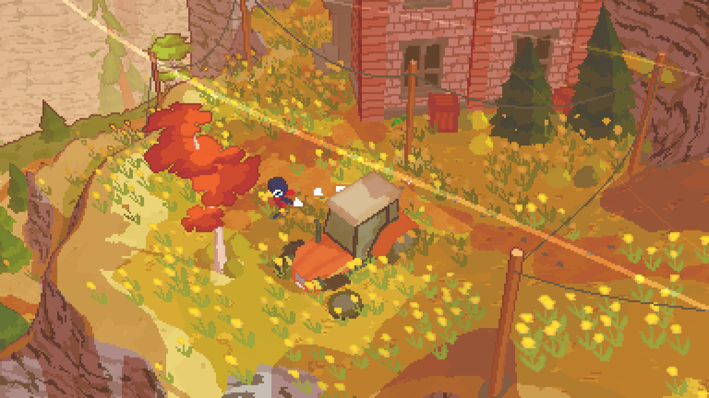

# 自由遊園、角色小故事與不鎖死的收藏

2026-10-20，ST-1。先讀 User-guide；本次是六方原文與一張官方靜態圖的研究，不是六款遊戲試玩或影片觀看。

| 原始團隊／來源 | 實際看到的做法 | Snapland 的選擇 |
|---|---|---|
| [Adam Robinson-Yu：A Short Hike](https://ashorthike.com/) | 官方頁描述沿標示路線或離開步道探索，途中遇見其他登山者；另看一張官方原圖。 | 主線提供方向，沿途人物和物件值得停留。保留安全回程；不用把每條支線變成開區前置。 |
| [ustwo：Alba](https://www.albawildlife.com/) | 官方文字介紹小島、幫助動物與按自己的步調遊玩；影片未觀看。 | 玩家實際做一件看得見的好事，再看到角色／環境回應；沒有真實時間倒數催趕。 |
| [Something We Made：TOEM](https://www.somethingwemade.se/toem/) | 官方文字介紹以攝影觀察不同建築、遇見人物、搭車與登頂；影片未觀看。 | 拍照是觀察及構圖的行為，不能只在每個入口發一張卡；保留人物和當地特徵。 |
| [MegaWobble／Playtonic：Lil Gator Game](https://www.playtonicgames.com/game/lil-gator-game/) | 官方文字描述以移動探索山丘森林、在高處遇見需要幫忙的朋友；影片未觀看。 | 任務帶出可玩的地形與互動；支線提供小目標，不剝奪單純玩耍和自行離開的自由。 |
| [Failbetter：Echo Bazaar Narrative Structures, part two](https://www.failbettergames.com/news/echo-bazaar-narrative-structures-part-two) | 原文說明以狀態控制短故事的出現、串成有開頭中段結尾的事件，亦介紹一次性消失的故事。 | 採用可追蹤的三步事件與獨立旗標；不採用永久消失、一次錯過便無法補領的設計。 |
| [inkle：Writing web-based interactive fiction with ink](https://www.inklestudios.com/ink/web-tutorial/) | 原文示範段落、轉向、選項與未接結尾的警告。 | 用明確段落與可驗證連結避免故事斷線；機械檢查補助作者，不能取代文字和玩家動作的審閱。本作未接入 ink runtime。 |

原圖來自官方頁連結的 `images/screen2.png`，原樣保存；觀察到彎曲小路、植被與建物形成前後層次，沒有任務清單覆蓋大半畫面。它不證明該作品的所有互動、相機或動畫做法，也不可當作本作遊戲素材。取得方式及 SHA-256 見[來源](../../pm/Snapland-story/images/ST-1-20261020-reference-provenance.json)。

## 採用的故事結構

六人各有想達成的小事與會出錯的性格，不讓同一個人永遠只負責發獎。四段主線依序為入園、自由巡園、普通結局、可選首演；普通結局要求六十張與十區造訪，完整一百八十張只用於其後的可選終區認證。兩者不可互換，劇場八款另冊，不回填入場門檻。

每區二支線、三探索形成當區閉環，靠觀察、調整、操作與角色回應構成小故事。所有固定來源可重做，借用道具免費恢復，單人能完成全部必要行為。每位參與者保存自己的照片與進度，晚加入者能補做缺少步驟；不用付費隨機獎勵、高難 AI 或尚未開放區域解鎖當區任務。

## 可重用的檢查流程

先把人物、四段主線、結局認證與可恢復規則列成清楚的設計資料，再對照園區的同一份門檻及真正迎賓資料。每次改動驗證人物引用、主線順序、普通／完整結局關係、二十任務／三十探索的獎勵覆蓋和區內無循環依賴；故意加入未知人物、跨區前置、普通結局需全集、高難 AI 或房主獨得等反例，必須拒絕。

文件預覽只驗收設計可讀性。ST-2／3 的現行迎賓原型，和其他角色、九區、兩種結局與多人系統的完整落地分開列出；不能把資料驗證通過寫成整段故事可玩。
