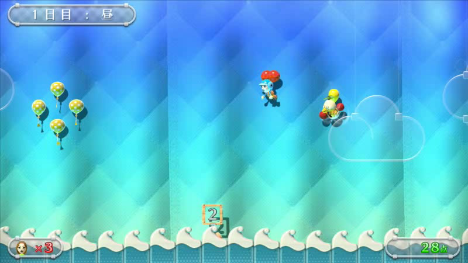
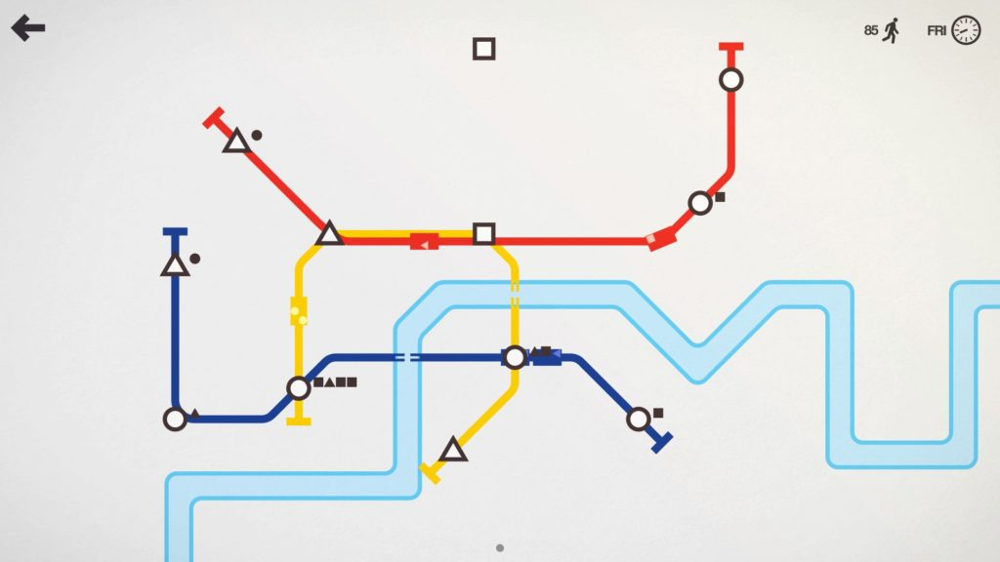

# 氣球快遞：風場、操控與引導
使用者指出原玩法無聊、海風看不見、操控與引導弱。原版本是一次送到單一信箱，只有一個刺球與短方向字；不依玩家速度解釋投遞失敗。這輪改為可預判風場、明確煞車與多段投遞。

以下六個來源已閱讀文字或 PDF；GDC 只讀講座摘要，沒有看完整影片。玩家偏好不能由一份訪談或一則評論推成普遍結論。

| 來源 | 實際看到的內容 | 選用與取捨 |
|---|---|---|
| [Nintendo Land 官方手冊](https://www.nintendo.com/eu/media/downloads/games_8/emanuals/wii_u_6/nintendo_land_1/ElectronicManual_WiiU_NintendoLand_EN.pdf) | Balloon Trip Breeze 用觸控吹風、衝擊波與障礙導引飛行 | 採輸入立即對應可見氣流，移動和避險有決策；不照搬觸控手勢或場景 |
| [Mario Golf 官方手冊](https://www.nintendo.com/eu/media/downloads/games_8/emanuals/nintendo_8/Manual_Nintendo64_MarioGolf_EN.pdf) | 風方向與速度提供擊球前資訊 | 採方向與數值並列，讓玩家能預判風；本作以高度風道箭頭、強度和氣球飄帶呈現，不使用風袋 |
| [Ghost of Tsushima 風場 GDC 摘要](https://www.gdcvault.com/play/1027350/Blowing-from-the-West-Simulating) | 摘要說明多個世界系統回應風變化 | 採同一風力驅動畫面線條、布料和氣球；沒有做或宣稱完成其完整模擬 |
| [LostWinds 開發者 David Braben 訪談](https://www.gamedeveloper.com/game-platforms/interview-frontier-s-braben-on-i-lostwinds-i-return-to-wiiware) | 靈感來自風影響樹葉，把環境觀察變成操控 | 採風有實際影響且玩家可以抵抗、順風和煞車，避免只有風的字樣 |
| [Skull and Bones 開發團隊訪談](https://www.gamedeveloper.com/design/water-water-everywhere-a-q-a-with-ubisoft-s-i-skull-and-bones-i-team) | 風袋、衣物、浪花和顏色方向資訊幫玩家學看風 | 保留多種視覺線索需互相一致的設計方向；本作選用高度風道箭頭、強度、氣球飄帶與數值預告，沒有採用風袋 |
| [教學研究作者的十名玩家訪談](https://www.gamedeveloper.com/design/video-game-tutorials-how-do-they-teach-) | 十人質性訪談討論教學與遊玩學習；機制練習和情境提示能教操作，過度打斷會影響體驗 | 採一個提示教一件事、安全短練習與可跳過；十人訪談不代表所有玩家偏好 |

## 本作整合
方向鍵或滑鼠控制同一個有慣性的氣球；空白鍵或滑鼠右鍵煞車。不同高度的風道以箭頭表示方向並顯示強度，氣球飄帶提供近身方向線索，數值預告呈現即將到來的陣風；這些訊號對應遊戲中的風力，不使用風袋。降低動態時仍保留風道方向、強度與數值預告。

從安全練習教移動與煞車，閱讀提示不扣時間；可直接開始，快速重試不強迫再讀。三段投遞逐次點亮信箱，靠近時用减速和短停留完成，進度環說明判定。撞到刺球或過快進站有具體回饋並能原地恢復，不無預警傳送。保留普通與惡魔收藏、輔助及既有成就資格。

目前實際玩家操作驗收仍待原生 helper 重跑；自動或局部驗證不等同於原生輸入通關。是否有趣仍需使用者實際玩後的回饋，不能以輸入事件冒充真人偏好測試。Steam 玩家個人頁未取得單一評論的固定連結，故不列為已查證的玩家喜好證據。

## 2026-10-22：可讀成果與恢復路線

以目前main的立體海港為基準，保留原三站、55秒、150分、風函式、速度／煞車、碰撞與輔助門檻。逐站列出實際完成的150分；撞海膽、過快進站各自記錄零分及發生次數，避免結算只有一個不明的失誤數。普通需三站完成，小惡魔需未輔助、零失誤；結算顯示本次未達原因。私人練習仍只顯示練習成果，沒有收藏資格。

本輪另實際讀以下六個團隊的一手文字；參考靜態圖與試玩分開，不由商店總評推斷因果或普遍玩家偏好。

| 團隊／來源 | 實讀與採用方向 | 不套用 |
|---|---|---|
| [Nintendo／Balloon Trip Breeze](https://www.nintendo.co.jp/wiiu/alcj/attraction/balloon.html) | 官方圖文說明風的輸入、漂浮與障礙；保留同一風場的可見線索與路徑取捨。 | 不移植觸控吹風或原作關卡。 |
| [Frontier／LostWinds](https://store.steampowered.com/app/447780/LostWinds/) | About將風與滑翔、跳躍及環境解題連接；氣球推動、風與煞車共同決定移動。 | 不加第二角色／平台跳躍。 |
| [Dinosaur Polo Club／Mini Metro](https://dinopoloclub.com/games/mini-metro/) | 官方說明站點連線、效率與有限資源；讓三站的目前與已完成狀態清楚。 | 不把短航行擴為建線經營。 |
| [Shape Shop／Mars First Logistics](https://store.steampowered.com/app/1532200/Mars_First_Logistics/) | About說明實體貨物、投遞與可見建設回應；每站成果在世界及結算都看得見。 | 不抄開放世界建造或零件系統。 |
| [SMG／DevM／Moving Out FAQ](https://www.team17.com/news/moving-out-faq)及[開發者試玩紀錄](https://blog.playstation.com/2020/04/27/how-playtesting-improved-moving-out-out-on-ps4-today/) | 讀取鍵鼠、輔助與實錄對照版本的方法；分開驗正常與輔助，記實際輸入、成果與版本。 | 原作者真人試玩的結論不冒稱本作已做真人試玩。 |
| [Hollow Ponds／Richard Hogg／Wilmot’s Warehouse](https://store.steampowered.com/app/839870/Wilmots_Warehouse/) | About描述自主整理、記住位置再回應具體需求；結算列出完成的具體站點及失誤原因。 | 不加入500種物品或記憶倉庫規則。 |

Wilmot獨立官網讀取逾時未列為成功來源，改讀開發者商店About。沒有觀看來源影片或試玩來源遊戲。

實作核對另發現氣球輔助零失誤回合會回報小惡魔旗標，雖保存端拒絕該資格，結果標題仍可能誤報。氣球結束旗標改為同樣要求未輔助；保留其他遊戲行為與所有分數／物理門檻，原可達性測試改核對輔助普通資格而非錯誤的小惡魔旗標。

兩張官方來源原圖已實際查看：Nintendo的飛行主體／障礙留白與角落資訊、Mini Metro的形狀站點／路線優先於裝飾，供本作資訊主次比較，不作為遊戲資產。圖檔URL、原頁、尺寸與SHA256保留；沒有觀看影片。

### 風向實際遮蓋反例

本輪全尺寸審圖發現不透明WindLegend會蓋住海面上的兩個3D箭頭；節點visible、旋轉與投影數值通過仍不能代表畫面可讀。現在在圖例的2D前景繪製實線當前／虛線預告箭頭與實際風速整數；無風是中性記號，不誤示向右。保留同一組實際／預告向量與原世界風旗、海面風道，不另外計算風。

同一GPU視圖、夜間／降低動態、固定向量的前後比較：舊圖兩列箭頭區均0個識別色像素；新版都超過20個，原圖保存並實看。第一輪舊來源複本因重複全域類別宣告解析失敗而拒收；第二輪僅移除診斷複本的class_name，沒有改舊畫面／物理，2.73秒exit0／0ERROR。此為畫面反例，非實際投遞或真人試玩。正式原生路線另核對像素及向量。

## 2026-10-23 最終原生與交付範圍

逐站分數與同類失誤計次分開：最後審圖發現零分原因列只顯示0分，改用既有「次」數欄呈現過快進站／撞海膽實際次數。保留真正總分、零分事件及原普通／小惡魔門檻。教材與目錄同步明列「未開輔助、零失誤」，避免只說零碰撞而漏掉過快進站。

最終實際時鐘輸入：獨立鍵盤三站零失誤450分取得普通／小惡魔，獨立滑鼠輔助／降低動態私人練習450分，受保護進度不變，46.26秒0ERROR。失誤路線實際一次過快進站、一次海膽碰撞，再恢復完成三站450分普通；夜間／降低動態輔助正式零失誤450分仍無小惡魔、無重複貨幣或成就；自然55秒逾時0分後完整非空存檔逐位元不變，96.80秒0ERROR。重試另保留原0.20秒後續幀契約，以固定60步進獨立驗暫停／恢復、確認瞬間全部歸零，24.27秒0ERROR。沒有延長原62秒航行或240秒程序限制。

部分鍵盤操控草稿仍會碰到海膽，只接受為普通完成，未冒稱精準；保留逐航點／位置／速度／事件追蹤後以較南側的安全進站路徑完成真正零失誤。只改測試操作路線，不改正式風、速度、煞車、人物位置或結果旗標。實際輸入不等於真人手感或偏好測試。

三張新教材均為現行原生PNG逐位元複製：安全操縱、實際煞車及真實450分結算。材料更新後另外驗首次三頁、鍵鼠導覽、開始／略過、重看、教學凍結時間、私人練習與返回，41.53秒0ERROR。前面的通關影片仍含舊教材，不能宣稱顯示新圖。最後只為失誤列加計次，不影響無失誤路線或教材來源。

並列十二款現行教材實際遊玩來源圖，氣球是有慣性的俯看立體港灣與三站航行；風箏是側向海崖穿環，噴泉是角色節拍落地，人潮是路口排程，其他解題／攝影／接物也各有空間及資訊。此輪只新增氣球來源圖；風箏來自前張SG-17，其餘十款為歷史圖，不冒稱本輪重玩十二款或ART-21全套通過。

共用回合75.55、港灣畫面0.34、小遊戲介面6.59秒通過；前述六套檢查及最後投遞2.04秒均保留原90秒上限。Python143項最終47.550秒全通過；初輪目錄文字同步期間的單一失敗另保留，不能掩蓋。前置94de1a9的143Python／93Godot／5設計範圍CI實際成功並核對名稱、順序及原上限，並非本輪SG16完整CI。
