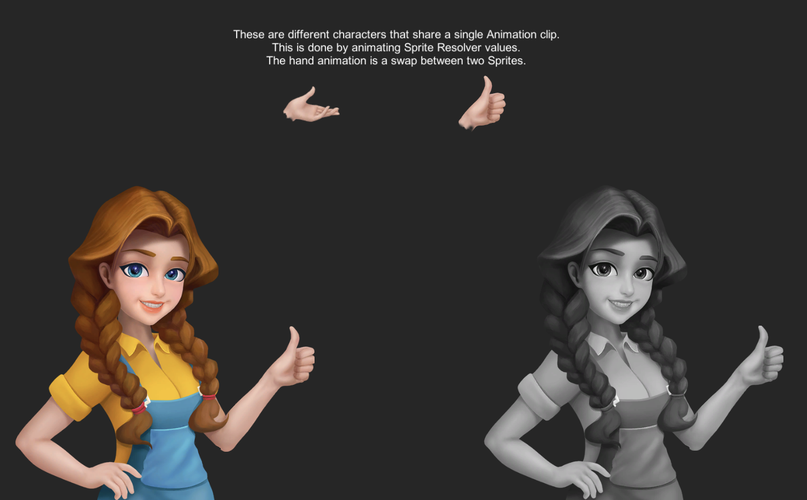

# 接帽角色身份、固定畫布與動作選擇

2026-10-20；ART-17／SG-20，ART-18相關。先讀User-guide及既有完整角色製作流程，重新比對正式專用待機與接帽序列。舊v4相對舊待機曾通過，不能推論它和後來正式的專用待機仍一致；本輪看到髮型、臉向與頭身差異，中央髮頂約48–59px，正式待機為72px。

## 七個已讀方向與取捨

這一輪製作前重新讀過以下作者／官方文字，並看過Unity官方靜態圖；沒有宣稱參考影片已播放或試玩。完整角色圖、來源錨點與逐姿勢檢視沿用[原管線](character-production-pipeline-v2.md)。

- [Aseprite sprite sheet](https://www.aseprite.org/docs/sprite-sheet/)：固定格序、畫布與來源資料；不讓每格alpha裁切結果決定人物大小。
- [Godot SpriteFrames](https://docs.godotengine.org/en/stable/classes/class_spriteframes.html)：格序、FPS與循環分別定義。保留十二格、20FPS、非循環；判定仍跟模型時鐘。
- [Spine attachments](https://en.esotericsoftware.com/spine-attachments)：共同姿勢／插槽關係支持換件，而不是各部件各自追畫面bbox。本作仍用完整原畫，沒有開回被否定的拆腿角色。
- [Factorio FFF146](https://www.factorio.com/blog/post/fff-146)：大量方向／動作需要一致來源流程及角色識別，不能只用總幀數代表品質。
- [Universal LPC generator](https://github.com/liberatedpixelcup/Universal-LPC-Spritesheet-Character-Generator)：共享動作格表是換件的前提。沒有借用其人物或服裝當本作素材。
- [Dead Cells作者訪談](https://www.gamedeveloper.com/production/art-design-deep-dive-using-a-3d-pipeline-for-2d-animation-in-i-dead-cells-i-)：動畫工具可協助製作，但輸出仍要看姿勢／輪廓。沒有將3D人物或機械拆件當使用者已否定路線的替代品。
- [Unity Sprite Swap 10.0](https://docs.unity3d.com/Packages/com.unity.2d.animation@10.0/manual/ex-sprite-swap.html)：同一動畫可以共享替換資源，但身份、動作與部件關係仍需核對。靜態圖中兩個人物共用clip與手部swap；本作選完整作者姿勢，不照抄其美術或做臨時剪貼手臂。

## v5來源與定位

先用正式待機＋舊動作手勢做單張關鍵姿勢候選，再用正式待機與該候選製作4×3十二格。只有完整人物姿勢進圖集，未變形、補鏡像或拆身體。原始生成檔、兩份完整提示、輸入圖與SHA256保存在[來源紀錄](../../assets/characters/traveller-catch-v5-provenance.json)；工具沒有回傳模型版本，留null，不猜測。單張候選不是直接上線的動畫。

原圖1448×1086，每行四個姿勢。每列採一次固定相機／身體中心登錄，沿用至三行；行基準352／350／350沿用至該行四格。保留330×362固定來源區域與單一0.81像素倍率（source_scale0.50625），落在280×360共用畫布。沒有每格依鞋底或alpha bbox重新縮放／置中。所有接帽格仍共用(140,346)足錨點；實際可見鞋底另由像素檢查，不拿錨點代替接地證據。

原有v4保留作歷史；新的v5不變更主角原畫待機、八向行走或三位NPC來源。

## 換髮、手掌與匯入

新姿勢先產生頭／身體材質遮罩候選，再逐格看完整圖與遮罩；只加入十二個新來源識別，原有所有owner資料逐項不變。抬手時的深線可能被當作眼睛，因此十二格都有獨立來源核對的雙眼範圍；短髮／捲髮不能把額頭挖空。手掌和袖子各有材質責任：抬手覆在髮前，袖子仍屬衣料。過窄手掌框、誤含臉側或整條袖子的候選均拒收，重新檢視完整來源與實際換髮圖。

資料中的短髮id是`bob`；曾用`short`的早期檢查只落回原髮型，已拒絕當短髮證據，最終使用真正bob重驗。回歸直接檢查實際額頭／臉頰alpha與兩邊手掌像素，不只看「有輸出texture」。

第一份PCK出現新圖半透明邊緣RGB變化：alpha相同，正規化來源位元組卻不同，使精確owner失配。只對新圖保留lossless且關閉fix_alpha_border，重新匯入後來源與PCK一致；沒有放寬來源hash或刪錯誤檢查。另由全新compositor匯出兩款八方向遮罩與walk／idle聯集，確認全部原owner、髮根、權重、重疊及cut資料相同，才重建共用依賴。原Python依賴失敗保留，沒有直接忽略hash。

## 站定與移動

十二格接帽是腳不移動的完整姿勢。角色有移動速度時，呈現使用完整原畫走路並保留接帽提示；新開始移動會結束站定的視覺演出，停下不從半途接續。模型的接帽窗口、控制、物理、得分與收藏規則不變。沒有將固定腿姿沿地滑動，也沒有合成半身或拆腿補步伐。

原生驗收分開：先用實際Space做無收藏的站定十二格演練並正常退出，再進正式六頂鍵盤救援；移動且模型接帽提示仍有效時，另觀察實際走路格。最後六頂滑鼠輔助／降低動態練習須不更改私人進度。站姿檢視不鎖住正式局的輸入，也不替正式局配分。

本批驗收結果、正常／真正四分之一速度短片與逐格圖附ART-17及SG-20；實際檢視範圍以各自證據JSON為準。影片抽格不是逐電影格連續人工播放；沒有Windows EXE、聽感或真人樂趣認證。ART-17四人完整動作、NPC正式走路與更多情緒，ART-18不同輪廓服裝，SG-20整體玩法美術條件仍分票驗收，不因這套接帽而全部結案。
