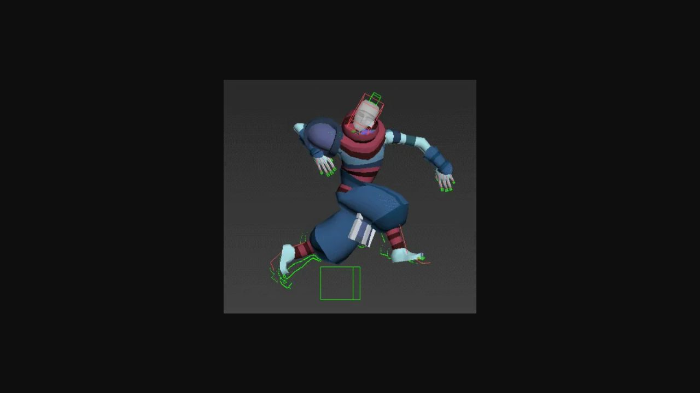
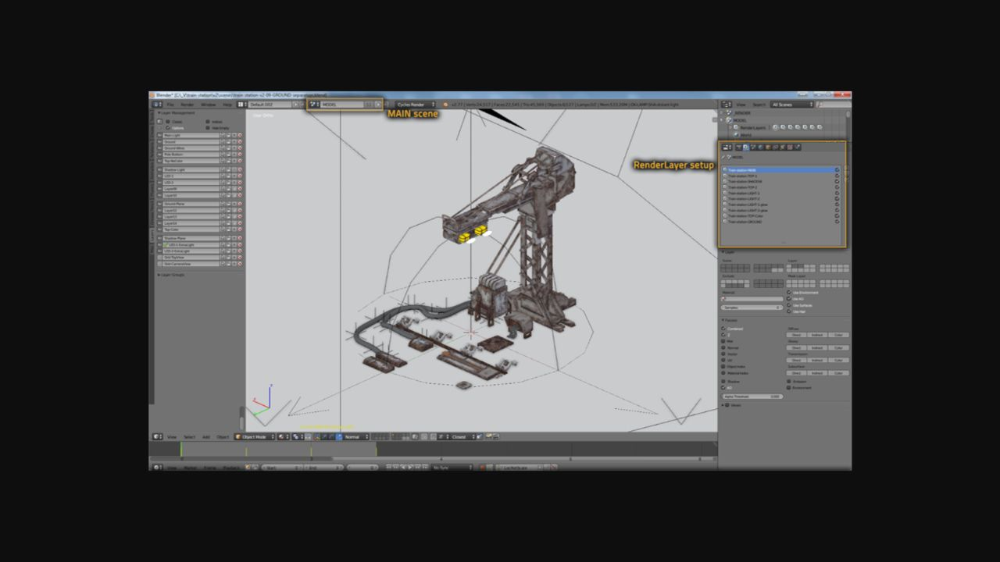
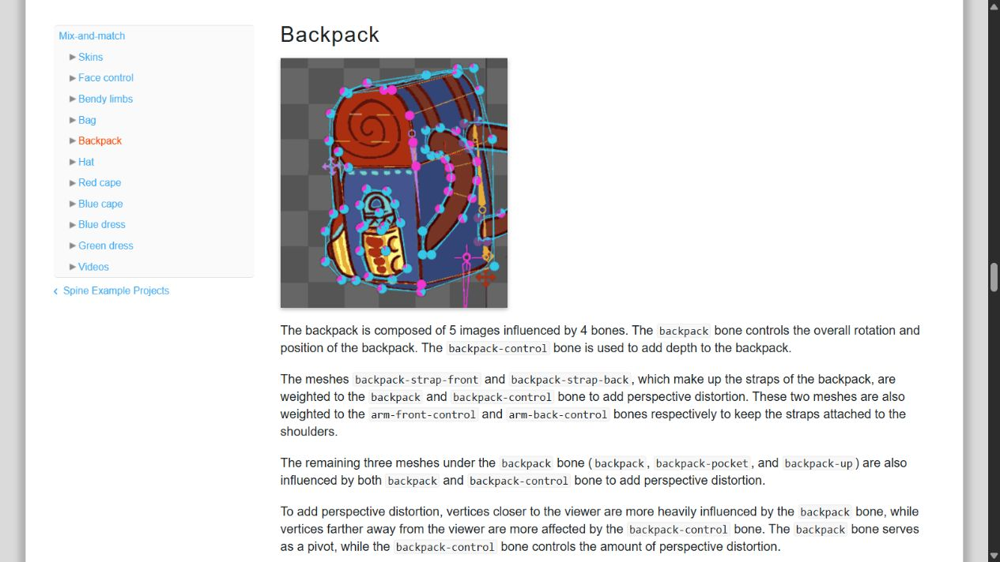
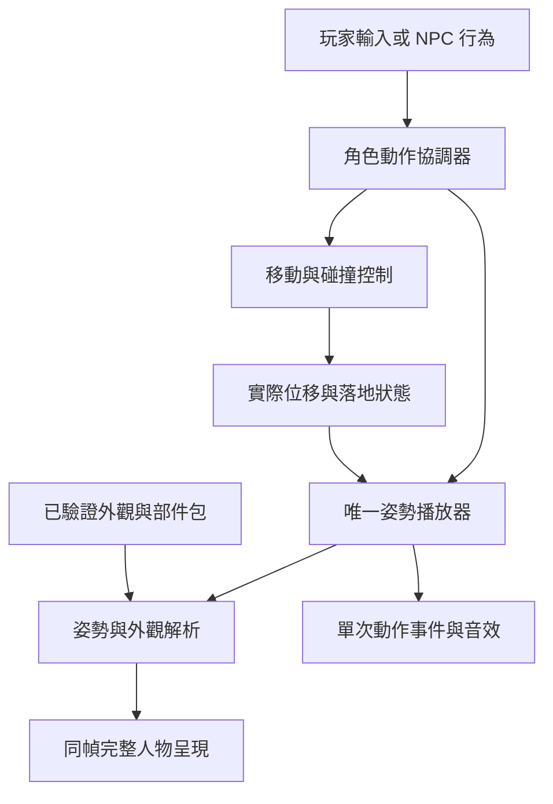

# 角色製作、換裝與行為管線重設

> 最新決策：2026-10-16 使用者明確否定本批 3D 模型與外觀。保留既有 2D 像素人物風格，以完整光頭底圖、八方向頭髮及配件處理換裝。3D 樣本已停止、未採用；先前的方向批准不能解讀為批准改變人物畫風。

## 1. 最新決策與範圍

主線改為：**既有主角 2D 風格／身份基準 → 完整光頭人物底圖與逐格動作 → 同風格八方向頭髮與配件 → 明確錨點及前後遮擋 → 共用姿勢播放與合成**。頭髮生成為獨立透明部件，不從已有頭髮的全身圖在執行時猜測刪除或補頭皮。

- 光頭底圖保留完整頭皮、臉、耳朵、脖子和原本人物比例；不得趁重設部件改成新的 3D 人物外觀。
- 頭髮、帽子及其他配件有正確八方向，使用同一像素比例、頭型與固定畫布；需要前髮／後髮遮擋時明確分層。
- 綁定使用製作時確認的頭部、手部等錨點。方向與每格動作共用同一姿勢進度；低頭、舉相機與起停轉身的錨點／遮擋也需逐格檢查，不能只在靜止正面對上。
- 保留既有可用的 2D 步行原圖與位移相位。補必要起停、轉身與相機動作，不再轉鞋、拆腿或扭曲全身造步態。
- 先以主角完成換髮、帽、兩件不同輪廓衣物、相機及正常／慢放驗收，再擴其他人物。ART-29 已交付獨立 2D 主角樣本與局部驗收；正式島嶼與其他人物尚未套用。被否定的 3D 候選不算交付。

### 2D 骨架與髮尾動態評估（2026-10-16）

使用者詢問是否可綁 2D 骨架並讓頭髮飄動。本段是經官方文件核對的提案；使用者隨後批准先以主角一款髮型製作，另以 ART-30 驗收。ART-29 是固定部件樣本，不能把未驗收的髮尾動態算進其成果。

Godot 的 [2D 骨架教學](https://docs.godotengine.org/en/stable/tutorials/animation/2d_skeletons.html) 與 [Bone2D](https://docs.godotengine.org/en/stable/classes/class_bone2d.html) 支援以 Skeleton2D／Bone2D 驅動有權重的 Polygon2D 圖片網格；不需要人物 3D 模型。[Jiggle 文件](https://docs.godotengine.org/en/stable/classes/class_skeletonmodification2djiggle.html) 明確列出頭髮與衣角的彈性次級動作，但此類別仍標為實驗性。教學另標示尚未更新至 4.7；採用前需在本專案實際引擎上測試，不能只因文件有 API 就宣稱可交付。

建議先保留既有八方向全身步行原圖與固定人物基準，只為一款髮型拆出固定頭頂／髮根與可動髮束末端。髮根完整跟隨當格頭部錨點；末端以短骨鏈及局部權重做低幅度延遲、回擺與收斂，避免整頂頭髮滑移或露出頭皮。帽子剛性跟隨頭部，帽下髮束另限幅；相機及手部仍遵守原姿勢遮擋。八方向須各有正確的原畫與休止形狀，不能用單一平面骨架扭出所有視角。

驗證項目包括起步、停下、急轉向、八方向切換、戴帽、換髮、拍照遮擋、暫停恢復與四分之一模擬速度。切換方向、換裝或瞬移須處理舊動量；關閉額外動態時須回到原畫。骨架不會修復來源裁切中心不一致，本輪固定畫布／人物基準校正仍是前提。先確認主角小樣本，再決定是否擴展到衣角或其他人物，不重做全身骨架步態。

### ART-30 已批准的小樣本範圍

沿用 ART-29 的微風短髮、原有八方向貼圖和全身動作，使用 Godot 原生 Skeleton2D／Bone2D 與局部圖片網格權重。頭部根骨、頭頂、髮根、臉側核心與帽子保持剛性；只有外側髮束末端由短骨鏈帶動。採有範圍限制、可重置的彈簧更新，保留逐格原畫，避免依賴仍屬實驗性的 Jiggle 功能。先確認實際圖層與權重，若帽下合併圖不能安全保持帽子固定，須調整分層再驗收，不能拿整頂頭髮或帽子一起旋轉冒充。

提供額外動態開／關比較、真實四分之一模擬速度與暫停。局部測試先驗證根骨不動、髮尾回擺收斂、時間步長一致、戴帽限幅與重置；原生事件巡覽涵蓋兩種帽狀態、八方向起停轉向、反向、拍照遮擋與回擺中暫停恢復。主 Session 看正常與慢放、全身與頭部近照後才接受；仍不擴其他髮型、其他人物或正式島嶼。

### 歷史提案

2026-10-15 的研究曾推論使用可編輯 3D 原件再離線渲染。實際樣本改變了使用者想保留的 2D 外觀，於 2026-10-16 被明確否定。此製作路徑不再採用；下方研究來源與既有系統核對保留作為背景，不能覆蓋最新 2D 指示。

## 2. 現況核對：為什麼修髮型會牽動整個人物

以下是 2026-10-15 可見工作樹的程式核對，不是遊戲試玩；程式基準提交 c4e42c7；研究開票提交 1febb5c 只增加文件，沒有更動程式。以下行號指本次可見檔案，含仍未提交的頭部修補；與既有機制分開看待。

- **既有生成結果已經把身體、頭髮、衣服與道具壓成全身圖片。** 目前可見的 assets/design/tools 沒找到 `.blend`、`.aseprite`、`.ase` 或 `.psd` 原件；這只代表本次搜尋範圍，不表示外部不存在原件。PNG 與提示詞能記錄來源，卻沒有提供可重新編輯的綁定、完整光頭或衣物接縫。
- **既有定位依來源採不同規則。** `game/world/avatar_renderer.gd:211`、`:218`、`:616` 同時使用 manifest 錨點、步行圖辨色量測及歷史偏移。既有 `:718` 的色系判斷也被用於皮膚／衣物判別。顏色相近不等於部件相同；同一套外觀換姿勢後仍需重新推斷，這是脆弱的製作前提。
- **尚未提交的修補試著在執行時恢復被遮住的內容。** 同檔 `:282` 開始去原髮／還原身體，`:1056` 起產生頭部度量，`:1168` 起推算臉部語義層，`:1479` 起處理原髮遮罩。來源雜湊綁定的人工像素歸屬能收窄個別誤判，但不能替代完整頭皮與部件原件；新增方向、表情、道具就可能再增加例外。
- **主角已經有值得保留的實際位移步態。** `game/world/park_world.gd:2149` 移動並經邊界修正後，`:2164–2170` 以實際水平距離推進相位。不能把它說成「目前完全靠時間亂走」。缺的是獨立且明確的起停、轉向、動作進出與部件契約。
- **NPC 的歷史路線與動作排程仍耦合。** `game/world/npc_activity.gd:443` 的可選短路線直接改根位置；`:527` 的迴圈更新動作時間與角色播放；`:888` 另有阿浪排程。部分路徑受開關與素材覆蓋限制，不代表目前每位 NPC 都走這條路。重設時必須統一權責，不能因根節點有移動就算具有批准的行走動畫。

早期研究其實已提出同步影格與分層；本次需要補上的，是**在原件製作時就形成這些分層、綁定和完整隱藏內容**，而不是輸出成平面圖之後才用程式逆推。歷史文件見[角色動畫與換裝](character-animation-wardrobe.md)。

## 3. 一手來源與實際檢閱狀態

本節短述來源事實；第 4 節後是 Snapland 提案。既有 2026-10-12 八方研究不冒充新成果。本次重新核對具體限制，新增 Wube 製作流程與 Epic 步態同步資料，共八方團隊／專案；工具文件不是出貨作品案例，歷史案例也不代表今日唯一標準。

### Motion Twin：《Dead Cells》角色作者 Thomas Vasseur

[製作訪談原文，2018-01-25](https://www.gamedeveloper.com/production/art-design-deep-dive-using-a-3d-pipeline-for-2d-animation-in-i-dead-cells-i-)

實際閱讀 model sheet、3D 骨架、關鍵姿勢／節奏、逐格 PNG／normal map、回原時間軸修改與加裝甲段落。另檢視原文連結的製作骨架 GIF 靜態畫面並保存截圖；未逐時播放檢閱 GIF，未觀看教學影片。

採用：從同一可編輯人物修改、輸出動作。限制：文中約 50 像素角色的結果不保證適用本作；攻擊插值策略也不能直接當成走路規則。

### Wube：《Factorio》Albert 的美術流程

[Friday Facts #146，2016-07-08](https://www.factorio.com/blog/post/fff-146)

實際閱讀 Blender 原件、MODEL／RENDER 場景、分層輸出、後期遮罩與圖集產出段落；檢視 render layers 圖並保存截圖。未觀看動畫。

採用：保留可重渲原件，先明定輸出層，再處理像素與圖集。限制：這篇是遊戲物件製作，並非人物步態或任意換裝的驗證。

### Esoteric Software：Spine

[Mix and Match 範例](https://en.esotericsoftware.com/spine-examples-mix-and-match)、[Slots 與 draw order](https://en.esotericsoftware.com/spine-slots)

實際閱讀 skins、Photoshop 原件匯入、頭部控制、背包肩帶、衣裙綁定及接縫權重；另讀槽位與疊放順序。檢視 Backpack 示意 GIF 的靜態畫面並保存截圖，未審閱完整動畫，未播放嵌入影片。

採用：部件有指定綁點、相容條件及遮擋，軟部件另有製作控制。限制：範例可彎曲網格的外觀不直接用於本作像素人物。

### Igara／Aseprite：作者原件與匯出

[官方 CLI 文件](https://www.aseprite.org/docs/cli/)

實際核對 split-layers、frame tags、layer hierarchy、slices、trim 與 JSON 輸出；未操作本機 Aseprite，未觀看影片。本次不新增其圖像證據，舊研究截圖仍保留原日期。

採用：逐格分層原件與有命名的動作，圖集和對齊資料一起輸出。限制：匯出工具不會替美術建立缺少的部件、動作或正確遮擋。

### Universal LPC：可組合像素人物專案

[官方儲存庫 README](https://github.com/liberatedpixelcup/Universal-LPC-Spritesheet-Character-Generator)

實際閱讀 Animation Frame Guide 索引、Terms 的基底／影格規格變更、未畫齊新動作的限制、輸出 JSON 的建議；延伸 guide 連結本次讀取失敗，不稱已讀。未重新操作產生器或檢視整套圖集。

採用：共享姿勢規格與明列素材覆蓋。限制：有共用規格仍可能缺某個體型或動作；研究此方法不等於採用 LPC 圖像或其美術風格。

### Unity Technologies：Sprite Swap 10.0.3

[官方文件](https://docs.unity3d.com/Packages/com.unity.2d.animation@10.0/manual/SpriteSwapIntro.html)

實際閱讀 Library／Category／Label／Resolver、替換圖需相同骨架、不同動畫寫入方式會衝突的限制；未執行範例，未看影片。

採用：明確相容版本、外觀解析的單一責任。限制：名稱相同或同一個槽位不保證不同圖片的骨架、比例或定位相容。

### Godot：AnimationTree

[官方 stable 文件](https://docs.godotengine.org/en/stable/tutorials/animation/animation_tree.html)

實際核對離散影格、Carry 保留播放位置、狀態轉移與 3D root motion 說明；未用文件範例跑引擎，未看影片。stable 網址會變動；不假定新出現的 Sync Mode 在本專案 Godot 4.7.2 可用。

採用：離散姿勢與連續相位分開管理。限制：保留時間位置仍須有相容腳步標記；3D root motion API 不是逐幀 PNG 的自動落腳解法。

### Epic Games：步態同步

[Sync Groups，固定 4.27 文件](https://dev.epicgames.com/documentation/en-us/unreal-engine/sync-groups?application_version=4.27)

實際閱讀主從時間、相同起止腳與左右落腳 marker 同步規則；未執行 Unreal 範例，未觀看動畫。

採用：同步的是有相同語義的腳步階段，事件只由一個主播放者發出。限制：這是骨架動畫工具的能力；本作以自己的離散畫姿契約實作同一原則，不引入 Unreal。

上述三張參考截圖是本次親自檢視的網頁畫面，保留來源內容，沒有作為遊戲素材。Blender 英文版本手冊本次讀取失敗，未計入八方來源，也不據此宣稱試過自動綁定。

## 4. 三條製作路線與選擇

| 製作路線 | 適用與成本 | Snapland 判斷 |
|---|---|---|
| 同一 3D 原件／骨架，離線八方向烘焙，再逐格像素修整 | 輪廓、體積、相機角度與服裝動作能共同修改；前置建模、綁定及像素風格開發成本較高 | **優先推薦作為製作主線**，先做一位角色的樣本驗證畫風與修改成本；不直接換掉現有素材 |
| 人工 2D 分層逐幀原件 | 像素、表情與誇張姿勢控制最直接；新增八方向、衣物和動作都需繪製／修整 | 可作同契約的替代作者工具，以及烘焙後修整工具；不能退回獨立生成平面圖再自動拆件 |
| 遊戲內 2D 骨架／網格變形 | 較容易重用動作與換件；需處理視角、權重、接縫與像素變形 | 不作本次正式路線，與使用者要求的完整畫姿與穩定像素輪廓有明顯衝突 |

比較基於上述案例與本作需求，並未量測三套工具的製作工時。不能宣稱烘焙必然省時：若修整每格的成本接近重畫，應選人工分層。也不以增加到固定 16 格當作品質提升；先讓重量、關鍵姿勢、腳步和節奏成立，再加有作用的中間格。

## 5. 製作端：先有完整人物，再有部件

### 5.1 單一角色基準

每位角色有一份獲准的比例表、多視角造型、色盤與辨識細節。主角與 NPC 可以共用工作流程，不強迫共用頭身、步幅或動作節奏。體型或種族若改變骨架幾何，建立明確的相容家族；性別標籤不限制可穿物品，免費外觀規則不變。

3D 原件保存模型、骨架、bind/rest pose、材質、服裝、道具、固定相機與輸出設定。正交／透視選擇、像素密度、光照與基線由樣本對齊現有批准角色後鎖定；不讓各批生成自行改鏡頭。2D 修整保留有圖層與時間軸的原件；重新烘焙時以原件版本追蹤修整，不能把手修差異無聲覆蓋。

**完整光頭與基本身體是實際繪製／建模的原件**，包括被髮、帽或衣物遮住的部分。輸出可按物品遮擋隱藏內容，但換裝時不能靠皮膚顏色補出未知頭形。眼睛、眉、嘴與臉部外形都明確隸屬頭部；低頭、閉眼與背面各自有對應畫姿。

### 5.2 綁定規則

| 部件 | 製作時的關係 | 交付時必須存在的內容 |
|---|---|---|
| 頭、臉、眼眉嘴 | 頭骨與表情控制；像素修整沿用同一頭部畫姿 | 完整頭形與獲准表情，沒有從舊髮型反推的臉部缺口 |
| 前髮、後髮、耳邊髮 | 髮根固定頭部；髮尾另有受限次級控制 | 逐姿勢前後髮層、帽下髮型及必要遮擋變體 |
| 硬帽、角、硬飾品 | 指定頭部／插槽的剛性連結 | 同向透視與固定形狀，不靠縮放修頭寬 |
| 外套、袖口、裙襬 | 軀幹／手臂的蒙皮與專用衣襬控制 | 能改輪廓的逐格部件、衣物覆蓋身體的遮罩與前後袖層 |
| 背包與肩帶 | 包體控制與肩部連結，明確前後帶 | 肩點持續相連、受身體／手臂遮擋的分層 |
| 相機／票券 | 指定握點；雙手動作在製作原件內約束與修正 | 道具、遠手、近手的完整姿勢，兩隻手都落在正確位置 |
| 腳、鞋 | 同一身體動作的落腳與鞋形 | 完整腳步畫姿與接觸標記，不在遊戲中旋轉鞋片補走路 |

這是本作規則；不是假定按一次自動綁定就能通過。抬手、蹲下、轉頭、最大步幅、長髮穿帽與雙手持相機都需在原件中檢查。髮與衣物的隨動預先烘入相同時間軸；MVP 不增加執行時動態髮／布模擬。

### 5.3 生成工具的角色

AI 圖像可用於概念、材質與造型候選，或以獲准原件作受控修整候選。保存完整提示、參考來源及雜湊，但這些只是來源紀錄。

不能把「每批重新生成一位相似的人」當成有一致拓撲、骨架與圖層的角色製作，也不能把提示寫了同一方向／同一影格當成真的對齊。進入正式管線前，候選必須成為可編輯原件，具備完整底圖與明確部件歸屬；自動分割可提出草稿，人工核對與批准後才可使用。禁止執行時依 RGB／HSV 自動識別皮膚、髮、袖口或眼睛。

## 6. 輸出契約與遮擋

### 6.1 同一姿勢、同一邏輯畫布

每個部件包宣告 `character_family`、`rig_version`、`pose_set_version`、`item_id`、`action`、`direction`、`pose_id`、`duration`、`source_version` 與相容外觀組態。姿勢資料另含世界步幅、左右腳接觸、頭／肩／雙手／道具握點、事件標記及疊放 recipe。這是設計欄位，尚無實作。

所有部件在同一邏輯畫布與 root 原點製作，方向由明確的八方向相機集合決定。圖集允許 trim，但必須保存原畫布大小與 trim offset；不能用每張 alpha 外框重新置中。頭髮和衣服已隨姿勢畫到正確位置，執行時按相同原點放置；錨點用於製作檢查、互動對位與診斷，不用來把靜態髮圖拉寬、平移到每個頭上。

色彩替換只作用於作者指定的材質索引／遮罩，不依顏色猜部件。色盤能保留明暗關係，但換色不算新增衣物輪廓。

### 6.2 遮擋與相容，不能只排一張全域圖層表

製作原件包含語義部件，渲染端使用同一相機與深度／物件歸屬資料生成像素層、可見性遮罩及逐姿勢 recipe。**把每件物品單獨透明渲染再直接疊起來，不能保證遮擋正確。** 長髮繞肩、袖口包手、相機跨手與身體，都可能需要拆成多個前後可見片段或受控組合變體。

例如持相機：遠手、帶子後段、身體／外套、相機、近手與前方袖口的順序由當格姿勢決定；轉背後重新導出 recipe，不能永久讓道具最後畫。帽子有帽下髮變體或明確遮罩，不刪除整顆頭；衣物可遮身體但不能誤刪臉或手。

配件依髮型／帽型、外套／包帶建立少量可解釋的相容 profile，不預先烘所有顏色的笛卡兒積。共通 profile 能覆蓋時重用圖層；互相纏繞而無法通用的組合，製作專用變體或修訂原件。預期販售和免費外觀中的正常組合必須支援，不能用大量禁止配對掩蓋缺素材。

建置時檢查必需組合的 recipe 與完整姿勢覆蓋。執行時只合成已驗證圖層與遮罩；在換裝／載入時準備新外觀並快取，整套成功後同一畫面切換。不能一幀先換髮、下一幀換頭。快取只保留有上限的近期外觀，不預建所有膚色／髮色組合；所需圖層預先載入，超出預算時淘汰舊快取，不在每個畫面重新分割或分析圖片。未完成物品不進正式衣櫃；損壞包才使用已驗證的完整預設外觀並記錄診斷，不湊錯方向或局部沿用舊部件。

normal map、額外燈光層與大量快取預算留待基本樣本成立後決定；本階段不增加會掩蓋輪廓問題的光效。

## 7. 執行端：行為、移動、動作與外觀分責

- **行為**決定人物想做什麼。玩家輸入或 NPC 路線／對話／任務反應送出意圖，不直接設定圖片、幀數或根位置。
- **協調器**決定可同時做什麼：模態暫停優先；對話與登乘持有必要姿勢；一般拍照／招呼能被移動中斷，先結束道具狀態再恢復行走。慶祝不阻擋操作，移動可取消。劇情必須鎖操作時由劇情明確持有，不能藏在動畫計時器。
- **移動控制**獨佔世界根位置與碰撞，輸出每物理步實際水平位移、速度、落地／騰空與瞬移標記。所有啟用且具批准行走素材的 NPC 巡路也送移動意圖，不另用三角波平移 root；未啟用或缺素材的角色保持原地待機。垂直落下、船移動與瞬移不加入步行距離。
- **姿勢播放器**每個人物只有一份實例狀態，產出 `{action, direction, phase, pose_id, contact, event_cursor}`。所有部件讀同一樣本；不各自取全域時間。外觀解析只決定同一姿勢要用哪件物品，無權改動人物行為或位置；動作中換裝保留當前相位和事件游標。
- **事件**由權威播放者越過時間／相位標記時發出一次，腳步、快門與結果通知不由每個部件重複觸發。更換外觀、重建快取或暫停恢復不得重播既有事件；拍貼獎勵仍以遊戲規則為準。

### 7.1 走路與轉向

保留既有實際位移原則：`步態相位增量 = 實際水平移動距離 / 該步態一循環距離`。每套步態有自己的步幅與左右接觸標記；不同方向對齊的是同一隻腳的接觸／離地階段，不能只假定格 0 都等價。

輸入方向先正規化，避免斜走比直走更快。正常轉向保留同一接觸階段，配合八方向切換的遲滯，避免方向在邊界來回閃動。大幅反向有專門轉身畫姿；控制器立即回應輸入，呈現以已製作的短轉身過渡銜接，不等待整個循環播完，也不把腳片旋轉過去。

起步從與當前站姿相容的啟動畫姿進入循環。停步時世界移動依操作規則結束，呈現使用該接觸階段的收勢畫姿回到同向站姿；撞牆零位移不繼續播行走。若過渡尚未製作，標為素材缺口，以完整中立站姿保底並保持未驗收；不能補一段假腳步後勾完成。

走與跑要有各自批准姿勢與步幅；沒有跑步素材時不能把加速走路稱為已完成跑步。各向腳底、步幅與影格長度先在製作端校準；距離驅動只改善同步，不保證本來錯的姿勢不滑步。

### 7.2 跳躍、互動、待機與 NPC

跳躍的離地、空中與落地由移動狀態選相應畫姿，垂直位移不推進走路；落地前不能只靠計時回站姿。拍照包含預備、舉機、握持、快門與放下，手和相機一同製作；沒有某方向時先由明確轉向狀態轉到有素材方向，再開始動作，不瞬間換臉或混用。

待機為獨立完整姿勢與低頻事件，停步後不立即連續表演。降低動態關閉非必要髮／衣襬／待機花動，保留必要移動與互動資訊；暫停保留整個角色的相位，恢復不單獨重置頭髮。

NPC 共用協調與播放介面，各自使用姿勢庫與節奏：票票從容服務與遞票、小角俏皮反應與尾部節奏、阿浪慢步與看港口。進入對話時暫停巡路、完成明確朝向並傾聽，離開後恢復行為。批准行走覆蓋缺少時保留原地待機，不把根位置移動或另一位角色的步態當成該 NPC 已完成。

行為與呈現不依賴單一全域主角，以便後續同機與 P2P 擴充；目前不新增連線同步實作。

## 8. 最小樣本、遷移與驗收門檻

### 8.1 先證明一位角色的製作流程

使用主角，先做完整底圖、兩種髮型、一頂帽、短外套與長外套兩種真輪廓，以及雙手持相機。先以正面、側面、背斜檢查關鍵姿勢與最難遮擋；三向成立後才擴成八方向。這是提案中的未來製作批次，此次沒有生成或實作。

樣本必須能在原件修改頭部比例、袖口或一個關鍵姿勢，再重新輸出相同組合；記錄重作步驟與手修量。如果大多數姿勢都得重畫才能保住風格，停止擴張 3D 路線，改採人工分層原件。兩條路都遵守同一輸出契約，禁止增加執行時辨色例外。

批准門檻包含實際遊戲尺寸的畫風、角色身份、完整輪廓、落腳、手持與換裝遮擋；來源圖漂亮、靜態參考或工具成功輸出都不能取代這些條件。

### 8.2 驗收矩陣

| 情境 | 應看見的結果 | 證據 |
|---|---|---|
| 光頭／兩髮型／戴帽，八方向與閉眼、低頭 | 頭形完整，髮根相連；無舊髮殘留、第二張臉或耳角漂移 | 原件與分層檢視、全身逐姿勢、合成前後對照 |
| 短／長外套、背帶、相機與雙手 | 輪廓確實不同；肩點、袖口、手掌相接，前後遮擋隨姿勢改變 | 高風險組合完整序列，原件視圖與遊戲對照 |
| 起步、停步、斜向切換、反向、貼牆 | 實際位移與腳步相符，阻擋時不原地走；沒有滑步或假轉鞋 | 原生正常速度、四分之一模擬速度、輸入／位移／接觸紀錄 |
| 動作中換裝、拍照中移動、暫停恢復 | 同幀完整切換、道具不殘留、事件不重複 | 明確操作序列與事件次數紀錄 |
| 缺格、錯版本、錯 trim offset、破損包 | 建置指出具體缺口；執行不出現半套人或錯方向拼裝 | 故意破壞的獨立測試資料與診斷 |
| 三位 NPC 巡路／對話／回位 | 各自完整動作與個性，碰撞與朝向正確；缺素材維持原地 | 各角色獨立錄影與素材覆蓋 |
| 主場景、遮擋、降低動態、輸出版本 | 素材完整與屋頂／標籤遮擋分開判定；正常啟動也可用 | 原生取景與普通啟動，隔離測試存檔 |

自動驗證包含版本相容、方向／姿勢覆蓋、邏輯畫布與 trim 還原、材質歸屬、同一姿勢取樣與事件只發一次。預期值要來自作者標記與獨立批准圖；不能用同一個合成函式生成 expected，再用圖片相同證明自己正確。接觸測試也不能只用自己的 alpha 外框推回預期腳底。

### 8.3 分批遷移

1. 凍結本次遭質疑的補丁與生成候選；保留歷史、來源及拒收理由。先審閱本設計。
2. 確認作者原件與輸出契約，製作並審閱上述小樣本；通過後才決定正式工具主線。
3. 以隔離入口接入唯一姿勢播放器與部件包，保留原全身播放基準供比較；先完成主角小樣本的真實起停與換裝。
4. 八方向與所需動作、可販售物品覆蓋完整後逐批遷移；每位 NPC 獨立交付，不能複製相似角色充數。
5. 原生、慢放、普通輸出與存檔隔離驗收通過後再切換正式入口；確認沒有引用才移除舊推算與未採用資產。

這些是設計與交付門檻，不是已排定的實作計畫。具體工作拆票、工具版本、工期與測試接線在本設計審閱後另列；不需要先大量生成素材才能回答是否能保住人物與畫風。

## 9. 本次交付的驗證邊界

已做：八方一手文字核對、三張新參考圖靜態檢視、現況程式與原件搜尋、三條路線比較及完整責任／遮擋／步態／遷移設計。

未做：安裝工具、建立骨架、製作新部件、執行新管線、觀看來源教學影片、重新驗收舊修補或宣稱遊戲已修好。這些未發生的事情不影響研究票可交付，但 ART-17／18 的產品驗收仍按原條件判定。
