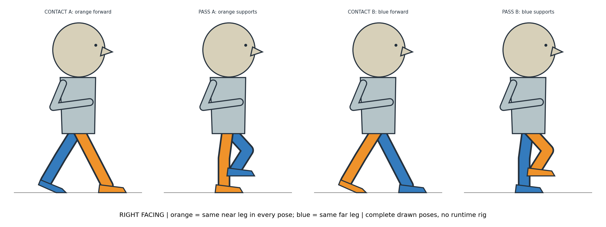

# 行走候選的接地腿恢復紀錄

2026-10-15，ART-17。先前五次票票行走候選都未批准。本輪先以完整人物姿勢圖明確標示近腿／遠腿，再試作四姿勢與單格反向接地；兩次結果仍不符合身份、比例或交替承重要求，因此沒有加入遊戲。主角既有八向行走、阿浪既有側向行走維持原圖播放。

## 實際閱讀與採用範圍

| 一手來源 | 本輪實際取得內容 | 對製作的用途 |
|---|---|---|
| [Animation Mentor：Human Walk Cycle](https://www.animationmentor.com/blog/tutorial-animating-human-walk-cycle/) | 文字中的 contact／down／pass／up、相反接地姿勢與循環檢查；沒有觀看教學影片。 | 導引必須辨識兩條腿各自的接地與擺動，不能只看輪廓有變。 |
| [Adobe：Body Behaviors](https://helpx.adobe.com/africa/adobe-character-animator/desktop/behaviors/learn-more-about-behaviors/body-directly-controlled.html) | 腳踝／腳趾標記、地面偵測、腳部固定與步態控制文字；沒有觀看範例影片。 | 以腳跟、腳趾、膝與髖的連續關係檢查導引；不把工具的可變形 rig 接入正式角色。 |
| [Aseprite：Animation](https://www.aseprite.org/docs/animation/) | frame、cel、tag 與逐格編輯入口的官方文字；沒有新觀看示範影片。 | 保留原始完整姿勢及播放次序，不用重複圖湊數。 |
| [Spine：Keys](https://us.esotericsoftware.com/spine-keys) | key 與時間軸管理文字；沒有新觀看範例影片。 | 對照關鍵姿勢與時序方法；不採執行期骨架扭曲。 |
| [Godot：2D Sprite Animation](https://docs.godotengine.org/en/stable/tutorials/2d/2d_sprite_animation.html) | sprite sheet 與離散影格播放文字。 | 接線仍直接播放完整來源姿勢；引擎播放成功不代表美術合格。 |
| [Motion Twin：Dead Cells Art Pipeline](https://www.gamedeveloper.com/production/art-design-deep-dive-using-a-3d-pipeline-for-2d-animation-in-i-dead-cells-i-) | 作者撰寫的 3D 製作再輸出 2D 角色流程文字；沒有本輪觀看內嵌影片。 | 立體姿勢可當內部體積與接地參考；未因此把目前素材改成程序拆腿。 |

Toon Boom Walk Analysis 與舊 Blender 文件的本輪直接讀取失敗，不計入以上六方。已有的 Aseprite／Spine／LPC 參考圖仍見角色動畫與換裝研究；本輪新增的可見圖是自行繪製的完整姿勢導引，未宣稱新觀看六方影片或外部動圖。

## 本輪導引與拒收

橙色固定代表近腿，藍色固定代表遠腿。此圖只供作者辨識接地、交替承重與四肢連接，不是遊戲角色素材，沒有加入正式執行期。

- 四格重畫仍得到 A／pass A／A／pass A，缺少另一條腿承重的半循環。
- 單格標色反向接地失去原稿的嚴格側面、頭身比例與像素表現，近遠腿交疊也不可靠，因此沒有進行去色或採用。
- [完整提示、來源雜湊與拒收決定](../../pm/Snapland-art/images/ART-17-ticket-pose-recovery-20261015.json)。兩張候選原圖保留於票據證據，沒有登記為正式 walk。
