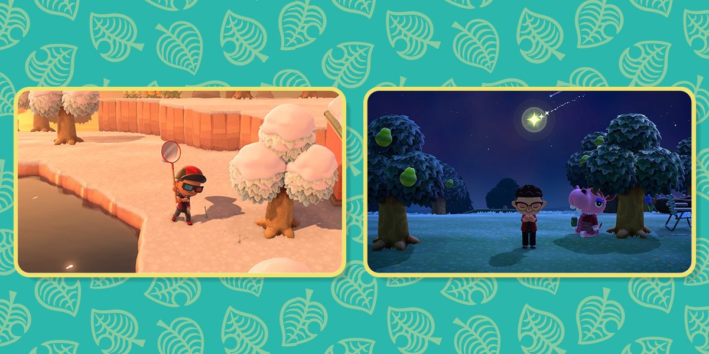

# 海岸停留點：操作後看得見環境回應

2026-10-20；MAIN-11。先讀使用者指南，接續已開放首島環線。這份改動服務探索，不新增拍貼數量、付費物品或強制收集清單。

## 本輪六方比較

| 第一方團隊與實際閱讀 | 採用與界線 |
|---|---|
| [Adam Robinson-Yu：A Short Hike](https://ashorthike.com/) | 已讀官方的標示路徑、旁路與沿途相遇；讓海岸停留點成為可選發現，保留回大道支線。沒有以宣傳頁當實際玩家訪談。 |
| [House House：Untitled Goose Game](https://untitled.goose.game/) | 已讀官方村莊設定與公開截圖入口；比較在同一世界行動的方向。頁面文字很少，不據此宣稱觀察過完整物件互動或影片。 |
| [Ben Esposito：Donut County](https://www.donutcounty.com/) | 已讀官方的敘事／物理解謎定位與角色互動動詞；讓場景有可見因果，不只按確認出現說明。不複製吞洞玩法。 |
| [Team ASOBI：Astro Bot](https://www.playstation.com/en-us/games/astro-bot/) | 已讀官方能力、探索與角色專用道具演出；比較操作帶來環境反應。沒有實玩、觀看幕後影片或取得硬體觸覺。 |
| [inkle：Overboard!](https://www.inklestudios.com/overboard/) | 已讀官方 simulated story-world、角色自主行動與自由選擇；避免每個停留點都切成孤立挑戰。本輪不引入其犯罪題材或時間壓力，也不宣稱本作已有同等角色模擬。 |
| [Nintendo：Animal Crossing 島嶼提示](https://play.nintendo.com/news-tips/tips-tricks/animal-crossing-new-horizons-tips-tricks/) | 已讀不同時段發現、灑水與開花；採用日夜下可操作的燈鏡、灑水後可見的花朵。沒有每日打卡、稀有花繁殖或等候獎勵。 |

本輪實際下載並檢視 Nintendo 公開原圖，日間捕蟲與夜間觀星分成兩個情境；只研究時段如何提供探索理由，不作本作素材。TOEM 的兩個候選頁未能讀取，不列入六方證據。來源影片均未觀看。

## 本作取捨

- 回聲燈塔：在步道旁操作低位轉輪，左右鍵連續轉動燈鏡；按住滑鼠拖曳也能轉向。光軸與海上三個反光標一致，轉開就失去回光。實際 SpotLight 加入既有最近八盞／最多兩盞陰影限制；可見光束只是薄霧表現，不能代替真實場景光照。
- 操作燈鏡時不讓同一方向鍵把角色帶走。E／情境按鈕結束，Esc 第一次結束操作、下一次仍可正常暫停；失焦釋放控制。開啟其他選單時不接收轉動輸入，降低動態仍能親手控制。
- 海玻璃溫室：同一情境按鈕開關灑水；水滴、把手與花朵一致。三秒內四朵不同配色的花逐步展開；關水停止水流與生長，已展開的花留下。這是可玩植物，不是角色整身縮放或假裝服裝動畫。
- 兩個停留點都留在探索場景，不給分、金幣、任務事件或拍貼，不另加常駐面板。完整存檔位元比較確認這些自由操作沒有偷偷發獎。

研究、模型行為、無視窗測試、真正視窗輸入及畫面審閱分開記錄。地標可玩不等於 MAIN-11 的完整故事動線、NPC 動畫和整島最終美術已結案。

[本輪原生證據與完整雜湊](../../pm/Snapland-main/images/MAIN-11-discoveries-20261020-verification.json)。
