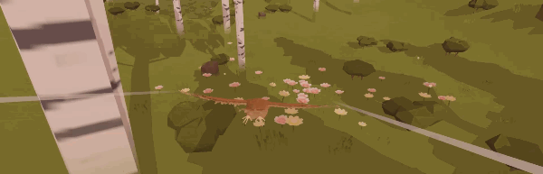
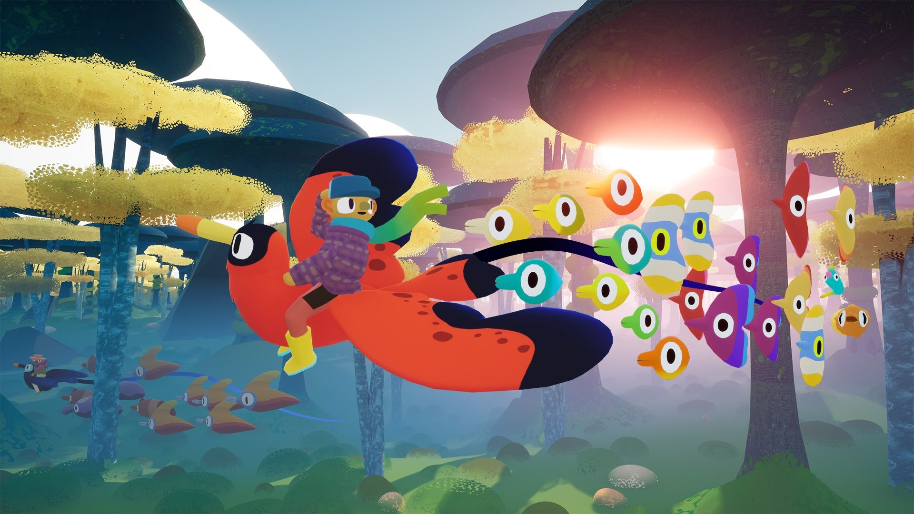
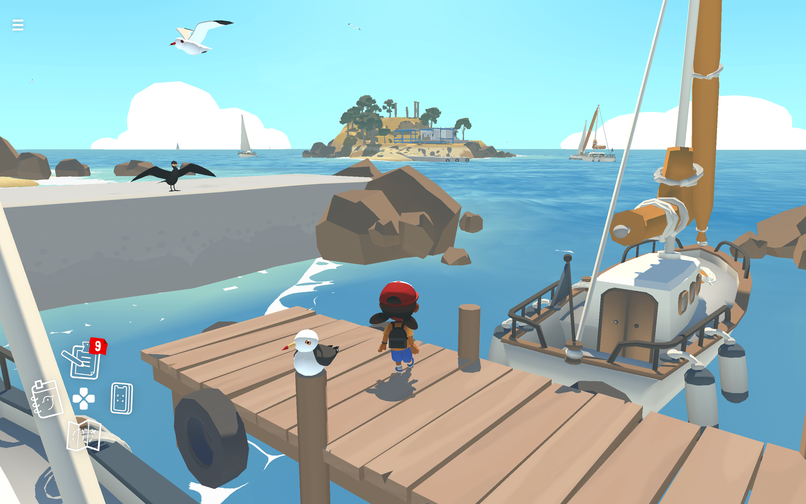
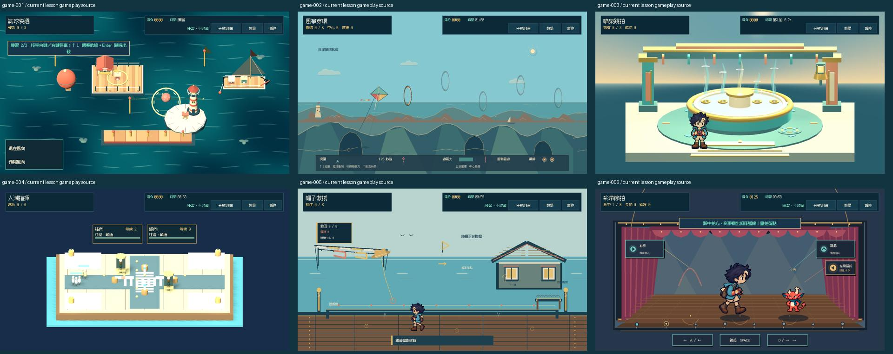
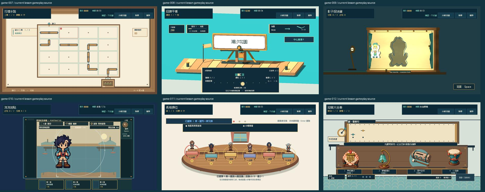

# SG-17 風箏穿環：側面飛行模型

## 體驗方向

氣球快遞使用立體俯瞰港灣、慢速靠站與煞停；風箏採 2.5D 海崖側面長鏡頭，以高度和速度管理飛越五個有深度層次的風環。海崖剪影固定在下方，海面與雲層分層平移，路線環與陣風刻度讓玩家從起點就看見整段旅程。成功中心穿越時環面折成潮汐橢圓，再將下一環推到視線焦點。Session 已接入獨立飛行模型與側面畫面，計分、陣風預報、衝刺和收線都取自同一狀態。

## 操作和物理

- `set_aim(-1..1)` 控制迎風角，持續施力改變垂直速度；高度由速度積分，不可瞬移。風力、垂直速度、高度、前進速度、張力都設界限；單次 `step` 最多積分 0.05 秒，超過部分不加入模型時間。
- 前進基速為 118 單位／秒。衝刺提高速度且增加張力；若張力高於 0.78 持續 0.65 秒，風箏斷線，造成一次失誤並消耗救援、退回當前環前。警示以 `tension_warning` 和 `tension_risk` 預先顯示。收線降速、減少張力並帶來小幅下沉；張力降到 0.58 以下會清除風險進度。兩種輸入互斥，新的輸入立即解除另一種。
- 固定五環中心高度為 390、285、430、315、405。使用風箏中心實際穿越環平面的線性插值高度判定；完整開口扣除風箏半高後才是有效通過範圍。中心偏差 18 內為精準，之後到實際安全邊界為擦邊，越界為失誤。
- 漏環仍是當前環，最多救援兩次；每次把風箏退回該環前 120 單位並停輸入 0.7 秒，避免高速連續重判。第三次漏環結束失敗。普通成功需五環全過；惡魔需五次中心命中、零擦邊與救援，輔助模式不得取得惡魔。
- 回合 60 秒。陣風以固定 8 秒週期、平滑 2.1 秒脈衝變化；預報欄位直接取 `elapsed + 1.25` 秒的同一風函式，事件標記保留固定陣風時間。畫面可以改寫標記呈現方式，但不可另造一套視覺風向。
- `snapshot()` 在狀態改變時更新同一份字典，事件標記也一直使用同一個陣列；只在重置和新增事件時調整標記內容，不在每幀複製。消費端不得修改快照。字典包含高度、速度、張力風險、當前／預報風、下個環、判定事件、救援與陣風標記。

## 來源研究：實際閱讀、圖例及選擇理由

此處記錄來自主要機構、協會與遊戲開發指引的內容；只採納物理關係和體驗原則，不借用其美術或版面。

| 來源 | 實際看到的內容／圖例 | 本設計採納理由 |
|---|---|---|
| [NASA Glenn：Aerodynamics of a Kite](https://www.grc.nasa.gov/www/k-12/VirtualAero/BottleRocket/airplane/kiteaero.html) | 側視圖把升力畫成垂直於風、阻力畫在風向；頁面明列兩力隨相對風速平方變化，係數受風箏表面和風向夾角影響。 | 以迎風角同時影響高度反應與張力，再把力幅壓成易操作、有限幅的遊戲控制量；沒有把真實平方力搬進遊戲。 |
| [American Kitefliers Association：How Do Kites Fly?](https://www.kite.org/about-kites/how-do-kites-fly/) | 文字解釋 bridle 調整迎風角；風箏位於 wind window 不同位置會改變風力與可控性，並可用草、沙或飄帶觀察風向。 | 讓角度與風況產生清楚取捨，並以統一風力資料餵給預報和實際物理。 |
| [American Kitefliers Association：How to Fly a Kite PDF](https://www.kite.org/wp-content/uploads/2020/11/howtoflyakite-revised.pdf) | 詞彙頁說明迎風角略微改變可明顯影響高度和拉力；也分別定義線張力、升力和收線輪。 | 張力必須是可讀的狀態量；收線作為速度和張力管理手段，而非額外複雜的真實捲線模擬。 |
| [NASA Glenn：Kite Geometry Definitions](https://www.grc.nasa.gov/www/k-12/airplane/kitegeom.html) | 側視／正視圖標出重心、壓力中心、風箏翼展和連接點，並指出風箏會繞連接點轉動。 | 側面飛行需要讓風箏姿態和拉線方向有物理依據；本回合先用單一迎風角和張力顯示，不假裝計算完整剛體轉動。 |
| [NASA Technical Memorandum 2022-0009943：Design, Control, and Simulation of Tensegrity Based Kites](https://ntrs.nasa.gov/api/citations/20220009943/downloads/9943-Design__Control__and_Simulation_of_Tensegrity_Based_Kites.pdf) | 附錄以明確簡化假設將風箏投影成 2D，再分解升力與阻力；同時列出模型幾何、風速和係數假設。 | 採用明示的 2.5D 抽象比宣稱完整飛行模擬更誠實；遊戲模型把複雜力收斂成有界、可測的垂直加速度。 |
| [Microsoft Xbox Accessibility Guidelines：XAG 107 Input](https://learn.microsoft.com/en-us/xbox/accessibility/xbox-accessibility-guidelines/107) | 目標是讓玩家可選擇輸入方式；指出關鍵的非傳統操作要有數位替代輸入。 | 模型 API 接收抽象 aim 與兩個按住狀態，鍵盤、滑鼠或手把之後都能映射同一套反應。 |
| [Microsoft Xbox Accessibility Guidelines](https://learn.microsoft.com/en-us/xbox/accessibility/guidelines) | 分類列出物件清晰度、時間限制、視覺干擾與動態設定等獨立指引。 | 陣風、環與回合時間是模型公開狀態，畫面可用形狀／文字／方向同時說清，不依賴顏色或無預警畫面晃動。 |

## 聚焦驗收

`game/tests/test_kite_flight_model.gd` 的 29 項檢查涵蓋真實 step 和 aim/boost 通關五環、漏環與張力斷線、救援耗盡、預報、輔助、逾時、邊界及快照。畫面測試 83 項、Session 測試 53 項另覆蓋 GUI STOP 容器下的實際滑鼠事件路由，不以 OS 游標位置冒充輸入事件位置。

原生正常速度與四分之一速度錄製均完成兩條真實輸入路線：鍵盤輔助練習與滑鼠正式回合，各五次中心穿環、500 分，衝刺與收線均實際生效；正式回合取得惡魔資格。結束前等待自然繪製，核對畫面實際顯示 0500、5/5 和 500 分結算，影片沒有灰色結尾。此段是 Session 原生輸入驗收；Main 首次教學、園區收藏、重試與離開流程仍待另行驗收。跨遊戲鏡頭研究及已保存圖例另見 ART-21 的研究紀錄。

## 海岸畫面第二輪修訂與實際驗收（2026-10-12）

保持模型、環座標、碰撞與計分不變；側向航線以快取的錯層海岸、變化的崖線、三個可見拱洞、港屋／燈塔／帆船建立尺度和視差。三條 176–214 像素短風跡及旗尾直接取 actualwind，弱風隱去、強風彎曲；預報不驅動裝飾。降低動態凍結裝飾相位，實際風力與風箏、風環仍由模型更新。成功提示寬 420、移至頂部安全區，與招牌平衡共用的既有寬度一致。

Root 拒絕初版長橫線／大色帶／儀表遮住拱洞及提示遮住風箏後，重新執行：96 畫面、29 模型、81 Session 檢查；正常 3929 幀（65.483 秒）、四分之一速度 15245 幀（254.083 秒）均零腳本／解析／驗收錯誤。兩種速度各三條真實輸入路線完成五中心、500 分；衝刺、收線與正式／私人練習資格均由實際模型及 HUD 核對。自然強風擷取值分別為 125.8、121.5，沒有人工改寫風力或結局。實際模型的陣風只有非負上升力；負風向僅由畫面單元檢查驗證，不宣稱原生出現反向風。

Root 查看全部 46 張實際擷取及 12 頁 QA 拼圖，播放兩段影片至結尾。每組五張時段／靜態圖是獨立畫面預覽；其餘 18 張來自鍵盤輔助練習、滑鼠正式、降低動態鍵盤輔助練習。Root 接受本輪可讀性修訂，最終美術與 Main 完整流程仍在 SG-17 追蹤；不是十二款真人試玩結論。證據與 SHA-256 索引位於 `pm/Snapland-small-game/images/SG-17-coast-evidence.json`。

傍晚／夜間標題及事件字另加深色半透明襯底；最終局部 CPU 為 100／29／81 項。Root 查看四個時段、兩種暗色時段各五事件及 playing/result 的 24 張原生畫面；後 20 張是合成事件的 view-only 測試，不建立遊戲結果。凌晨／中午與原影片版本逐像素 RGB 差異為 0。正常／慢放影片錄製於暗色字修訂之前，採用未變動的白天畫面；證據索引保留兩個版本的 hash。新增擷取場景曾解析失敗，修正後重新擷取為 0 錯誤。

## 2026-10-22：結算資格、逐次零分與分頁穩定

本輪固定起點 `f6b48d0`。飛行方程、風函式、五個環位置、中心18／擦邊37界線、60秒回合及兩次救援都維持原規則。中心與擦邊各列實際環號；漏環／斷線按實際發生次數列零分，重試清空當局明細，不替未經過的環補結果。

結果現在直接顯示 `score_summary.qualification_text`：五環全過的普通資格、中心數／救援數不足的原因，或輔助回合不取得小惡魔。此文字來自真正模型，不只留在資料或遊戲中計分規則。Main只在有此欄位時增加一行可換行說明，其他遊戲沒有被塞入風箏規則。

原生第二輪已通過流程，但審圖發現最後一頁只有失誤一列時，對話框會縮動、照片及其標題跟著位移。結果明細改用可換行文字，翻頁保留前一頁的最小內容高度，窄視窗／較大字級切換容量時重新量測。最後原生普通結果兩頁的四個照片矩形逐值相同；不靠放寬座標門檻接受跳動。

### 六個不同團隊的體驗研究

本輪實際讀取以下一手頁面，與原有NASA／風箏協會研究互補。是文字及標示的靜態圖閱讀，沒有觀看來源影片、遊玩這些作品或由評價比例推論單一設計的因果。

| 團隊／來源 | 實際查閱與本作採用 | 不套用的部分 |
|---|---|---|
| [adamgryu／A Short Hike](https://store.steampowered.com/app/1055540/A_Short_Hike/) | 官方About說明多條路線、滑翔、寶物與沿路互動。保留能讀出前後路段的海崖、燈塔及飛行方向。 | 探索自由不表示這個挑戰可以沒有目標；五環仍是清楚的短回合。 |
| [Samurai Punk／Feather](https://samuraipunk.itch.io/feather) | 官方列出流暢飛行、鍵鼠、日夜及可發現音樂。借鑑克制HUD及連續控制的方向。官方39格GIF僅查看首格，未觀察整段動畫。 | 不因其無威脅模式便取消張力／救援取捨；不借音樂或地圖。 |
| [Hollow Ponds／Flock](https://www.annapurna.com/interactive/flock) | 官方說明飛行、探索和逐漸成長的生物群；查看官方宣傳插畫中的前後景及明確主體。保持風箏與風環的輪廓對比。 | 插畫不是實際操控證據，不推論轉向或碰撞參數。 |
| [ustwo／Alba](https://www.albawildlife.com/) | 官方自定步調／島上互動說明；查看實際官方海港靜態截圖，主地標、近岸與少量HUD有主次。 | 不是飛行遊戲，不拿它推導風力；不複製其海港。 |
| [Giant Squid／ABZÛ](https://giantsquidstudios.com/abzu/Games) | 官方說明流動控制與環境探索；採用讓移動與場景一起成立的原則。 | 未看嵌入影片；不宣稱已測其控制手感。 |
| [Forgotten Key／AER官方發布資料](https://daedalic.prezly.com/aer-memories-of-old) | 開發／發行方說明自由飛行、浮島與地標探索；用清楚層次表現旅程，避免只在一張靜圖上移動風箏。 | 不把大地圖或自由飛行等同本回合需要擴成開放世界。 |

原件、擷取方式及SHA附於本票，參考圖片未進遊戲資源。十二款比較另用現行教學的實際遊玩來源圖；除本輪風箏外都是先前已採收畫面，不當作本輪重玩十二款。

風箏是連續側向飛越海崖、管理高度／張力；氣球是俯看立體港灣與煞停投遞，噴泉是節奏起落，人潮是路口排程，帽子是固定碼頭接物；花圃、影子、泡泡、換位和合奏也各有操作平面。這份並列只支持風箏的獨立體驗驗收，不能把ART-21整票一併結案。

新增共用UI回歸用六列含長環號明細、資格文字的結果，保留原五項閱讀斷言並驗第六項及各頁四個照片矩形。相同fixture下，僅撤回本次布局修正的舊Main在48.52秒退出1、20個照片位置／尺寸斷言失敗；現行Main47.18秒退出0、0ERROR，均原90秒限制。最初短標籤／無資格文字fixture舊版也通過49.65秒，屬不具決定性的反例，原始來源及紀錄保留。這項合成UI測試與實際原生結果分頁證據分開。
