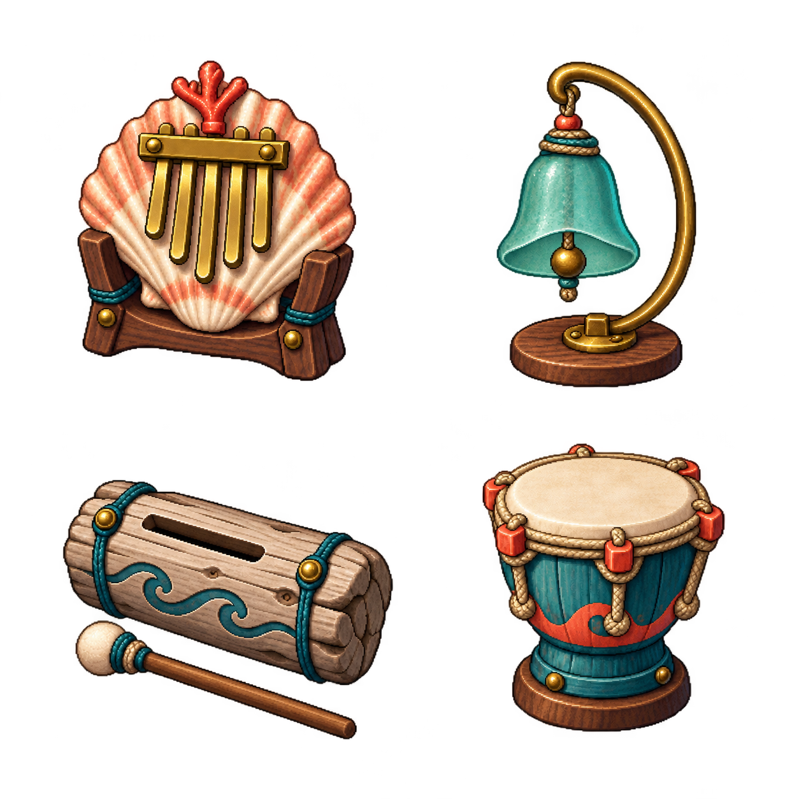

# SG-27 海港樂器素材來源與檢查

2026-10-12，由主 Session 使用 Codex 內建 imagegen 產生；不是 ComfyUI。工作區正式素材為 `assets/minigames/props/melody-instruments-v2.png`，審閱圖為 `pm/Snapland-small-game/images/SG-27-instruments-art-v2.png`。只做檔案複製，沒有以程式重繪圖片。

## 兩次產生與選擇

第一版有跨格風險：貝殼底座與漂木音板的槌子接近／穿越格線，故不採用。第二次以第一版作編輯參考，保留四種樂器形狀、材質和共同光源，要求全輪廓、透明留白及固定四格排列。第一版只保留為被拒絕的審閱證據，不供正式畫面載入。

第二版實際尺寸 1254×1254，每格 627×627。以 alpha≥64 檢查各格實體輪廓，格內包圍盒分別為貝殼 `(121,95,559,598)`、玻璃鈴 `(152,97,466,608)`、漂木音板與槌 `(99,126,617,534)`、港鼓 `(130,69,511,522)`，均未跨格或裁掉支架、底座和槌子。提示要求的四側 14% 留白沒有全部達成，尤其音板右側僅約 10 像素，不把提示當成實際結果。弱透明邊緣仍有少量雜點，不能宣稱完美 alpha 清理。

主 Session 實際看過原圖及 1280×720 原生日間畫面：四個樂器在遊戲尺寸下能區分、零件完整，舊版程序陰影遮住樂器的問題已消除。這是靜態美術檢查，敲擊、聲音、回合流程及夜間閱讀仍需原生驗收。正式載入經 Godot ResourceLoader 使用匯入資源與四個快取 AtlasTexture，不用磁碟 Image.load 繞過匯出資源。

## 首次生成的完整 prompt

```text
Production game asset: one square RGBA sprite atlas, 2 by 2 equal square cells, four original handmade seaside music instruments. Each instrument must fit entirely inside its own cell with generous transparent gutters and no overlap; all handles, bases, rims and mallets fully visible. Top left: a scallop-shell thumb piano mounted in a small dark teak cradle, five straight brass tines and coral latch. Top right: a sea-glass musical bell hung inside a small curved brass stand, visible clapper and stable wooden foot. Bottom left: a driftwood slit drum with a clean rectangular hollow sound slot, carved wave inlay, two believable fasteners and a small attached striking mallet. Bottom right: a short harbor hand drum, cream taut hide membrane, six logically connected rope tension points, coral/teal wooden body and stable foot. Style: refined high-resolution pixel art for a distinctive collectible harbor game, crisp deliberate square pixel clusters, clean designed silhouettes, constrained deep navy, muted teal, coral, honey brass, warm cream and wood palette. Objects should be about 320 px tall within each approximately 512 px cell; atlas approximately1024x1024. Front three-quarter view consistently from above, same modest upper-left key light, only restrained material shading, no soft painted blur or oily highlights. Pixel clusters express shell ridges, rubbed brass edges, small wood grain and coherent stitching, never random scattered noise. No scenery, no decorative extra props, no labels, no letters, no UI, no borders, no cast ground shadows. True transparent empty background. Each instrument is a functional designed object: exact coherent construction, no melted geometry, no duplicated handles, no impossible straps, no cropped parts. Original shapes, no recognizable franchise motifs. Intended for four independent music-game hit targets; large readable silhouettes at 200px display size.
```

## 第二次編輯的完整 prompt

```text
Edit this production sprite atlas to fix only sprite layout and alpha cleanliness. Preserve the identities, coherent construction, colors and refined crisp pixel-art craftsmanship of all four instruments. Use a square transparent canvas and an EXACT 2x2 equal-cell arrangement. In EACH cell, scale its entire instrument and any attached mallet down to fit inside the central 72% of that cell, centered; at least14% completely transparent padding on ALL FOUR sides. Absolutely no painted or opaque pixel may touch either horizontal or vertical center divider or any canvas edge. The shell's entire wooden cradle stays in the top-left cell. The sea-glass bell's whole base stays in the top-right. The driftwood drum AND its entire mallet stay wholly in the bottom-left, without entering the neighboring drum's cell or crossing the center. Harbor drum wholly bottom-right. Four entire silhouettes intact, no clipping. Do not redraw decorations or add scenery; remove fringe red/yellow halos and stray semitransparent specks in the empty gutters, leave clean alpha-zero transparent negative space. No shadows outside silhouettes. Keep original single consistent upper-left shading and no text.
```



