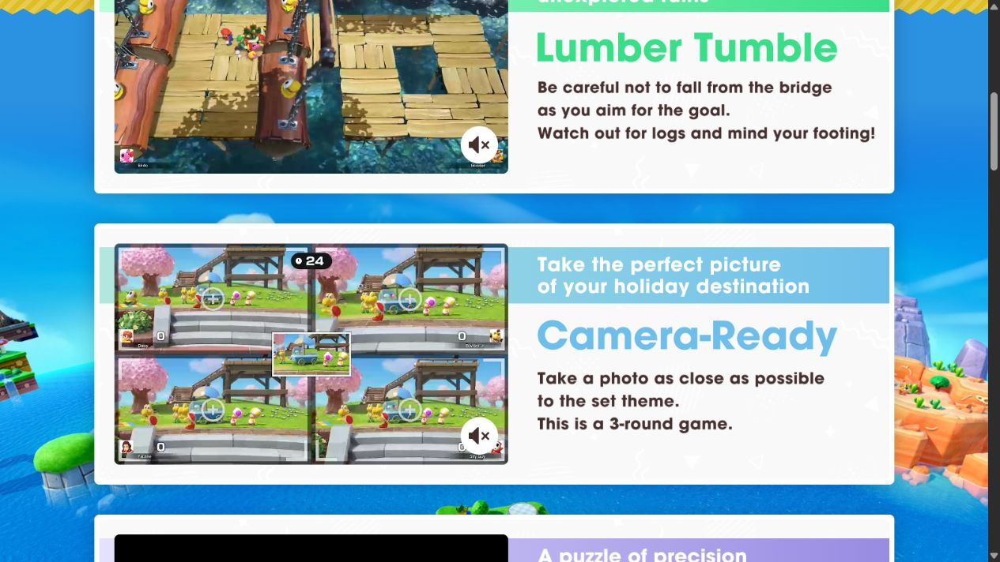
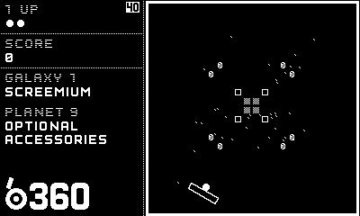
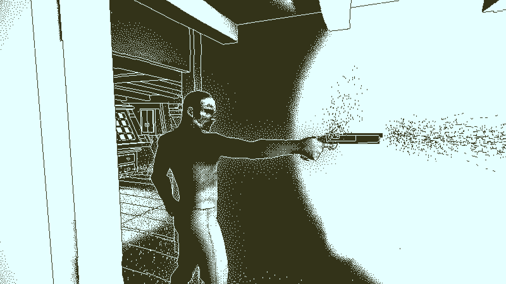
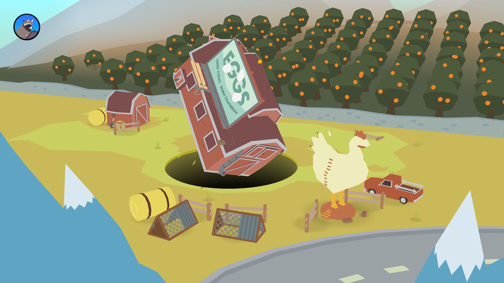
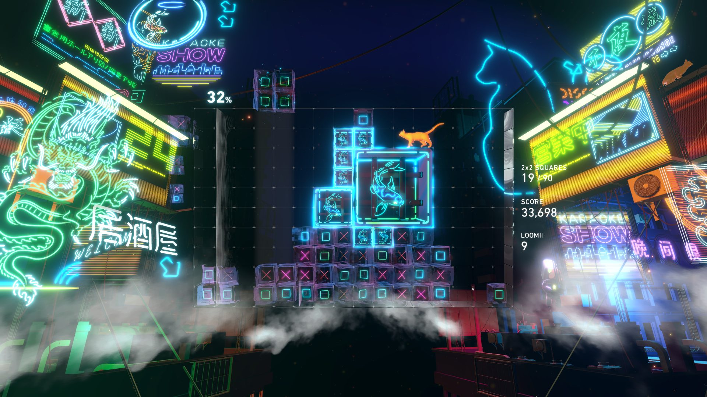
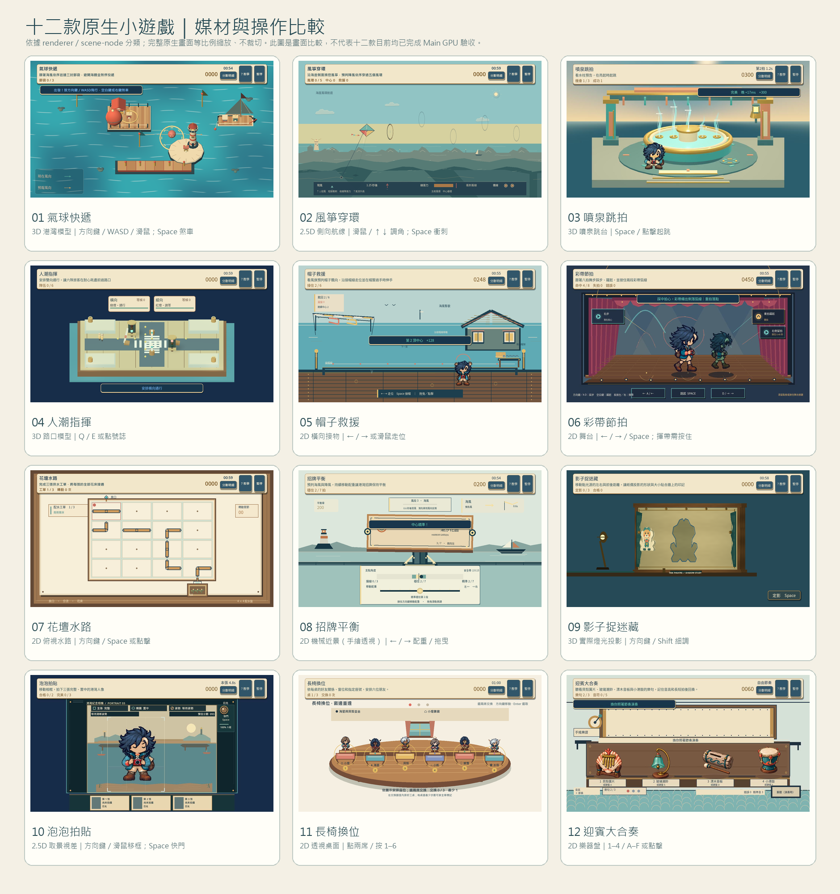

# ART-21 visual diversity review

This review records six first-party reference pages and six still images supplied in `pm/Snapland-art/images/`. I opened each image and read the matching official page text. These are still-image observations only: I did not play the games, watch trailers, or infer motion from a still. The screenshots are reference exhibits, not Snapland assets.

## Six inspected examples

### Nintendo — Super Mario Party Jamboree

Official [minigames page](https://www.nintendo.com/ph/switch/a7hl/minigame/index.html) describes *Lumber Tumble* as a bridge-footing challenge, *Camera-Ready* as a three-round photo game, and *Shadow Play* as aligning two images. The supplied page capture visibly presents Lumber Tumble and Camera-Ready sections. In the Camera-Ready still, four small camera views share one landscape; each has a centered framing reticle, a timer sits near the top of each view, player scores stay at the lower edges, and a sample photo is centered between the four views. The capture also has large explanatory product-page copy beside the game examples. This is evidence of the page layout and its still game frames, not of how the game animates.

### Panic / Playdate — b360

The [official Playdate catalog page](https://play.date/games/b360/) describes brick-breaking with a rotational twist and lists D-pad/crank controls. The supplied game still is a strict black-and-white pixel display: a thin rectangular playfield dominates the right side, while compact labels for score, galaxy, and optional accessories form a stacked left rail. The ball, paddle, and blocks are tiny but separated by high-contrast pixels. Adopt the strong division between playfield and score rail; do not adopt the monochrome screen or its tiny scale for Snapland.

### Lucas Pope — Return of the Obra Dinn

The creator’s [prerelease notes](https://obradinn.com/media/prerelease.html) explain the fixed 800×450 1-bit dithered rendering and alternate output modes. The supplied still shows a first-person ship interior: a close, dark central form is surrounded by hard-edged beams, doorway geometry, and stippled light/shadow. The image has no prominent score panel. It demonstrates how a restricted display treatment can support careful scene reading; it does not establish what motion or interaction feels like. Snapland can borrow the clear value separation and observation-first framing, but not the one-bit palette or low-resolution treatment.

### Drool — Thumper

The [official Thumper page](https://thumpergame.com/) describes “rhythm violence,” a space beetle, speed, and physicality, with glossy 2D and VR presentations. In the supplied still, a metallic beetle occupies the near foreground at lower right while a narrow track funnels toward a bright vanishing point; long neon trails and a deep purple-black field push the eye forward. There is no readable score in this crop. Adopt the match between camera perspective and a forward-driving verb; do not adopt the speed blur, neon intensity, or threatening tone for Snapland’s relaxed park games.

### Ben Esposito / Annapurna Interactive — Donut County

The [official Donut County page](https://donutcounty.com/) describes a physics puzzle in which the player is a hole in the ground. The supplied still uses a low-poly three-quarter view: a dark circular hole and a large tilted building anchor the center, while fences, smaller objects, water, and a broad ground plane give the scene scale. No score or HUD is visible in this image. Adopt the idea that the central mechanic can shape the whole composition and that a few well-chosen objects can communicate scale; do not reproduce its hole mechanic, palette, or character designs.

### Enhance — Lumines Arise

The [official Lumines Arise page](https://lumines.game/) describes 2×2 blocks, a beat-sweeping timeline, score generation, and distinct stage environments. The supplied still places a crisp square grid and stacked blocks at center, with score and play metrics in a narrow right column. Dense neon signage, reflections, and glow surround the play area. Adopt the legible board/status separation and mechanic-linked rhythm; do not copy the maximal signage, bloom, or peripheral density. This still cannot establish the timing or animation of the sweep.

## Principles for Snapland

- Keep the island’s shared material and color identity, but choose camera and play-space geometry for the verb: a route can be side-on, a grid can be overhead, and a framing task can use a camera view.
- Reserve the visual center for the current interaction. Place score, time, and round state at stable edges, with target and status signals that remain distinguishable by shape and position as well as color.
- Let effects explain cause and result: show the path of water after a pipe connection, a framing boundary during a photo task, and a clean settling pose after balance succeeds. Avoid effects that merely fill space.
- Use depth only when it helps judge distance, orientation, or physical contact. A flat plan is better for exact tile rotation; perspective is useful when the player must read depth or a physical prop.
- Provide a stable reduced-motion representation for every important state. A still target marker, filled hold segment, or lit connected path must remain after motion stops.
- Keep the art original. These examples inform camera, information hierarchy, scale, and causal feedback; none is a request to duplicate a game’s scene, characters, palette, textures, or effects.

## Evidence limits

The six local images above were visually inspected at their supplied resolution. The source-page text was also read; the Nintendo Jamboree page was readable as a text result while the direct Superstars minigame page had timed out earlier, so this review cites the Jamboree page matching the approved capture. The official pages’ embedded videos were not played. No still is described as a gameplay test or as proof of animation.

## Current twelve-mode source audit (2026-10-12)

The full row-by-row HEAD and control audit is recorded in [the current twelve-mode audit](minigame-current-diversity-audit.md).

Scope: the twelve `game-001`–`game-012` entries in `game/data/welcome_games.json` and their current `game/minigames/*_view.gd` presenters, selected through `game/minigames/session.gd`. This is a static code/catalog audit, not a rendered-art review or a playtest. “Limitation” below names a concrete constraint visible in the current presentation structure; it does not assert a user-tested failure. The current twelve presenters include five renderers with 3D scenes: Balloon Delivery (001), Fountain Jump (003), Crowd Traffic (004), Sign Balance (008), and Shadow Theatre (009). Their interaction differs: 001 keeps movement on a fixed projected plane; 003 uses a 2D billboard hero in its 3D scene; and 004, 008, and 009 change spatial scene objects from model state. Kite Flight (002) and Bubble Photo (010) use 2.5D layering/parallax; Hat Rescue (005), Ribbon Rhythm (006), Flower Pipes (007), Bench Swap (011), and Melody Memory (012) are 2D compositions. Renderer medium alone does not mean free 3D movement. Perspective-looking tabletop drawings do not count as 3D scenes.

| Mode and presenter | Camera / medium | Unique verb | Main space | Current source-level limitation |
|---|---|---|---|---|
| Balloon Delivery — [BalloonHarborView](../../game/minigames/balloon_harbor_view.gd) | Fixed elevated orthographic 3D harbor scene presented in a bounded 2D design plane | Steer, brake, and deliver in wind | Small harbor panorama with three mail docks, flags, wind streams, and a hazard | The environment uses 3D geometry/materials, while steering remains projected into a fixed screen plane rather than free-flight camera movement. It is a 3D-rendered miniature with a fixed projected play plane; count it as a 3D renderer, not as free spatial navigation. |
| Kite Flight — [KiteFlightView](../../game/minigames/kite_flight_view.gd) | 2.5D side profile with layered cliff, sea, and a shallow ring plane | Adjust kite pitch to catch gusts and thread five rings | Long coastal cliff lane with rings at changing heights | The ring’s depth is encoded with front/back drawing and a small depth band; most navigation remains vertical screen alignment. |
| Fountain Jump — [FountainJumpView](../../game/minigames/fountain_jump_view.gd) | Full 3D orthographic SubViewport with a billboarded 2D hero sprite | Read the rising jet and jump on the beat | Close fountain court with basin, water columns, lanterns, and a front platform | It is a genuine 3D environment, but the hero remains a sprite and the orthographic camera deliberately reduces depth cues. |
| Crowd Traffic — [CrowdSemaphoreView](../../game/minigames/crowd_semaphore_view.gd) | Raised, slightly oblique 3D harbor semaphore miniature in a SubViewport, with a 2D signal/status surface | Alternate lane signals and clear the crossing before queues lose patience | Four quays, zebra markers, two physical gate arms, six pooled guest groups, and a rescue stretcher/flag token | The stage now has real spatial gate, token, and lighting states. Its fixed camera and bounded token pool make it a miniature intersection, not a walkable street or free camera. |
| Hat Rescue — [HatRescueView](../../game/minigames/hat_rescue_view.gd) | Side-on 2D stage | Track a falling hat and reach at the instant it passes the catch line | Boardwalk, shore, wind flag, hat fall paths, and low rescue rail | This has a distinct timed reach action, though its lower-screen avatar and falling-object composition shares the familiar flat action-stage silhouette. |
| Ribbon Rhythm — [RibbonRhythmView](../../game/minigames/ribbon_rhythm_view.gd) | Frontal 2D proscenium with drawn floor perspective and input-derived path traces | Step, jump, and hold through eight dance beats | Velvet-curtained stage, central performers, upcoming cue cards, floor lights, and a persistent ribbon trail | The gesture trail records performed paths, and a hold draws its active arc. Both remain flat canvas strokes; the scene does not provide spatial depth or a separate physical choreography surface. |
| Flower Pipes — [PipePlanView](../../game/minigames/pipe_plan_view.gd) | Overhead 2D blueprint/workbench | Rotate pipe joints to route water into every flower bed | 4×4 board, source, branch routes, outlets, and work-order labels | The map supports exact routing, but the grid dominates all three rounds; the drawing does not convey height or pressure beyond the flow trace. |
| Sign Balance — [SignBalanceView](../../game/minigames/sign_balance_view.gd) | Orthographic 3D SubViewport apparatus with 2D gauges and controls | Shift counterweight against changing gusts and hold balance | Pier sign, support and axle, moving 3D counterweight, forecast flag, gauges, and adjustment controls | The sign and weight respond as spatial objects, but the interaction remains on one horizontal counterweight rail under a fixed camera; surrounding readouts are 2D. |
| Shadow Alignment — [ShadowTheatreView](../../game/minigames/shadow_theatre_view.gd) | Full 3D tabletop theatre with a real point-light projection | Move a lamp in two axes and set the projected silhouette | Framed wall, curtain, puppet, lamp rail, target mark, and shutter | This is a genuine 3D light-and-shadow scene; the core read still collapses to a single wall silhouette, so depth is judged through its resulting outline and scale. |
| Bubble Photo / postcard — [BubblePhotoView](../../game/minigames/bubble_photo_view.gd) | Close 2.5D optical postcard: 2D vector scene planes use model-pan parallax; portrait remains a sprite | Reframe a whole portrait and choose the shutter moment | Camera body, far headlands, mid quay/skiffs, near shoreline, focus/exposure readouts, shutter, and three-print rail | Three flat paper-cut layers shift at different bounded rates from the actual frame center, but there is no 3D lens, perspective camera, or depth-tested subject. |
| Bench Swap — [BenchSwapView](../../game/minigames/bench_swap_view.gd) | Close three-quarter 2D tabletop drawing | Exchange two numbered seats to satisfy visible relationship rules | One six-seat row on a harbor desk with a window, rules card, and full-body figures | The tabletop uses perspective cues but remains authored 2D geometry and renderer figures; the single row is the only spatial arrangement the puzzle can express. |
| Melody Memory — [MelodyMemoryView](../../game/minigames/melody_memory_view.gd) | Close 2D tabletop with a sheet-roll timeline and instrument atlas | Listen, remember pitch and long/short spacing, then perform | Four material-distinct instruments beneath a hand-cranked music roll | The hand-cranked roll gives it its own mnemonic object, but it shares Bench Swap’s close desk/table composition and uses a flat timeline for all time cues. |

### Three most visible commonalities

1. **One fixed presentation canvas.** All twelve modes occupy the same 1280×720 design space and shared top/bottom HUD bands. Five renderers use 3D scenes: 001 is a fixed projected harbor, 003 places a 2D billboard hero in 3D, and 004/008/009 drive 3D scene objects from model state. These distinct renderer structures still do not imply free-moving cameras or the same interaction depth.
2. **A recurring human focal figure.** Fountain Jump, Hat Rescue, Ribbon Rhythm, Bubble Photo, and Bench Swap place a full-body hero sprite, authored pose, or figure in a prominent role. Balloon Delivery focuses on the small 3D balloon pilot and harbor model, while Kite Flight focuses on the kite and side-profile route; neither belongs in this repeated full-body-figure count. The five listed scenes use different verbs, but their recurring figure treatment can make unrelated actions feel like variations on a character stage.
3. **Repeated harbor craft materials and edge cards.** Wood, brass, teal/coral accents, outlined status cards, and progress markers recur across many presenters. The new optical photo adds measured layer parallax, Crowd adds real gate/token geometry, and Ribbon records gesture paths, yet their color/material vocabulary still ties them to the same park family.

### Implemented visual directions and remaining limits

- **Sign Balance** now uses an orthographic 3D apparatus: model state moves the counterweight and rotates the sign around its support; the controls and gauges remain 2D, and the camera is fixed.
- **Crowd Traffic** now presents a raised 3D semaphore intersection. Model signal phases drive physical gate arms and only the active queue group crosses the marker path; the 2D surface keeps lane choices and patience readable. The camera remains fixed and the stage is a bounded miniature.
- **Bubble Photo** now uses far/mid/near vector layers whose offsets come only from the model's viewfinder center. The subject and paper-cut background are still 2D; call this 2.5D optical illustration, not a true 3D camera or lens simulation.
- **Ribbon Rhythm** now retains input-derived gesture traces and shows a growing trace for active holds. This is a real presentation mechanic in the current presenter, not an unimplemented proposal; its strokes and proscenium remain 2D.

Other source-level differences remain: the kite uses a side-profile altitude lane, the pipe task uses a top-down route grid, the sign task uses a spatial counterweight apparatus with a one-axis control rail, the photo task scores a camera frame, the bench task rearranges a row, and melody asks for temporal phrase recall across unlike instruments. These distinctions come from camera, verb, or information layout; they do not make simple vector presenters into polished 3D environments. Current texture/material depth and original art asset completion remain uneven and should be audited separately from this source review.

These statements describe current source structure and documented behavior only. This audit did not render all twelve modes or play them, and the six inspected reference images remain stills rather than evidence of motion.

## 十二款原生畫面並列

此圖以 3 欄 × 4 列並列十二款已保存的原生畫面；完整 1280×720 畫面依比例縮放，沒有裁切。媒材分類依上方 renderer／scene-node 稽核，而不是單憑截圖推測。這張歷史圖的四款媒材分類是 game-001、003、004、009；它早於目前 game-008 招牌平衡的 3D renderer。依目前 HEAD 程式結構共有五款 renderer 使用 3D 場景（001、003、004、008、009），但這張舊靜格沒有呈現目前五款狀態，也不代表目前 Main 已完成十二款 GPU 試玩或驗收。

SG-20 帽子救援圖使用 Hat checkpoint `f2919ac` 的 v13 原生截圖；SG-25 泡泡拍貼使用 Photo checkpoint `80ca160` 的 v2 畫面。逐張來源、SHA-256、輸出雜湊及候選限制見[比較圖來源清單](ART-21-twelve-native-comparison-manifest.md)。

## 2026-10-24 current acceptance

The 12 current native scenes were reviewed as 60 complete-frame images: four actual time-panel selections plus night with the actual reduced-motion setting for each game. All twelve contact sheets were inspected. Camera and action spaces are distinct: harbour delivery, side-on kite flight, fountain timing, oblique traffic junction, dock catching, performer stage, overhead plumbing grid, projected 3D balancing sign, lamp-driven shadow stage, camera framing, waiting-room seating and instrument memory. Common corner HUDs retain identity, progress, time/score and pause while each renderer supplies its own action feedback. No subject/control overlap was observed in this matrix. Night lighting preserves target recognition; indoor pipe and melody boards retain deliberately stable task lighting instead of forcing the outdoor palette over them.

The six first-party directions above were reread and all six saved reference images inspected again: Nintendo for bounded tasks, b360 for a distinct field/status split, Obra Dinn for silhouette, Thumper for a focused track, Donut County for framing a physical subject, Lumines for separating board from peripheral decoration. The stills do not establish their animation, usability or player preference. Snapland does not copy the intense peripheral motion in the Lumines example.

The phase fixture checks that opening the time modal freezes the same Session and active model, real phase buttons update the environment, Escape resumes that Session, and real settings enable reduced motion. Real pause/leave confirmation preserves progress. Station placement is a fixture, not a walk-through; fixed60 simulation is not a hardware benchmark. The separate current full-input result/qualification routes are traced by SG-14 final evidence, with ART-5 final native gameplay captures and the final Bench/Crowd revisions. This matrix alone is not twelve completions or listening. No player source changed for this acceptance.

[Ticket and all 12 comparisons](../../pm/Snapland-art/[ART-21]重整小遊戲操作畫面.md) · [Raw matrix and replay fixture](../../pm/Snapland-art/images/ART-21-matrix-20261024-raw-and-fixture.zip).
