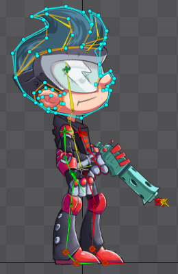

# 服裝整套覆蓋與完整回退

2026-10-17，ART-18；起始 main `1baf7dd`。這是防止缺件混穿的交付，不是新長雨衣或 ART-18 全票完成。

## 重新核對的六方方法

| 來源（本輪實際讀取） | 觀察與採用 | 限制 |
|---|---|---|
| [Spine Mix and Match](https://eu.esotericsoftware.com/spine-examples-mix-and-match) | 每件服飾分別組成 skin；肩部與背帶有綁點，衣物下半部另有控制。保留衣物身份及固定接縫。 | 不以其平滑網格取代既有像素步態；本輪只看兩張靜態原圖，沒有觀看範例動畫。 |
| [Unity Sprite Swap 10.0.3](https://docs.unity3d.com/Packages/com.unity.2d.animation@10.0/manual/SpriteSwapIntro.html) | 替換骨架必須相容；影格與外觀不能由衝突的播放來源各自改寫。使用同一姿勢及當格錨點。 | 換圖工具不會自動產生缺少的衣物姿勢。 |
| [Aseprite CLI](https://www.aseprite.org/docs/cli/) | 圖層、動作標籤及切片資料可一起輸出。先保有作者原件、命名和完整畫布。 | 本輪沒有操作 Aseprite 或建立新美術。 |
| [Godot Cutout](https://docs.godotengine.org/en/stable/tutorials/animation/cutout_animation.html) | 親子變換與前後遮擋可分開處理；複雜手部可使用逐格原畫。沿用完整畫姿，只讓合適部件隨動。 | 文件標示尚未更新至 4.7，必須實測；不把靜止對齊當成動畫成立。 |
| [Universal LPC](https://github.com/liberatedpixelcup/Universal-LPC-Spritesheet-Character-Generator) | 新動作／體型可能缺件，JSON 與圖片一起保存；相同命名仍需逐姿勢覆蓋核對。 | 不使用其圖像或畫風；不因同一套命名而假設影格相容。 |
| [Spriter Character Maps](https://www.brashmonkey.com/spriter_manual/what%20are%20character%20maps.htm)、[組合外觀](https://www.brashmonkey.com/spriter_manual/activating%20and%20stacking%20character%20maps.htm) | 替換圖的尺寸、命名與分組有助保持一致；多件外觀仍共同讀原動畫。採整套切換與明確外觀分類。 | 不引入平滑補間來扭曲像素角色。 |

兩張 Spine 原始插圖已下載、原樣保存並實際檢視：[服飾分類](../../pm/Snapland-art/images/ART-18-reference-skins-20261017.png)、[衣物固定處與下擺骨鏈](../../pm/Snapland-art/images/ART-18-reference-dress-20261017.png)。是文件內的靜態圖，並非整頁截圖；沒有將其當成遊戲素材或真人偏好測試。來源與 SHA 見 [provenance](../../pm/Snapland-art/images/ART-18-reference-provenance-20261017.json)。本輪另外重看既有八向雨衣／短外套圖例及雨衣走路圖集，沒有重新批准為島上可販售物品。

## 問題與處理

舊 `CharacterAnimationLibrary` 逐格選 `variants`，壞格才回原圖：一件候選可能在招手穿背心、待機穿外套。正式 `AvatarRenderer` 曾只對珊瑚款繞開候選，因此直接使用動畫庫仍會混穿。

現在有兩種明確模式：

- `outfit_modes: palette`：原完整人物來源、原錨點、原圖層；只由角色合成的既有調色流程處理顏色。四件正式外套都是此模式。舊背心資料保留來源紀錄，但不再被選用。
- `variant`（未宣告時的預設）：先檢查同角色全部已登記動作／方向／影格；每格必須有實際可讀且不越界的來源、明確頭／腳錨點、有限數值及有效共同比例。任一缺件，所有姿勢都保留原完整身體與原錨點，不只回退壞掉那格。

`outfit_required_poses` 另列不能因整段資料刪掉就消失的必要姿勢。主角包含 84 格既有專用動作／待機，加上外部步行圖集的八向 64 格，共 148 格。步行尚未遷入此動畫庫的完整衣物包，因此真正新輪廓款無法只靠部分正面動作就通過。四款換色不需要重複製作相同身體圖。

檢查在首次解析外觀時完成，結果最多快取 64 組；重新載入清單會清除判定及影格快取，修復包不會永久卡在舊回退。素材當成同次載入期間的不可變輸入，不支援直接更改已快取的字典當作熱更新。

這是來源／覆蓋的必要條件；不能證明新衣物的步態、輪廓、手部或前後遮擋美術合格。真正不同衣物、其全套原畫和完整品質驗收仍由 ART-18 原條件判定；未完成衣物不進正式衣櫃。正式角色的八向步行仍保留原圖，不使用樣本雨衣的生成步態取代。

## 回歸

`test_outfit_atomic_coverage` 使用獨立紅色原衣／綠色替換衣，故意破壞另一動作的最後一格，確認前面所有正常格也保留原衣與原錨點。涵蓋缺格、越界、壞錨點、缺來源、壞容器、無限值、壞比例、缺整個動作／方向及缺必要錨點；另驗證修復重載、明確換色、84 格正式動作及外部步行義務。先在舊程式重現失敗，才修正；沒有把 expected 由同一替換函式產生。

完整套件使用既有 Godot 4.7.2 CI；本輪局部執行是 Linux Godot 4.7。本機原生、匯出與影片範圍以 ART-18 本輪證據為準，不從無頭像素測試推論全島品質。

## 原生審閱發現的側身調色問題

舊正面條紋內衣的保護區被套到左右側身，導致袖子中心即使選珊瑚款仍是藍色。獨立原畫像素 `(135,210)` 在右向行走第 2 格原為 `(4,105,130)`，選珊瑚款後也沒有改變。

本輪檢查了 148 格的離線衣料草稿，拒收全姿勢版本：其中有相機鏡片、抬高手臂與跨胸袖子的誤標。兩輪修訂仍有道具、內衣或衣袖的錯誤，沒有接入遊戲；不能因批次輸出成功就稱為完整部件原件。

正式採用範圍是左右側向的各 8 格走路與各 4 格專用待機，共 24 格（22 個不同原始像素來源）。三張固定畫布的遮罩／珊瑚預覽聯絡圖已逐一核對，保留原頭、髮、臉、手、相機、背包、內衣、褲與鞋。`author_side_coat.py` 只在製作端提出這批索引，保留來源指紋；執行端讀取核對後的像素索引，不擴大 RGB/HSV 判定。只重用明暗比例，不修改原 PNG、姿勢或固定根點。

`export_outfit_sources.gd` 經驗證的 Godot 入口輸出固定畫布來源；執行時必須有獨立絕對存檔及 `SNAPLAND_OUTFIT_AUTHOR_DIR`。輸出再交製作工具，不從每張 alpha 外框重新置中。透明度低於 13 的 RGBA 歸零後才計算來源雜湊，避免匯入器對看不見的 RGB 補色造成誤判；可見像素改變則拒絕該標記。執行時最多快取 32 張遮罩，其他姿勢維持既有完整原圖與調色路徑，並非本輪已逐動作重製完成。

新增的實際島上衣物巡覽沿用八向輸入、四帽、暫停、拍照中斷、降低動態與即時換髮，另檢查珊瑚款的側身袖子確實變色。這只驗收來源與側身衣料修正，不代表不同服裝輪廓已完成。新輪廓製作與其他動作的衣料逐格標記仍受 ART-18 原條件約束。


## 單格製作檢視與正式換裝

`inspect_variant_texture(actor, action, direction, frame_index, outfit)` 明確讀取保留在清單的單格候選。它仍核對來源、區域、頭／腳錨點、共同比例及固定畫布；缺件、越界與非有限數值不會因是診斷入口而獲准。索引需確實存在，不自動繞回別格。正式 `texture`／`get_sequence`／`normalized_anchor` 維持整套衣服的原安全契約，沒有診斷開關可使候選上架。

兩條路徑共用同一份圖層與畫布合成；檢視以獨立命名空間存放紋理與量測布局，不與任何裝備字典鍵混用。候選行走來源也不被正式登錄原圖覆蓋，否則會讀到錯誤來源卻以為檢視成功。

原有角色回歸仍要求「歷史背心候選可讀且確實不同」，改由明確檢視 API 呼叫，並增加同尺寸畫布及正式珊瑚款仍等於原外套來源的斷言。沒有刪掉該檢查或改 CI 測試選擇器。整套服裝反例另外核對：檢視不污染正式快取／錨點，壞掉的另一格仍阻止全套上架，但可單獨檢視尚未壞掉的候選格。

## 2026-10-21：先做衣料、保留完整原人物

起點 `5daf281`，期間修正的慶祝帽子快取已由 ART-17 獨立交付。重新閱讀上表六個團隊的原文件：Spine 的 skin／衣襬固定與袖子前後分層、Unity 10.0.3 的相同骨架與播放來源衝突、Aseprite 的標籤／裁切區別、Godot 的父子定位與獨立遮擋、LPC 的缺少體型／動作問題、Spriter 的命名與尺寸契約。再次實際查看兩張已保存的 Spine 原圖、批准的主角與舊八向長衣候選；沒有觀看網站動畫或把舊光頭雨衣步態重新批准。

全身生成稿雖能畫出長外套，卻會更動頭、手及最後一步的腳；不採用其人物。早期依顏色提取衣料也出現相機碎片、袖口錯位及衣襬不足，全部保留拒收紀錄。採用內建 imagegen 產生的**純衣料**原檔，原圖不改；肩、肘、腕明確標記，衣料跟隨原姿勢，原人物不拆腿、不縮放、不按每格透明外框置中。圖層順序和袖子所屬區域明確指定，重疊處不以執行期 RGB 推測。

製作流程：

1. 先匯出目前真正使用的 280×360 原人物，保存每格 RGBA 指紋，保留共同根點；衣料來源另保存完整提示、原檔與 SHA256。
2. 衣物只變形自己的布料；原頭、腳、手、相機及明確前景背帶／紙張保持原像素，已審閱的頭髮所有權也沿用原格。袖子固定在當格肩／肘／腕，不拿手掌中心當腕點。
3. 製作入口先驗來源、有限幾何、區域與姿勢身份，再由固定 Godot 4.7.2 合成。來源改變、沒有可見衣料或保護區改變時拒絕；最後一格失敗亦只留下待驗輸出，不產生已接受的完整輸出。
4. `python tools/island_avatar/garment_manifest.py` 列出實際缺件；`python tools/island_avatar/build_garment_layers.py --godot /absolute/path/to/godot --profile /absolute/fresh/parent/progress.json` 產生製作預覽。可另用 `--project` 指定乾淨匯入的專案，`--verify-live-fallback` 檢查正式原人物；每次使用全新隔離存檔父目錄。工具不登錄衣櫃，預覽完整也不自動上架。
5. 正常及真正四分之一模擬速度的製作視窗逐格比對固定頭／腳；注入一個實際螢幕像素的位移必須失敗。圖形檢查與人眼審圖都需要；通過數值的錯袖口仍拒收。

### 兩種覆蓋不能混算

目前純衣料正面行走 **8/148 個必要原畫格**，其餘 **140 格**由報告逐一列出。正式 `celebrate` 沒有已登記原畫方向，另走八方向 × 三個序號的既有回退，共 **24 個渲染請求**；它們不是 24 張新原畫。覆蓋報告從目前角色動作／方向清單另找整個動作缺失，不能只看到原畫表齊全就宣稱覆蓋所有實際路線。檢視入口固定 `inspection_only`，不開放衣櫃就緒狀態。

實際正式渲染器比較 148 個原畫格及 24 個回退請求，候選 ID 都顯示完整原衣人物，並確認真實衣櫃沒有候選。這次只測預設人類／原微風髮型，不推論其他髮型、新衣遮擋、降低動態或打包驗收；不同輪廓全套仍由 ART-18 原條件驗收。

原生證據是私有 2D 製作視窗，採 8 FPS 檢視時間軸，不是正式世界依行走距離推進的動畫時序。兩段無聲 20 FPS 影片完整解碼，實際查看 16 張全姿勢與關節示意圖；沒有聲稱連續看完影片或執行正式換裝操作。最後重建的 24 張來源／衣料／合成 PNG 與原生檢視所用 PNG 逐位元一致。

[逐姿勢、影片與驗證入口](../../pm/Snapland-art/[ART-18]同步換裝分層與角色動畫.md) · [來源／提示／拒收診斷快照](../../pm/Snapland-art/images/ART-18-authoring-20261021-source-and-diagnostics.zip) · [完整缺件及回退清單](../../pm/Snapland-art/images/ART-18-authoring-20261021-fallback-runtime-reviewed-coverage.json)。拒收歷史包含一次未保留原始引擎錯誤文字的超時，以及一次設計錯誤的反例，均不計為成功驗收。

## 2026-10-21 接續：八向專用待機與多來源覆蓋

前節8格為首次製作交付。本輪新增36個專用待機衣料格：正面8格，其餘七向各4格；合併正面行走8格，現在可重建的製作預覽是 **44/148**，另缺104個原畫格與24個既有慶祝回退請求。這是製作覆蓋，不是正式衣櫃或ART-18完成。

待機使用不同身體的完整來源指紋，因此不能直接借另一個整身的所有權紀錄。先找到同方向已批准的固定行走頭，再逐一確認每個已擁有的髮像素RGBA相同，才可用於待機衣料保護；任一髮像素不同即拒絕。36個真實待機來源、八向變更髮像素及非待機借用的反例皆有檢查。身體來源指紋仍在合成前核對，沒有用「頭相同」取消整身指紋。原標記的半開右端點與製作前景標記的含右端點分開處理。

衣物軀幹可明確設定水平／垂直比例，袖子依各自肩、肘、腕及來源區域處理；只改衣料，不改原人物。先在來源和目標各畫出關節，修正把掌心當腕點、把袖子外緣當骨頭中心、以及不同方向衣身根點的誤判。來源衣領與袖子分開限定區域，保留原青綠帽衫。待機衣料的1px呼吸跟隨既有原人物姿勢，頭與腳保持原格。

首次正常／慢放的頭腳數值都通過，實際查看正常36姿勢後仍拒收：暖色前景草稿把舊短褲邊線保護到長衣上，且袖片最後的光柵小塊取到了旁邊衣身。現在手部標記排除褲子，背包與紙張保存完整原輪廓；袖片只取明確來源區域。獨立反例在修正前取進23個鄰片像素，修正後仍保有121個正確袖片像素、鄰片為0，未指派給袖子的衣身也正常保留。此反例加入官方測試，現為93個執行項目；原時間上限不變。

多來源清單可重複 `--guide` 核對同一衣物的聯集：

```sh
python tools/island_avatar/garment_manifest.py --guide tools/island_avatar/garments/mustard-front-guide.json --guide tools/island_avatar/garments/mustard-idle-eight-guide.json
```

每份先各自驗來源與幾何，再依動作／方向／格合併；重複姿勢或不同衣物不能湊數。缺件清單仍逐格列出，製作預覽永遠不因聯集達標而自動上架。單一來源合成仍使用 `build_garment_layers.py --guide ...` 與全新絕對隔離存檔父目錄。

最終原生使用專用待機的原始每格時長，正常23.40秒／真正四分之一時間93.50秒，兩段無聲20FPS；實際查看全部72張逐姿勢畫面及關節圖，影片完整解碼，沒有聲稱連續觀看。108張最後重建的原人物／衣料／合成PNG與原生輸入逐位元相同。舊正面8格的原人物與完整合成16張PNG也逐位元相同，衣料獨立層只改到alpha為0的RGB。

## 2026-10-22：獨立衣身保護與拒收紀錄

固定起點 `59a494f`。本輪交付的是製作入口的安全能力，**新服裝草稿全部未採用**；既有長外套仍為44/148，缺104格與另列24個慶祝回退請求。新的長背心是不同衣物身份，100格草稿不能與舊長外套44格相加，也不能因數值通過就計為已批准覆蓋。

持相機的衣料來源將袖子畫在衣身上。當袖子移開，若仍從同一張圖排除袖片範圍，身體就留下原姿勢的缺口。現在可提供獨立 `body_atlas`、`body_atlas_sha256`、`body_atlas_size` 與逐格 `body_atlas_region`。軀幹根點／多邊形依自己的圖格驗證；袖子仍依原袖片圖格驗證。另一來源不完整、越界、雜湊或尺寸不同，都在引擎執行前拒絕。引擎也重新核對實際來源。

預設 `coat` 保留原製作行為。明確的 `construction: sleeveless_overlay` 只畫衣身，必須有獨立衣身來源、`part_order: [body]` 及兩份非空 `original_arm_spans`。原袖子／手的所有權由來源指紋約束，恢復原像素時同時清空衣料層對應像素，避免往後把衣身蓋到手上；不把刪去袖子當作缺少來源也可上架。這仍是 `inspection_only` 製作契約，沒有正式衣櫃登錄能力。

局部測試19項通過，包含獨立來源、不同圖格尺寸、錯誤來源、缺少原臂所有權及錯誤構造反例。實際Godot反例先保有舊袖片排除行為：獨立衣身仍有洞，exit1／1ERROR；正確版本exit0／0ERROR，0.35秒。既有121個袖片像素、0鄰片與未分配衣身保護仍成立，另檢查原臂恢復不抹去旁邊衣料。重建舊正面與八向待機，共132張原人物／衣料／合成PNG逐位元相同。

### 視覺拒收與下一輪製作界線

56格外套與100格長背心草稿均能保護固定頭腳，但審圖仍發現袖片太窄、腕點與持物不合、來源臂洞、背包下半部被切掉、短褲邊線穿過衣身，以及原臂範圍不準造成的黃色衣料缺口。全身人物沒有被新生成的人物替換。兩張新生成的八向純衣身原件、原參考、完整提示、來源指紋及各次拒收診斷保留在附件；未加入正式資源。

過寬的相機保護矩形也會連原短褲一起保護。縮小範圍雖能改善單格，仍不能代替真實手臂／道具的逐格部件所有權。顏色草稿、近似骨頭走廊或粗略多邊形都不能在肉眼有破綻時升格為正式部件資料。下一輪需逐格完成明確袖子、手、背包與道具邊界；本批不以增加影格數或繼續放寬保護範圍表示完成。

保存的拒收原生正常影片為1280×720、20FPS、628格31.40秒，完整解碼。其頭腳比較數值通過，但視覺仍拒收；不是正式換裝、慢放、降低動態、Main、打包或真人試玩驗收。

### 本輪實際閱讀與圖例

| 團隊／來源 | 採用的製作原則 | 本輪範圍 |
|---|---|---|
| [Esoteric Software／Spine Meshes](https://esotericsoftware.com/spine-meshes) | 圖像所有權邊界與變形邊界分開；獨立部件不能被另一片的排除區挖洞 | 讀網格、邊界及洞的說明，下載並查看官方靜態網格圖；未看影片 |
| [Unity／Sprite Swap 10.0.3](https://docs.unity3d.com/Packages/com.unity.2d.animation@10.0/manual/SpriteSwapIntro.html) | 一致骨架和單一播放來源，避免兩套動畫同時改寫外觀 | 讀必要元件及骨架／動畫器限制；未使用其套件 |
| [Igara／Aseprite Sprite Sheets](https://www.aseprite.org/docs/sprite-sheet/) | 保留固定圖格、偏移、圖層及動作身份 | 讀匯入／輸出說明，下載並查看官方水平圖格靜態圖 |
| [Godot／Cutout Animation](https://docs.godotengine.org/en/stable/tutorials/animation/cutout_animation.html) | 混用逐格與部件，複雜手部保留原逐格來源 | 讀方法與階層說明；頁面仍標示4.7未更新，另以本機4.7.2驗證 |
| [Universal LPC團隊](https://github.com/liberatedpixelcup/Universal-LPC-Spritesheet-Character-Generator) | 每個動作／格與外觀身份分別核對，來源授權逐件保留 | 讀動畫指南、授權／素材說明；不採用其美術 |
| [BrashMonkey／Character Maps](https://www.brashmonkey.com/spriter_manual/what%20are%20character%20maps.htm) | 替換件維持一致尺寸／命名，衣物身份不能混算覆蓋 | 讀完整說明；不把平滑補間套到原像素人物 |




以上是官方靜態原圖，非網頁截圖或遊戲素材；不能由文件推論玩家偏好。[驗證與範圍](../../pm/Snapland-art/images/ART-18-underlay-20261022-verification.json) · [拒收歷史](../../pm/Snapland-art/images/ART-18-underlay-20261022-attempt-history.json) · [拒收原生短片](../../pm/Snapland-art/images/ART-18-underlay-20261022-rejected-native.mp4) · [原件、完整提示與診斷](../../pm/Snapland-art/images/ART-18-underlay-20261022-rejected-sources-and-diagnostics.zip)。前置main的[完整CI](https://github.com/deadline314/Snapland/actions/runs/39524314595)已核對137項Python、93個Godot的名稱／順序／原上限及5個設計範圍；不包含本輪尚未推送的改動。

[最終原生與資料證據](../../pm/Snapland-art/images/ART-18-idle-cloth-20261021-verification.json) · [104缺格與24回退請求](../../pm/Snapland-art/images/ART-18-idle-cloth-20261021-combined-coverage.json) · [完整提示、原檔與拒收診斷](../../pm/Snapland-art/images/ART-18-idle-cloth-20261021-source-and-diagnostics.zip)。正式未知衣物仍完整回退；本批沒有啟用新服裝、即時換髮、降低動態或PCK驗收。

## 2026-10-24：完整來源製作與舊動作相容

新的低領無袖長背心為獨立身份，不與舊長外套44格混合。重新生成的八方向純衣料保留原人物；正面／斜前方的開襟採凹形衣料範圍，不能把背面內裡畫到原本胸前。蹲下只調衣料的局部長度；身體、頭、相機與腳底的畫布和位置不變。袖口、背帶、手掌使用逐來源前景範圍；由膚色連通塊猜測手掌的試作曾誤把褲子恢復到長背心上，已拒收，未成為通用生產規則。

製作清單現在可分列148個已登記原畫格與24個既有慶祝請求。實際匯出證明慶祝24次均指向同一個既有原畫；不能宣稱增加24張動畫。舊慶祝沒有可用的髮材質owner，因此只以完整原圖精確指紋及上半部全區不變證明允許衣料製作，衣料alpha也必須完全不進該區；這不是頭髮材質的所有權，不開放正式染髮或換髮。任意一像素原圖更改或未登記動作都拒絕借用。

本輪V20製作輸出148原畫格及24次舊來源覆蓋，22張全身靜態聯絡圖已查看；其中四張斜前方採V20重看，其餘原有方向已看V18且以逐位元相同結果確認。新衣料只供製作整合，`ready_for_wardrobe`仍為false，不能由覆蓋完整直接上架。正式路線預計先對原身體染色，再疊純衣料，最後用原頭部資料處理髮型與帽子；不能把合成後的整身圖當原髮材質來源。

本輪再次閱讀[Aseprite Layers](https://www.aseprite.org/docs/layers/)、[Godot Cutout animation](https://docs.godotengine.org/en/stable/tutorials/animation/cutout_animation.html)及[Spine Meshes](https://en.esotericsoftware.com/spine-meshes)：保留獨立cel與鎖定原身體，複雜手腳不作全身骨架扭曲，衣料範圍明確處理凹形開襟。Godot該教學有版本更新提醒，實作仍以固定4.7.2驗證。文件與靜態圖不能代替正常／慢放原生換裝、降低動態或打包驗收。

### 同日正式接入：純衣料先於髮帽

`outfit-rainvest`是免費基礎收藏，固定itemdefid 51009；新檔與既有檔都補入收藏，原本穿著、金幣、成就及其他收藏保持原規則。衣櫃仍先預覽，再按「穿戴所選」保存。正式身體來源先用原潮汐外套處理外觀，再疊純衣料，最後套原來的頭髮與帽子；新衣料不取得頭髮／皮膚材質責任，也不改原錨點或正規化。

整套148原畫格與24舊呼叫，先對實際原身體指紋與每份衣料的完整資料指紋驗證，全部有效才允許任何格顯示。缺最後一格時，其他八向也全部回原衣；改原人物、改衣料、重複鍵與bool序號反例都拒絕。正常與四分之一時間原生各172次，預設與交替短髮／捲髮、髮色、膚色的衣料外像素保持不變。這些是逐格整合檢視，非玩家逐款通關；舊慶祝的替代髮型仍可能沿用原髮，不能冒充已補新動作／髮材質owner。

第一份打包實際失敗：被Godot匯入的PNG不再保留原始FileAccess路徑資料，不能把本機散落PNG通過當成PCK通過。正式衣料改存`.pngdata`原PNG位元組，兩種桌面匯出都明確納入原資料；172份資料與V20逐位元一致，直接解碼並驗指紋。只有project.godot與外部檢查腳本的獨立目錄，沒有散落遊戲程式或美術，實際載入嵌入PCK後172次通過。這是包內資源檢查，另以真正Linux ELF從乾淨release目錄啟動十二款首幀，帶入原生衣櫃保存的新衣物／降低動態存檔；不是十二款打包通關或Windows驗收。

冷啟動也發現共用smoke入口錯把降低動態的裝飾停播當失敗。保留失敗後，驗收改為核對保存設定、實際停播／播放狀態及原本至少100個登記；不強制打開動態。原生元件與Main檢查、真正降低動態ELF重跑皆通過。整票仍依其餘部件動態／完整換裝條件驗收，不能因單一新衣物上架就勾完所有要求。

### 原資料副檔名也要進隔離稽核

875963c的遠端完整Python／設計工作成功，但固定原點稽核在目錄準備階段失敗。隔離複製器的舊正規表示式把`.pngdata`截為`.png`；正式包內驗證不會覆蓋這個獨立入口。兩個角色稽核複製器現共用完整副檔名辨識，支援已知的gd／json／png／pngdata與引號邊界；未支援的長副檔名不截成另一個檔案。回歸直接執行真正複製器，核對完整依賴圖與原位元組，不只比對一段regex。修正後實際重跑CI固定原點與待機命令；原畫、像素判定和缺件拒絕保持不變。
