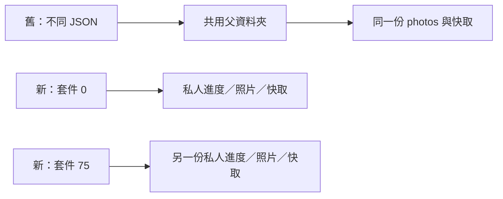

# 原生套件隔離完整進度資料夾

2026-10-20；MAIN-2；開始main `26a5353`。先讀User-guide。完整[CI39339867661](https://github.com/deadline314/Snapland/actions/runs/39339867661)已通過前75項，包括先前對話收尾與新接帽；第76項共享照片在兩個檔案數斷言失敗，設計／Python工作成功。不能把整套寫成綠燈。

## 問題與選擇

原生入口原本給每套件不同的`profile-N.json`，但照片、快取與解碼反例都從該JSON的父資料夾尋找。所有套件仍共享同一個`photos/`。因此單跑只有一張照片，整套執行卻會把前面套件留下的圖片算進來。不能刪掉別套件的照片、改成只數自己喜歡的檔名，或調寬「同一份照片服務普通／惡魔卡、重玩不再產生照片」的斷言。

每一套件改有完整私人資料夾，先建立後傳入`progress.json`。原92個命令、完成行及90／240秒門檻不變；遊戲照片保存和收藏程式也沒改。

## 六個團隊的實際文字比較

只閱讀官方文字／API，沒有外部圖片或影片觀看宣稱。

- [Python TemporaryDirectory](https://docs.python.org/3/library/tempfile.html#tempfile.TemporaryDirectory)：目錄及其內容一起管理生命週期；保留現有外層暫存上下文，只細分套件子目錄。
- [Bazel Test Encyclopedia](https://bazel.build/reference/test-encyclopedia)：測試依賴需明確，私人可寫目錄隔離副作用；不任意寫其他測試產物。
- [JUnit TempDir](https://docs.junit.org/6.1.3/api/org.junit.jupiter.api/org/junit/jupiter/api/io/TempDir.html)：每測試與共享範圍是刻意選擇，不由不同檔名推定隔離。
- [Jest Setup and Teardown](https://jestjs.io/docs/setup-teardown)：只有整套失敗時要檢查共用狀態。此案採分離目錄，沒有清掉他人的圖來製造乾淨環境。
- [Go testing.TempDir](https://pkg.go.dev/testing#T.TempDir)：每次呼叫取得不同目錄，結束才清理自身範圍。
- [Rust tempfile.TempDir](https://docs.rs/tempfile/latest/tempfile/struct.TempDir.html)：目錄內容與資源生命週期一起處理；不是僅替主要檔案改名。

## 可重現驗證

新增Python回歸實際走官方入口的全部92次派送，用假的引擎寫相同相對照片／快取名稱，確認前一套件檔案不被後一套件看見或覆寫。舊配置第二次就失敗；新配置通過。這是入口行為測試，不是92項Godot遊戲通過。

另外用真Godot在舊共用父目錄預置一張前套件原生PNG，原照片測試完全不改便重現兩個斷言失敗；改到私人父目錄則exit0、0ERROR、有實際完成行，且前套件13個檔案的SHA256全部不變。共享照片、原圖、檢視器及存檔隔離四項局部Godot檢查通過；24項Python入口／結果契約通過。原照片數量、錯誤檔、超大IHDR、壞zlib反例與快取上限斷言都保留。

[本輪完整數據與原始記錄](../../pm/Snapland-main/images/MAIN-2-profile-isolation-20261020-verification.json)。完整遠端回歸由本批合入後的CI核對，本頁不以局部通過替代整套。
