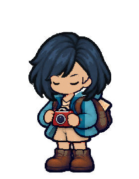
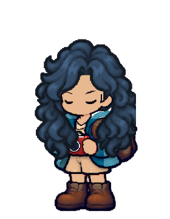

# Godot 測試結果契約

2026-10-19（Asia/Taipei），MAIN-2。起始 main `a8f610a`；本批僅處理測試完成辨識與診斷，不變更遊戲原畫、角色程式或正式待機呈現。

## 實際失敗

[前批 CI](https://github.com/deadline314/Snapland/actions/runs/38968613443) 的角色來源、捲髮／NPC 量測、正式世界整合均通過。待機附件測試 exit 0 且無 ERROR，但它已輸出「來源圖集閉眼附件可用」的成功訊息；runner 仍期待舊的「方向待機附件」文字，因契約不一致停止。

以官方 Godot 4.7.2 ed1daf0bf 及獨立絕對存檔路徑重現，實際成功訊息為 `PASS: source-atlas closed-eye attachment availability (not production idle playback)`。這個範圍標示是必要更正，不應把來源診斷說成正式待機播放已通過。

## 六方一手方法比較

本輪實際閱讀文字文件；沒有觀看參考影片或擷取網站截圖。下方兩張是本專案真實診斷輸出，與外部參考資料分開。

| 來源 | 實際核對 | 採用／界線 |
|---|---|---|
| [Python subprocess](https://docs.python.org/3/library/subprocess.html#subprocess.CompletedProcess) | CompletedProcess 分別提供退出狀態、stdout、stderr。 | 三者合併判定；成功文字不能蓋掉非零退出碼或引擎錯誤。 |
| [pytest exit codes](https://docs.pytest.org/en/stable/reference/exit-codes.html) | 成功、執行失敗與沒有收集到測試是不同結果。 | 未完成本測試的輸出不能因正常退出就當成功。沒有改用 pytest 或引入依賴。 |
| [Godot command line](https://docs.godotengine.org/en/stable/tutorials/editor/command_line_tutorial.html) | quit／quit-after 是退出迭代的控制，不是測試完成證明。 | 一般測試要讀到自己的完成行；編輯器匯入仍以原本 exit／ERROR 條件判定。 |
| [GitHub workflow logs](https://docs.github.com/en/actions/how-tos/monitor-workflows/use-workflow-run-logs) | 可依失敗 step、行號與執行時間查原因。 | 每項完成後立即 flush；契約不符時報出實際收到的成功行，避免只見舊預期。 |
| [CMake PASS_REGULAR_EXPRESSION](https://cmake.org/cmake/help/latest/prop_test/PASS_REGULAR_EXPRESSION.html) | 此選項能讓文字比對優先於一般退出碼；逾時仍失敗。 | 只借鏡輸出契約概念；**不採用文字覆蓋退出碼**，保留更嚴格的交集判定。 |
| [Meson unit tests](https://mesonbuild.com/Unit-tests.html) | 明確區分 exitcode／TAP、略過與硬錯誤。 | 本案保持既有格式與引擎入口；不把缺測或略過當通過，不在這批全面更換協定。 |

網站文件版本供概念比較；實際使用既有 Python／Godot 4.7.2 API，CI Python 3.12 設定不變。

## 本案契約

1. 非零退出碼一律失敗，包括已印成功行後中止。
2. stdout 或 stderr 有 ERROR，一律失敗，即使另一處有完成行。
3. 一般測試必須在 stdout 行首收到本測試的完成標記。另一測試的成功行、引用／預期文字或只有 stderr 的標記不能冒充完成。
4. 每項 runtime 測試都要有契約。此次補齊來源座標、側向待機、整套衣物及側身衣料；乾淨編輯器匯入維持原有例外，沒有假造 PASS。
5. 測試名、命令、版本與 90／240 秒門檻保持；沒有刪斷言、換測試選擇器或 known failure。AST 比對確認命令與門檻一致。
6. 23 項 Python 完成／入口檢查放在 game-runtime job 的引擎安裝之前，不因 SG-1 設計 job 失敗而全部被略過。完成契約的配置核對會提前指出漏登記或重複測試名。

## 實際診斷圖

以下為 Godot 測試寫出的 280×360 PNG，本輪已直接查看短髮與捲髮兩張。保留來源閉眼、完整身體及原換裝合成。它們是來源圖集診斷，**不是正式島上待機畫面、正常／慢放影片或新美術品質驗收**。

完整局部結果、原腳本雜湊與證據：[verification.json](../../pm/Snapland-main/images/MAIN-2-runtime-contract-20261019-verification.json)。全套結果以最新實際 CI 為準，SG-1 的設計缺檔仍保留為失敗。
