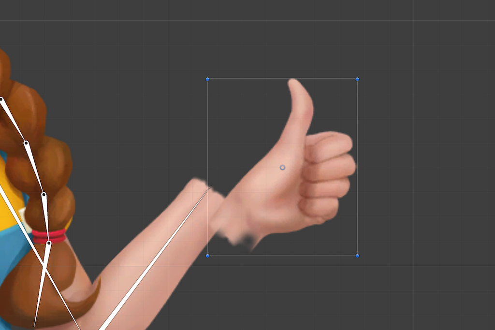
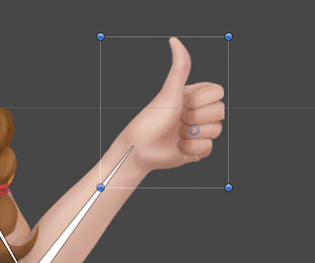

# 角色來源與量測標記的座標契約

2026-10-17，MAIN-2，固定開始 main `dc32c1480301da70c9f2faf0009ad42f1217f17e`。

## 問題與證據

main `1baf7dd` 的 Godot 4.7.2 CI 在既有角色來源校準回歸失敗：原固定鏈長 `0.3740643274853801` 的斷言沒有通過，之後逾時。重新以相同官方 ed1daf0bf 核對，現值為 `0.37333333333333`；八個方向的來源本身均有效。

ART-31 已登錄的第 0 格校正為正面 `(0,-3)`、背面 `(0,-2)`，其他六向 `(0,0)`。畫布與人物原畫已套用校正，但舊量測的髖點、裁切框與保護區沒有一起轉換。相對鏈長本應在共同平移下保持不變；不能移回人物原畫或換掉原測試常數來掩蓋這個差異。

## 六方一手方法核對

| 來源 | 本輪實際閱讀與採用 | 界線 |
|---|---|---|
| [Godot AtlasTexture](https://docs.godotengine.org/en/stable/classes/class_atlastexture.html) | region、margin 與整數圖像區域是不同概念；保留明確的畫布／區域資料。 | 不依每格可見外框重建原點。 |
| [Unity Character Parts](https://docs.unity3d.com/Packages/com.unity.2d.animation@10.0/manual/CharacterParts.html) | 替換圖的 pivot 需在相對位置一致；重看對齊前／後的官方圖例。 | 不把改 pivot 當成重新畫姿勢或改整個人物位置。 |
| [Aseprite Slices](https://www.aseprite.org/docs/slices/) | bounds、pivot 與匯出 JSON 一起保存。 | 量測標記跟隨其來源畫布，不跨圖集套用。 |
| [Phaser Frame](https://docs.phaser.io/api-documentation/class/textures-frame) | realWidth／realHeight 保存原尺寸，x／y 保存 trim 後偏移。 | 原尺寸、顯示區域與世界根點不可混為一個量。 |
| [libGDX TextureAtlas 原始碼](https://github.com/libgdx/libgdx/blob/master/gdx/src/com/badlogic/gdx/graphics/g2d/TextureAtlas.java) | AtlasSprite 分別保留 originalWidth／Height 與 offsetX／Y，平移、原點與翻轉都傳遞偏移。 | 本輪只採座標契約，不引入該引擎。 |
| [Spriter Character Maps](https://www.brashmonkey.com/spriter_manual/what%20are%20character%20maps.htm) | 替換圖保有一致尺寸、命名與動畫引用，減少換件定位差異。 | 同名不會自動修復舊座標。 |

TexturePacker 文件本輪讀取失敗，不計入成功閱讀來源。Unity 兩張官方原圖重用已保存的 ART-34 圖例，沒有聲稱新擷取頁面或觀看動畫：

## 處理範圍

來源提供者回傳其已登錄的整數畫布位移。既有預設主角的量測資料每次從不可變原件複製，再對同一來源中的點、框、跨距及保護區套用一次平移。重建、換色及損壞來源恢復不得累加偏移。

獨立鞋圖的裁切範圍、pivot、sole 與比例仍屬該獨立圖集，不跟主角畫布移動。借用其他方向的鞋色取樣區時，使用被借用來源自己的位移。

原本的固定鏈長與所有來源有效性／完整回退斷言保留。島上正式角色仍是原八向 2D 圖格與髮尾綁定；這項修正不啟用被否定的拆腿步態，也不作為 3D 樣本美術驗收。驗證需另確認固定根點、髮帽、衣料及原生入口沒有改變。

## 局部驗證結果

官方 Godot `4.7.2.stable.official.ed1daf0bf`：原測試與常數不改，八向來源校準回復 `0.3740643274853801`；完整樣本測試 38.69 秒、實際世界整合 12.02 秒通過。故障來源回退／重建恢復、固定根點、髮型生命週期與其他髮型、314 項整套衣服契約、72 組側身衣料均通過。新增非零 X 位移／獨立色樣位移反例，確認不會修改原件或累加；編輯器匯入無 ERROR，13 項啟動器測試通過。

世界整合明確核對正式島上不建立拆腿 rig，仍以完整原畫 Sprite 呈現。來源圖與根點未改。本輪無新的遊戲美術或原生錄影驗收。[引擎、檔案雜湊與完整局部範圍](../../pm/Snapland-main/images/MAIN-2-source-registration-20261017-verification.json)。

MAIN-2 仍為進行中；全域設計 CI 的 SG-1 缺檔未解決。修正前 ART-18 main `dc32c14` 的 [CI](https://github.com/deadline314/Snapland/actions/runs/38965270551) 又揭露舊候選檢視入口與新換色契約的相容問題，另接 ART-18 處理，不能把本頁局部通過寫成全套綠燈。
