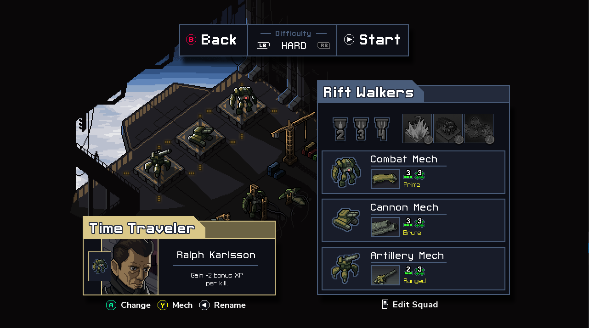

# 當前教學圖與真實結果來源

2026-10-20；MAIN-10。先讀 `pm/user_guide.md`，保留既有十三課、每課三步及遊玩中主動重看的入口。這份研究不代表其他作品的影片已看過，也不代表 Snapland 已取得玩家測試或無障礙認證。

## 六方比較與取捨

| 團隊／來源 | 本輪實際閱讀／看圖 | 採用方式與界線 |
|---|---|---|
| [Apple：Onboarding](https://developer.apple.com/design/human-interface-guidelines/onboarding)／頁面公開連結的 [Markdown](https://developer.apple.com/design/human-interface-guidelines/onboarding.md) | 原文文字；未看影片 | 每步一件事，先讓玩家操作；可跳過並有固定重看入口。不把每次回到站點都變成強制閱讀。 |
| [Valve：Steam Input best practices](https://partner.steamgames.com/doc/features/steam_controller/steam_input_gamepad_emulation_bestpractices) | 原文與 Into the Breach 按鍵畫面原圖 | 說明必須符合實際輸入。圖例中的難度、返回與開始分工清楚；本作使用自有圖像，不複製介面或宣稱已接 Steam Input SDK。 |
| [Nintendo：Super Mario Party Jamboree 小遊戲](https://www.nintendo.com/ph/switch/a7hl/minigame/index.html) | 當前公開分類頁文字；未看影片 | 以各款的具體動詞說明行為，不把十二款都寫成「按鍵拿分」。這一頁沒有提供可核對的練習模式說明，不能拿它證明練習設計。 |
| [W3C：Consistent Help](https://www.w3.org/WAI/WCAG22/Understanding/consistent-help.html) | 原文文字 | 同類畫面的說明入口位置與行為一致；關閉後回到原本步驟／暫停狀態。網頁標準是參考，不是遊戲認證。 |
| [Microsoft：XAG 121](https://learn.microsoft.com/en-us/xbox/accessibility/xbox-accessibility-guidelines/121) | 公開正文與其中的支援文件例子；未登入 | 目標、輸入與可用協助應可查找。不是把長篇說明全疊到正式遊玩畫面。 |
| [Game Accessibility Guidelines：interactive tutorials](https://gameaccessibilityguidelines.com/include-interactive-tutorials/) | 原文文字；頁面引用影片未觀看 | 讓玩家在安全練習中操作，不要求只靠記憶文字。練習與正式收藏分開，輔助也不能自動作答。 |

實際下載並檢視的 Valve 原始靜態圖：

原圖與來源頁、雜湊、取得方式見本票證據清單。它是靜態參考原圖，沒有稱為影片觀察或本作畫面。

## 圖像採收流程

1. 更新前保存三十九張原教學 PNG 的位元雜湊，先辨認舊版介面、教學用途與目前規則。
2. 示範遊玩可在隔離的私人練習中取得，但說明只宣稱圖上真有的操作；結果步驟必須由實際輸入完成回合、正常結算與授卡後取得。生成圖、人工結果旗標與直接寫分數都不能當成功範例。
3. 診斷入口可以把人物直接放到站點，接著仍由真實視窗事件開啟資訊、開始與遊玩；沒有因此宣稱徒步抵達或真人試玩。結果觀察器只讀正式 Session 的完成訊號，記錄程序、分數、實際明細與練習／輔助旗標，並保存完整原生畫面。
4. 來源素材擷取和完整玩法驗收分開。如果舊流程在取得真正結果後，因過期的收藏捲動假設或舊練習入口失敗，整條舊流程仍記失敗。另開明確的「來源擷取」範圍，保留原正式輸入、判定與結果斷言，不把後續未執行的流程寫成通過。
5. 固定步長是離線素材擷取工具，不是硬體效能結果。依 [Godot Movie Maker](https://docs.godotengine.org/en/stable/tutorials/animation/creating_movies.html) 的用途，分開記錄模型時間與牆鐘時間；不能放寬遊戲命中窗口以換取漂亮分數。拍點等待使用模型已定義的比較 epsilon，仍核對實際誤差與原本分級。
6. 所有寫入跟隨本次絕對隔離存檔父目錄，不能直接覆寫票內舊證據。檢視完整畫面、核對文字與分數後，才選取放入正式教學與票。
7. 替換 PNG 後，在新的私人專案匯入，避免讀到舊 `.godot` 圖像快取或匯入其他 Session 的暫存腳本。再驗十三課的圖像、鍵鼠導航、放大返回、首次／略過／重看與暫停時鐘。

原生流程另外發現暫停時的重繪成本，採用[保留完整子畫面的六方方法](paused-subviewport-rendering.md)，保持原時限與實際輸入。

只看來源圖不代表已檢視連續動畫；Dummy 音訊不代表試聽。十三份教學驗收也不等於十二款最終美術、手感與內容全部完成。
