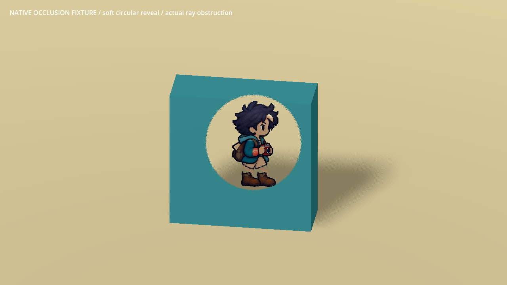
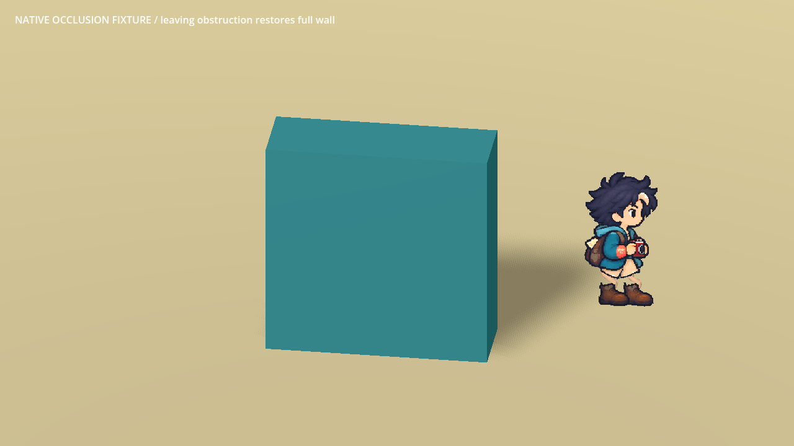
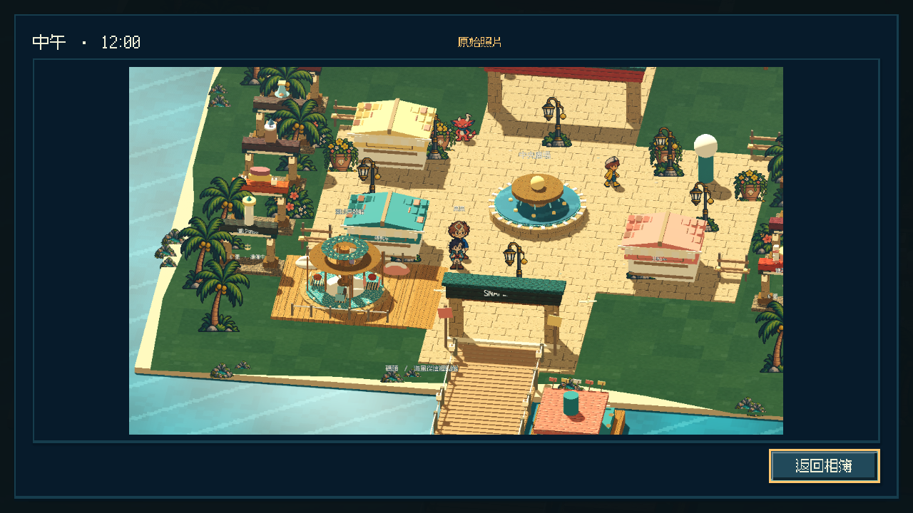
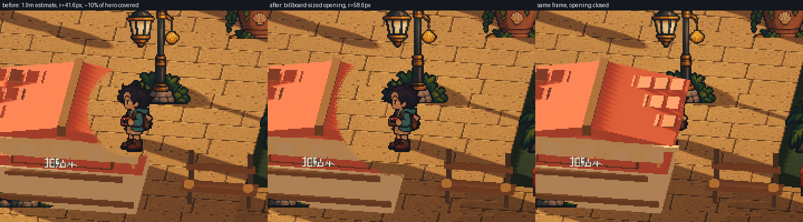
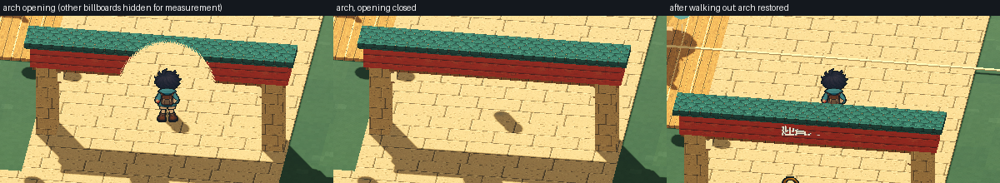

# [ART-10] 提供建築遮擋圓形透視

> 狀態：完成

## 內文

### 需求
主角走到建築等遮擋物後方時，以主角為中心顯示圓形透視區域，保留位置、穿搭及動作的辨識。只在實際遮擋時出現，離開後恢復建築外觀。

### 來源
2026-10-11 使用者追加：建築遮擋時需要圓形穿透顯示主角；氣球快遞過於簡略、海風不可見、操控與引導弱。參考資料至少超過五個來源，跨不同方向比較並形成自己的設計。

### 驗收條件
- [x] 查閱至少六個不同來源，比較透視、淡出與鏡頭避障的實際做法及取捨。
- [x] 在不同建築後方可看見圓形區域內的主角，建築其他部分及碰撞保持正常。
- [x] 離開遮擋區、換裝、改視窗大小、日夜及降低動態時，位置與顯示正常。
- [x] 主角前方或遠在主角後方的建築不錯誤透視，重新進入場景無殘留。
- [x] 原生畫面驗證並保存遮擋前後截圖與短影片，局部測試與打包檢查通過。

### 測試流程
1. 原生視窗走到兩種建築後方，查看圓形透視、主角與碰撞。
2. 前後移動、換装、改視窗及切日夜，核對效果恢復與定位。
3. 重啟並執行局部測試、打包資源檢查。

---

# 跟其他票的關係
- Blocks：無
- Blocked by：無
- Related：ART-3、ART-7、ART-9

---

# 開始與研究

固定基準：a1fc7abaa91a5d9fdf6e2c7ca084f0dba0205985。來源比較與採用原因見 design/runtime/occlusion.md 與 design/runtime/balloon-delivery.md，未看影片不算已看。

## 研究圖例

官網靜態圖可看見建築內部與角色位置，並非圓形遮罩動態證據。只借鑑遮擋處仍能辨識角色的目的；Snapland 保留自己的建築配色與圓形局部透視。來源：https://shadercrew.com/assets/reveal.png。六種來源及取捨见研究文件。

---

# Commit-1

問題：角色走到建築後方時容易被完全遮住，外觀與位置難以辨認。

改動：加入以角色位置為中心的圓形透視，並依遮擋關係、視窗比例、日夜和降低動態控制效果。

驗收：原生審查涵蓋三組固定遮擋位置、日夜、降低動態、1600×900 resize 與離開後恢復；錄影與資源封裝驗收仍待完成。固定位置是驗收場景佈置，不代表玩家操作路線。

| 畫面證據 | 說明 |
| --- | --- |
| [遮擋日景](images/ART-10-cutaway-day.png) · [遮擋夜景](images/ART-10-cutaway-night.png) · [降低動態](images/ART-10-cutaway-reduced-motion.png) | 原生靜態畫面 |
| [右側小亭遮擋](images/ART-10-cutaway-right-kiosk.png) · [拱門遮擋](images/ART-10-arch-cutaway-day.png) | 固定審查視角畫面 |
| [1600×900 視窗](images/ART-10-arch-cutaway-resized-equipped.png) · [遮擋退出後](images/ART-10-arch-cutaway-clear.png) | 原生靜態畫面 |

程式交付：[Commit 886816a](https://github.com/deadline314/Snapland/commit/886816ad9a7d35b7702cce48a93e4fd052517bb8)（分支 `feature/island-first-park`；固定基準 `a1fc7abaa91a5d9fdf6e2c7ca084f0dba0205985`）。

### 最新輸出驗證
Windows輸出於Intel Arc B580原生GPU完成圖集、NPC、場景動畫與遮擋資源冒煙檢查，12款場景所需素材均載入，無ERROR；此檢查不代表真人試玩、完整換裝動作、每姿勢或試聽驗收。

### 程式與證據提交
分支：feature/island-first-park。更新至最新main後的本票提交：[63f423d](https://github.com/deadline314/Snapland/commit/63f423dfcabc62ede8a09ddb85e30d53165e27ad)。

# Commit-2

## 問題

燈塔等曲面建築可能遮住主角而沒有透視；更換建築材質後，透視也可能遺失原本的發光或表面效果。

## 改動

曲面遮擋也能顯示較大的柔邊圓形透視，離開後恢復建築。保留支援材質的顏色、發光與表面效果，以及完整建築影子；不支援的特殊材質保留原狀並記錄位置。新的海港材質圖集是保留表面效果所需的共同資源，與 ART-3、MAIN-11 共同使用。

## 驗收

主 Session 驗證本次提交的匯入、遮擋及光照三項檢查全部通過，無 ERROR；原有驗收要求保留。實際查看同一個原生遮擋場景的完整牆面、圓形透視及離開後恢復，確認主角頭腳完整、牆面影子保持。這是固定測試場景，正式園區材質與行走另隨 MAIN-11 完成整合驗收。

### 測試結果

| 項目 | 結果 |
|---|---|
| 本次提交匯入、遮擋、光照 | 3 / 3 通過 |
| 原生遮擋與離開後恢復 | 1280×720，171 幀，通過場景檢查並查看三張畫面 |
| 全套測試 | 留給 CI，本次未執行 |

### 截圖與錄影

[原生測試場景錄影](images/ART-10-native-v2-reveal.mp4)。分支：`feature/island-experience`；本輪固定基準：`86bd44cd7017fb2d4bc05685271f6cdfa618c9da`。遠端連結於推送後補入。

# Commit — 2026-10-20 修復大量建築的透視參數容量

固定開始 SHA：`b9619c5`；分支：`codex/delivery-batch-20261020`。

原生拍照流程暴露 OpenGL 相容模式在完整園區產生 270 筆引擎錯誤；只改海港材質的中間候選仍有 55 筆，均拒收。現在透視共用受控材質，保留原本圖集、顏色、發光、金屬與完整影子；地板和不同場景不互相套用透視，離開與未完成登記的清理也恢復原材質。

原有遮擋與日光兩項回歸通過；新增來源不可變、相同來源重用、跨控制器隔離與清理檢查。完整園區仍有 865 個布景網格，1280×720 的實際時段拍照／原圖檢視已重跑為 0 ERROR。使用 Godot 4.7.2、Compatibility、llvmpipe；不是 Windows 硬體、Forward+ 完整光影或真人試玩驗收。原有不支援特殊材質警告保留，票維持進行中。

[六方資料與選擇](../../design/runtime/occlusion.md) · [遮擋實測](images/ART-10-capacity-20261020-occlusion.log) · [日光實測](images/ART-10-capacity-20261020-daylight.log)。修正前後的引擎記錄、照片與雜湊見本批驗證索引。

[本輪來源、範圍、修正前後與圖片雜湊](images/ART-10-capacity-20261020-verification.json)。

# Commit — 2026-10-23 依實際立牌開圈並完成原生前後驗收

固定開始 SHA：`2e95cc6`；分支：`work/occlusion-light`。

## 問題

在正式島上以實際按鍵走到拍貼本亭後方量測：透視圈仍以「腳底往上 1.9 公尺」估算大小，但主角是 2.4 公尺、面向鏡頭的立牌，畫面上更高。圓半徑 41.6 像素時，約一成的主角像素（頭頂兩側髮型與靴底）仍被屋頂和亭身蓋住；只擋住頭的建築也不會開圈。

## 改動

透視圈改以主角立牌在畫面上的實際範圍為中心與大小（整張立牌的半對角線加柔邊），並多檢查頭部高度；沒有立牌時維持原本做法，既有檢查全部保留。乘坐等隱藏立牌的情況沿用舊估算。

## 驗收

同一凍結畫面先拍「建築在、透視開啟」，再讓建築只留影子拍參考：參考中主角的每一個像素透過透視圈都必須顏色相同（≥95%），頭頂與靴底列完全一致；同時只在該建築的畫面範圍內比較開圈前後，圈外建築像素不得改變。

| 項目 | 結果 |
|---|---|
| 拍貼本亭、迎賓大道拱門 × 四時段 | 8／8 通過；主角像素 100% 相同，頭頂／靴底列一致，圈外建築改變 0 |
| 換裝（珊瑚外套＋水手帽）、降低動態 | 通過；降低動態立即全開 |
| 800×600、1600×900 視窗 | 通過（800×450 內容半徑 36.6、1600×900 半徑 73.3 像素） |
| 站在亭前、離開後恢復、重建 Main | 不誤開；離開後權重歸零；新 Main 無殘留並可再次開圈 |
| 遮擋局部測試 | 通過；新增立牌開圈大小、只擋頭部的建築與舊做法反例 |
| 受影響 17 組 Godot 局部測試／Python 147 項／設計 5 範圍 | 全部通過，0 ERROR |
| Linux 輸出 | 釘選範本匯入 132.5 秒、輸出 12.5 秒，0 ERROR；輸出檔自身啟動與關閉 exit 0、0 ERROR |

量測過程發現的假差異都保留原因：鄰近燈柱、植栽等立牌的透明邊緣會在隱藏主角時改變幾個像素，最後改為量測時隱藏其他立牌與標籤，只比較主角與建築；門檻沒有放寬。Godot 4.7.2 Compatibility、Xvfb 上的 llvmpipe 軟體繪製，腳本送出實際方向鍵；不是 GPU 硬體、Windows 或真人試玩。

[正常速度短片](images/ART-10-occlusion-20261023-normal.mp4)（26.2 秒，30 FPS 固定時鐘，中午與夜晚各走兩種建築） · [真正四分之一速度](images/ART-10-occlusion-20261023-quarter.mp4)（98.5 秒） · [逐案量測](images/ART-10-occlusion-20261023-verification.json) · [研究與決策](../../design/runtime/occlusion.md)
