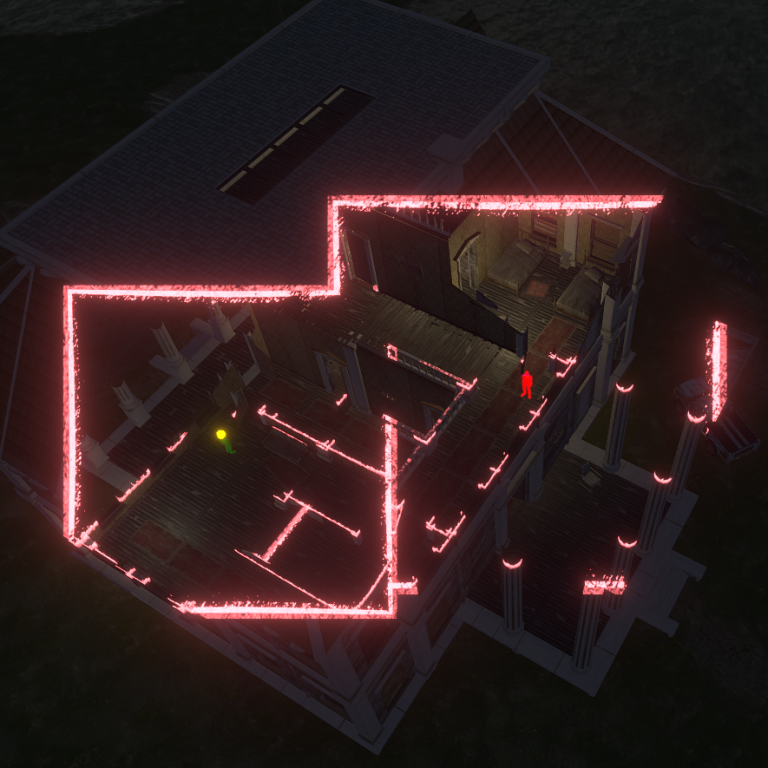

# [ART-10] 提供建築遮擋圓形透視

> 狀態：進行中

## 內文

### 需求
主角走到建築等遮擋物後方時，以主角為中心顯示圓形透視區域，保留位置、穿搭及動作的辨識。只在實際遮擋時出現，離開後恢復建築外觀。

### 來源
2026-10-11 使用者追加：建築遮擋時需要圓形穿透顯示主角；氣球快遞過於簡略、海風不可見、操控與引導弱。參考資料至少超過五個來源，跨不同方向比較並形成自己的設計。

### 驗收條件
- [x] 查閱至少六個不同來源，比較透視、淡出與鏡頭避障的實際做法及取捨。
- [x] 在不同建築後方可看見圓形區域內的主角，建築其他部分及碰撞保持正常。
- [x] 離開遮擋區、換裝、改視窗大小、日夜及降低動態時，位置與顯示正常。
- [x] 主角前方或遠在主角後方的建築不錯誤透視，重新進入場景無殘留。
- [ ] 原生畫面驗證並保存遮擋前後截圖與短影片，局部測試與打包檢查通過。

### 測試流程
1. 原生視窗走到兩種建築後方，查看圓形透視、主角與碰撞。
2. 前後移動、換装、改視窗及切日夜，核對效果恢復與定位。
3. 重啟並執行局部測試、打包資源檢查。

---

# 跟其他票的關係
- Blocks：無
- Blocked by：無
- Related：ART-3、ART-7、ART-9

---

# 開始與研究

固定基準：a1fc7abaa91a5d9fdf6e2c7ca084f0dba0205985。來源比較與採用原因見 design/runtime/occlusion.md 與 design/runtime/balloon-delivery.md，未看影片不算已看。

## 研究圖例

官網靜態圖可看見建築內部與角色位置，並非圓形遮罩動態證據。只借鑑遮擋處仍能辨識角色的目的；Snapland 保留自己的建築配色與圓形局部透視。來源：https://shadercrew.com/assets/reveal.png。六種來源及取捨见研究文件。

---

# Commit-1

問題：角色走到建築後方時容易被完全遮住，外觀與位置難以辨認。

改動：加入以角色位置為中心的圓形透視，並依遮擋關係、視窗比例、日夜和降低動態控制效果。

驗收：原生審查涵蓋三組固定遮擋位置、日夜、降低動態、1600×900 resize 與離開後恢復；錄影與資源封裝驗收仍待完成。固定位置是驗收場景佈置，不代表玩家操作路線。

| 畫面證據 | 說明 |
| --- | --- |
| [遮擋日景](images/ART-10-cutaway-day.png) · [遮擋夜景](images/ART-10-cutaway-night.png) · [降低動態](images/ART-10-cutaway-reduced-motion.png) | 原生靜態畫面 |
| [右側小亭遮擋](images/ART-10-cutaway-right-kiosk.png) · [拱門遮擋](images/ART-10-arch-cutaway-day.png) | 固定審查視角畫面 |
| [1600×900 視窗](images/ART-10-arch-cutaway-resized-equipped.png) · [遮擋退出後](images/ART-10-arch-cutaway-clear.png) | 原生靜態畫面 |

程式交付：[Commit 886816a](https://github.com/deadline314/Snapland/commit/886816ad9a7d35b7702cce48a93e4fd052517bb8)（分支 `feature/island-first-park`；固定基準 `a1fc7abaa91a5d9fdf6e2c7ca084f0dba0205985`）。

### 最新輸出驗證
Windows輸出於Intel Arc B580原生GPU完成圖集、NPC、場景動畫與遮擋資源冒煙檢查，12款場景所需素材均載入，無ERROR；此檢查不代表真人試玩、完整換裝動作、每姿勢或試聽驗收。

### 程式與證據提交
分支：feature/island-first-park。更新至最新main後的本票提交：[63f423d](https://github.com/deadline314/Snapland/commit/63f423dfcabc62ede8a09ddb85e30d53165e27ad)。
