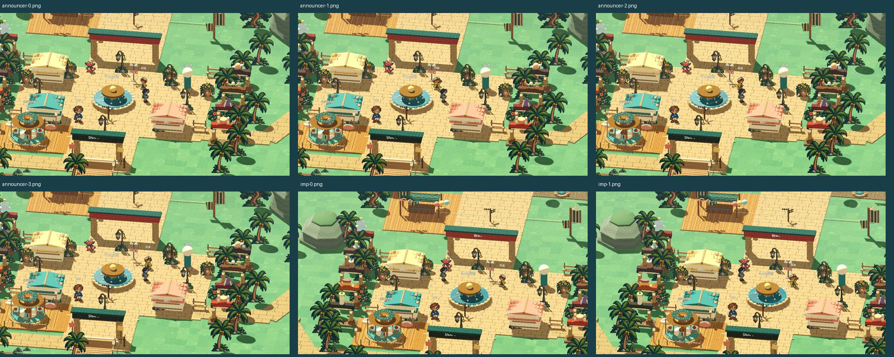
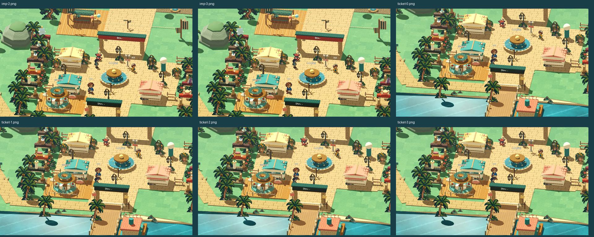

# [ART-12] 安排角色站位與個性動作

> 狀態：完成

## 內文

### 需求
把 NPC 安排在可見的活動空間，提供各自呼吸、服務姿勢、短距離走動或舞蹈等活動；依人物個性選動作，避免重疊和阻擋玩家。

### 問題—改動—驗收
問題：園區角色站位和活動不夠鮮明，互動標示也可能和角色分開。

改動：讓三位角色各有合適的待機或活動，並讓稱呼與互動位置跟著移動中的角色。

驗收：玩家可辨認每位角色並找到互動位置；角色腳底仍須穩穩接地，目前已發現接地問題，待 ART-15 修正後再驗收。

### 來源
2026-10-12 使用者要求：加大透視圈並考慮效果、NPC 避免遮擋且有個性動作、修正光影、自由切換四時段並融入拍貼或任務、小遊戲有時段布景。研究需超過五個來源，來源與已看過的截圖一同附票。

### 驗收條件
- [x] 至少六個來源比較角色活動、待機、道具與動線，記錄取捨。
- [x] 原生畫面可辨認三位角色與各自四格活動，移動中的稱呼及互動位置跟隨角色。
- [x] 對話／選單暫停與降低動態設定能同步停止活動並恢復基準姿勢。
- [x] 角色腳底穩定接地、道具位置正確、活動不阻塞玩家通行；短片仍待腳底修正後檢查。
- [x] 原生活動短片及完整局部與打包驗證通過。

### 研究來源
已閱讀六個以上來源的文字內容；比較及實際取捨記錄於[NPC 站位與個性待機研究](../../design/runtime/npc-activity.md)。相關原始文件：[Godot AnimationPlayer](https://docs.godotengine.org/en/stable/classes/class_animationplayer.html)、[Godot AnimationTree](https://docs.godotengine.org/en/stable/tutorials/animation/animation_tree.html)、[Godot SpriteBase3D](https://docs.godotengine.org/en/stable/classes/class_spritebase3d.html)、[Godot NavigationAgent3D](https://docs.godotengine.org/en/stable/classes/class_navigationagent3d.html)、[Godot Navigation Regions](https://docs.godotengine.org/en/stable/tutorials/navigation/navigation_using_navigationregions.html)、[Godot CharacterBody3D](https://docs.godotengine.org/en/stable/classes/class_characterbody3d.html)、[Godot Label3D](https://docs.godotengine.org/en/stable/classes/class_label3d.html)、[避免突發動作的可及性指引](https://gameaccessibilityguidelines.com/avoid-any-sudden-unexpected-movement-or-events/)、[Aseprite Tags](https://www.aseprite.org/docs/tags/)。未宣稱看過來源影片。

原生檢視：三位角色四格活動與名稱／互動位置跟隨均已看過；降低動態及模態暫停恢復已檢查。玩家指出腳底接地仍有問題，相關短片待修正後補看，故不以目前畫面宣稱腳步自然。

### 測試流程
1. 啟動獨立測試存檔，原生操作本票功能。
2. 檢查四時段、設定、重啟與不同視窗的相關行為。
3. 保存實際看過的截圖和短片，執行受影響局部驗證。

---

# 跟其他票的關係
- Blocks：無
- Blocked by：無
- Related：ART-7、ART-9、ART-11

---

# 開始

固定基準：c8202d69779497456ee55ae1ca051d21f7952dec。分支：feature/island-first-park。

# Commit-1

### 問題
NPC位置容易遮擋，角色缺少各自活動節奏。

### 改動
安排角色站位與短活動循環。

### 驗收
三位NPC各四格活動、路線限度、對話暫停與互動位置同步局部／原生fixture通過。腳底完整性由ART-15修正；短循環不是整套動畫。

### 測試結果
受影響的執行專案檢查19/19通過；Windows輸出以實際GPU檢查角色圖集、NPC活動、場景動畫與遮擋資源載入通過，無ERROR。

分支：feature/island-first-park。

### 截圖

[原生或研究證據：ART-12-announcer-01.png](images/ART-12-announcer-01.png)
[原生或研究證據：ART-12-announcer-02.png](images/ART-12-announcer-02.png)
[原生或研究證據：ART-12-imp-01.png](images/ART-12-imp-01.png)
[原生或研究證據：ART-12-imp-02.png](images/ART-12-imp-02.png)
[原生或研究證據：ART-12-ticket-01.png](images/ART-12-ticket-01.png)
[原生或研究證據：ART-12-ticket-02.png](images/ART-12-ticket-02.png)

### 程式與證據提交
分支：feature/island-first-park。更新至最新main後的本票提交：[449c328](https://github.com/deadline314/Snapland/commit/449c328b6bd41116b15e190b96ea90a0935d4539)。

# Commit — 2026-10-24 完成現行活動接地與通行驗收

本票保留三位角色的現有短活動與站位，補驗腳底修正後的原生畫面及短片。三個視角下角色自然活動，每個視角四張，沒有設定NPC姿勢、動作時間或行走位置；玩家只作取景定位。36次獨立實際影格腳底投影都在本地地面以上，12張原生圖及兩張聯絡頁已查看，票票位於攤位旁可見，小角在廣場側邊，阿浪於公開路線內活動。

| 項目 | 結果 |
|---|---|
| 原生自然活動與腳底 | 44.79秒、exit0／0ERROR；36次實際透明像素投影，最低離地約0.0077m，沒有低於地面；沒有啟用已拒收的拆腿候選 |
| 局部生命週期 | NPC活動0.53秒、世界活動3.42秒、正式原畫行走來源1.00秒，全部通過；對話路線凍結、招呼、降低動態、互動點跟隨及完整人物回退保持 |
| 通行與相機 | 地圖局部7.97秒通過，包含交談空間、阿浪全路線腳底、拱門／坡道與實際物理通行；原90秒上限不變 |
| 輸出資源 | 真正Linux輸出檔自身Main及十二款初始繪圖／資源21.48秒、exit0／0ERROR；此項不代表打包檔內完整NPC活動試玩 |
| 短片 | 實際時鐘、外部無聲15FPS、1280×720、670格44.666667秒，完整解碼；靜格與聯絡頁已查看，未冒稱連續觀看或試聽 |

這次完成的是本票站位、短活動、接地及通行範圍；票票／小角仍缺正式完整方向行走，主角與所有NPC整套動畫繼續由ART-16／17／18驗收，不能由本票結案推論全套動作完成。原畫及正式角色程式未因本次驗收變更。

[原生活動短片](images/ART-12-live-20261024-npc-live-v2-live.mp4) · [腳底逐次量測](images/ART-12-live-20261024-npc-live-v2-feet.json) · [範圍與來源](images/ART-12-live-20261024-verification.json) · [局部結果](images/ART-12-live-20261024-npc-checks-results.json) · [取景／量測來源](images/ART-12-live-20261024-sources.zip)。
