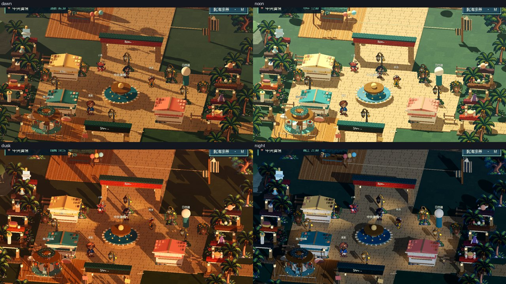
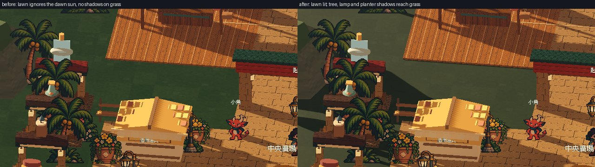
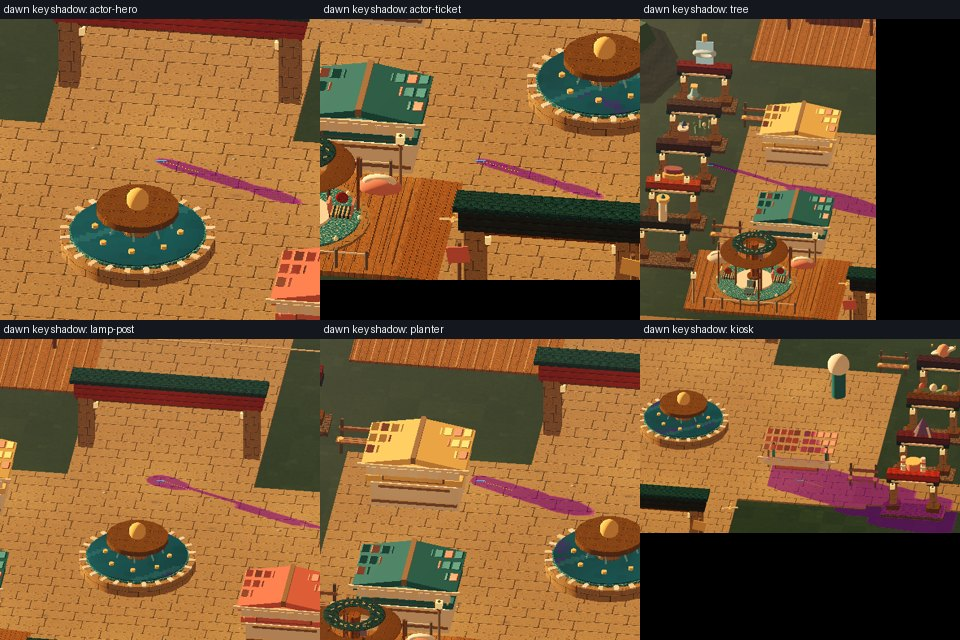
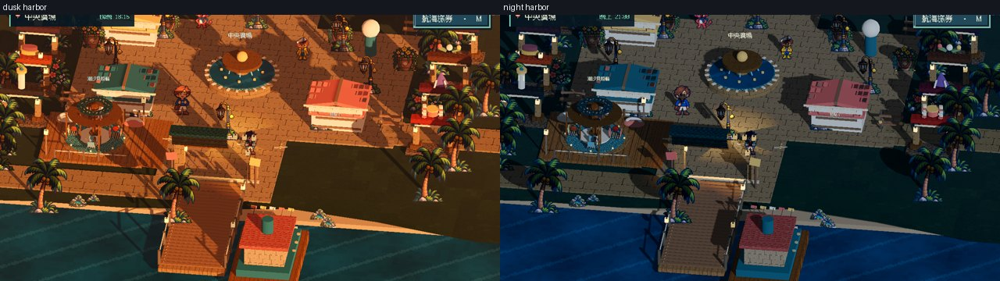

# [ART-13] 統一時段光源與遊戲布景

> 狀態：完成

## 內文

### 需求
檢查並修正島上光影，投影方向與實際光源一致；四時段展現不同氛圍，小遊戲同步使用時段背景與光影，不影響操作目標辨識。

### 問題—改動—驗收
問題：園區與小遊戲的時段氛圍可能不一致，光影也容易讓玩家誤判方向或目標。

改動：讓四個時段在園區和十二款小遊戲中都能清楚辨認，同時保留易讀的遊戲目標。

驗收：玩家在每個時段都能看清操作目標，園區光源和影子方向一致；目前已檢視四時段與小遊戲畫面，完整光影及打包驗收仍待完成。

### 來源
2026-10-12 使用者要求：加大透視圈並考慮效果、NPC 避免遮擋且有個性動作、修正光影、自由切換四時段並融入拍貼或任務、小遊戲有時段布景。研究需超過五個來源，來源與已看過的截圖一同附票。

### 驗收條件
- [x] 至少六個來源比較太陽光、局部光源、像素角色與二維布景，記錄取捨。
- [x] 四時段島上光源與投影方向相符，角色、植栽及建築不出現明顯反向或漂浮影子。
- [x] 夜間燈具發光、日間受控，降低動態不關閉必要照明。
- [x] 十二款小遊戲的四時段背景已檢視；遊戲目標、提示與規則保持清楚。
- [x] 夜間燈具、所有角色／紙景受光效果的原生檢查、局部測試與打包驗證完成。

### 研究來源
已閱讀六個以上來源的文字內容；實際觀察、光照方向及預繪紙景的限制記錄於[四時段光源研究](../../design/runtime/daylight-lighting.md)。相關原始文件：[Godot DirectionalLight3D](https://docs.godotengine.org/en/stable/classes/class_directionallight3d.html)、[Godot 3D lights and shadows](https://docs.godotengine.org/en/stable/tutorials/3d/lights_and_shadows.html)、[Godot OmniLight3D](https://docs.godotengine.org/en/stable/classes/class_omnilight3d.html)、[Godot Light3D](https://docs.godotengine.org/en/stable/classes/class_light3d.html)、[Godot SpriteBase3D](https://docs.godotengine.org/en/stable/classes/class_spritebase3d.html)、[Godot Environment](https://docs.godotengine.org/en/stable/classes/class_environment.html)、[Godot 2D lights and shadows](https://docs.godotengine.org/en/stable/tutorials/2d/2d_lights_and_shadows.html)、[Octopath Traveler II 官方訪談](https://www.unrealengine.com/developer-interviews/octopath-traveler-ii-builds-a-bigger-bolder-world-in-its-stunning-hd-2d-style?lang=en-US)、[Yoshi's Crafted World 官方頁](https://www.nintendo.com/en-gb/Games/Nintendo-Switch-games/Yoshi-s-Crafted-World-1233953.html)。已讀頁面文字；未宣稱看過訪談影片。預繪紙景與 shader 色調不等於每個 sprite 都受物理光照。

原生畫面：四時段園區與十二款遊戲各四時段共 48 張截圖已保存；根工作階段檢視了全部三張小遊戲接觸表及園區四時段畫面。局部最終 integration 檢查單獨通過；此前一輪首格順序發現問題後已修正來源，目前未重跑整套 18 項檢查。套件尚待本機執行檔驗收。

### 測試流程
1. 啟動獨立測試存檔，原生操作本票功能。
2. 檢查四時段、設定、重啟與不同視窗的相關行為。
3. 保存實際看過的截圖和短片，執行受影響局部驗證。

---

# 跟其他票的關係
- Blocks：無
- Blocked by：無
- Related：MAIN-9、ART-3、ART-5、ART-9、ART-11

---

# 開始

固定基準：c8202d69779497456ee55ae1ca051d21f7952dec。分支：feature/island-first-park。

# Commit-1

### 問題
時段光源方向與布景缺少共同基準；部分材質未提交，乾淨匯入失敗。

### 改動
統一四時段光源與遊戲布景。

### 驗收
四時段與12款×4時段共48張原生布景已檢視；相關局部檢查通過。預繪紙景和像素陰影仍有限制，未勾選全場物理受光。

### 測試結果
受影響的執行專案檢查19/19通過；Windows輸出以實際GPU檢查角色圖集、NPC活動、場景動畫與遮擋資源載入通過，無ERROR。

分支：feature/island-first-park。

### 截圖

[原生或研究證據：ART-13-game01-dawn.png](images/ART-13-game01-dawn.png)
[原生或研究證據：ART-13-game01-dusk.png](images/ART-13-game01-dusk.png)
[原生或研究證據：ART-13-game01-night.png](images/ART-13-game01-night.png)
[原生或研究證據：ART-13-game01-noon.png](images/ART-13-game01-noon.png)
[原生或研究證據：ART-13-game02-dawn.png](images/ART-13-game02-dawn.png)
[原生或研究證據：ART-13-game02-dusk.png](images/ART-13-game02-dusk.png)
[原生或研究證據：ART-13-game02-night.png](images/ART-13-game02-night.png)
[原生或研究證據：ART-13-game02-noon.png](images/ART-13-game02-noon.png)
[原生或研究證據：ART-13-game03-dawn.png](images/ART-13-game03-dawn.png)
[原生或研究證據：ART-13-game03-dusk.png](images/ART-13-game03-dusk.png)
[原生或研究證據：ART-13-game03-night.png](images/ART-13-game03-night.png)
[原生或研究證據：ART-13-game03-noon.png](images/ART-13-game03-noon.png)
[原生或研究證據：ART-13-game04-dawn.png](images/ART-13-game04-dawn.png)
[原生或研究證據：ART-13-game04-dusk.png](images/ART-13-game04-dusk.png)
[原生或研究證據：ART-13-game04-night.png](images/ART-13-game04-night.png)
[原生或研究證據：ART-13-game04-noon.png](images/ART-13-game04-noon.png)
[原生或研究證據：ART-13-game05-dawn.png](images/ART-13-game05-dawn.png)
[原生或研究證據：ART-13-game05-dusk.png](images/ART-13-game05-dusk.png)
[原生或研究證據：ART-13-game05-night.png](images/ART-13-game05-night.png)
[原生或研究證據：ART-13-game05-noon.png](images/ART-13-game05-noon.png)
[原生或研究證據：ART-13-game06-dawn.png](images/ART-13-game06-dawn.png)
[原生或研究證據：ART-13-game06-dusk.png](images/ART-13-game06-dusk.png)
[原生或研究證據：ART-13-game06-night.png](images/ART-13-game06-night.png)
[原生或研究證據：ART-13-game06-noon.png](images/ART-13-game06-noon.png)
[原生或研究證據：ART-13-game07-dawn.png](images/ART-13-game07-dawn.png)
[原生或研究證據：ART-13-game07-dusk.png](images/ART-13-game07-dusk.png)
[原生或研究證據：ART-13-game07-night.png](images/ART-13-game07-night.png)
[原生或研究證據：ART-13-game07-noon.png](images/ART-13-game07-noon.png)
[原生或研究證據：ART-13-game08-dawn.png](images/ART-13-game08-dawn.png)
[原生或研究證據：ART-13-game08-dusk.png](images/ART-13-game08-dusk.png)
[原生或研究證據：ART-13-game08-night.png](images/ART-13-game08-night.png)
[原生或研究證據：ART-13-game08-noon.png](images/ART-13-game08-noon.png)
[原生或研究證據：ART-13-game09-dawn.png](images/ART-13-game09-dawn.png)
[原生或研究證據：ART-13-game09-dusk.png](images/ART-13-game09-dusk.png)
[原生或研究證據：ART-13-game09-night.png](images/ART-13-game09-night.png)
[原生或研究證據：ART-13-game09-noon.png](images/ART-13-game09-noon.png)
[原生或研究證據：ART-13-game10-dawn.png](images/ART-13-game10-dawn.png)
[原生或研究證據：ART-13-game10-dusk.png](images/ART-13-game10-dusk.png)
[原生或研究證據：ART-13-game10-night.png](images/ART-13-game10-night.png)
[原生或研究證據：ART-13-game10-noon.png](images/ART-13-game10-noon.png)
[原生或研究證據：ART-13-game11-dawn.png](images/ART-13-game11-dawn.png)
[原生或研究證據：ART-13-game11-dusk.png](images/ART-13-game11-dusk.png)
[原生或研究證據：ART-13-game11-night.png](images/ART-13-game11-night.png)
[原生或研究證據：ART-13-game11-noon.png](images/ART-13-game11-noon.png)
[原生或研究證據：ART-13-game12-dawn.png](images/ART-13-game12-dawn.png)
[原生或研究證據：ART-13-game12-dusk.png](images/ART-13-game12-dusk.png)
[原生或研究證據：ART-13-game12-night.png](images/ART-13-game12-night.png)
[原生或研究證據：ART-13-game12-noon.png](images/ART-13-game12-noon.png)
[原生或研究證據：ART-13-world-dawn.png](images/ART-13-world-dawn.png)
[原生或研究證據：ART-13-world-dusk.png](images/ART-13-world-dusk.png)
[原生或研究證據：ART-13-world-night.png](images/ART-13-world-night.png)
[原生或研究證據：ART-13-world-noon.png](images/ART-13-world-noon.png)

### 程式與證據提交
分支：feature/island-first-park。更新至最新main後的本票提交：[e61dd4a](https://github.com/deadline314/Snapland/commit/e61dd4ab4f228853df43f449b0bcb7dcb8623d1e)。

# Commit — 2026-10-23 量測投影方向並修正草地與紙景影子

固定開始 SHA：`2e95cc6`；分支：`work/occlusion-light`。

## 問題

逐一量測每個物件的影子後發現三個問題：
- 整片草地不受太陽光：草地網格的正面朝下，所以樹、角色、建築的影子一落到草地就消失；凌晨時樹幹影子要到 55 像素外的石板才出現，看起來像漂浮的樹冠影子。
- 廣場的燈柱、花盆、灌木是畫上去的立牌，完全沒有影子，旁邊的樹和角色卻有長影子。
- 凌晨路燈太弱，地面光圈只亮 1～5 個亮度單位，看起來像沒開。

## 改動

- 草地改為正面朝上並接受日光；同時把草地底色調暗約一半，中午仍是原本的深綠，影子能清楚落在草地上。
- 燈柱、花盆、灌木各加上依原畫輪廓量出的隱形投影體（燈桿、燈頭、底座／盆身、花叢／樹叢），不擋路、不顯示，只投影。
- 凌晨路燈調為介於夜晚與中午之間的亮度；中午仍全關。

## 驗收

原生量測一次只讓一個物件投影，拍「無影－有影－無影」三張，只算兩張無影畫面完全相同的像素（排除水面、旗子動畫），再取與底部相連的影子區塊，比較影子方向與實際光源方向。

| 項目 | 結果 |
|---|---|
| 主角、票票、小角、阿浪、樹、燈柱、花盆、灌木、亭子 × 四時段 | 36／36 通過；影子從底部開始，方向與太陽／月光一致（夾角餘弦 0.78～1.00） |
| 路燈投影（傍晚、晚上） | 在燈光範圍內的角色影子背離燈光；超出燈光七成範圍者不要求 |
| 燈光 | 凌晨光圈 +2.6～11.7、傍晚 +4.0～21.4、晚上 +10.2～47.2 亮度；中午 0 盞亮；降低動態下晚上光圈與太陽影子不變 |
| 日光局部測試 | 通過；新增草地每個三角形朝上（舊順序反例被拒絕）、三種紙景投影體不懸空也不加碰撞 |
| 受影響 17 組 Godot 局部測試／Python 147 項／設計 5 範圍 | 全部通過，0 ERROR |
| Linux 輸出 | 釘選範本匯入、輸出 0 ERROR；輸出檔自身啟動與關閉 exit 0、0 ERROR（不是在輸出檔內重跑量測） |

只有離玩家最近兩盞燈投影是既有效能取捨，已記錄；立牌上畫好的明暗不會隨太陽旋轉。十二款小遊戲四時段背景沿用先前檢視，這次沒有重拍。Godot 4.7.2 Compatibility、Xvfb 上的 llvmpipe 軟體繪製，腳本送出實際方向鍵；不是 GPU 硬體、Windows 或真人試玩。

[逐案量測](images/ART-13-lighting-20261023-verification.json) · [輸出紀錄](images/ART-13-lighting-20261023-linux-build.json) · [研究與決策](../../design/runtime/daylight-lighting.md)
