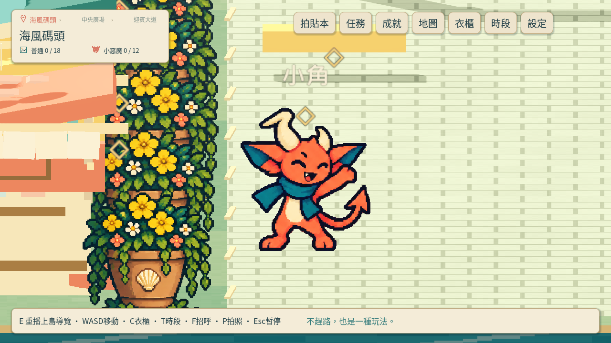
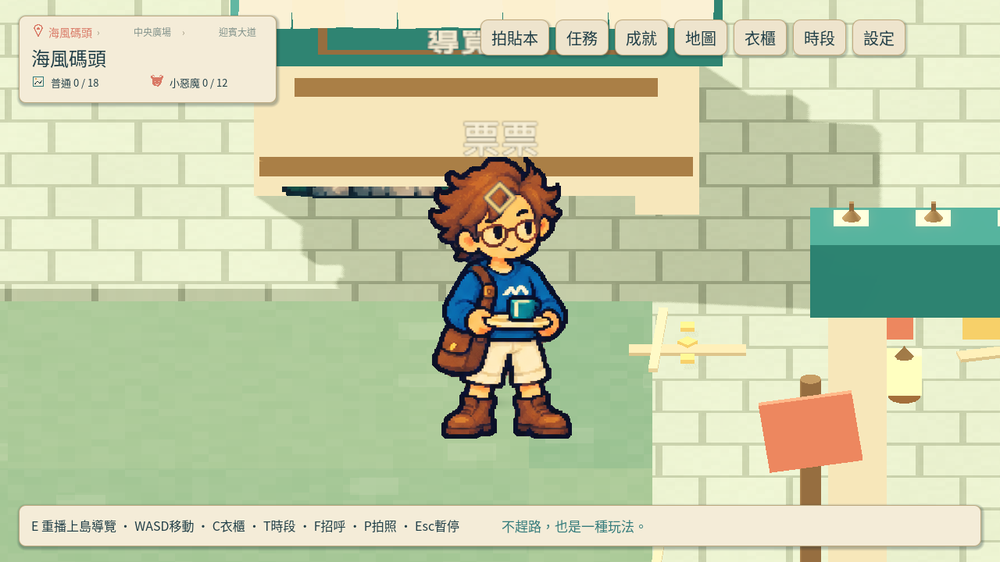
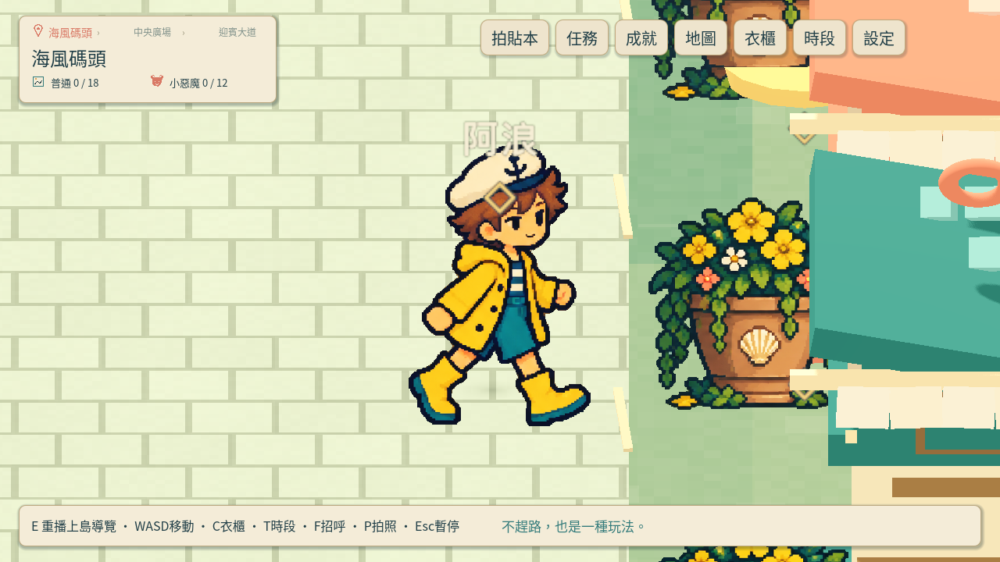
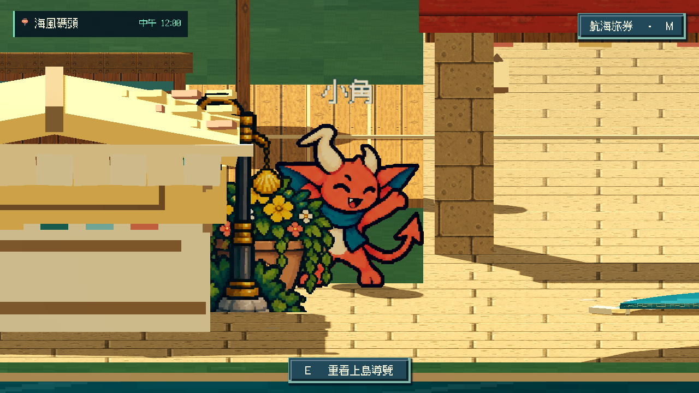
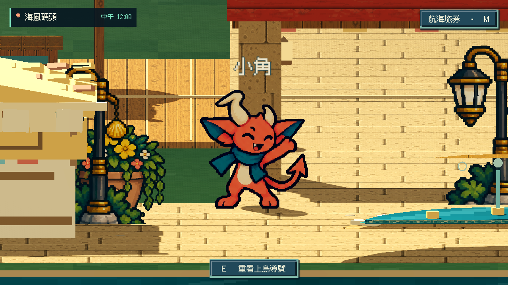
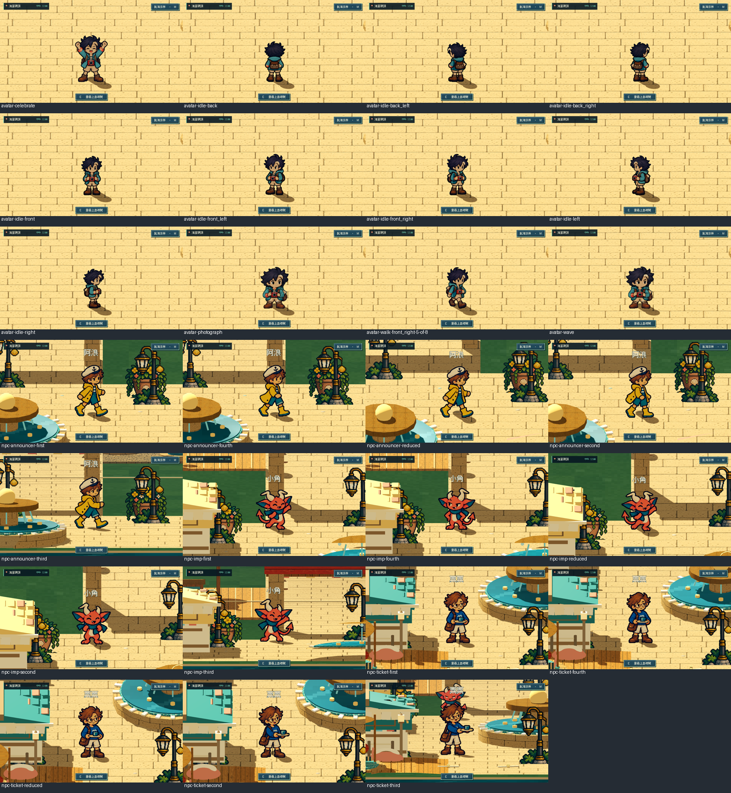

# [ART-15] 修正角色裁切與完整性檢查

> 狀態：完成

## 內文

### 需求
修正小角腳底被地面截斷，檢查角色原圖、裁切、部件及原生顯示完整性；各方向、動作、視窗與鏡頭都需保留完整身體。

### 來源
2026-10-12 使用者查看小角原生畫面指出腳底裁切，並要求增加動畫幀數，改善幾張圖片輪播感、先查閱業界實例，以較高標準製作；AI 圖像需正確檢測與修正一致性問題。

### 驗收條件
- [x] 原生小角及其他角色完整顯示頭、四肢、衣帽與腳底，接地自然且沒有穿透地面。
- [x] 來源影格、輸出部件的完整性與透明邊距有可執行的檢查，失敗會指出角色與影格位置。
- [x] 實際看過的修正前後截圖、不同鏡頭／方向／動作驗證與打包驗證附票。

### 測試流程
1. 使用獨立存檔檢查完整角色、各動作及八方向。
2. 比較原圖、分層與原生鏡頭；查看正常速度、慢放及逐影格對照。
3. 保存實際看過的證據，執行相關局部與打包驗證。

---

# 跟其他票的關係
- Blocks：無
- Blocked by：無
- Related：ART-7、ART-12、ART-14、ART-16

---

# 開始

固定基準：2678e7d1640fbf62e08f032019263ec39891ee74。分支：feature/island-first-park。

# Commit-1

### 問題
小角腳掌遭地板截斷；步態來源相鄰姿勢的切圖邊界也有一列錯誤。降低動態時 NPC 圖片尺寸不同，會改變接地；售票員在草地／抬高步道交界還會被截掉鞋尖。

### 改動
保留完整角色外觀與透明邊距，依實際地表和鏡頭角度對齊腳底。降低動態維持共用畫布與腳底位置；售票員全身站在同一地面高度，互動位置跟著調整。

### 驗收
主 Session 實際看過小角修正全身與三位角色降低動態畫面，售票員鞋尖完整。原生 fixture 檢查27張圖：三位 NPC 各四姿勢及三種鏡頭角度、主角八方向與動作、三位NPC降低動態與恢復；這是畫面檢查，不是玩家試玩。完整輪廓、共用腳底、來源區域邊距及降低動態局部測試通過。

### 測試結果
- 相關執行專案檢查19/19通過；新增站位完整寬度地表檢查通過。
- 原生全身fixture：27張截圖、降低動態與恢復檢查通過，無ERROR。
- 分支：feature/island-first-park。固定基準：[2678e7d](https://github.com/deadline314/Snapland/commit/2678e7d1640fbf62e08f032019263ec39891ee74)。

### 截圖

Windows 輸出以 Intel Arc B580 原生 GPU 檢查角色、NPC、場景動畫與遮擋素材載入通過；這是打包冒煙檢查，不是輸出版本完整逐姿勢畫面驗收。

### 程式與證據提交
分支：feature/island-first-park。更新至最新main後的本票提交：[95a2d02](https://github.com/deadline314/Snapland/commit/95a2d027e8743f71acabe0f369dc2d0ffb3e5943)。

# 2026-10-20 重新驗收並結案

本輪重新看圖發現舊檢查漏掉花台遮住小角左側手腳，四個姿勢及降低動態有約7.9%–16.1%人物像素被覆蓋。小角改站旁邊開放空間，任務位置一起跟隨，深度、人物大小、來源與場景花台保留。新增實際渲染對照，舊位置反例確實退出失敗；直接啟動新的完整性檢視也只寫本次獨立存檔旁的圖，不覆蓋舊證據。

800×450、1280×720、1920×1080各27個原生案例及獨立PCK27個案例，人物可見範圍均沒有被覆蓋；保留完整來源、足底、材質、鏡頭、降低動態及恢復檢查。四個受影響局部套件通過。正常20FPS影片9.6秒、四分之一速度37秒，模型／影片時間比例實測1.0／0.25；實際看過每四分之一模型秒的70張全身抽格及16張實際呈現的不同姿勢，沒有把抽格寫成完整連續播放或真人操作。本票按完整性範圍結案。

[六方文字比較及方法](../../design/runtime/sprite-rendered-clearance.md) · [完整驗收範圍／雜湊](images/ART-15-clearance-20261020-verification.json) · [正常速度短片](images/ART-15-clearance-20261020-motion-normal-play.mp4) · [真正四分之一速度](images/ART-15-clearance-20261020-motion-quarter-play.mp4)。PCK為Windows Desktop預設匯出的資源包，在Linux Compatibility實際播放，沒有宣稱Windows EXE或聽感驗收。

