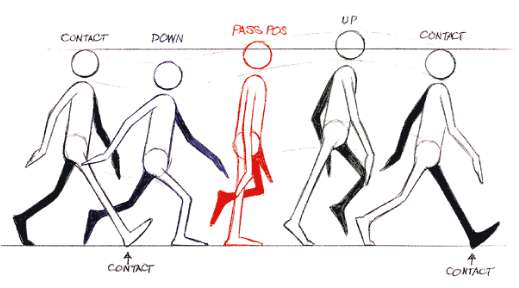

# [ART-16] 提高角色動畫流暢與一致性

> 狀態：進行中

## 內文

### 需求
改善圖片輪播感，提高主角與NPC動作的中間姿勢、重心、跨步、擺臂、銜接及表情；採較高標準並保持角色身份與像素風格。

### 來源
2026-10-12 使用者查看小角原生畫面指出腳底裁切，並要求增加動畫幀數，改善幾張圖片輪播感、先查閱業界實例，以較高標準製作；AI 圖像需正確檢測與修正一致性問題。

### 驗收條件
- [x] 至少六個不同來源比較逐幀、骨架插值與立體烘焙，記錄實際觀察、採用理由及參考圖。
- [ ] 主角八方向與NPC動作有足夠且有意義的過渡，連續播放沒有明顯輪播、姿態跳變或錯誤淡化重影。
- [ ] 髮束、臉、相機、包袋、服裝、部件比例及完整身體在動作中一致，停走、轉向及換装正常。
- [ ] 原生正常速度與慢放短片、姿勢／部件對照及局部性能、降低動態與打包驗證附票。

### Research
已閱讀並比較 Aseprite 的[動畫時間軸](https://www.aseprite.org/docs/animation)與[洋蔥皮](https://www.aseprite.org/docs/onion-skinning/)、Pixel Joint 的[eishiya 步態回饋](https://pixeljoint.com/forum/forum_posts.asp?PID=215709&TID=25611)、Raymond Schlitter 的[步態示範](https://www.slynyrd.com/blog/2020/1/23/pixelblog-25-motion-cycles)、[UNM 四個步態姿勢課程](https://swardson.com/unm/animation1/mod13-walkcycle.php)、Godot 的[2D骨架](https://docs.godotengine.org/en/4.7/tutorials/animation/2d_skeletons.html)與[Sprite3D](https://docs.godotengine.org/en/4.7/classes/class_sprite3d.html)、Spine 的[權重](https://us.esotericsoftware.com/spine-weights)、[IK](https://esotericsoftware.com/spine-ik-constraints)與[關鍵影格插值](https://en.esotericsoftware.com/spine-graph)，以及 Motion Twin 的[Dead Cells 3D烘焙流程](https://www.gamedeveloper.com/production/art-design-deep-dive-using-a-3d-pipeline-for-2d-animation-in-i-dead-cells-i-)。共 11 個來源頁、7 個網站；逐項觀察與採用／不採用理由見[動畫品質研究](../../design/runtime/animation-quality.md)。

步態示意圖：

此圖由 eishiya 貼於 Pixel Joint 討論；圖上來源指向 Martin Sammut，但原始繪者與出版來源未能獨立確認。僅作步態姿勢研究參考，不作遊戲素材。

### 測試流程
1. 使用獨立存檔檢查完整角色、各動作及八方向。
2. 比較原圖、分層與原生鏡頭；查看正常速度、慢放及逐影格對照。
3. 保存實際看過的證據，執行相關局部與打包驗證。

---

# 跟其他票的關係
- Blocks：無
- Blocked by：無
- Related：ART-9、ART-12、ART-14、ART-15

---

# 開始

固定基準：2678e7d1640fbf62e08f032019263ec39891ee74。分支：feature/island-first-park。

# Commit-1

### 問題
增加影格數沒有解決步態銜接；兩次完整圖集試作順序仍不自然。拆件骨架的腿部比例、膝蓋接縫與鞋子旋轉被使用者明確否定。

### 改動
撤回不合格骨架試作，繼續使用認可的完整角色圖。保留生成來源與失敗原因供審閱，後續需先驗收完整跨步。較高影格數的播放能力已補齊，並不代表較高品質素材完成。完整待機与換裝分層缺口另由ART-17／ART-18追蹤。

### 驗收
主 Session 實際檢視正常／慢放與全身畫面後拒收試作；數值測試不作合格依據。8／16格選擇、負相位、循環邊界與安全預設的局部測試通過；現有素材仍是八方向各八格。流暢度和整套動作驗收保持未勾。

### 測試結果
- 8／16格播放局部測試通過，主 Session 獨立複核。
- 不合格拆件圖、控制器及測試已退出遊戲；生成說明保存在研究文件。
- 分支：feature/island-first-park。固定基準：[2678e7d](https://github.com/deadline314/Snapland/commit/2678e7d1640fbf62e08f032019263ec39891ee74)。

### 失敗證據
[不合格原生試作（僅供追溯）](images/ART-16-rejected-rig.png)。此試作沒有列為交付動畫。
