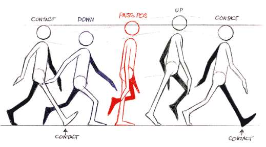
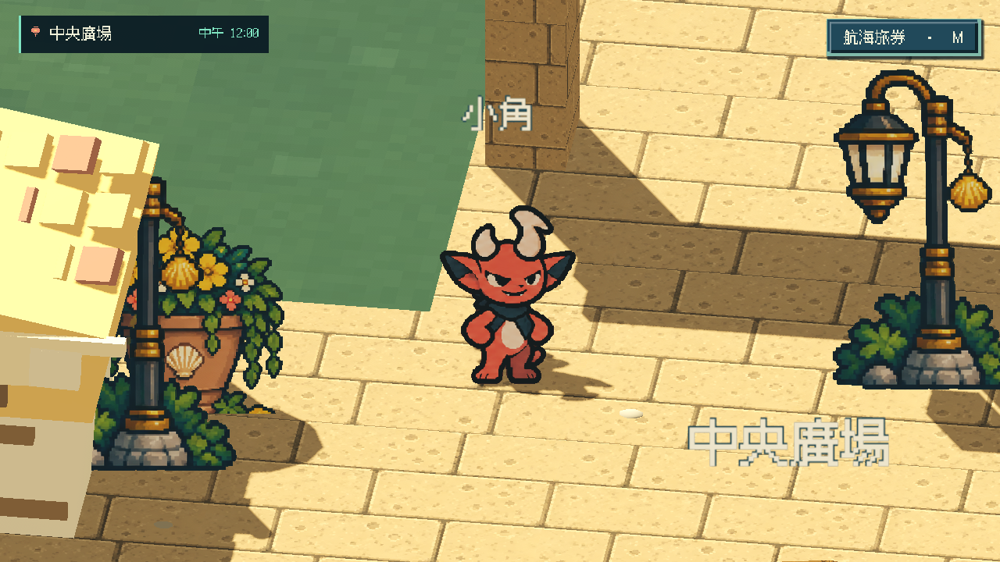
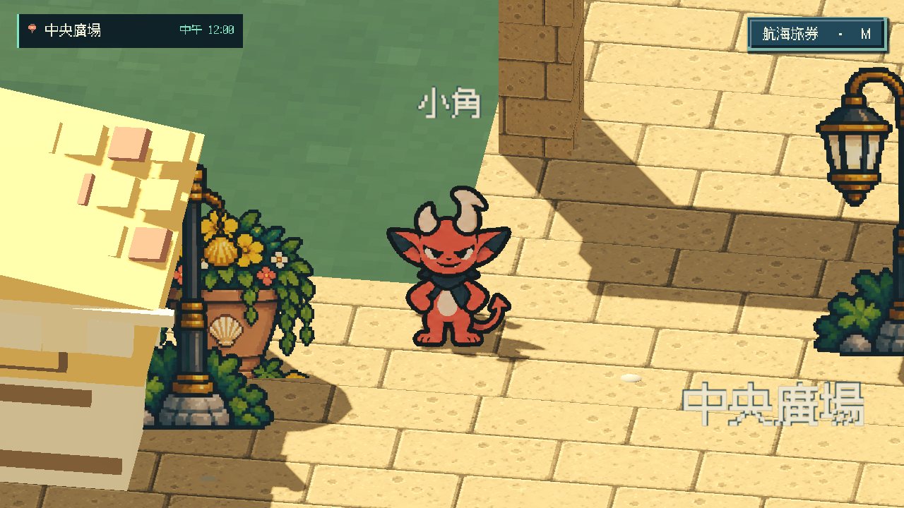
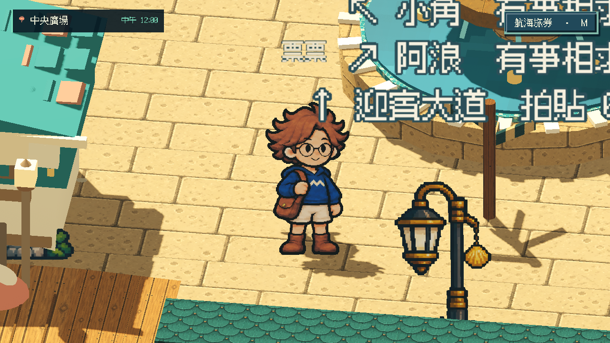
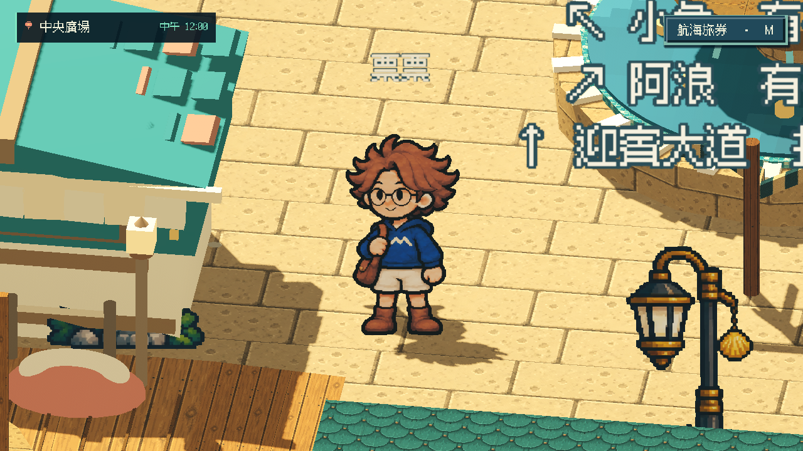
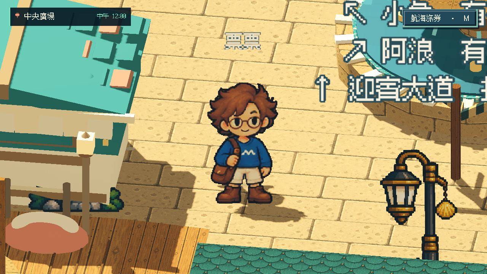
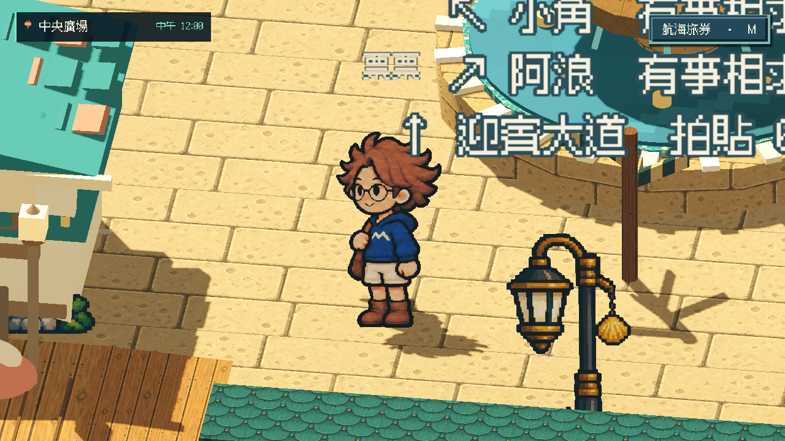
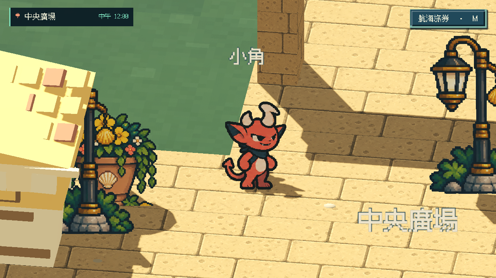

# [ART-16] 提高角色動畫流暢與一致性

> 狀態：進行中

## 內文

### 需求
改善圖片輪播感，提高主角與NPC動作的中間姿勢、重心、跨步、擺臂、銜接及表情；採較高標準並保持角色身份與像素風格。

### 來源
2026-10-12 使用者查看小角原生畫面指出腳底裁切，並要求增加動畫幀數，改善幾張圖片輪播感、先查閱業界實例，以較高標準製作；AI 圖像需正確檢測與修正一致性問題。

### 驗收條件
- [x] 至少六個不同來源比較逐幀、骨架插值與立體烘焙，記錄實際觀察、採用理由及參考圖。
- [ ] 主角八方向與NPC動作有足夠且有意義的過渡，連續播放沒有明顯輪播、姿態跳變或錯誤淡化重影。
- [ ] 髮束、臉、相機、包袋、服裝、部件比例及完整身體在動作中一致，停走、轉向及換装正常。
- [ ] 原生正常速度與慢放短片、姿勢／部件對照及局部性能、降低動態與打包驗證附票。

### Research
已閱讀並比較 Aseprite 的[動畫時間軸](https://www.aseprite.org/docs/animation)與[洋蔥皮](https://www.aseprite.org/docs/onion-skinning/)、Pixel Joint 的[eishiya 步態回饋](https://pixeljoint.com/forum/forum_posts.asp?PID=215709&TID=25611)、Raymond Schlitter 的[步態示範](https://www.slynyrd.com/blog/2020/1/23/pixelblog-25-motion-cycles)、[UNM 四個步態姿勢課程](https://swardson.com/unm/animation1/mod13-walkcycle.php)、Godot 的[2D骨架](https://docs.godotengine.org/en/4.7/tutorials/animation/2d_skeletons.html)與[Sprite3D](https://docs.godotengine.org/en/4.7/classes/class_sprite3d.html)、Spine 的[權重](https://us.esotericsoftware.com/spine-weights)、[IK](https://esotericsoftware.com/spine-ik-constraints)與[關鍵影格插值](https://en.esotericsoftware.com/spine-graph)，以及 Motion Twin 的[Dead Cells 3D烘焙流程](https://www.gamedeveloper.com/production/art-design-deep-dive-using-a-3d-pipeline-for-2d-animation-in-i-dead-cells-i-)。共 11 個來源頁、7 個網站；逐項觀察與採用／不採用理由見[動畫品質研究](../../design/runtime/animation-quality.md)。

步態示意圖：

此圖由 eishiya 貼於 Pixel Joint 討論；圖上來源指向 Martin Sammut，但原始繪者與出版來源未能獨立確認。僅作步態姿勢研究參考，不作遊戲素材。

### 測試流程
1. 使用獨立存檔檢查完整角色、各動作及八方向。
2. 比較原圖、分層與原生鏡頭；查看正常速度、慢放及逐影格對照。
3. 保存實際看過的證據，執行相關局部與打包驗證。

---

# 跟其他票的關係
- Blocks：無
- Blocked by：無
- Related：ART-9、ART-12、ART-14、ART-15

---

# 開始

固定基準：2678e7d1640fbf62e08f032019263ec39891ee74。分支：feature/island-first-park。

# Commit-1

### 問題
增加影格數沒有解決步態銜接；兩次完整圖集試作順序仍不自然。拆件骨架的腿部比例、膝蓋接縫與鞋子旋轉被使用者明確否定。

### 改動
撤回不合格骨架試作，繼續使用認可的完整角色圖。保留生成來源與失敗原因供審閱，後續需先驗收完整跨步。較高影格數的播放能力已補齊，並不代表較高品質素材完成。完整待機与換裝分層缺口另由ART-17／ART-18追蹤。

### 驗收
主 Session 實際檢視正常／慢放與全身畫面後拒收試作；數值測試不作合格依據。8／16格選擇、負相位、循環邊界與安全預設的局部測試通過；現有素材仍是八方向各八格。流暢度和整套動作驗收保持未勾。

### 測試結果
- 8／16格播放局部測試通過，主 Session 獨立複核。
- 不合格拆件圖、控制器及測試已退出遊戲；生成說明保存在研究文件。
- 分支：feature/island-first-park。固定基準：[2678e7d](https://github.com/deadline314/Snapland/commit/2678e7d1640fbf62e08f032019263ec39891ee74)。

### 失敗證據
[不合格原生試作（僅供追溯）](images/ART-16-rejected-rig.png)。此試作沒有列為交付動畫。

### 程式與證據提交
分支：feature/island-first-park。更新至最新main後的本票提交：[12a7aa8](https://github.com/deadline314/Snapland/commit/12a7aa8072fdd075a3c31c9de411136dbb3e7366)。

# Commit — 2026-11-11 補上小角停步回正面收勢

## 內文

小角原本一停步就直接切回正面站姿。現在從左右兩側各經過四張完整收勢：雙腳落地、轉身、收手，再回到正面叉腰與原有待機。轉身期間人物根位置保持不動，站定後稍作停留才接個性小動作。

四份原畫先後修正手勢、尾巴前後順序與領巾垂片；第三版在原生畫面發現領巾缺口後，由第四版取代並重新錄製正常與慢速版本。八張收勢均為獨立完整姿勢，保留長短角、完整四肢與同側領巾；既有四位人物的行走、其他動作與換裝來源相同。

### 測試結果

| 項目 | 結果 |
|---|---|
| 來源與重建 | 新增左右各四張收勢，202 個區域通過；資料比對僅增加小角收勢，其他動作及衣物資料相同；Python 建置測試 4 項通過 |
| 受影響回歸 | 匯入、NPC 行走、素材庫、狀態、輪廓、正式世界及對話共 7 項通過；回正面資料的追加驗證與狀態檢查通過 |
| 正式世界 | 左右八張收勢可見腳底接地，根位置與互動位置保持穩定；暫停、中斷、對話及降低動態檢查通過 |
| 有限動作與容錯 | 播足最後姿勢才回正面；回正面資料型別／方向錯誤或誤用在循環動作時，各讀取途徑一致拒絕，其他待機仍可用 |
| 原生正常 | 298 格／30 FPS／9.933 秒；左右八張行走及八張收勢均觀察到，最後回到原站姿；exit 0、0 ERROR |
| 四分之一速度／重入 | 1131 格／30 FPS／37.700 秒；場景重建後觀察完整往返、兩側收勢及待機；exit 0、0 ERROR |
| 隔離 PCK | 與正式來源及動作內容相同，包內再次觀察兩側行走、收勢及待機；匯入、匯出及執行 exit 0、0 ERROR。以相同 Godot 執行，非獨立桌面執行檔 |

實際逐張檢視最終正常八張收勢，以及慢速近正面、末格和停止後待機；包內另核對收勢圖。第三版原生日誌與代表圖保留；新增測試曾因先推進時間、再檢查初始待機時間而失敗，調整測試順序後通過，沒有放寬原斷言。

Godot 4.7.2、Compatibility／llvmpipe、Dummy 音訊，固定離線錄影節拍不作即時性能結果。NPC 根沒有被檢視程式挪動；自動報告保留 `OBSERVATIONS_COMPLETE_VISUAL_PENDING`，逐張檢查不當作真人連續觀看、遊玩或試聽。整票維持進行中。

[正常速度影片](images/ART-16-imp-settle-20261111-normal.mp4) · [真實四分之一速度／重入](images/ART-16-imp-settle-20261111-quarter.mp4) · [結果、版本與指紋](images/ART-16-imp-settle-20261111-review.json) · [原生姿勢、測試、失敗與打包紀錄](images/ART-16-imp-settle-20261111-evidence.zip) · [四份原畫與完整提示](images/ART-16-imp-settle-20261111-sources.zip)。起始 SHA：`5a28e44`；分支：`codex/imp-authored-settle-20261111`。角色行為覆蓋與換裝依 ART-17、ART-18 原條件分別驗收。

# Commit — 2026-11-11 補上票票停步回正面收勢

## 內文

票票走到路線端點時原本直接切回正面待機。現在從左右兩側各經過四張完整站定與轉身姿勢，再回到原有站姿；人物根位置在收勢期間保持不動，原有招呼、遞票與個性待機繼續可用。

第一版末段雙腳過窄，原生檢視後重畫近正面與正面站距。第二版逐張核對完整四肢、眼鏡、髮型、短褲及右側斜背包，保留固定根點與共同行地面；沒有拆腿、鏡像或逐姿勢縮放。既有角色動作及換裝資料逐項相同，僅新增票票左右收勢。

### 測試結果

| 項目 | 結果 |
|---|---|
| 來源及重建 | 210 個來源區域檢查通過；5 項建置測試通過，含先失敗的缺少收勢反例與既有動作、衣物資料保留 |
| 受影響回歸 | 匯入、NPC 完整來源步行、巡路、素材庫、狀態及腳底接地共 6 項通過 |
| 原生正常 | 382 格／30 FPS／12.733 秒，左右各四張行走及收勢、82 個實際根位置與最後待機；exit 0、0 ERROR |
| 真實四分之一速度及重入 | 1525 格／30 FPS／50.833 秒；重建後再次觀察完整往返、八張收勢與待機；exit 0、0 ERROR |
| 降低動態及重入 | 54 格／30 FPS／1.800 秒，靜止完整人物及既有安全檢查通過；exit 0、0 ERROR |
| 隔離 PCK | 來源指紋一致，包內再觀察完整往返、左右八張收勢與待機；362 格／30 FPS／12.067 秒，匯入、輸出及原生程序均 exit 0、0 ERROR |

Godot 4.7.2、Windows Compatibility、Dummy 音訊。實際查看正常八張收勢、四分之一速度左右近正面與包內左向近正面；影片完成完整解碼檢查，不宣稱真人連續觀看、遊玩、試聽或即時性能。PCK 以相同引擎執行，不是獨立桌面執行檔。整票維持進行中。

[正常影片](images/ART-16-ticket-settle-20261111-normal.mp4) · [四分之一速度／重入](images/ART-16-ticket-settle-20261111-quarter.mp4) · [降低動態](images/ART-16-ticket-settle-20261111-reduced.mp4) · [PCK 播放](images/ART-16-ticket-settle-20261111-pack.mp4) · [完整結果與來源指紋](images/ART-16-ticket-settle-20261111-review.json) · [原生姿勢、測試、初版與封裝紀錄](images/ART-16-ticket-settle-20261111-evidence.zip) · [兩版原畫與完整提示](images/ART-16-ticket-settle-20261111-sources.zip)。起始 SHA：`28fb8f7`；分支：`codex/ticket-delivery-20261111`。

# Commit — 2026-11-12 銜接原地轉向與實際起步

## 內文

票票與小角原本從正面待機直接切成側向行走。現在左右各經過四張既有完整轉身姿勢，轉好才起步；轉身期間人物與互動位置不移動。三位 NPC 的收勢末端統一回到原有中立站姿，票票與小角起步首格亦保持相同外觀，避免頭部、衣著與站距在交接處跳變。沿用既有原畫，新增原畫數為零。

對話或暫停期間結束的起步回到站姿；恢復活動再重新轉身，不會站在原地踏步。招呼中斷、降低動態與破損動作來源均保留完整人物及安全回退。相同姿勢共用貼圖，沒有額外產生重複畫布。

### 測試結果

| 項目 | 結果 |
|---|---|
| 來源與重建 | 218 個區域通過，八方向主角與換裝資料保留；Python 局部 38 項通過 |
| 受影響引擎 | 匯入、NPC 行走、巡路、起步生命週期、素材庫、狀態、輪廓、世界活動、缺圖對話、對話暫停及腳底接地共 11 項通過 |
| 起步生命週期 | 暫停、對話、招呼中斷、重新設定、重新接步、降低動態及五類來源錯誤通過；貼圖身份、錨點及快取無重複增長 |
| 正常原生 | 票票 408 格／13.600 秒、小角 289 格／9.633 秒；各觀察左右八張起步、行走與收勢，起步最大根位置偏移 0 |
| 四分之一速度／重入 | 票票 1621 格／54.033 秒、小角 1227 格／40.900 秒，完整往返及最後待機通過 |
| 降低動態／重入 | 兩位維持完整靜止人物，原生檢查通過 |
| 隔離 PCK | 來源指紋一致；票票 388 格／12.933 秒、小角 289 格／9.633 秒，阿浪中立收勢另通過；匯入、輸出及十次原生執行均 exit 0、0 ERROR |

實際逐張檢視票票與小角正常左右八張起步，另檢視慢速、包內代表姿勢及阿浪中立末格。初版獨立正面圖的輪廓跳變已改正，前後對照與先失敗後通過的診斷均保存。六部影片完成完整解碼檢查。Godot 4.7.2、Windows Compatibility、Dummy 音訊、固定 30 FPS 錄影；不宣稱真人連續觀看、遊玩、試聽或即時性能。PCK 使用相同引擎執行。整票依原條件維持進行中。

[票票正常](images/ART-16-pivots-20261112-ticket-normal.mp4) · [票票慢速](images/ART-16-pivots-20261112-ticket-quarter.mp4) · [票票包內](images/ART-16-pivots-20261112-ticket-pack.mp4) · [小角正常](images/ART-16-pivots-20261112-imp-normal.mp4) · [小角慢速](images/ART-16-pivots-20261112-imp-quarter.mp4) · [小角包內](images/ART-16-pivots-20261112-imp-pack.mp4) · [結果及來源指紋](images/ART-16-pivots-20261112-review.json) · [姿勢、診斷與重現紀錄](images/ART-16-pivots-20261112-evidence.zip)。起始 SHA：`702825b`；分支：`codex/npc-departures-20261112`。

# Commit — 2026-11-12 複核並拒收步態候選

## 內文

阿浪八相位步態先後嘗試整張圖集參考、單張正式側面／正面參考，以及單張相反接觸姿勢，共三份候選。前兩份仍無法可靠交換接觸腳與近遠側擺臂；第三份亦沒有足夠的相反接觸與連續循環證據。三份均未採用，正式原畫、播放資料與已交付的起停功能保持相同。較多欄位、新檔名或單張姿勢不當作完整新步態。

三份圖實際檢視，透明通道、尺寸、來源及 SHA-256 已核對，封存內容可完整解壓。這是原畫研究結果，不是新增原生動畫或遊玩驗收；整票依原條件維持進行中。

[三份候選、完整提示、參考與指紋](images/ART-16-walk-study-20261112-candidates.zip)。來源使用內建圖像工具；詳見[動畫品質研究](../../design/runtime/animation-quality.md)。固定基準 `4cb87f5`；分支 `codex/announcer-walk-study-20261112`。
