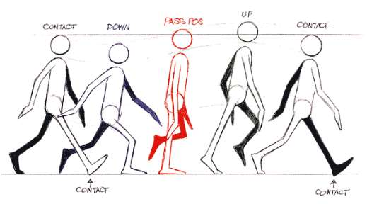

# [ART-16] 提高角色動畫流暢與一致性

> 狀態：完成

## 內文

### 需求
改善圖片輪播感，提高主角與NPC動作的中間姿勢、重心、跨步、擺臂、銜接及表情；採較高標準並保持角色身份與像素風格。

### 來源
2026-10-12 使用者查看小角原生畫面指出腳底裁切，並要求增加動畫幀數，改善幾張圖片輪播感、先查閱業界實例，以較高標準製作；AI 圖像需正確檢測與修正一致性問題。

### 驗收條件
- [x] 至少六個不同來源比較逐幀、骨架插值與立體烘焙，記錄實際觀察、採用理由及參考圖。
- [x] 主角八方向與NPC動作有足夠且有意義的過渡，連續播放沒有明顯輪播、姿態跳變或錯誤淡化重影。
- [x] 髮束、臉、相機、包袋、服裝、部件比例及完整身體在動作中一致，停走、轉向及換装正常。
- [x] 原生正常速度與慢放短片、姿勢／部件對照及局部性能、降低動態與打包驗證附票。

### Research
已閱讀並比較 Aseprite 的[動畫時間軸](https://www.aseprite.org/docs/animation)與[洋蔥皮](https://www.aseprite.org/docs/onion-skinning/)、Pixel Joint 的[eishiya 步態回饋](https://pixeljoint.com/forum/forum_posts.asp?PID=215709&TID=25611)、Raymond Schlitter 的[步態示範](https://www.slynyrd.com/blog/2020/1/23/pixelblog-25-motion-cycles)、[UNM 四個步態姿勢課程](https://swardson.com/unm/animation1/mod13-walkcycle.php)、Godot 的[2D骨架](https://docs.godotengine.org/en/4.7/tutorials/animation/2d_skeletons.html)與[Sprite3D](https://docs.godotengine.org/en/4.7/classes/class_sprite3d.html)、Spine 的[權重](https://us.esotericsoftware.com/spine-weights)、[IK](https://esotericsoftware.com/spine-ik-constraints)與[關鍵影格插值](https://en.esotericsoftware.com/spine-graph)，以及 Motion Twin 的[Dead Cells 3D烘焙流程](https://www.gamedeveloper.com/production/art-design-deep-dive-using-a-3d-pipeline-for-2d-animation-in-i-dead-cells-i-)。共 11 個來源頁、7 個網站；逐項觀察與採用／不採用理由見[動畫品質研究](../../design/runtime/animation-quality.md)。

步態示意圖：

此圖由 eishiya 貼於 Pixel Joint 討論；圖上來源指向 Martin Sammut，但原始繪者與出版來源未能獨立確認。僅作步態姿勢研究參考，不作遊戲素材。

### 測試流程
1. 使用獨立存檔檢查完整角色、各動作及八方向。
2. 比較原圖、分層與原生鏡頭；查看正常速度、慢放及逐影格對照。
3. 保存實際看過的證據，執行相關局部與打包驗證。

---

# 跟其他票的關係
- Blocks：無
- Blocked by：無
- Related：ART-9、ART-12、ART-14、ART-15

---

# 開始

固定基準：2678e7d1640fbf62e08f032019263ec39891ee74。分支：feature/island-first-park。

# Commit-1

### 問題
增加影格數沒有解決步態銜接；兩次完整圖集試作順序仍不自然。拆件骨架的腿部比例、膝蓋接縫與鞋子旋轉被使用者明確否定。

### 改動
撤回不合格骨架試作，繼續使用認可的完整角色圖。保留生成來源與失敗原因供審閱，後續需先驗收完整跨步。較高影格數的播放能力已補齊，並不代表較高品質素材完成。完整待機与換裝分層缺口另由ART-17／ART-18追蹤。

### 驗收
主 Session 實際檢視正常／慢放與全身畫面後拒收試作；數值測試不作合格依據。8／16格選擇、負相位、循環邊界與安全預設的局部測試通過；現有素材仍是八方向各八格。流暢度和整套動作驗收保持未勾。

### 測試結果
- 8／16格播放局部測試通過，主 Session 獨立複核。
- 不合格拆件圖、控制器及測試已退出遊戲；生成說明保存在研究文件。
- 分支：feature/island-first-park。固定基準：[2678e7d](https://github.com/deadline314/Snapland/commit/2678e7d1640fbf62e08f032019263ec39891ee74)。

### 失敗證據
[不合格原生試作（僅供追溯）](images/ART-16-rejected-rig.png)。此試作沒有列為交付動畫。

### 程式與證據提交
分支：feature/island-first-park。更新至最新main後的本票提交：[12a7aa8](https://github.com/deadline314/Snapland/commit/12a7aa8072fdd075a3c31c9de411136dbb3e7366)。

# Commit — 2026-11-11 補上小角停步回正面收勢

## 內文

小角原本一停步就直接切回正面站姿。現在從左右兩側各經過四張完整收勢：雙腳落地、轉身、收手，再回到正面叉腰與原有待機。轉身期間人物根位置保持不動，站定後稍作停留才接個性小動作。

四份原畫先後修正手勢、尾巴前後順序與領巾垂片；第三版在原生畫面發現領巾缺口後，由第四版取代並重新錄製正常與慢速版本。八張收勢均為獨立完整姿勢，保留長短角、完整四肢與同側領巾；既有四位人物的行走、其他動作與換裝來源相同。

### 測試結果

| 項目 | 結果 |
|---|---|
| 來源與重建 | 新增左右各四張收勢，202 個區域通過；資料比對僅增加小角收勢，其他動作及衣物資料相同；Python 建置測試 4 項通過 |
| 受影響回歸 | 匯入、NPC 行走、素材庫、狀態、輪廓、正式世界及對話共 7 項通過；回正面資料的追加驗證與狀態檢查通過 |
| 正式世界 | 左右八張收勢可見腳底接地，根位置與互動位置保持穩定；暫停、中斷、對話及降低動態檢查通過 |
| 有限動作與容錯 | 播足最後姿勢才回正面；回正面資料型別／方向錯誤或誤用在循環動作時，各讀取途徑一致拒絕，其他待機仍可用 |
| 原生正常 | 298 格／30 FPS／9.933 秒；左右八張行走及八張收勢均觀察到，最後回到原站姿；exit 0、0 ERROR |
| 四分之一速度／重入 | 1131 格／30 FPS／37.700 秒；場景重建後觀察完整往返、兩側收勢及待機；exit 0、0 ERROR |
| 隔離 PCK | 與正式來源及動作內容相同，包內再次觀察兩側行走、收勢及待機；匯入、匯出及執行 exit 0、0 ERROR。以相同 Godot 執行，非獨立桌面執行檔 |

實際逐張檢視最終正常八張收勢，以及慢速近正面、末格和停止後待機；包內另核對收勢圖。第三版原生日誌與代表圖保留；新增測試曾因先推進時間、再檢查初始待機時間而失敗，調整測試順序後通過，沒有放寬原斷言。

Godot 4.7.2、Compatibility／llvmpipe、Dummy 音訊，固定離線錄影節拍不作即時性能結果。NPC 根沒有被檢視程式挪動；自動報告保留 `OBSERVATIONS_COMPLETE_VISUAL_PENDING`，逐張檢查不當作真人連續觀看、遊玩或試聽。整票維持進行中。

右向停步後接近正面的收勢（畫面已精簡）
左向收勢保留領巾與尾巴（畫面已精簡）
回到原有完整待機（畫面已精簡）

正常速度影片 · 真實四分之一速度／重入 · 結果、版本與指紋 · 原生姿勢、測試、失敗與打包紀錄 · 四份原畫與完整提示。起始 SHA：`5a28e44`；分支：`codex/imp-authored-settle-20261111`。角色行為覆蓋與換裝依 ART-17、ART-18 原條件分別驗收。

# Commit — 2026-11-11 補上票票停步回正面收勢

## 內文

票票走到路線端點時原本直接切回正面待機。現在從左右兩側各經過四張完整站定與轉身姿勢，再回到原有站姿；人物根位置在收勢期間保持不動，原有招呼、遞票與個性待機繼續可用。

第一版末段雙腳過窄，原生檢視後重畫近正面與正面站距。第二版逐張核對完整四肢、眼鏡、髮型、短褲及右側斜背包，保留固定根點與共同行地面；沒有拆腿、鏡像或逐姿勢縮放。既有角色動作及換裝資料逐項相同，僅新增票票左右收勢。

### 測試結果

| 項目 | 結果 |
|---|---|
| 來源及重建 | 210 個來源區域檢查通過；5 項建置測試通過，含先失敗的缺少收勢反例與既有動作、衣物資料保留 |
| 受影響回歸 | 匯入、NPC 完整來源步行、巡路、素材庫、狀態及腳底接地共 6 項通過 |
| 原生正常 | 382 格／30 FPS／12.733 秒，左右各四張行走及收勢、82 個實際根位置與最後待機；exit 0、0 ERROR |
| 真實四分之一速度及重入 | 1525 格／30 FPS／50.833 秒；重建後再次觀察完整往返、八張收勢與待機；exit 0、0 ERROR |
| 降低動態及重入 | 54 格／30 FPS／1.800 秒，靜止完整人物及既有安全檢查通過；exit 0、0 ERROR |
| 隔離 PCK | 來源指紋一致，包內再觀察完整往返、左右八張收勢與待機；362 格／30 FPS／12.067 秒，匯入、輸出及原生程序均 exit 0、0 ERROR |

Godot 4.7.2、Windows Compatibility、Dummy 音訊。實際查看正常八張收勢、四分之一速度左右近正面與包內左向近正面；影片完成完整解碼檢查，不宣稱真人連續觀看、遊玩、試聽或即時性能。PCK 以相同引擎執行，不是獨立桌面執行檔。整票維持進行中。

右向收勢接近正面（畫面已精簡）
左向保留斜背包身份（畫面已精簡）
回到原有完整待機（畫面已精簡）

正常影片 · 四分之一速度／重入 · 降低動態 · PCK 播放 · 完整結果與來源指紋 · 原生姿勢、測試、初版與封裝紀錄 · 兩版原畫與完整提示。起始 SHA：`28fb8f7`；分支：`codex/ticket-delivery-20261111`。

# Commit — 2026-11-12 銜接原地轉向與實際起步

## 內文

票票與小角原本從正面待機直接切成側向行走。現在左右各經過四張既有完整轉身姿勢，轉好才起步；轉身期間人物與互動位置不移動。三位 NPC 的收勢末端統一回到原有中立站姿，票票與小角起步首格亦保持相同外觀，避免頭部、衣著與站距在交接處跳變。沿用既有原畫，新增原畫數為零。

對話或暫停期間結束的起步回到站姿；恢復活動再重新轉身，不會站在原地踏步。招呼中斷、降低動態與破損動作來源均保留完整人物及安全回退。相同姿勢共用貼圖，沒有額外產生重複畫布。

### 測試結果

| 項目 | 結果 |
|---|---|
| 來源與重建 | 218 個區域通過，八方向主角與換裝資料保留；Python 局部 38 項通過 |
| 受影響引擎 | 匯入、NPC 行走、巡路、起步生命週期、素材庫、狀態、輪廓、世界活動、缺圖對話、對話暫停及腳底接地共 11 項通過 |
| 起步生命週期 | 暫停、對話、招呼中斷、重新設定、重新接步、降低動態及五類來源錯誤通過；貼圖身份、錨點及快取無重複增長 |
| 正常原生 | 票票 408 格／13.600 秒、小角 289 格／9.633 秒；各觀察左右八張起步、行走與收勢，起步最大根位置偏移 0 |
| 四分之一速度／重入 | 票票 1621 格／54.033 秒、小角 1227 格／40.900 秒，完整往返及最後待機通過 |
| 降低動態／重入 | 兩位維持完整靜止人物，原生檢查通過 |
| 隔離 PCK | 來源指紋一致；票票 388 格／12.933 秒、小角 289 格／9.633 秒，阿浪中立收勢另通過；匯入、輸出及十次原生執行均 exit 0、0 ERROR |

實際逐張檢視票票與小角正常左右八張起步，另檢視慢速、包內代表姿勢及阿浪中立末格。初版獨立正面圖的輪廓跳變已改正，前後對照與先失敗後通過的診斷均保存。六部影片完成完整解碼檢查。Godot 4.7.2、Windows Compatibility、Dummy 音訊、固定 30 FPS 錄影；不宣稱真人連續觀看、遊玩、試聽或即時性能。PCK 使用相同引擎執行。整票依原條件維持進行中。

票票沿用原待機開始轉身（畫面已精簡）
票票左向轉身中段（畫面已精簡）
小角右向轉身中段（畫面已精簡）

票票正常 · 票票慢速 · 票票包內 · 小角正常 · 小角慢速 · 小角包內 · 結果及來源指紋 · 姿勢、診斷與重現紀錄。起始 SHA：`702825b`；分支：`codex/npc-departures-20261112`。

# Commit — 2026-11-12 複核並拒收步態候選

## 內文

阿浪八相位步態先後嘗試整張圖集參考、單張正式側面／正面參考，以及單張相反接觸姿勢，共三份候選。前兩份仍無法可靠交換接觸腳與近遠側擺臂；第三份亦沒有足夠的相反接觸與連續循環證據。三份均未採用，正式原畫、播放資料與已交付的起停功能保持相同。較多欄位、新檔名或單張姿勢不當作完整新步態。

三份圖實際檢視，透明通道、尺寸、來源及 SHA-256 已核對，封存內容可完整解壓。這是原畫研究結果，不是新增原生動畫或遊玩驗收；整票依原條件維持進行中。

三份候選、完整提示、參考與指紋。來源使用內建圖像工具；詳見[動畫品質研究](../../design/runtime/animation-quality.md)。固定基準 `4cb87f5`；分支 `codex/announcer-walk-study-20261112`。

# Commit — 2026-11-12 防止新原畫被舊圖覆蓋

## 內文

替換完整原畫、調整畫布或新增行走姿勢時，原有穩定化圖可能蓋住新來源，較長動作也可能遇到舊格數的錯誤。現在先核對當前姿勢與原畫指紋，符合才沿用原穩定化圖；缺少、損壞或不符時保留本次完整原姿勢。原有主角行走、待機與三位 NPC 的正式原畫保持相同。

另完成阿浪左右各八張完整步態候選與原生固定根比較；擺臂交替改善，但共享列地板下的鞋底仍差 0–5 原畫像素，統一比例後最多約 4 像素，故未採用。整票仍依原自然度、完整覆蓋及播放驗收維持進行中。

### 測試結果

- 替換來源的問題先重現，再驗證新原畫、相同路徑不同圖、較長動作、不同畫布、缺少／損壞資料與有上限的指紋快取；先前待機回歸失敗已修正，保留失敗紀錄。
- 受影響引擎回歸 16 組通過；最後索引修正後再跑素材庫、主角世界及缺少步態待機共 4 組通過。Python 局部 20 項與五類設計檢查通過。
- 主角八方向、NPC 兩側與非靜止四肢的固定畫布像素檢查通過。672 張原生匯出中核對 24 張既有 NPC 來源綁定；原 PNG 未修改。
- 空目錄 PCK 內的素材替換與像素穩定兩組檢查通過。原生包內正常 460 格／15.333 秒、四分之一速度 1,842 格／61.400 秒、降低動態 54 格／1.800 秒；均 30 FPS、exit 0、0 ERROR。
- 實際檢視包內右向跨步、停止站姿與慢速左向完整身形。Godot 4.7.2、AMD RX 9070 XT、Compatibility、Dummy 音訊；固定離線錄影不作即時性能、真人連續觀看、遊玩或試聽結果。

包內維持原有完整站姿（畫面已精簡）

包內正常 · 四分之一速度 · 降低動態 · 候選固定根比較 · 來源、格數與指紋 · 最終正常完整姿勢、慢速代表圖、失敗與重現紀錄 · 兩側候選、指南與完整提示。固定基準 `f9a05ae`；分支 `codex/source-bound-walks-20261112`。

# Commit — 2026-11-12 核對原畫尺寸與格式

## 內文

邊界複核另外重現：圖片按相同像素資料改變長寬排列後，仍可能套用舊圖。現在把圖片尺寸與格式一併核對；損壞的巢狀資料也會保留完整來源。原有角色圖、快取上限與播放時序相同。

### 測試結果

相同像素、不同圖像排列先重現錯套，再由原生隔離包確認不再錯用舊圖。世界移動、三位 NPC 來源行走、素材庫及輪廓共 5 組局部檢查通過；最後追加資料型別案例後，匯入與素材庫再跑 2 組通過。Python 像素與重建檢查 7 項通過；原生 672 張匯出再次核對 24 張來源尺寸、格式及指紋。

空目錄包內確認主角八方向／NPC 像素、素材替換及相同資料改變排列三項檢查；正常巡路錄影 460 格／15.333 秒、30 FPS，exit 0、0 ERROR。這是原生自動檢查與截圖，沒有真人遊玩或試聽；整票維持進行中。

包內沿用原有完整走姿（畫面已精簡）

來源、失敗重現、局部檢查與包內結果。固定基準 `d396e86`；分支 `codex/walk-source-layout-20261112`。

# Commit — 2026-11-17 防止錯誤錨點裁掉人物

## 內文

新原畫的圖片範圍和腳下定位即使各自合法，落到固定畫布時仍可能裁掉半個人物。現在會在接受姿勢前核對完整可見範圍；錯誤姿勢保留完整舊人物，並記錄具體角色與格位。衣物最後一格損壞也會保留整套原衣物，不在不同姿勢間混換。透明邊距與空白格維持原有行為。

### 測試結果

| 項目 | 結果 |
|---|---|
| 四邊裁切與衣物末格反例 | 各先失敗再通過；錯誤姿勢沒有貼圖或定位快取，衣物整套保留原角色 |
| 現有完整來源 | 50 組／294 格登錄序列可用；三款髮型完整回退、透明邊距與空白格通過 |
| 受影響引擎回歸 | 素材庫、主角、衣物整套、NPC 行走、起步生命週期、像素與影子輪廓共 7 組通過；exit 0、0 ERROR、各有實際完成行 |
| Python 局部 | 素材重建及隔離輸出共 11 項通過 |
| 原生／隔離 PCK | 匯入、輸出與靜態原生對照通過；開發版與最終包內畫面像素相同，exit 0、0 ERROR |
| 獨立審查 | 無須阻擋交付的發現；空白格相容性已另加回歸 |

實際檢視 1280×720 靜態原生對照：舊版右半身被截斷，新版保留完整頭髮、相機、手腳與既有完整招呼姿勢。Godot 4.7.2、Windows Compatibility、AMD Radeon RX 9070 XT、Dummy 音訊；PCK 由相同引擎執行，不是獨立 Windows 成品。這是容錯與靜態繪製驗證，不代表正常／慢放動畫自然度、真人遊玩、即時性能或試聽驗收。

本輪另閱讀六方文字，並以內建圖像工具製作四份阿浪步態候選。相反接觸與近側褲管／腿的連續關係仍不明確，單張亦無完整循環，四份皆未採用。尺寸、alpha、原圖、完整提示與指紋均保存；正式原畫與已批准格數保持原值。研究與共用接入流程見[原畫接入驗收](../../design/runtime/character-source-acceptance.md)。本票原有驗收條件維持未勾選，狀態仍為進行中。

原生對照：合法圖片與錯誤腳錨的裁切及完整人物回退（畫面已精簡）

結果與來源指紋 · 失敗、通過、原生與包內重現證據 · 四份未採用候選、原提示與參考。固定基準 `d7f3855`；分支 `codex/character-continuation-20261117`。

# Commit — 2026-11-17 複核八相位換腳與原生銜接

## 內文

二十份生成輸出逐步釐清阿浪左右各八張姿勢的近遠側褲口、腿與擺臂。早期只換手臂或鞋色的版本經獨立複核拒收；後續明暗、局部修色與頭部輪廓比較改善換腳辨識，十六張候選均保留完整人物並落在共同鞋底基線。

正常與真實四分之一速度的 Main 巡路已觀察左右十六張走姿、兩側起步與收勢。起停對照仍有頭髮輪廓與頭身、衣物比例跳變；試驗步距下每模擬秒只切換約四張姿勢，也不能證明改善輪播感。因此候選拒收，正式原畫、播放時序與巡路保持原值，原驗收條件維持未勾選。

### 測試結果

| 項目 | 結果 |
|---|---|
| 候選離線畫布 | 十六格實際人物底部均為 448；固定頭部相同，明列定位與局部修色後的頭部輪廓外來源相同；不替代正式腰部或自然度驗收 |
| 最終正常 Main | 460 格／30 FPS／15.333 秒，十六張走姿、左右起停及最後待機；exit 0、0 ERROR |
| 最終四分之一速度／重建 | 1,842 格／30 FPS／61.4 秒，重建後完整往返；exit 0、0 ERROR |
| 原有來源局部回歸 | 素材清單與像素共 15 項通過，原正式檔案逐項還原並核對指紋相同 |
| 影片與封存 | 四部試驗影片全段解碼通過；交付最終兩部，兩份證據包解壓與 CRC 通過 |

逐張查看正常全片的取樣對照、慢速代表姿勢及起停圖；不是真人連續觀看、遊玩、試聽或即時性能驗收。Godot 4.7.2、Windows Compatibility、AMD Radeon RX 9070 XT、Dummy 音訊；既有材質警告與低磁碟空間警告保留。所有研究使用獨立存檔，失敗程序另保存，沒有把退出碼 0 的 SCRIPT ERROR 算成通過。

未採用候選的原生右向換腳（畫面已精簡）
既有收勢顯示比例銜接差異（畫面已精簡）

[正常影片](images/ART-16-gait-20261117-normal.mp4) · [四分之一速度／重建](images/ART-16-gait-20261117-quarter.mp4) · [結果與指紋](images/ART-16-gait-20261117-review.json) · [原生姿勢、端點、慢速代表圖、失敗與重現紀錄](images/ART-16-gait-20261117-evidence.zip) · [二十份原件與完整提示](images/ART-16-gait-20261117-sources.zip)。研究及界線見[阿浪八相位原畫複核](../../design/runtime/announcer-walk-study-20261117.md)。固定基準 `63ab519`；分支 `codex/animation-source-20261117`。

# Commit — 2026-11-19 補上阿浪左右起步短步

## 內文

阿浪轉至側面後原本會直接切到跨步。現在先顯示一張完整的單腳承重姿勢，再接上行走，左右起步各新增一張。起步仍為 0.4 秒，左右原生巡路在起步期間均沒有根位移。

逐張比對四組候選與正式畫面後採用第四組。右向改善較明顯，左向肩部與腳步的位移仍可見。本次交付範圍為阿浪左右起步。

### 測試結果

| 項目 | 結果 |
|---|---|
| 素材與清單 | 220 個來源區域驗證通過，8 項 Python 回歸通過 |
| 行為回歸 | Godot 素材庫、三位 NPC 巡路與起步生命週期共 3 組通過。原有轉身共用畫布，每方向增加一張起步畫布。暫停、對話打斷、降低動態與損壞素材回退通過 |
| 原生正常與慢放 | 正常 460 格／30 FPS，四分之一速度重建場景 1,842 格／30 FPS。兩側各觀察 5 格起步、4 格行走、4 格收勢。影片全段解碼通過 |
| 降低動態與打包 | 重建 Main 後維持完整站姿。內嵌 Windows 測試執行檔觀察左右完整起步與停步，相關最終匯入、執行與輸出皆 exit 0、0 ERROR |
| 失敗重現 | 舊驗證器以固定 FPS 取格而漏判第五格，退出 1。改用實際逐格停留時間後重跑通過 |

Godot 4.7.2、Windows Compatibility、硬體繪製、Dummy 音訊。核對實際原生截圖、播放紀錄和影片可解碼性。真人連續觀看、試玩、試聽及即時效能驗收仍未納入本次範圍。

### 截圖

右向短步，前腳微抬（畫面已精簡）
左向四分之一速度的承重姿勢（畫面已精簡）
降低動態並重建場景後的站姿（畫面已精簡）

正常速度影片 · 四分之一速度／重建 · 原生截圖、候選、測試與打包證據 · [程式與素材提交](https://github.com/deadline314/Snapland/commit/a6858e844e36289e2b281f60ac01584874313834)。

# Commit — 2026-11-19 補上阿浪左向停步落腳

## 內文

阿浪左向走到端點時，懸空的後腳原本直接切進雙腳併攏。新增一張前腳承重、後腳收近的完整姿勢，再接側站和原有轉身。左向收勢共五格，右向共四格。收勢總時長為 0.4 秒。

以同一鏡頭拍攝緊鄰的最後走姿、落腳和側站。三張畫面的巡路根位置相同。離線另核對四張可能接入的左向走姿，加入過渡後，兩次切換中最大的全身、頭部、軀幹與下肢像素差都較小。

### 測試結果

| 項目 | 結果 |
|---|---|
| 素材及局部回歸 | 221 個來源區域、8 項 Python、3 組 Godot 測試通過。落腳來源損壞時會拒絕不完整收勢，左向起步仍可用 |
| 原生正常與慢放 | 正常 460 格、四分之一速度重建 1,842 格，皆為 30 FPS 且全段可解碼；兩側各五格起步，完整播放左五格及右四格收勢 |
| Windows 封裝 | 內嵌測試執行檔完成同一段巡路、左右起步、停步和回正面，匯入、輸出及執行 exit 0、0 ERROR |

Godot 4.7.2、Windows 硬體繪製、Dummy 音訊。確認原生逐格、回放紀錄及封裝，驗證範圍為阿浪停步銜接。

### 截圖

舊版最後一張左向走姿（畫面已精簡）
新增的承重落腳姿勢（畫面已精簡）
後腳收近並回到側站（畫面已精簡）

正常速度影片 · 四分之一速度與重入 · 原生對照與打包證據 · [程式與素材提交](https://github.com/deadline314/Snapland/commit/36410af65a347bd707b7166cfafacf80bac94bab)。

## Commit — 2026-11-19 加快首次穿雨背心

首次穿上雨背心仍會核對 185 格的原畫、衣料指紋及解碼安全。原畫直接使用原有的定位與裁切流程產生可校驗像素。共用同一原畫的舊慶祝姿勢只計算一次原畫指紋，完全相同的衣料也只解碼一次。各檔案仍各自驗證，衣料快取維持 12 張。

| 項目 | 結果 |
|---|---|
| 首次換裝同機比較 | 舊版 1,056／1,047 ms，新版 781／790 ms。中位數從 1,051 降至 786 ms，少 25.2%。前後都以隔離的新程序與存檔重跑 |
| 角色移動與記憶體 | 固定相同八方向腳本，測原裝、雨背心搭鮑伯頭與草帽，以及降低動態。衣裝驗證後建立的原畫 GPU 貼圖數從 61 降至 0，解碼衣料上限維持 4.62 MiB |
| 容錯與封裝 | 5 組 Godot、213 項 Python 與 5 個設計範圍通過。核對全部 185 格及共用指紋／檔案遭替換時的回退。Windows 內嵌執行檔以預設渲染器重驗八方向及三種設定 |

量測使用 Godot 4.7.2、Windows Forward+、AMD Radeon RX 9070 XT、1280×720 與實際畫面呈現時鐘。四輪順序為舊、新、新、舊，全程維持視窗焦點。此數據涵蓋單機局部換裝與移動。第一次封裝退出出現資源釋放診斷，驗證場景改為先釋放音訊與場景後重跑，最終為 0 ERROR、0 釋放診斷。[Godot 計量說明](https://docs.godotengine.org/en/4.7/classes/class_performance.html)

本票的正常、慢放、姿勢、降低動態與封裝證據，以及主角與 NPC 的接話和換裝影片，可從上述各段與 [ART-17 動畫接續](<[ART-17]製作角色完整動畫與個性待機.md>) 檢視。

Windows 封裝中的雨背心（畫面已精簡）

配對量測、封裝、回歸與原生截圖 · [程式提交](https://github.com/deadline314/Snapland/commit/cdb68782bd60be1e217437de57187c9e915191a1)。

## Commit — 2026-11-19 阿浪右向停步落腳

阿浪向右走到巡路端點時，先以近側靴承重，後腳再落到站定位，接著播完原有轉身。新增落腳姿勢 0.06 秒，整段仍為 0.4 秒。實際抓到巡路第 2 格、落腳、雙腳站定三張相鄰原生畫面，根位置全程相同。

| 項目 | 結果 |
|---|---|
| 原畫對照 | 核對帽徽、臉、雨衣、兩隻靴與腳底。實際進入姿勢的最大相鄰整體像素差異比例由 0.5321 降為 0.4532。四種可能走姿的最差差異亦下降，頭部、衣身及腿部各自核對 |
| 原生與封裝 | 正常、四分之一速度重入及 Windows 內嵌執行檔均看到左右各五張收勢，來源逐格相符。降低動態重入保持站姿。原生程序無引擎錯誤或退出資源殘留 |
| 回歸 | 237 個原畫區域、214 項 Python、五組相關 Godot 測試及五區設計檢查通過。雙向損壞落腳時取消不完整收勢，起步仍有完整來源 |
| 影片 | 正常 460 格、慢放 1,842 格，均為 1280×720／30 FPS，已完整解碼 |

兩次對照使用固定取景、獨立存檔及 Dummy 音訊。比例反映相鄰原畫的像素差異。整票的全角色連續動作與換裝一致性仍在驗收。

阿浪停前的右向步態（畫面已精簡）
阿浪右向承重落腳（畫面已精簡）
阿浪右向雙腳站定（畫面已精簡）

正常影片 · 四分之一速度與重入 · 來源、原生及封裝證據 · [程式提交](https://github.com/deadline314/Snapland/commit/529601b9d6fa27f69cd8f6e8f615688be6a75660)。

## Commit — 2026-11-19 主角左右起步

主角站定後沿目前方向開始走動時，若下一格步態已核對且有足夠銜接空間，先以一張低抬腳的全身姿勢過渡。起步素材長 0.08 秒，人物持續由原有物理邏輯移動，步距照實際位移累計。降低動態、缺圖、離地及方向中斷均回到原流程。

早期 0.1 秒原生驗證曾在左向起步後直接看到行走第 1 格。縮短後，正常、四分之一速度重入和 Windows 內嵌版各 6 案均接到第 0 格。補齊兩側衣料遮罩後，逐像素比對也確認雨背心、珊瑚外套、攝影機、臉和帽髮在可見上半身的合成一致。

| 項目 | 結果 |
|---|---|
| 相鄰姿勢 | 第 0 格路線的最大整身像素差異比例，左 0.3776 → 0.3440，右 0.4249 → 0.4152。確認雙側支撐腳和抬腳輪廓 |
| 原生與封裝 | 左右各涵蓋原裝、雨背心加草帽及動態鮑伯頭，起步時保留同一航向並持續移動。降低動態及重入通過 |
| 回歸 | 247 個原畫區域、201 個雨背心姿勢、7 組 Godot 測試、214 項 Python 及 5 區設計檢查通過 |
| 影片 | 正常 298 格，四分之一速度 1,077 格，均為 1280×720／30 FPS，完整解碼通過 |

錄影使用實際 A、D 輸入、固定取景及隔離存檔。後續仍需核對其餘方向的起步和連續轉向。

主角左向起步（畫面已精簡）
主角穿雨背心右向起步（畫面已精簡）
動態鮑伯頭左向起步（畫面已精簡）

正常影片 · 四分之一速度與重入 · 候選原畫、反例與封裝證據 · [程式提交](https://github.com/deadline314/Snapland/commit/1c025098c091bc5423923d32a0754da5200ba97f)。

## Commit — 2026-11-19 主角八方向起步

正面、背面及四個斜向各加一張全身起步姿勢，沿用左右起步的同向條件、步距和缺圖回退。每個方向只在已比對的下一張走姿及剩餘步距允許時播放。移動速度、角色位置和相機跟隨沿用原有物理邏輯。新圖保留同向中立的上半身，正面也保留玩家選用的表情。

| 項目 | 結果 |
|---|---|
| 素材與換裝 | 253 個區域、207 個雨背心姿勢。逐像素核對八方向不同表情、帽髮、相機及衣料的上半身合成 |
| 原生與封裝 | 正常、四分之一速度重入及 Windows 內嵌版各通過 24 案。八方向各有原裝、雨背心加草帽及動態鮑伯頭。起步時位置與步距持續更新，隨後畫面接到同向行走第 0 格 |
| 回歸 | 降低動態與重入、7 組 Godot 測試、214 項 Python、5 區設計檢查通過 |
| 影片 | 正常 1,085 格，四分之一速度 4,029 格，均為 1280×720／30 FPS，完整解碼通過 |

影片使用實際方向鍵輸入、固定取景及隔離存檔。跨方向轉向與整套角色自然度仍待驗收。

正面起步（畫面已精簡）
左後斜向起步（畫面已精簡）
穿雨背心左前斜向起步（畫面已精簡）

正常影片 · 四分之一速度與重入 · 原畫、測試及封裝證據 · [程式提交](https://github.com/deadline314/Snapland/commit/23306713ddf48586fefd3f8e263652e85f18877b)。

## Commit — 2026-11-19 折返時保留步態

玩家持續按相反方向時，人物會先減速再折返。四分之一速度曾在四個正向折返各插入六個物理更新的待機姿勢。現在保留已呈現的走姿及步距，直到移動足以切到新方向。停住、阻擋及離地仍依原有流程處理。

| 項目 | 結果 |
|---|---|
| 對照重播 | 七條路線以正常與四分之一速度各重播，798 筆位置間距、水平速度、接地和步距完全相同。四個慢速折返的待機更新各自從 6 降到 0，其餘測試路線的畫面序列相同 |
| 原生與封裝 | 正常、四分之一速度重入與 Windows 內嵌版各通過 8 案，涵蓋左右、前後兩種折返與原裝、雨背心加草帽及動態鮑伯頭。連續按鍵後順利切到新方向，無待機畫格 |
| 局部回歸 | 降低動態重入、4 組 Godot 測試、214 項 Python 及 5 區設計檢查通過 |
| 影片 | 正常 294 格、四分之一速度 1,079 格，均為 1280×720／30 FPS，完整解碼通過 |

本次修正低速折返的待機跳格。折返角度之間的專用轉身姿勢仍待驗收。

慢速左向折返期間保留原走姿（畫面已精簡）
折返後接右向走姿（畫面已精簡）
換裝後由背面折返的慢速畫面（畫面已精簡）

正常影片 · 四分之一速度與重入 · 前後重播、原生和封裝證據 · [程式提交](https://github.com/deadline314/Snapland/commit/7b8527fe76ac2b5d54d25b4bc4e4ea649215045a)。

## Commit — 2026-11-19 主角左右折返轉身

主角貼地減速並持續按相反的橫向鍵時，已核對的起始步態會經過三個背側輪廓後接上新方向的步伐。轉身長 0.12 秒。左後姿勢沿用已驗證的起步圖格，背面與右後新增承重姿勢。方向中斷、離地、降低動態或缺圖時回到原流程。

| 項目 | 結果 |
|---|---|
| 相鄰姿勢 | 實際第 5 格折返樣本的最大整身像素差異比例由 0.7157 降為 0.6392，腿部與靴子由 0.7860 降為 0.7455 |
| 實際位移 | 14 次對照重播共 798 筆位移、水平速度、步距與接地資料逐筆一致。原生影片拍到人物在轉身期間繼續沿原物理路徑移動 |
| 原生與封裝 | 正常、四分之一速度重入與 Windows 內嵌版各通過 6 案。左右各覆蓋原裝、雨背心加草帽及動態鮑伯頭，依序看到三個轉身方向 |
| 回歸 | 255 個原畫區域、209 個雨背心姿勢、7 組 Godot、214 項 Python、5 區設計檢查及降低動態重入通過 |
| 影片 | 正常 224 格、四分之一速度 828 格，均為 1280×720／30 FPS，完整解碼通過 |

原生驗證使用實際 A、D 輸入、隔離存檔及固定取景。前後折返候選仍待改進，已保存比較結果。

左後轉身姿勢（畫面已精簡）
背面承重姿勢（畫面已精簡）
穿雨背心的右後姿勢（畫面已精簡）

正常影片 · 四分之一速度與重入 · 原畫、原生與前後重播證據 · [程式提交](https://github.com/deadline314/Snapland/commit/0474b2472571a12644dafaa5ead1f82906f607be)。

## Commit — 2026-11-19 主角前後折返轉身

主角接地走動並反按 W 或 S 時，經驗證的承重步態會在 0.15 秒內依序顯示正面、前斜面、側面、後斜面和背面，再接上新方向的步伐。相機轉至側面後逐步遮住，背包隨朝向露出。手掌、頭髮與雨背心各有來源綁定。步態、方向與來源可用性共同決定播放，其他情況沿用原方向變更。

| 項目 | 結果 |
|---|---|
| 姿勢 | 比對兩個方向各 2,420 個既有姿勢組合，另核對新原畫接上各步態格的邊界。採用的五個起訖格組合均降低最壞相鄰整身與腿部像素差異 |
| 實際位移 | 72 次鍵盤對照重播共 6,480 筆位置、速度、步距相位、方向及接地資料逐筆一致。兩方向於原生遊戲實際走完五格，橫向偏移為零 |
| 原生與封裝 | 正常、四分之一速度重入及獨立 Windows 封裝各通過 6 案。原裝、雨背心草帽配鮑伯頭及雨背心草帽配捲髮分別核對兩方向。另驗證降低動態與重入 |
| 局部回歸 | 265 個原畫區域、216 個雨背心合成、Godot 匯入和 7 組局部測試、215 項 Python 及 5 區設計檢查通過 |
| 影片 | 正常 420 格，四分之一速度 1,418 格。兩部皆為 1280×720／60 FPS，完整解碼通過 |

影片使用實際 W、S 按鍵、隔離存檔與固定取景。逐格查看持握的相機、雙腳、臉、背包及三款髮型。不同路線的連續自然度仍依本票檢查。

三組換裝和前後折返的原生姿勢（畫面已精簡）

前斜面 · 雨背心側面 · 捲髮後斜面 · 正常影片 · 四分之一速度與重入 · 原畫、比較、原生和封裝證據 · [程式提交](https://github.com/deadline314/Snapland/commit/6e1fb2326a3bcf8d2dfe828de6c6aefb5cc45660)。

## Commit — 2026-11-19 八方向與全角色動作驗收

主角以實際方向鍵連續繞行兩輪，八個方向各看見至少兩格正式步態，途中持續行走並接地。風拂髮旅行裝與捲髮、雨背心、草帽各跑一輪。正常速度和四分之一速度重入均通過。停步、轉向、揮手、拍照、互動及移動中兩次換裝另逐項核對。對照畫面確認髮束、臉、相機、包袋、服裝與全身裁切。行走以正式格序逐格呈現，主角下半身另比對實際合成畫面。

三位 NPC 的左右步態與自然起停均在場景巡路中實際播放，另對照各自的招呼、互動與收勢。主角正常速度、四分之一速度、重入、降低動態及空目錄 Windows 內嵌成品通過。最初慢放的真實方向鍵按得太短，修正後重新錄製並保留前次失敗報告。215 項 Python 與五組設計資料檢查通過。

正常速度走完八方向的兩套外觀（畫面已精簡）
四分之一速度重入後完整八方向（畫面已精簡）

原生短片、逐動作報告、降動態與封裝證據 · [驗收工具更新](https://github.com/deadline314/Snapland/commit/7c40485a77d228e04f06777ea1829d6872a87904)。

證據包含 154 項、67,285,237 bytes，SHA-256 `a65c94eaf9168eca1dda27b7dc81e38fb4501180384c0909f931e0264d791771`。內含清單逐項校驗。
