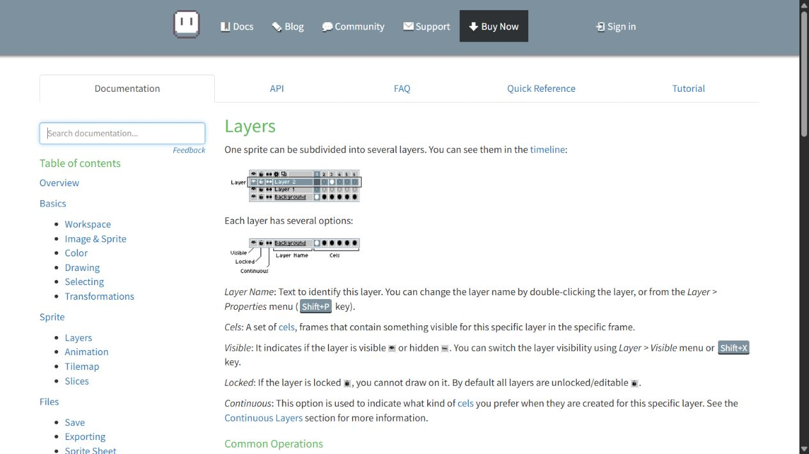
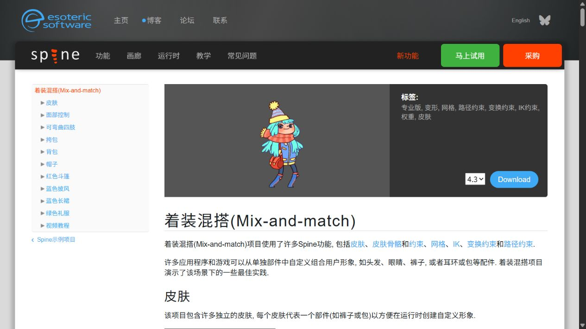
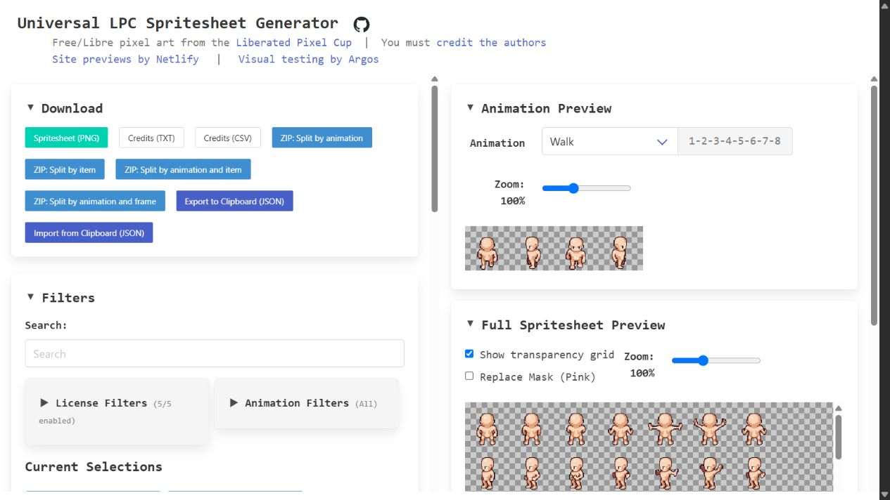
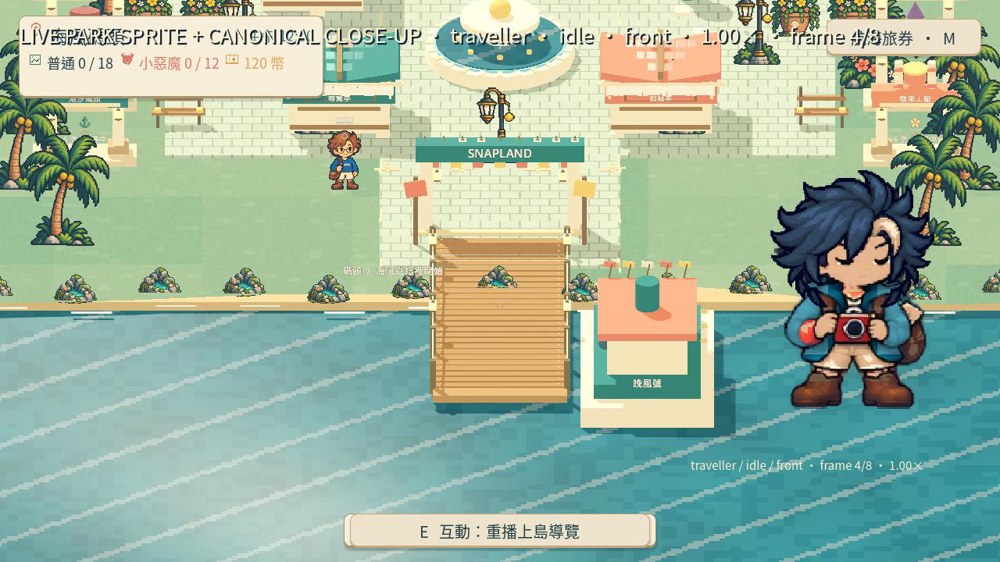
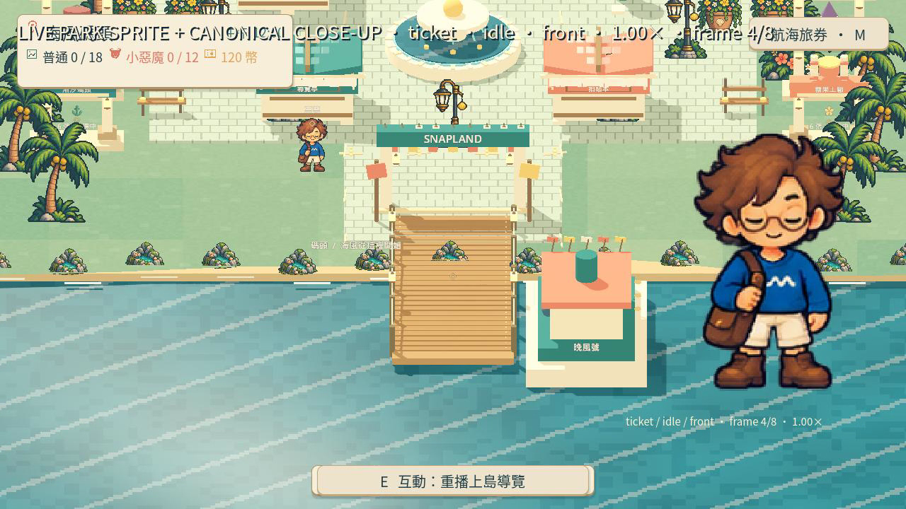
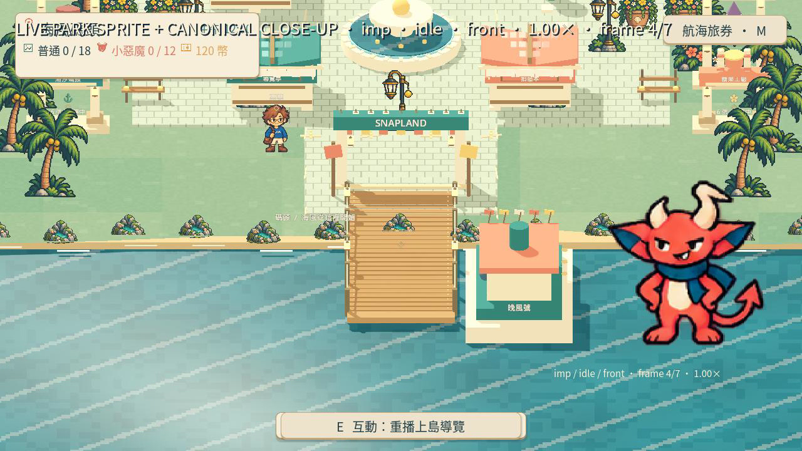
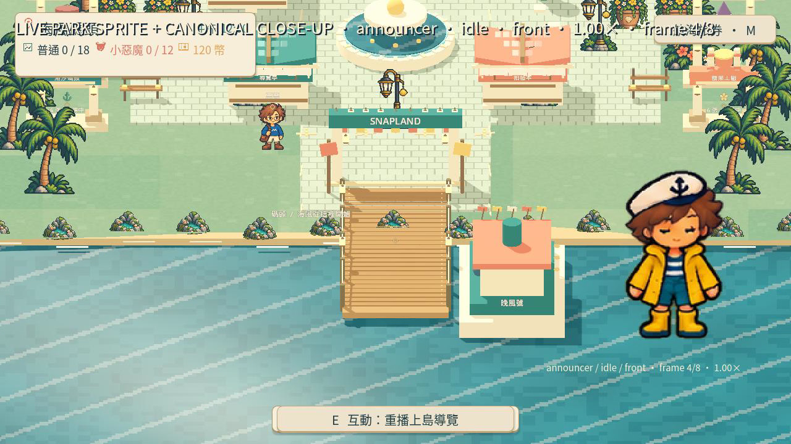
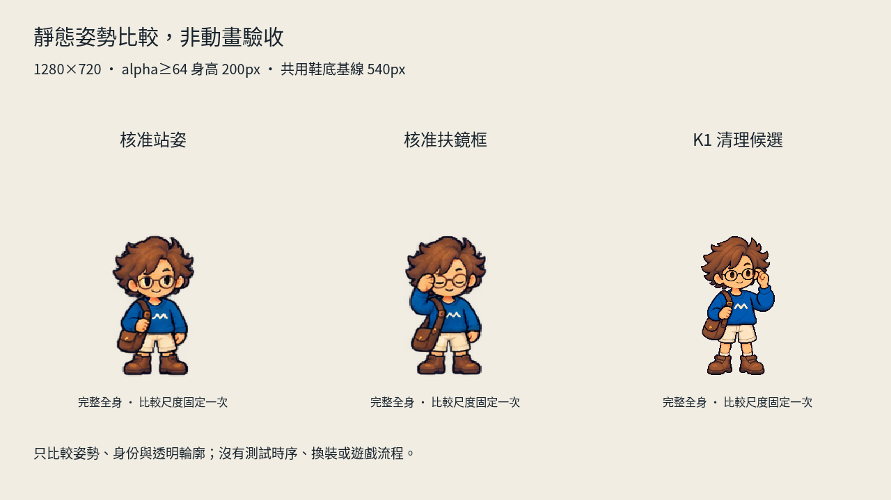
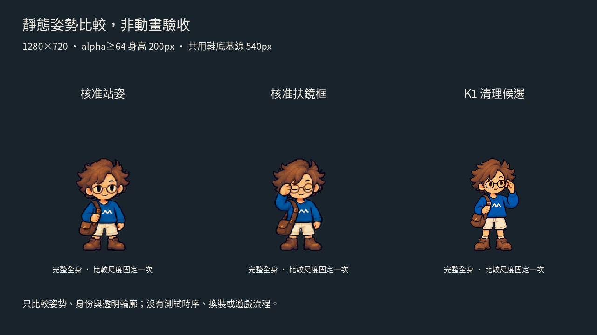

# [ART-17] 製作角色完整動畫與個性待機

> 狀態：進行中

## 內文

### 需求
主角和每位 NPC 都有符合自己個性的完整動畫：專用站姿、呼吸與眨眼、偶發待機小動作、行走起停與轉向、招呼、互動及情緒反應。現有角色的活動不能以幾張輪播或單張走姿代替完整待機，新增角色沿用同一驗收標準。

### 來源
2026-10-12 使用者要求所有 NPC 包含主角各自有整套完整動畫，不走路時有自己的站姿與待機動作；先研究業界做法。使用者已否定比例、膝蓋與鞋子不自然的拆件試作，角色須維持認可原稿的比例與完整外觀。

### 驗收條件
- [x] 比較至少六個來源與不同製作方法，附實際閱讀紀錄、參考圖和採用理由。
- [ ] 主角、票票、小角、阿浪逐一具備站姿、呼吸／眨眼、待機小動作、行走起停／轉向、招呼、互動、情緒反應及角色專用動作，附逐角色覆蓋表。
- [ ] 主角八方向動作合理；NPC 依自身外觀與性格演出，停留節奏有差異，沒有全場同步或不斷重播招呼。
- [ ] 停走、轉向、移動中互動、對話與恢復待機銜接自然；不凍結走路姿勢冒充完整動作。
- [ ] 正常速度與慢放能看見自然重心、完整四肢和接地，不因增加幀數、整身伸縮或淡化重影而假稱流暢。
- [ ] 降低動態、場景重入及實際打包播放正常，附原生短片與逐姿勢截圖。

### Research
已實際閱讀八方一手來源：Aseprite、Spine、Unity、Godot、Motion Twin、Universal LPC、Kenney、BrashMonkey。不同方法、閱讀段落、目前素材缺口、逐角色覆蓋與採用理由見[角色動畫與換裝研究](../../design/runtime/character-animation-wardrobe.md)。

三張皆為實際核對的網站參考截圖，未作為遊戲素材。文字閱讀與靜態截圖不算動畫播放驗收；未觀看教學影片。

### 測試流程
1. 使用獨立存檔逐一觀察每位角色站立至少 30 秒，辨識站姿與小動作。
2. 檢查行走起停、八方向轉向、招呼與互動，觀察動作結束後返回待機。
3. 比較正常速度、慢放與逐姿勢全身圖；確認表情、衣著、四肢與腳底一致。
4. 切換降低動態、離開／重入場景並在輸出版本重做，保存實際看過的證據。

---

# 跟其他票的關係

- Blocks：無
- Blocked by：ART-18
- Related：ART-9、ART-12、ART-14、ART-15、ART-16

---

# 開始

固定基準：affb6b1。分支：feature/island-first-park。需求登記已推送：[22e4fcb](https://github.com/deadline314/Snapland/commit/22e4fcb)。

# Commit-1

### 問題
主角與NPC只有短循環或單張姿勢，未具備完整站姿與待機集合。

### 改動
記錄完整角色動畫覆蓋與個性待機。

### 驗收
主角與三位NPC的站姿、呼吸、待機小動作、移動起停轉身、互動情緒與專屬動作已逐一列出；研究八方來源且附三張參考截圖。需求覆蓋表不是成品動畫，實際動作仍保持未勾。

### 測試結果
研究文件與三張參考截圖實際核對，沒有聲稱完成遊戲動畫。

分支：feature/island-first-park。

### 程式與證據提交
分支：feature/island-first-park。更新至最新main後的本票提交：[196b2b5](https://github.com/deadline314/Snapland/commit/196b2b586af2f15cd0c79a406833fb3ebfe000c5)。

# Commit-2

### 問題
角色缺少個別待機姿勢，換裝與動作容易失去對應，舊錄影也不能可靠呈現正常速度與慢放。

### 改動
主角與三位 NPC 使用各自的全身姿勢與待機，互動動作可暫停、恢復或被走路中斷。主角另有相同姿勢的珊瑚背心與完整起跳、落地素材；來源圖片保留原檔及生成紀錄，畫面邊界檢查會指出具體角色和幀。缺少方向的動作保持安全站姿，不假裝已有完整動畫。

### 驗收
主 Session 實際播放四位角色正面待機的正常速度與四分之一速度，並查看全部 31 格原生截圖，核對頭髮、服飾、配件及完整手腳。影片為 3,119 格、60 FPS、51.983 秒，內容是八段已存在的正面待機；素材待機仍為 3 FPS，影片幀率不代表新增姿勢。完整覆蓋報告仍缺 50 項動作／方向，輪廓細微變化與整套自然動作尚未驗收通過，票維持進行中。

### 測試結果
主 Session 重跑角色素材、主角、NPC 狀態、NPC 場景與安全預設相關局部測試通過；原生錄影完成，素材邊界問題 0。完整套件交由 CI，此次不聲稱完整動畫或換裝已完成。

### 截圖與影片

[正常速度與慢放影片](images/ART-17-idles-normal-slow.mp4) · [本次覆蓋與錄影報告](images/ART-17-idle-capture-report.json)

本次新增文件與票內引用皆可開啟，證據檔雜湊逐檔核對。整體連結驗證仍遇到原有設計入口缺少目錄文件，已另開 MAIN-12，未修改驗證或忽略失敗。

分支：`feature/island-first-park`。本次程式與證據提交：[f870e3d](https://github.com/deadline314/Snapland/commit/f870e3d)。

涉及 ART-18 的共用角色姿勢與換装對應，以及 SG-18 的主角起跳素材；兩票仍需各自的實際操作驗收。

# Commit-3

### 問題
票票待機 v1 候選雖有 16 個可切影格和相同平均身高，但這些數據不足以證明角色姿勢自然、輪廓穩定、接地清楚或能讀出看向隊伍的意圖。

### 改動
保存不等距圖集處理的六個一手來源閱讀紀錄、v1 區域與腳錨量測，以及正常與慢速原生畫面證據。該候選已退件，未整合到正式角色圖集。

### 驗收
Root 查看 32 張逐格原生截圖並將正常速度與慢速影片播放至結尾後退件：新頭髮輪廓較平順且缺少核准參考中的碎髮；幀間身高差 13 px，舊待機差 3 px；左右看隊伍的意圖不清楚，多數姿勢近似中性；腳下 padding 為 10–12 px，未達 12% 目標。影片各為 1280×720；正常 102 格／60 FPS／1.7 秒，慢速 342 格／60 FPS／5.7 秒。候選不得進入正式 atlas／manifest；原有動畫驗收仍未完成。

### 測試結果
區域、錨點與結構 CPU 檢查通過 90 項；這些數值檢查不代表動畫品質通過。原生正常與慢速播放各自 exit 0、記錄 0 個 ERROR，但視覺審查退件。完整逐格素材、執行 log 與雜湊見[證據索引](images/ART-17-queue-rejected-evidence.json)。

### 研究與證據
[待機圖集閱讀與退件紀錄](../../design/runtime/character-idle-atlas-review.md)保存六個文字來源的實際閱讀界限、量測與退件原因。32 張逐格截圖、8 張聯絡表、兩段影片、量測 JSON、三份執行 log 和原始未採用素材均放在 `images/ART-17-queue-rejected-*`；[正常影片](images/ART-17-queue-rejected-normal.mp4)、[慢速影片](images/ART-17-queue-rejected-slow.mp4)、[正常聯絡表 1](images/ART-17-queue-rejected-normal-contact-1.png)、[正常聯絡表 2](images/ART-17-queue-rejected-normal-contact-2.png)、[正常聯絡表 3](images/ART-17-queue-rejected-normal-contact-3.png)、[正常聯絡表 4](images/ART-17-queue-rejected-normal-contact-4.png)、[慢速聯絡表 1](images/ART-17-queue-rejected-slow-contact-1.png)、[慢速聯絡表 2](images/ART-17-queue-rejected-slow-contact-2.png)、[慢速聯絡表 3](images/ART-17-queue-rejected-slow-contact-3.png)、[慢速聯絡表 4](images/ART-17-queue-rejected-slow-contact-4.png)。47 份媒體的逐檔 SHA-256 記錄在[證據索引](images/ART-17-queue-rejected-evidence.json)。本候選屬 `feature/island-first-park`；所有動畫覆蓋與品質驗收維持未勾選。

本次研究與退件證據提交：[4e86c01](https://github.com/deadline314/Snapland/commit/4e86c011cf21f318c26257f862f135d9bd68025a)。票況：進行中。

# Commit-4

### 問題
票票扶鏡框候選雖能看出手碰外側鏡腿，但角色更瘦、頭髮更平滑，臉部與鞋形偏離核准角色；單張全身與留白資料不足以證明可加入完整動畫。

### 改動
保存透明清理前後圖片、兩種背景下的原生靜態比較、閱讀紀錄與量測證據；讓同一顯示身高下的身份與像素差異可直接對照。這張候選已退件，未加入正式動畫。

### 驗收
Root 實際查看兩張 1280×720 原生比較圖：三張全身姿勢均以 200px 核心身高、相同鞋底基線呈現。透明輪廓與完整手腳通過，但體型、髮束像素團塊、臉與鏡框、鞋形及衣物細節不一致，因此姿勢退件。這是靜態審查，不能當正常／慢放動畫、換裝或遊戲試玩驗收；票維持進行中，動畫條件保持未勾。

### 測試結果
原生靜態擷取 exit 0、0 個 ERROR；保留一次審查讀图不適合匯出用途的 WARNING。唯讀像素核對確認 RGB 未改，原 alpha≥128 全部保留，原 alpha≥64 的 925 個減量全為 1。透明清理由使用者已授權的本機核心 CPU 圖像處理執行，沒有本機模型 GPU 生成；GPU 僅顯示與擷取靜態姿勢。

### 截圖與證據

[靜態比較與退件紀錄](../../design/runtime/character-k1-static-review.md) · [本次量測](images/ART-17-K1-static-measurements.json) · [原生 log](images/ART-17-K1-static-native.log) · [逐檔證據索引](images/ART-17-K1-static-evidence.json)。本次記錄四個 Root 實際新讀來源；原有八方研究與 Commit-3 六來源紀錄沿用原票，不假稱本次重新查閱。

本證據包固定基準：`909356b551f280810f860417b1629fa2b5398d45`；分支：`feature/island-first-park`。保存的原生量測保留實際截圖基準，沒有在證據包新基準重跑 GPU。票況：進行中。
