# [ART-17] 製作角色完整動畫與個性待機

> 狀態：進行中

## 內文

### 需求
主角和每位 NPC 都有符合自己個性的完整動畫：專用站姿、呼吸與眨眼、偶發待機小動作、行走起停與轉向、招呼、互動及情緒反應。現有角色的活動不能以幾張輪播或單張走姿代替完整待機，新增角色沿用同一驗收標準。

### 來源
2026-10-12 使用者要求所有 NPC 包含主角各自有整套完整動畫，不走路時有自己的站姿與待機動作；先研究業界做法。使用者已否定比例、膝蓋與鞋子不自然的拆件試作，角色須維持認可原稿的比例與完整外觀。

### 驗收條件
- [x] 比較至少六個來源與不同製作方法，附實際閱讀紀錄、參考圖和採用理由。
- [ ] 主角、票票、小角、阿浪逐一具備站姿、呼吸／眨眼、待機小動作、行走起停／轉向、招呼、互動、情緒反應及角色專用動作，附逐角色覆蓋表。
- [ ] 主角八方向動作合理；NPC 依自身外觀與性格演出，停留節奏有差異，沒有全場同步或不斷重播招呼。
- [ ] 停走、轉向、移動中互動、對話與恢復待機銜接自然；不凍結走路姿勢冒充完整動作。
- [ ] 正常速度與慢放能看見自然重心、完整四肢和接地，不因增加幀數、整身伸縮或淡化重影而假稱流暢。
- [ ] 降低動態、場景重入及實際打包播放正常，附原生短片與逐姿勢截圖。

### Research
已實際閱讀八方一手來源：Aseprite、Spine、Unity、Godot、Motion Twin、Universal LPC、Kenney、BrashMonkey。不同方法、閱讀段落、目前素材缺口、逐角色覆蓋與採用理由見[角色動畫與換裝研究](../../design/runtime/character-animation-wardrobe.md)。

三張皆為實際核對的網站參考截圖，未作為遊戲素材。文字閱讀與靜態截圖不算動畫播放驗收；未觀看教學影片。

### 測試流程
1. 使用獨立存檔逐一觀察每位角色站立至少 30 秒，辨識站姿與小動作。
2. 檢查行走起停、八方向轉向、招呼與互動，觀察動作結束後返回待機。
3. 比較正常速度、慢放與逐姿勢全身圖；確認表情、衣著、四肢與腳底一致。
4. 切換降低動態、離開／重入場景並在輸出版本重做，保存實際看過的證據。

---

# 跟其他票的關係

- Blocks：無
- Blocked by：ART-18
- Related：ART-9、ART-12、ART-14、ART-15、ART-16

---

# 開始

固定基準：affb6b1。分支：feature/island-first-park。需求登記已推送：[22e4fcb](https://github.com/deadline314/Snapland/commit/22e4fcb)。

# Commit-1

### 問題
主角與NPC只有短循環或單張姿勢，未具備完整站姿與待機集合。

### 改動
記錄完整角色動畫覆蓋與個性待機。

### 驗收
主角與三位NPC的站姿、呼吸、待機小動作、移動起停轉身、互動情緒與專屬動作已逐一列出；研究八方來源且附三張參考截圖。需求覆蓋表不是成品動畫，實際動作仍保持未勾。

### 測試結果
研究文件與三張參考截圖實際核對，沒有聲稱完成遊戲動畫。

分支：feature/island-first-park。

### 程式與證據提交
分支：feature/island-first-park。更新至最新main後的本票提交：[196b2b5](https://github.com/deadline314/Snapland/commit/196b2b586af2f15cd0c79a406833fb3ebfe000c5)。

# Commit-2

### 問題
角色缺少個別待機姿勢，換裝與動作容易失去對應，舊錄影也不能可靠呈現正常速度與慢放。

### 改動
主角與三位 NPC 使用各自的全身姿勢與待機，互動動作可暫停、恢復或被走路中斷。主角另有相同姿勢的珊瑚背心與完整起跳、落地素材；來源圖片保留原檔及生成紀錄，畫面邊界檢查會指出具體角色和幀。缺少方向的動作保持安全站姿，不假裝已有完整動畫。

### 驗收
主 Session 實際播放四位角色正面待機的正常速度與四分之一速度，並查看全部 31 格原生截圖，核對頭髮、服飾、配件及完整手腳。影片為 3,119 格、60 FPS、51.983 秒，內容是八段已存在的正面待機；素材待機仍為 3 FPS，影片幀率不代表新增姿勢。完整覆蓋報告仍缺 50 項動作／方向，輪廓細微變化與整套自然動作尚未驗收通過，票維持進行中。

### 測試結果
主 Session 重跑角色素材、主角、NPC 狀態、NPC 場景與安全預設相關局部測試通過；原生錄影完成，素材邊界問題 0。完整套件交由 CI，此次不聲稱完整動畫或換裝已完成。

### 截圖與影片

[正常速度與慢放影片](images/ART-17-idles-normal-slow.mp4) · [本次覆蓋與錄影報告](images/ART-17-idle-capture-report.json)

本次新增文件與票內引用皆可開啟，證據檔雜湊逐檔核對。整體連結驗證仍遇到原有設計入口缺少目錄文件，已另開 MAIN-12，未修改驗證或忽略失敗。

分支：`feature/island-first-park`。本次程式與證據提交：[f870e3d](https://github.com/deadline314/Snapland/commit/f870e3d)。

涉及 ART-18 的共用角色姿勢與換装對應，以及 SG-18 的主角起跳素材；兩票仍需各自的實際操作驗收。

# Commit-3

### 問題
票票待機 v1 候選雖有 16 個可切影格和相同平均身高，但這些數據不足以證明角色姿勢自然、輪廓穩定、接地清楚或能讀出看向隊伍的意圖。

### 改動
保存不等距圖集處理的六個一手來源閱讀紀錄、v1 區域與腳錨量測，以及正常與慢速原生畫面證據。該候選已退件，未整合到正式角色圖集。

### 驗收
Root 查看 32 張逐格原生截圖並將正常速度與慢速影片播放至結尾後退件：新頭髮輪廓較平順且缺少核准參考中的碎髮；幀間身高差 13 px，舊待機差 3 px；左右看隊伍的意圖不清楚，多數姿勢近似中性；腳下 padding 為 10–12 px，未達 12% 目標。影片各為 1280×720；正常 102 格／60 FPS／1.7 秒，慢速 342 格／60 FPS／5.7 秒。候選不得進入正式 atlas／manifest；原有動畫驗收仍未完成。

### 測試結果
區域、錨點與結構 CPU 檢查通過 90 項；這些數值檢查不代表動畫品質通過。原生正常與慢速播放各自 exit 0、記錄 0 個 ERROR，但視覺審查退件。完整逐格素材、執行 log 與雜湊見[證據索引](images/ART-17-queue-rejected-evidence.json)。

### 研究與證據
[待機圖集閱讀與退件紀錄](../../design/runtime/character-idle-atlas-review.md)保存六個文字來源的實際閱讀界限、量測與退件原因。32 張逐格截圖、8 張聯絡表、兩段影片、量測 JSON、三份執行 log 和原始未採用素材均放在 `images/ART-17-queue-rejected-*`；[正常影片](images/ART-17-queue-rejected-normal.mp4)、[慢速影片](images/ART-17-queue-rejected-slow.mp4)、[正常聯絡表 1](images/ART-17-queue-rejected-normal-contact-1.png)、[正常聯絡表 2](images/ART-17-queue-rejected-normal-contact-2.png)、[正常聯絡表 3](images/ART-17-queue-rejected-normal-contact-3.png)、[正常聯絡表 4](images/ART-17-queue-rejected-normal-contact-4.png)、[慢速聯絡表 1](images/ART-17-queue-rejected-slow-contact-1.png)、[慢速聯絡表 2](images/ART-17-queue-rejected-slow-contact-2.png)、[慢速聯絡表 3](images/ART-17-queue-rejected-slow-contact-3.png)、[慢速聯絡表 4](images/ART-17-queue-rejected-slow-contact-4.png)。47 份媒體的逐檔 SHA-256 記錄在[證據索引](images/ART-17-queue-rejected-evidence.json)。本候選屬 `feature/island-first-park`；所有動畫覆蓋與品質驗收維持未勾選。

本次研究與退件證據提交：[4e86c01](https://github.com/deadline314/Snapland/commit/4e86c011cf21f318c26257f862f135d9bd68025a)。票況：進行中。

# Commit-4

### 問題
票票扶鏡框候選雖能看出手碰外側鏡腿，但角色更瘦、頭髮更平滑，臉部與鞋形偏離核准角色；單張全身與留白資料不足以證明可加入完整動畫。

### 改動
保存透明清理前後圖片、兩種背景下的原生靜態比較、閱讀紀錄與量測證據；讓同一顯示身高下的身份與像素差異可直接對照。這張候選已退件，未加入正式動畫。

### 驗收
Root 實際查看兩張 1280×720 原生比較圖：三張全身姿勢均以 200px 核心身高、相同鞋底基線呈現。透明輪廓與完整手腳通過，但體型、髮束像素團塊、臉與鏡框、鞋形及衣物細節不一致，因此姿勢退件。這是靜態審查，不能當正常／慢放動畫、換裝或遊戲試玩驗收；票維持進行中，動畫條件保持未勾。

### 測試結果
原生靜態擷取 exit 0、0 個 ERROR；保留一次審查讀图不適合匯出用途的 WARNING。唯讀像素核對確認 RGB 未改，原 alpha≥128 全部保留，原 alpha≥64 的 925 個減量全為 1。透明清理由使用者已授權的本機核心 CPU 圖像處理執行，沒有本機模型 GPU 生成；GPU 僅顯示與擷取靜態姿勢。

### 截圖與證據

[靜態比較與退件紀錄](../../design/runtime/character-k1-static-review.md) · [本次量測](images/ART-17-K1-static-measurements.json) · [原生 log](images/ART-17-K1-static-native.log) · [逐檔證據索引](images/ART-17-K1-static-evidence.json)。本次記錄四個 Root 實際新讀來源；原有八方研究與 Commit-3 六來源紀錄沿用原票，不假稱本次重新查閱。

本證據包固定基準：`909356b551f280810f860417b1629fa2b5398d45`；分支：`feature/island-first-park`。保存的原生量測保留實際截圖基準，沒有在證據包新基準重跑 GPU。票況：進行中。

[本輪靜態退件證據提交](https://github.com/deadline314/Snapland/commit/9c69d0ae48929a63a356db509c026318261424fb)。

## 2026-10-13 試玩後修訂

使用者否定目前島上畫面／動畫／介面品質。歷史交付證據只代表當時版本與當時範圍；本輪新增品質驗收如下。

- [ ] 重新檢查主角與三位NPC的動作及待機；確認步行接觸、重心、連續姿勢、角色身份與手腳完整，正常及慢放都自然。
- [x] 保存本輪原生前後畫面與影片，實際查看後記錄通過或拒絕原因。

Related：ART-22、MAIN-11、MAIN-14、MAIN-15、ST-5。

# Commit-5

## 內文

**問題：** 先前步態與NPC素材候選曾因腳部接地、角色輪廓或手髖缺口而退件，CPU結構測試不足以判斷原生畫面是否完整。

**改動：** 保存主角新步態／待機候選、三位NPC整合呈現，以及實際島上路線的版本化原生影片與截圖；保留先前失敗版本和證據，不將候選參數或測試截圖當作完整動畫已完成。

**驗收：** 主角walk10正常速度54.617秒、四分之一速度218.417秒；idle10正常197.617秒、四分之一790.417秒，四段影片均播放至結尾。Root檢視idle10三種外觀、八方向共72張PNG及正面呼吸／捲髮背右專項圖；先前正面眼鼻透明帶已消失。NPC第11版正常74.433秒、四分之一297.683秒均播放至結尾，Root檢視三位角色21張姿勢／路線PNG及三張聯絡表；先前的手髖缺口已不再出現。這些結果只支持本輪明列的來源、輪廓、接地可見度與路線呈現檢查，不代表全動作、所有外觀或NPC八方向自然度已驗收。

整圈路線原生驗證使用真實WASD與E輸入，5,500個模擬影格、91.667秒遊戲時間、178.545公尺，包含上下觀景坡與搭乘／離開設施；報告記錄0次傳送／復原、0個ERROR，9張路線截圖。正常91.667秒與四分之一速366.617秒影片均已播放至結尾，9張截圖聯絡表均已檢視，另全尺寸檢視碼頭與導覽員畫面。交付影片為正常30FPS/1280寬（CRF28）與四分之一速15FPS/960寬（CRF30、上限1.6Mbps）的壓縮版本；原始60FPS影片保留於私人驗收資料，無需進版控。Godot Movie Maker屬離線錄影，所有片長／編碼規格不代表遊戲即時FPS或效能基準。

NPC對話後待機回歸已完成GPU重跑：exit 0、0個ERROR。對話結束後完整3.017秒觀察記錄NPC活動時鐘前進3.133秒、113次足部姿勢改變、rig位移0.320公尺、角色根節點路徑0.496公尺；暫停期間時鐘、動作、貼圖與路徑皆凍結。Root檢視開啟對話、對話後待機、暫停三張原生圖，確認頭、手與腳完整可見。此測試有腳本放置角色／相機並暫時隱藏主角畫面，屬具明示限制的原生測試，不是人類遊玩證據。正常影片7.467秒、四分之一速影片29.850秒均已播放至結尾；443影格是暫停截圖點，不是影片總影格數。

### 測試結果

| 項目 | 結果 |
|---|---|
| 本輪受影響Godot測試與匯入 | Root回報15項通過；不等同完整測試套件 |
| Python entrypoint測試 | Root回報13項通過 |
| 主角步態／待機原生影片 | 正常與四分之一速度均播放至結尾；限於本輪外觀與姿勢檢視 |
| NPC原生影片／逐姿勢圖 | 正常與四分之一速度均播放至結尾；三角色各7姿勢已檢視 |
| 島上整圈路線 | 真實輸入與路線條件通過；正常及四分之一速影片播放至結尾；9張聯絡表與兩張全尺寸重點圖已檢視 |
| NPC對話後待機原生回歸 | GPU exit 0／0 ERROR；三張原生圖與正常／四分之一速影片已檢視 |

### 截圖與影片

[主角walk10正常](images/ART-17-hero-body-tenth-normal.mp4) · [主角walk10四分之一速](images/ART-17-hero-body-tenth-quarter.mp4) · [主角idle10正常](images/ART-17-hero-idle-tenth-normal.mp4) · [主角idle10四分之一速](images/ART-17-hero-idle-tenth-quarter.mp4)

[NPC第11版正常](images/ART-17-npc-island-eleventh-normal.mp4) · [NPC第11版四分之一速](images/ART-17-npc-island-eleventh-quarter.mp4) · [票票姿勢聯絡表](images/ART-17-npc11-ticket-contact.png) · [小角姿勢聯絡表](images/ART-17-npc11-imp-contact.png) · [阿浪姿勢聯絡表](images/ART-17-npc11-announcer-contact.png)

[對話開啟圖](images/ART-17-dialogue-accepted-open.png) · [對話後待機圖](images/ART-17-dialogue-accepted-idle.png) · [暫停凍結圖](images/ART-17-dialogue-accepted-pause.png) · [對話回歸報告](images/ART-17-dialogue-accepted-report.json) · [原生log](images/ART-17-dialogue-accepted.log) · [正常影片](images/ART-17-dialogue-accepted-normal.mp4) · [四分之一速影片](images/ART-17-dialogue-accepted-quarter.mp4)

[整圈路線報告](images/ART-17-island-motion-finalproof-report.json) · [整圈路線log](images/ART-17-island-motion-finalproof.log) · [九張截圖聯絡表](images/ART-17-island-motion-finalproof-contact.png) · [正常影片](images/ART-17-island-motion-finalproof-normal.mp4) · [四分之一速影片](images/ART-17-island-motion-finalproof-quarter.mp4)。兩段影片為離線Movie Maker輸出與壓縮交付，不作即時效能基準。

本輪驗收證據基準：`b2c44bf`；分支：`feature/island-experience`。本輪程式與證據提交：[b4c3f77](https://github.com/deadline314/Snapland/commit/b4c3f77c281e293a43dc69d8b3aca933c1e48a58)。[整組逐票交付紀錄](images/ART-17-session-delivery.md)。

票況維持進行中；完整角色動作／外觀覆蓋、打包播放、降低動態完整驗收仍未勾選。

## Commit — 2026-10-14 介面改版發現的角色回歸

**問題：** 島上路線切換與對話結束後，角色可能反覆重置姿勢，讓待機停住或足部接地錯亂。

**改動：** 保留缺少方向動作時的呼吸與待機，讓實際移動和轉向接續正確；缺少的角色動作會明確記錄位置，仍需補完整美術。

**驗收：** 本機局部測試涵蓋路線轉向、長短影格、停步、對話恢復與三位NPC活動，均通過。原生路線驗證exit 0、0 ERROR；Root實際看過22張姿勢與路線截圖及三張聯絡表。這次只接受靜態完整性與回歸條件，沒有新增正常／慢放完整動畫的驗收，也沒有勾選本票尚未完成的動畫條件。

[三角色原生報告](images/ART-17-ui-route-regression-report.json) · [姿勢聯絡表1](images/ART-17-ui-route-contact-1.jpg) · [姿勢聯絡表2](images/ART-17-ui-route-contact-2.jpg) · [姿勢聯絡表3](images/ART-17-ui-route-contact-3.jpg)。所有驗收使用獨立存檔；本輪開始基準`f1d2feedcf6b58418d2a6682238ce088e92cbbaf`。

分支：`feature/island-experience`；[程式與原生截圖提交](https://github.com/deadline314/Snapland/commit/3326f7a722199bb9eda9e511e32541650fc1f2d9)。票況：進行中；待處理完整角色動作／外觀覆蓋、打包播放與降低動態驗收。

## 2026-10-14 接續基準

固定開始 SHA：`4d0a2a814860e54243dd116bed54c564233c0aa0`。本輪接續既有角色完整動畫、服裝同步與島嶼聲音驗收；使用者要求持續修正實際問題，不能把階段素材或局部驗證當成整島完成。

## Commit — 2026-10-14 恢復八方向原圖步行

**問題：** 已有八方向逐幀走路圖，正式遊園卻仍優先套用拆分肢體的動作，並扭動角色頭髮與身體。招手、拍照和互動也可能過早結束，背向時停在舊走姿。

**改動：** 主角直接播放現有八方向原圖，以真實行走距離接續步態，停止時回到對應站姿；正面使用專用待機。招手與拍照等動作播放完整影格，沒有該方向素材時轉向實際具備素材的方向。阿浪恢復真正左右走路圖；票票、小角保留各自待機與專用動作，未批准的步行不冒充完成。角色不再額外扭曲身體，環境動態仍保留。

**驗收：** 主角八方向、起停、背向後招手／拍照、碰撞停步、暫停恢复、外觀切換及場景位移的局部檢查通過；NPC 真實路線與原圖影格檢查通過。四位角色各錄製至少 30 秒自然活動及已具備的完整动作，原生程序均 exit 0、0 ERROR。主 Session 實際查看主角正常／四分之一速度播放、三張主角逐姿勢聯絡表、三位 NPC 不受主角遮擋的全身起始圖及首張姿勢聯絡表。NPC 全套主觀動畫品質仍未勾選；票票、小角的正式走路素材明確列為缺項。

### 測試結果

| 項目 | 結果 |
|---|---|
| 原圖主角行走／世界狀態／NPC來源行走／角色與環境效果 | 4 項局部測試通過，0 ERROR |
| 隔離匯出工具 | 本機 3/3 通過 |
| 原生四角色錄影 | 真實場景與來源影格條件通過；不是真人試玩 |
| 降低動態與場景重建 | 原生 exit 0、0 ERROR，技術条件通過 |
| 輸出版本與重入 | 實際 QA 打包後啟動，八方向与動作条件通過；限默认外觀與腳本驗收 |
| 額外完整髮型矩陣檢查 | 150 秒未得到結果；列為不確定，未算通過 |
| 正式存檔 | 主檔、備份 SHA256 與本輪開始相同 |

### 截圖與影片

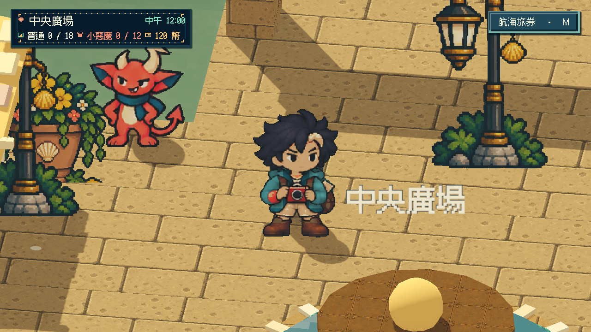

[主角正常速度](images/ART-17-authored-traveller-v1-normal.mp4) · [主角四分之一速度](images/ART-17-authored-traveller-v1-quarter-actions.mp4) · [主角逐姿勢 1](images/ART-17-authored-traveller-v1-cels-1.jpg) · [2](images/ART-17-authored-traveller-v1-cels-2.jpg) · [3](images/ART-17-authored-traveller-v1-cels-3.jpg)

[票票正常](images/ART-17-authored-ticket-v2-normal.mp4) · [慢放](images/ART-17-authored-ticket-v2-quarter-actions.mp4) · [全身圖](images/ART-17-authored-ticket-v2-start.png) · [姿勢圖](images/ART-17-authored-ticket-v2-cels-1.jpg)

[小角正常](images/ART-17-authored-imp-v2-normal.mp4) · [慢放](images/ART-17-authored-imp-v2-quarter-actions.mp4) · [全身圖](images/ART-17-authored-imp-v2-start.png) · [姿勢圖](images/ART-17-authored-imp-v2-cels-1.jpg)

[阿浪正常](images/ART-17-authored-announcer-v2-normal.mp4) · [慢放](images/ART-17-authored-announcer-v2-quarter-actions.mp4) · [全身圖](images/ART-17-authored-announcer-v2-start.png) · [姿勢圖](images/ART-17-authored-announcer-v2-cels-1.jpg)

[降低動態／重入影片](images/ART-17-authored-reduced-reentry-v1-normal.mp4) · [報告](images/ART-17-authored-reduced-reentry-v1-report.json) · [打包原生影片](images/ART-17-authored-packed-v1-normal.mp4) · [報告](images/ART-17-authored-packed-v1-report.json) · [局部測試紀錄](images/ART-17-authored-local-verification.json) · [四角色錄影與編碼資訊](images/ART-17-authored-walking-v1-evidence.json)

影片都是原生場景的腳本輸入錄製，審閱相機拉近；NPC 根節點和路線未移動，主角在 NPC 審閱中只作畫外取景輔助。慢放是正常影片動作段延長四倍，並非另一輪模擬；全部交付影片 30 FPS，不作即時效能基準。舊錄影中屋頂遮住足部或主角擋住 NPC 的版本沒有採作這次全身證據。

固定基準：`4d0a2a814860e54243dd116bed54c564233c0aa0`；分支：`feature/island-experience`；票況：進行中。待完整角色素材、正常／慢放品質與全換裝覆蓋通過後再轉審查。

本輪程式與原生證據已推送：[e8320de](https://github.com/deadline314/Snapland/commit/e8320de7ab71ac2d716d314ba09f95834116535c)。[八方向行走與動作短片](images/ART-17-authored-traveller-v1-walk-actions.mp4)直接取完整影片第 30 秒之後的正常速度動作段。

### 2026-10-14 獨立動作研究檢查補強

**問題：** 保留的獨立動作研究容易錯過 NPC 很短的自然停留窗口，無法證明招呼／互動在重新走動前完整結束。

**改動：** 以正常 30Hz 檢查自然停留時可完整播放兩種已具備動作；正式島嶼仍直接播放原圖，沒有重新啟用拆腿動作。

**驗收：** 獨立局部測試 exit 0、0 ERROR；[執行紀錄](images/ART-17-optional-motion-rest-v1.log)。這是獨立研究回歸，不算正式角色動畫品質或真人試玩。

獨立檢查提交：[cf7578a](https://github.com/deadline314/Snapland/commit/cf7578a29c4d64ffdf9bd5c471091cd5bb56f247)。

### 2026-10-14 普通試玩包與整組回歸

**問題：** 只交付測試場景或錄影，不能讓玩家確定自己啟動的是本輪修正後的版本。

**改動：** 從已推送的分支製作普通 Windows 試玩包，入口是實際上島遊戲，不包含驗收場景；另附使用獨立存檔的啟動檔。

**驗收：** 實際輸出版本以既有正常保存／退出流程啟動並關閉，exit 0、0 ERROR；主 Session 檢視實際上島與對話畫面。全組改動後再次檢查 Main 整合與主角世界狀態，兩項通過。這是啟動與整合回歸，沒有當成整島試玩成功或完整內容驗收。

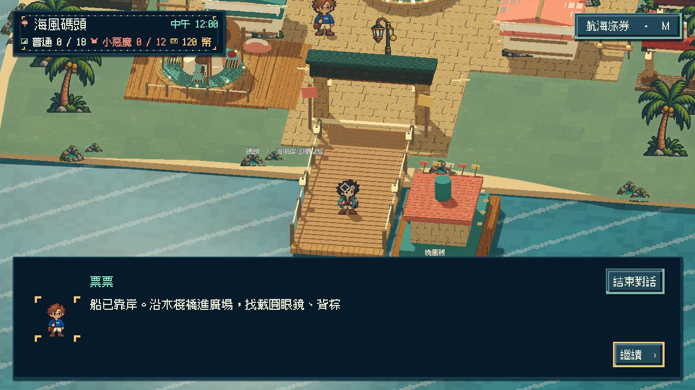

[試玩包來源與啟動紀錄](images/ART-17-normal-player-preview-v1-manifest.json) · [原生啟動紀錄](images/ART-17-normal-player-preview-v1.log) · [Main 整合](images/ART-17-session-main-integration-v1.log) · [世界狀態回歸](images/ART-17-session-world-integration-v1.log)。普通試玩包版本基準為 `cf7578a`，本機檔案在本分支的 `build/island-walk-preview-20261014/`；以 `Play-Island-Preview.cmd` 啟動會使用同資料夾的 `profile/progress.json`，不共用原本正式存檔。

## 2026-10-15 票票正式行走接續

固定開始 SHA：`68ceed09735e6fa02fb25519807d6eb889ecc07a`；分支：`feature/island-experience`。本批沿用既有需求，集中完成票票左右正式逐幀行走、短距巡走與起停服務銜接，正常／四分之一速度全身審閱，並回歸主角原圖步行及換裝。候選素材經審閱後才登記正式覆蓋；整張票維持進行中。

本輪調整：票票候選的兩步交替與身份未通過逐格審閱，不登記正式行走。先交付主角左右側專用站立待機，保持兩腳站定並有呼吸／眨眼，驗收左右行走停止、動作恢復、降低動態、重入與髮帽／珊瑚外套同步。

## Commit — 2026-10-15 補齊主角左右專用待機

### 問題
主角側向停步仍停在走路格，沒有兩腳站定的專用呼吸與眨眼；四分之一速度換向時，也會短暫向右移動卻保留向左走姿。票票新走路候選未清楚交換接地腿，部分重試還增加了錯誤襪口。

### 改動
主角左右各使用四個完整全身待機姿勢，包含站立、呼吸、短眨眼與回復；降低動態保持睜眼站姿。停止及換向跟隨真實移動，已有八方向走路原圖保持直接播放。票票五次候選全部拒收，維持原有完整待機與專用動作。

### 驗收
本批左右待機完成來源、正常速度、四分之一模擬速度與實際 Windows 輸出版本檢查。主 Session 查看24張原生全身姿勢及兩張打包全尺寸畫面，核對完整頭髮、手、相機、背包、短褲與靴底；播放正常與慢速影片至結束，並核對實際畫面有變化。換裝檢查涵蓋預設、珊瑚外套／草帽及短髮／花飾／精靈三組外觀。這些是 Main 場景腳本輸入與審閱相機，並非真人試玩；本票整套角色動畫驗收維持未勾選及進行中。

### 本批測試結果

| 項目 | 結果 |
|---|---|
| 專用待機與慢速換向回歸 | 先重現失敗，再修正通過；包含短眨眼、無效時序及降低動態 |
| 受影響 Godot 局部測試 | 7項通過、0 ERROR；含八方向走路、動畫素材庫、坐姿、髮帽、世界狀態、Main整合 |
| 髮帽既有回歸 | 64走路姿勢 × 3髮型接合檢查通過 |
| Python入口與隔離打包工具 | 16/16通過；新待機驗收場景確實包含於QA包 |
| 原生正常／四分之一模擬速度 | exit 0、0 ERROR；兩段皆30 FPS，正常24.60秒、慢速30.733秒 |
| 實際 Windows exe | 三組外觀、左右待機、暫停、降低動態及重入均通過；原生24.60秒、30 FPS |
| 普通上島包 | 實際啟動並經保存／正常退出流程關閉，exit 0、0 ERROR；限啟動驗收 |
| 正式進度與備份 | 開始／全部原生啟動結束後SHA256一致，所有驗收使用獨立絕對存檔路徑 |
| 文件連結 | 通過；不算遊戲試玩 |
| 完整套件 | 本機未執行，留CI |

既有布景材質透視警告仍保留在原生日誌；本批未以角色待機檢查宣稱全島透視或全角色品質完成。早期型別解析、截圖命名、慢速換向與打包命令失敗已保留摘要，未計入通過。

### 截圖與影片

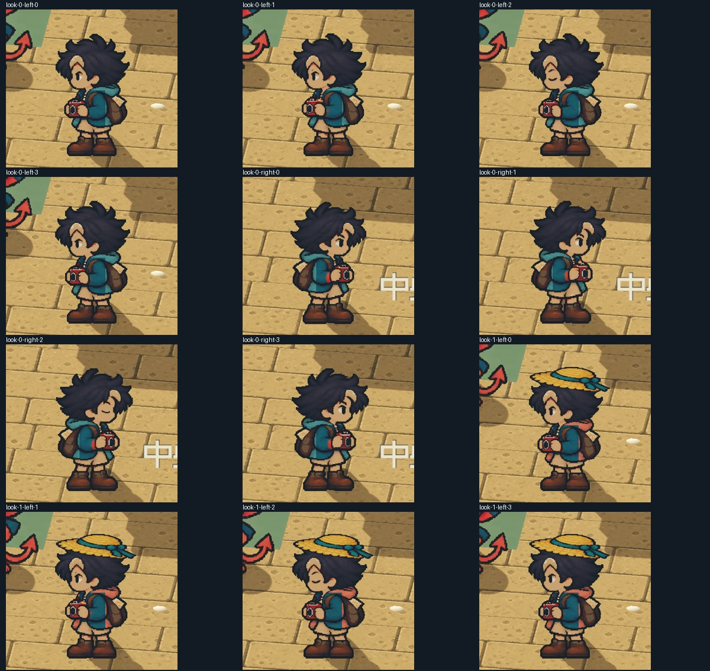
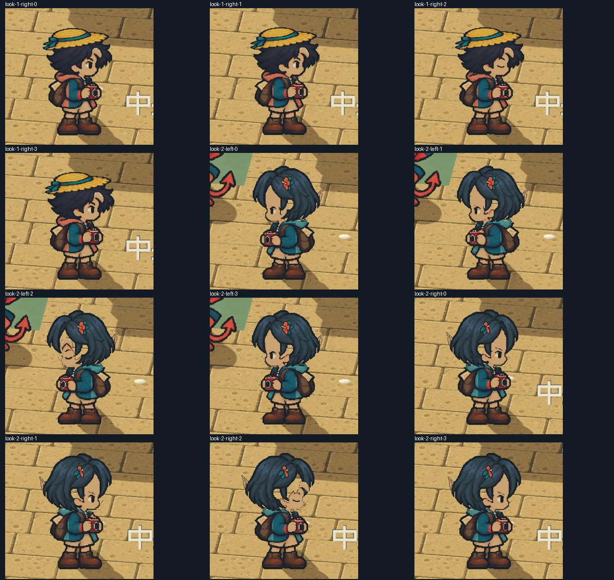

[正常速度](images/ART-17-side-idle-normal-v1.mp4) · [四分之一模擬速度](images/ART-17-side-idle-quarter-v1.mp4) · [實際打包正常速度](images/ART-17-side-idle-packed-normal-v1.mp4) · [驗收摘要](images/ART-17-side-idle-verification.json) · [原生正常報告](images/ART-17-side-idle-normal-report.json) · [慢速報告](images/ART-17-side-idle-quarter-report.json) · [打包報告](images/ART-17-side-idle-packed-report.json) · [普通包啟動紀錄](images/ART-17-side-idle-player-smoke.log) · [早期失敗](images/ART-17-side-idle-earlier-failures.json) · [票票候選拒收紀錄與完整提示](images/ART-17-ticket-walk-rejected-20261015.json)。

普通本機試走入口：`C:/Users/stanl/.codex/snapland-qa/side-idle-20261015-v1/Play-Island-Preview.cmd`。啟動檔使用同資料夾的`profile/progress.json`；直接開exe不會套用該隔離設定。來源素材由內建imagegen生成，完整提示與不可變原檔雜湊保存在素材來源紀錄；未使用API／CLI生成。

固定開始 SHA：`68ceed09735e6fa02fb25519807d6eb889ecc07a`；分支：`feature/island-experience`。本批僅接受左右專用待機與換向回歸；其餘五個方向專用待機、票票／小角正式行走與整套角色／換裝驗收仍保留未勾。

本批程式、來源素材與原生證據已推送：[8f141fb](https://github.com/deadline314/Snapland/commit/8f141fbeed9366d3b61ec0e98ac57b8edf8a58f3)。票況：進行中；未合入main。

## 2026-10-15 接續完成剩餘動畫

固定開始 SHA：`ce86d3b`；分支：`feature/island-experience`。使用者要求繼續完成未完票；本輪先補主角後與四個斜向的專用待機，接著補票票／小角正式行走與逐角色完整動作審閱。原圖播放、服飾身份與完整身體持續回歸；依實際完成條件逐項勾選。

# Commit — 2026-10-15 補齊五向專用待機

### 問題
主角後與四個斜向停止時只能保留走路格；斜向閉眼換成短髮時又會露出原髮殘片、額頭比例和頭皮缺口。

### 改動
新增五向共 20 個全身待機姿勢，主角八向合計有 36 個專用待機來源姿勢。前斜向短眨眼，後向以呼吸及輕微頭肩小動作表達，兩腳站定。短髮／捲髮沿同一姿勢與方向顯示，閉眼保留原稿表情；沒有可靠換髮定位時保留完整來源角色。重新整理動畫資料也保留獨立坐姿和接球內容。

### 驗收
主 Session 檢查兩張原圖的 20 個全身姿勢、三組外觀共 60 張正常原生逐姿勢，以及正常／真正四分之一模擬速度與打包影片的抽幀。腳底、頭髮、手、相機、背包和服裝在本批待機中完整。原生錄製使用 Main 場景、腳本鍵盤事件及審閱相機，不是人類試玩或全島品質完成。整票驗收仍維持原有未勾選項與進行中。

### 測試結果

| 項目 | 結果 |
|---|---|
| 受影響 Godot 局部測試 | 9 項通過、0 ERROR；另補缺少定位與無臉部開口的失敗／修復回歸 |
| Python 局部測試 | 17/17；包含完整重建後坐姿、接球及獨立方向保留 |
| 來源區域與完整資料重建 | 局部及完整檢查均通過；不修改來源 PNG |
| 正常原生 | 斜向 28.20 秒、後向 41.00 秒；各三組外觀，exit 0、0 ERROR |
| 四分之一模擬速度 | 斜向 100.133 秒、後向 51.10 秒；獨立 time_scale=0.25，非影片延長 |
| 實際 Windows 打包 | 五向 23.80 秒，重入／暫停／降低動態條件通過，exit 0、0 ERROR |
| 普通上島包 | 啟動、保存及正常退出通過；只代表啟動驗收 |
| 五段影片 | ffprobe 均為 1280×720、30/1 FPS；不代表非固定步長的效能驗收 |
| 正式進度與備份 | SHA256 不變；所有測試使用獨立絕對存檔 |
| 完整遊戲套件 | 留 CI，本機沒有執行 |

### 截圖與影片

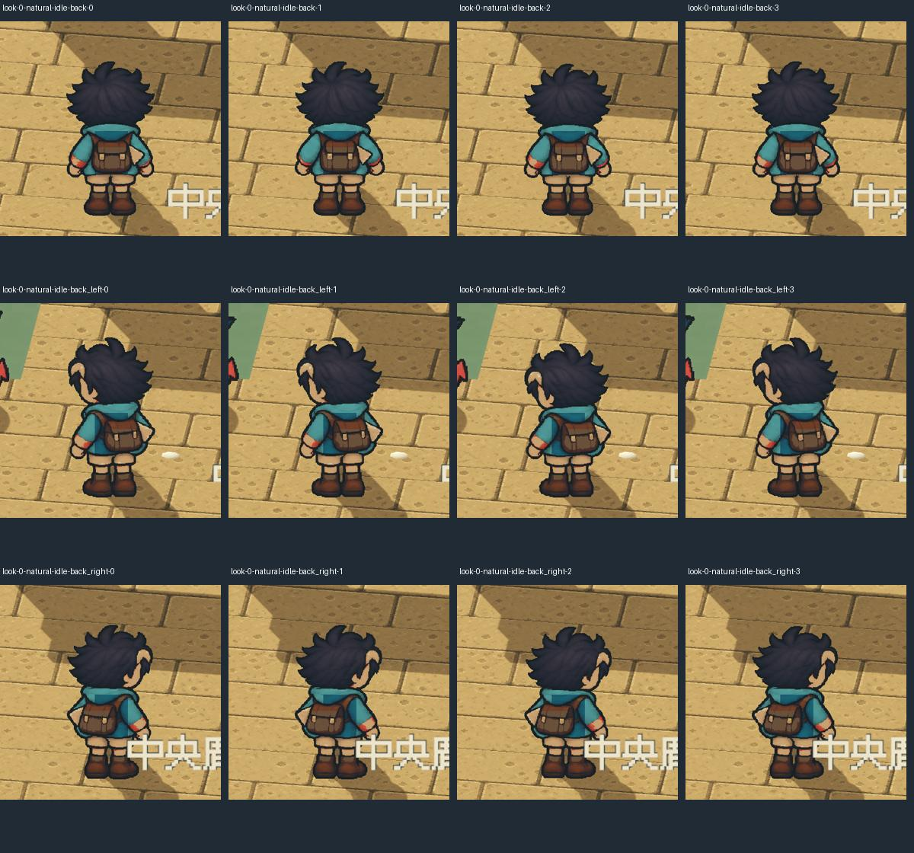

[斜向正常](images/ART-17-directional-idle-20261015-diagonal-normal.mp4) · [斜向四分之一模擬速度](images/ART-17-directional-idle-20261015-diagonal-quarter.mp4) · [後向正常](images/ART-17-directional-idle-20261015-rear-normal.mp4) · [後向四分之一模擬速度](images/ART-17-directional-idle-20261015-rear-quarter.mp4) · [實際打包影片](images/ART-17-directional-idle-20261015-packed.mp4) · [完整驗收與隔離存檔紀錄](images/ART-17-directional-idle-20261015-verification.json) · [來源、完整提示與雜湊](../../assets/characters/traveller-idle-directional-provenance.json)。

本輪兩次票票行走恢復候選皆拒收，沒有登記為正式行走。[六方方法閱讀與完整姿勢導引](../../design/runtime/character-walk-keypose-recovery.md) · [提示、來源雜湊與拒收理由](images/ART-17-ticket-pose-recovery-20261015.json)。

普通本機入口：`C:/Users/stanl/.codex/snapland-qa/directional-idle-20261015-v1/Play-Island-Preview.cmd`，啟動檔使用同資料夾 `profile/progress.json`。來源圖以內建 imagegen 生成，原檔保留；沒有使用 CLI／API 生成。

固定開始 SHA：`ce86d3b`；分支：`feature/island-experience`。本批接受範圍是新增五向待機與相關換髮回歸；票況維持進行中，未合入 main。

本批程式、原始素材與原生證據已推送：[3c6ae27](https://github.com/deadline314/Snapland/commit/3c6ae27c071290d12fc2f952ef036319f19257ce)。票況：進行中。

# 2026-10-20：接帽原畫、換髮及移動呈現

舊接帽v4和現在正式待機的髮型、臉向、頭身不同，已改成完整人物v5十二格。固定來源格與單一0.81倍率，保留共同畫布與足錨點；雙眼、髮／衣料與手掌前後關係逐姿勢核對。真實bob／curly切換不挖額頭、不讓手掌被頭髮蓋住。第一份匯出曾因半透明邊緣RGB改變使owner失配，已以新圖保留原像素處理重驗；沒有放寬hash。

正常30FPS／真正四分之一時間20FPS，完整Main實際輸入均exit0、0ERROR：獨立站定十二格演練與取消不改進度、正式六頂鍵盤中心救援、暫停／重試、普通／惡魔收藏，以及六頂滑鼠輔助／降低動態練習不發獎。移動時切回完整走路，不再把站定接帽沿地滑動；另記錄模型接帽提示仍有效時實際顯示走路格，左右八格全數觀察。模型控制、物理、窗口、計分與收藏規則不變。

四種外觀48張角色圖、兩速各12張post-draw姿勢均查看；站定片段所有22／50電影格已解碼查看，並非連續看完所有影片。101項Python、接帽規則／視圖與髮型來源／生命周期通過；原生三髮型×八方向×四帽96組像素、另200格待機／行走休止、保護區、恢復與1px反例通過。獨立PCK無散落PNG，十二新來源、36款髮型姿勢、原16方向動態依賴及移動優先均通過。

[七方已讀研究與製作／拒收流程](../../design/runtime/catch-character-consistency.md) · [全部實際範圍、版本與雜湊](../Snapland-art/images/ART-17-catch-v5-20261020-verification.json) · [正常短片](../Snapland-art/images/ART-17-catch-v5-20261020-normal.mp4) · [真正四分之一時間](../Snapland-art/images/ART-17-catch-v5-20261020-quarter.mp4)。雲端llvmpipe；2D完整1280×720，製作檢視暫隱3D世界，不當完整光影、Windows EXE、真人試玩或試聽。

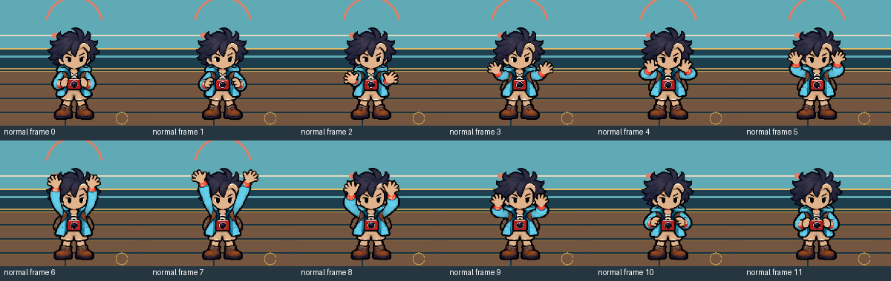
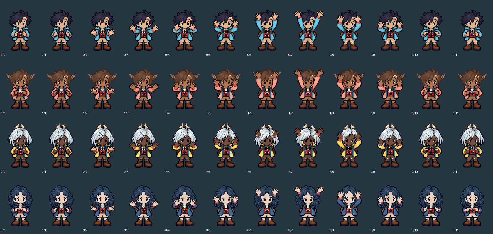

本批是兩張相關票的同一組素材／呈現整合，整票仍進行中。ART-17尚缺票票／小角正式左右步行及四人完整演出；SG-20整體布景、更多完整操作情境與玩法品質仍依原條件。NPC整張走路候選曾連續畫成同一條腿前伸，已拒收；兩色分腿關鍵姿勢只作製作診斷，未加入正式遊戲。

# Commit — 2026-10-21 修正慶祝回退的帽子朝向

慶祝回退先顯示正面、再要求右向時，帽子曾沿用正面；直接載入右向則不同。現在同一個方向的顯示不受先前看過哪個方向影響，重複顯示仍能重用正確結果。保留原完整人物，沒有新增或冒稱慶祝的八向原畫；整票仍進行中。

沿用並重新核對[六方換裝研究與參考圖](../../design/runtime/outfit-completeness.md)的共享姿勢、部件身份與安全回退原則。這次在主角服裝檢查中發現並先修正既有顯示錯誤，沒有提前擴製 NPC。

### 測試結果

| 範圍 | 結果 |
|---|---|
| 修正前反例 | 正面後轉右向錯用同張貼圖，與獨立右向逐像素不同；原紀錄保留 |
| 修正後獨立對照 | 右向與全新載入右向逐像素相同，與正面不同 |
| 正式行走／動作迴圈 | 35.06 秒，exit 0、0 ERROR；含真實世界八向移動、停步、互動及慶祝回退，另核對草帽八向 × 三個請求序號的冷／暖快取一致 |
| 動畫素材庫／整套衣服／側向衣料 | 三項均通過、0 ERROR，分別 0.43／0.72／5.46 秒 |
| 完整套件 | 此次變更留 CI；先前 5daf281 的 115 Python／92 Godot 通過不當成本次結果 |

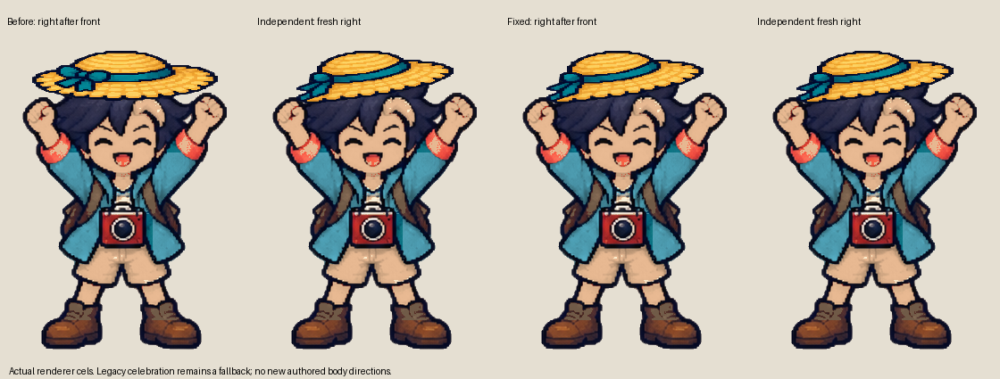

[前反例](images/ART-17-fallback-cache-20261021-before-probe.json) · [修正後對照](images/ART-17-fallback-cache-20261021-after-probe.json) · [四項局部結果](images/ART-17-fallback-cache-20261021-local-results.json) · [正式世界回歸日誌](images/ART-17-fallback-cache-20261021-test_avatar_authored_walk_loop.log)。貼圖對照是渲染來源檢查，不是新增動畫、美術自然度或輸出包試玩。

# Commit — 2026-10-21 修正斜向行走多手原畫

主角斜前右第4格在相機前已有兩隻手，背包下卻多出一隻。現在只修這一小塊來源，保留原臉、頭髮、相機雙手、腳底、人物位置及其餘七格；三款髮型都不再顯示多手。保存原圖與修正片，重新製作也能得到相同結果；整票維持進行中。

137項Python、六組正式角色測試通過。原速與真正四分之一速度各14組實際Main檢查均exit0／0ERROR，包含三髮型／四帽、八格行走、停步、暫停恢復、降低動態及場景重進；28張原生姿勢及三髮型24張對照已檢視。第一組顯示完整世界，其餘在相同Main隱藏3D、放大實際角色檢查；不是衣櫃UI、全島光影或真人試玩。早期完整世界錄製超時與慢放停步失敗都保留。

原88張輸入完整重建與原四肢保護通過。真正Linux成品十二場景啟動／繪製／退出通過；另在無散落圖片的玩家PCK檢查十二髮帽組合GPU及24組髮型／方向來源。來源、成品與本輪實際範圍逐項保存，先前CI不冒充本次CI。

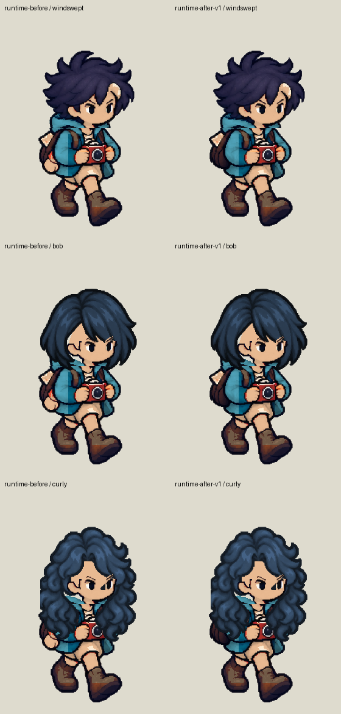

[原速短片](images/ART-17-source-hand-20261021-native-normal-v3-review.mp4) · [真正四分之一速度](images/ART-17-source-hand-20261021-native-quarter-v3-review.mp4) · [六方資料、製作與拒收流程](../../design/runtime/source-art-repairs.md) · [完整證據、結果與雜湊](images/ART-17-source-hand-20261021-verification.json)。

# Commit — 2026-10-24 正式行走候選拒收

重新閱讀 Adobe 的雙腳接觸／交叉、重心與回頭重畫說明，以及 Aseprite 的逐格、時間軸與疊影流程，並核對既有八方研究。以現行票票原畫製作右向八格候選；整張查看後，後半循環仍重複同一側腿前伸。再縮小為兩張相反接觸姿勢，第二張只改變小腿與襪子明暗，近側短褲／大腿仍連向相同前伸輪廓，不能當成真正換腿。兩次均拒收，沒有接入正式角色、改動既有原畫或勾選完整行走驗收。

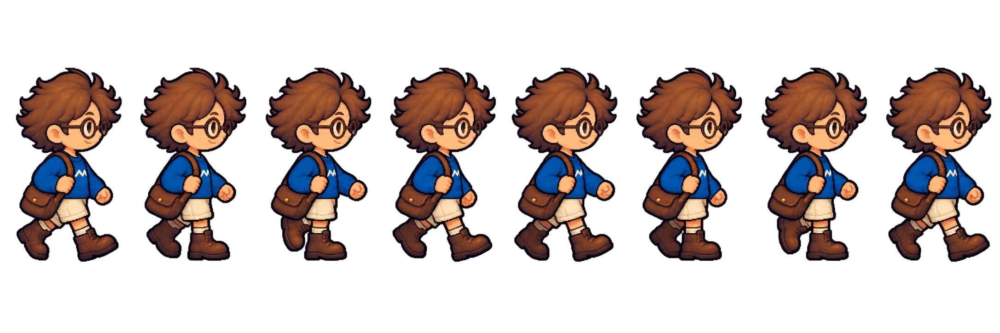
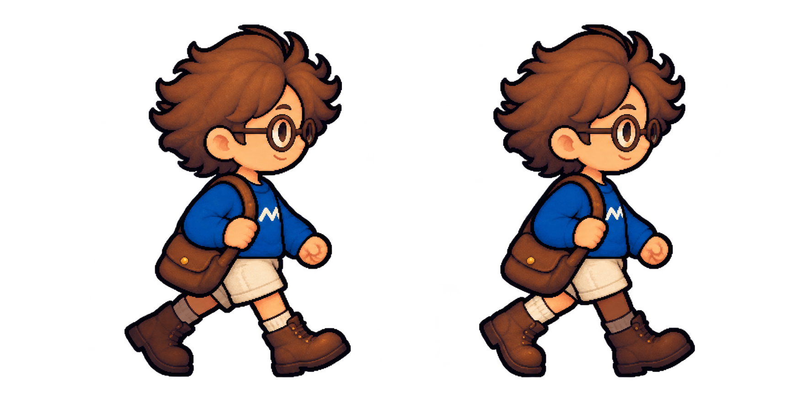

[實際閱讀、完整提示、來源及輸出雜湊、拒收原因](images/ART-17-ticket-walk-20261024-review.json)。本輪是原畫品質檢查，沒有通過的動畫，因此不宣稱原生播放或新增動作完成。

# Commit — 2026-10-24 核對相反接觸姿勢與四次候選

## 內文

補讀 [Monmouth 動畫課程的步行圖解](https://animation.monmouth.edu/instruct/animation/walk-cycle/)，實際查看接觸、跨步、下沉與推離四張圖：先確認兩次接觸交換前後腿，再補中間姿勢；循環結尾不重複起始格。採用其檢查方法，沒有把參考圖當作遊戲素材或生成輸入。Toon Boom 圖解頁回傳 403，BMCC 頁逾時，兩者不算已閱讀來源。

四次新候選包含正面八格、單張相反接觸、帶標記兩列八格及局部修正。單張相反接觸有改善，但渲染與步幅不符原角色；兩列候選仍有重複接觸，後續修改修好了推離格卻改壞另一跨步格。逐張實際查看，均未採用為正式動畫，原驗收保持未勾。黑底預覽疑似光暈的觀察，經白底合成覆核後撤回，拒收原因為姿勢與風格，不是預覽底色。

[四次完整提示詞、來源與輸出雜湊、逐格拒收理由](images/ART-17-front-walk-20261024-review.json)。原輸出完整保存，沒有拆腿拼接、整身伸縮或用淡化冒充新姿勢。

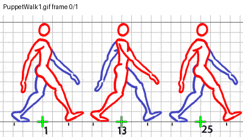
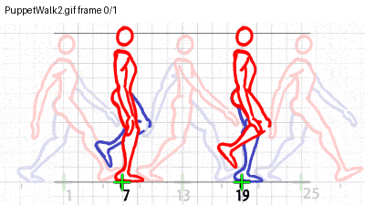
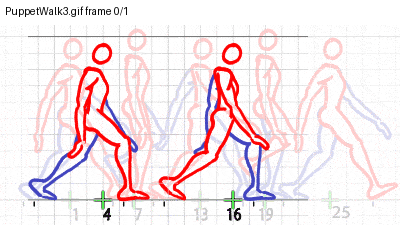
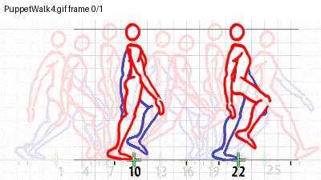
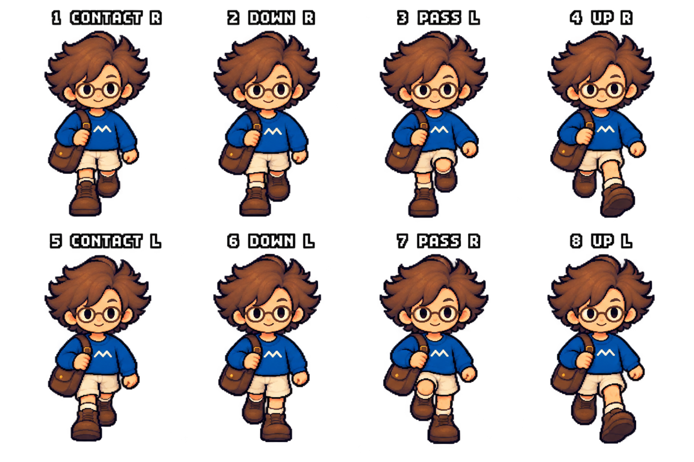
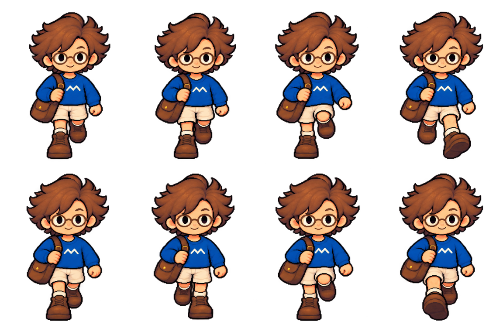

本輪是素材與圖解審閱，沒有新增原生動畫、效能或打包通過聲稱。

# Commit — 2026-10-26 拒收仍有中心偏移的招呼候選

## 內文

以既有 2D 主角招呼原圖另製六格完整人物候選，第二版再明確要求修正固定格位。兩版有不同手勢，但原本應固定的身體相機與腳部仍明顯偏移，均拒收，沒有替換正式角色或把六張圖當成已完成的新動畫。原始生成圖、完整提示詞、來源指紋與檢查程序保留。

固定格位下，相機鏡頭位置在兩版分別相差 43／42 個來源像素，後排上移約 6–7 像素，人物底部亦分別相差 7／6 像素。匹配不是像素完全相同，數字只用於指出格位問題；原尺寸診斷圖另實際查看。沒有逐格鞋底置中、拉伸人物或複製姿勢來讓結果看似穩定。

### 測試結果

| 項目 | 結果 |
|---|---|
| 兩份六格原始來源與固定格位診斷 | 實際查看，均拒收，未接入產品 |
| 原有四張完整舊動作 | 匯出來源及指紋，核對正面／側斜、相機和雙手遮擋，不共用頭部遮罩 |
| 透明原圖 | 實際檢查 alpha 並合成淺底；透明 RGB 的深底印象不作最終拒收理由 |
| 驗證範圍 | 原畫及靜態格位診斷，沒有新增原生動畫／玩法／完整動作完成聲稱 |

[完整來源、提示詞與可重播檢查](images/ART-17-greeting-20261026-source-review.zip) · [兩版來源指紋及逐格量測](images/ART-17-greeting-20261026-review.json) · [共用原畫入庫門檻](../../design/runtime/character-source-acceptance.md)。

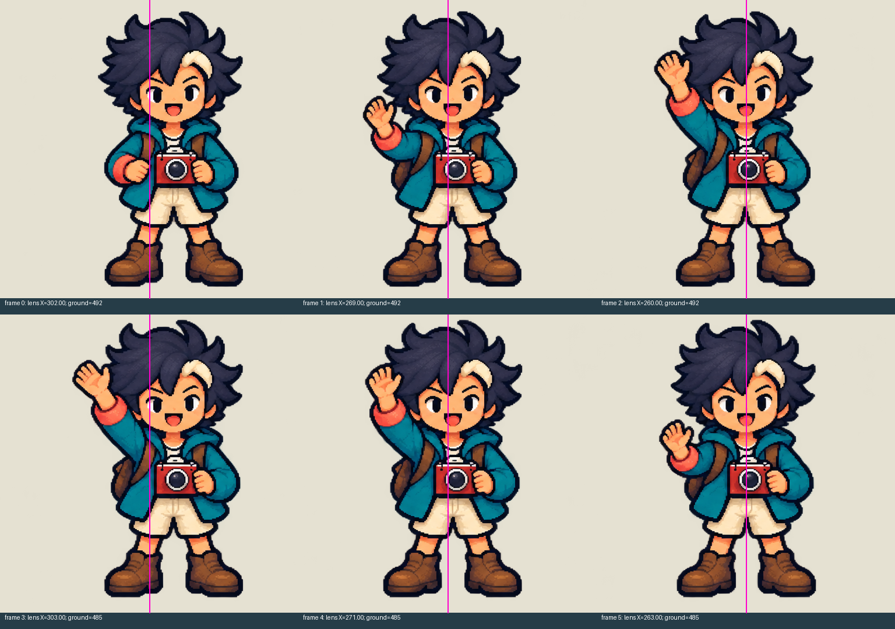
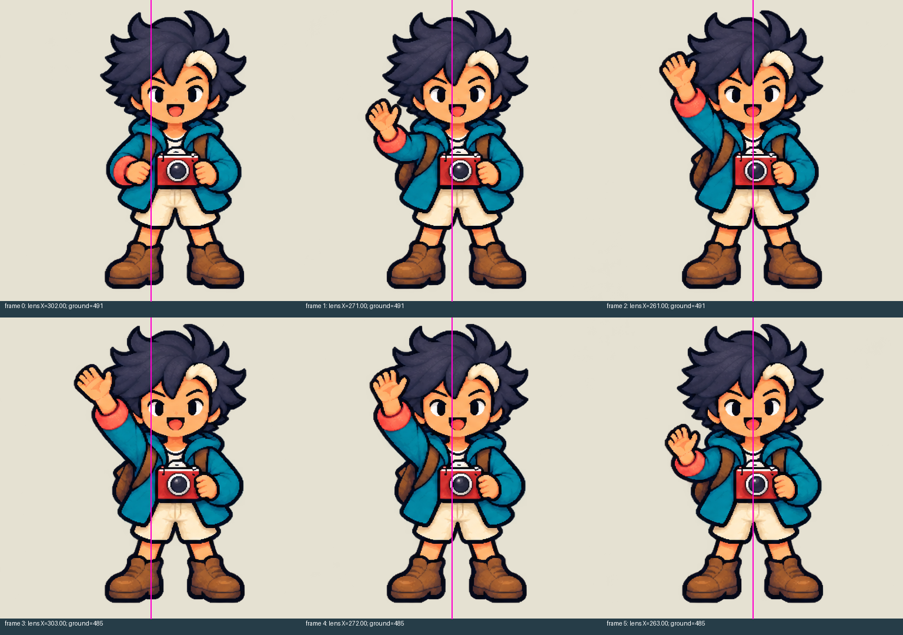
