# [ART-18] 同步換裝分層與角色動畫

> 狀態：進行中

## 內文

### 需求
衣服、帽子、頭髮與配件能分開選擇，又能隨主角站姿、待機、走路與各種動作自然同步。不同衣物有自己的輪廓；髮尾、衣襬與背帶適度隨動，帽子、頭髮、手和道具前後關係正確。

### 來源
2026-10-12 使用者要求研究業界如何處理主角服飾、配件與頭髮的動畫，認為可能需分開處理；此前要求紙娃娃購買／自訂服飾、基礎外觀免費無限更換，高像素 HD-2D 與角色一致性。

### 驗收條件
- [x] 比較至少六個來源的逐幀分層、骨架換裝、立體烘焙與次要動作，附來源、觀察和參考圖。
- [ ] 不同衣物能改變服裝輪廓，換裝不是只替同一件外套換色；基礎外觀仍可免費無限更換。
- [ ] 身體、服飾、頭髮、帽子與配件在同一動作進度和八方向下對齊；停走、轉向及動作中換裝不跳位、不露缺口。
- [ ] 帽子遮髮、前後髮束、背包背帶、手與道具的前後順序合理，沒有穿透眼睛、身體或飄離手掌。
- [ ] 次要動作只出現在合適部件，幅度與延遲合理；腳、臉、硬帽與相機保持形狀，不用整身伸縮代替呼吸。
- [ ] 逐衣物／動作／方向覆蓋檢查能指出缺件；素材不完整時安全顯示完整角色，不靜默套用錯誤方向。
- [ ] 原生換裝、正常速度、慢放、降低動態與輸出版本有可審閱證據。

### Research
已實際閱讀八方一手來源：Aseprite、Spine、Unity、Godot、Motion Twin、Universal LPC、Kenney、BrashMonkey。不同方法、閱讀段落、目前素材缺口、逐角色覆蓋與採用理由見[角色動畫與換裝研究](../../design/runtime/character-animation-wardrobe.md)。

三張皆為實際核對的網站參考截圖，未作為遊戲素材。文字閱讀與靜態截圖不算動畫播放驗收；未觀看教學影片。

### 測試流程
1. 主角在待機、走路、拍照、招呼和慶祝時逐一更換頭髮、帽子、服飾與配件。
2. 逐一觀察八方向以及不對稱服飾／配件，查看遮擋、銜接與完整輪廓。
3. 比較有風、無風、停止與轉向，確認只有適合部件產生次要動作。
4. 檢查缺少服飾姿勢時的完整角色預設、降低動態與輸出版本，附局部結果及原生證據。

---

# 跟其他票的關係

- Blocks：ART-17
- Blocked by：無
- Related：MAIN-8、ART-7、ART-8、ART-14、ART-15、ART-16、ART-34

---

# 開始

固定基準：affb6b1。分支：feature/island-first-park。需求登記已推送：[22e4fcb](https://github.com/deadline314/Snapland/commit/22e4fcb)。

# Commit-1

### 問題
服裝目前主要換色，部件缺少完整動作覆蓋與遮擋規則。

### 改動
記錄換裝動畫分層研究與驗收要求。

### 驗收
比較八方一手資料，實際核對並保存三張參考截圖；記錄逐幀分層、共用時序、逐格錨點與遮擋順序的取捨。服裝輪廓和整套動畫尚未製作，驗收保持未勾。

### 測試結果
研究文件與三張參考截圖實際核對，沒有聲稱完成遊戲動畫。

分支：feature/island-first-park。

### 截圖

[原生或研究證據：ART-18-reference-aseprite-layers.png](images/ART-18-reference-aseprite-layers.png)
[原生或研究證據：ART-18-reference-lpc-generator.png](images/ART-18-reference-lpc-generator.png)
[原生或研究證據：ART-18-reference-spine-mix-match.png](images/ART-18-reference-spine-mix-match.png)

### 程式與證據提交
分支：feature/island-first-park。更新至最新main後的本票提交：[3f87c63](https://github.com/deadline314/Snapland/commit/3f87c63ff57b93ae451276657651a0d6e922d8bb)。

## 2026-10-14 接續基準

固定開始 SHA：`4d0a2a814860e54243dd116bed54c564233c0aa0`。本輪接續既有角色完整動畫、服裝同步與島嶼聲音驗收；使用者要求持續修正實際問題，不能把階段素材或局部驗證當成整島完成。

## Commit — 2026-10-14 修正珊瑚外套的跨動作身份

**問題：** 衣櫃顯示珊瑚紅外套，但走路是外套，待機、招手與跳躍卻切成未完整製作的背心，角色衣著隨動作突變。

**改動：** 珊瑚紅外套在全部現有姿勢保持外套身份、配色與完整身體，不使用只有部分動作的背心。未批准的背心走路候選没有加入正式遊戲；本輪仍不把外套換色當成不同服飾輪廓已完成。

**驗收：** 本機檢查現有正面動作全部影格及八方向行走的首末影格，珊瑚與原色外套保持同一完整輪廓；髮帽貼合、四個坐姿及真實八方向行走回歸通過，0 ERROR。實際 Main 使用珊瑚外套完成八方向行走、完整招手／拍照／互動及動作中換裝，原生 exit 0、0 ERROR；主 Session 檢視六張全身姿勢聯絡圖。影片已保存供正常／慢放審閱，未以靜態圖宣稱全套動畫品質完成。

### 測試結果

| 項目 | 結果 |
|---|---|
| 原有角色功能與跨姿勢外套身份 | 通過；保留原有身份共用與快取上限檢查 |
| 髮帽貼合／坐姿／真實八方向行走 | 3 項局部檢查通過，0 ERROR |
| 珊瑚外套原生來源檢查 | 技術條件通過，完整招手／拍照／互動影格實際呈現 |
| 候選素材 | 側向背心候選跨格；重試又改變姿勢，均未採用 |

### 截圖與影片

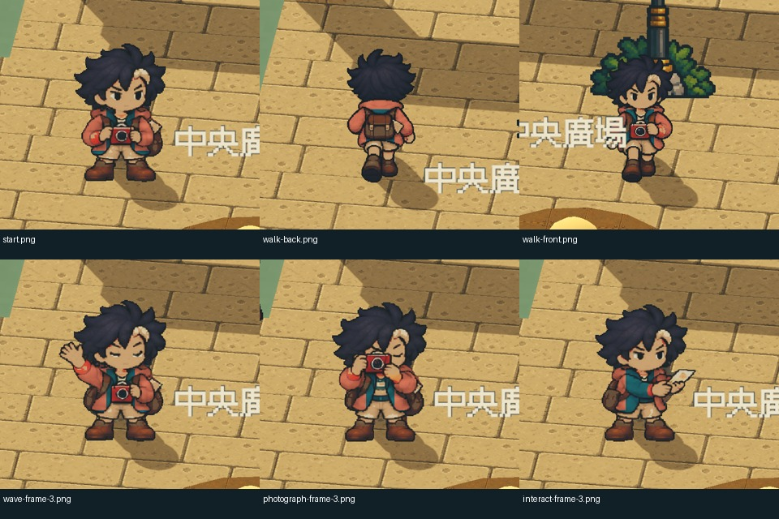

[正常速度](images/ART-18-coral-jacket-consistency-v1-normal.mp4) · [四分之一速度](images/ART-18-coral-jacket-consistency-v1-quarter.mp4) · [完整全身圖](images/ART-18-coral-jacket-consistency-v1-start.png) · [原生報告](images/ART-18-coral-jacket-consistency-v1-report.json) · [來源與編碼紀錄](images/ART-18-coral-jacket-consistency-v1-verification.json)

本輪開始基準：`4d0a2a814860e54243dd116bed54c564233c0aa0`；分支：`feature/island-experience`；票況：進行中。不同服裝完整輪廓、全部動作與輸出版本換裝仍需完成，相關驗收未勾選。

本輪程式與原生證據已推送：[48a8ab9](https://github.com/deadline314/Snapland/commit/48a8ab9580508dbb11cae6d269766d0512201091)。

# Commit — 2026-10-15 修正前斜閉眼換髮

### 問題
前斜方向的閉眼姿勢換成短髮／捲髮後會留下原瀏海、抬高髮頂，或露出頭皮缺口；這使待機與換髮不同步。

### 改動
同向中立姿勢只提供定位，表情仍取閉眼原稿。替換髮型回到原稿髮頂，補色只落在與臉相通的開口；缺少可靠定位或臉部開口時保留完整來源髮型。

### 驗收
兩個前斜方向的閉眼睫毛像素完整保留，沒有混入睜眼表情；短髮／捲髮的額頭、頭皮與鞋底局部回歸通過。Main 原生正常／四分之一模擬速度中檢查預設、珊瑚外套／草帽及短髮／花飾／精靈三組外觀。正常 60 張全身逐姿勢及編碼影片抽幀已檢查；這是新增五向待機的局部換裝回歸，整票驗收仍保持未勾選與進行中。

### 測試結果

| 項目 | 結果 |
|---|---|
| 閉眼原稿、頭皮、髮頂與鞋底回歸 | 先重現錯誤後通過，0 ERROR |
| 缺少定位／無臉部開口 | 先重現錯誤後保留完整原髮，0 ERROR |
| 既有八向走路髮帽與所有膚色／種族局部矩陣 | 通過；局部結果見 ART-17 的本批驗收摘要 |
| 原生五向待機與三組外觀 | 正常／慢速來源條件通過；ffprobe 30 FPS |
| 實際打包 | 五向預設外觀、重入、降低動態與暫停通過；普通包正常退出 |
| 完整遊戲套件 | 留 CI，本機未執行 |

### 截圖與影片

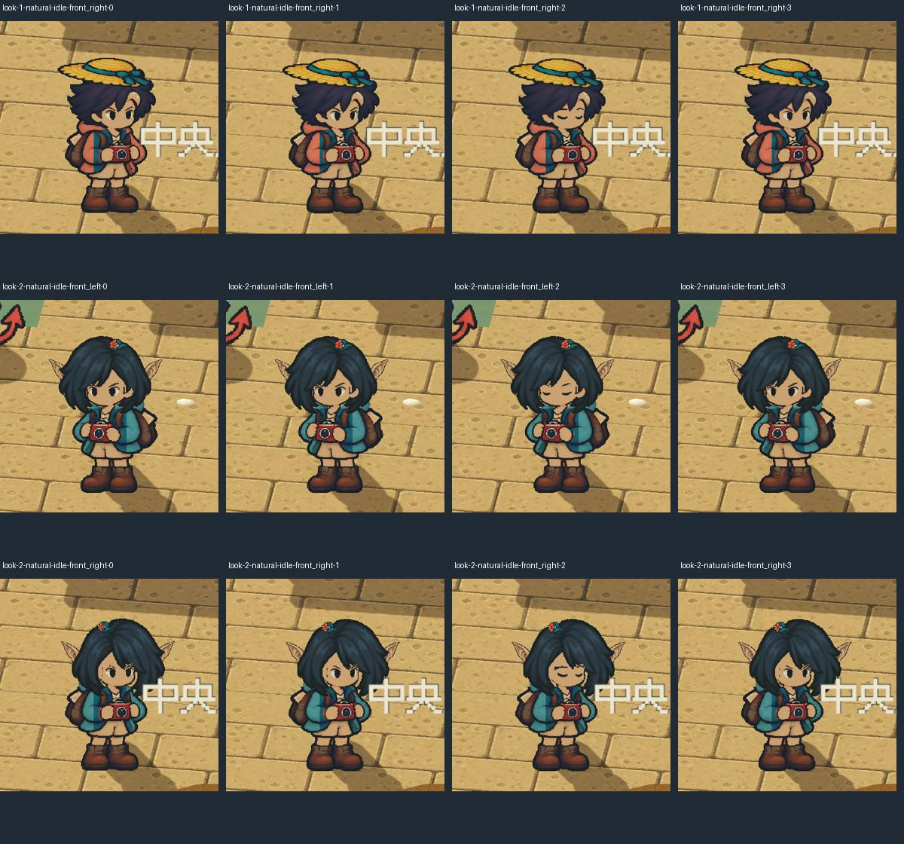
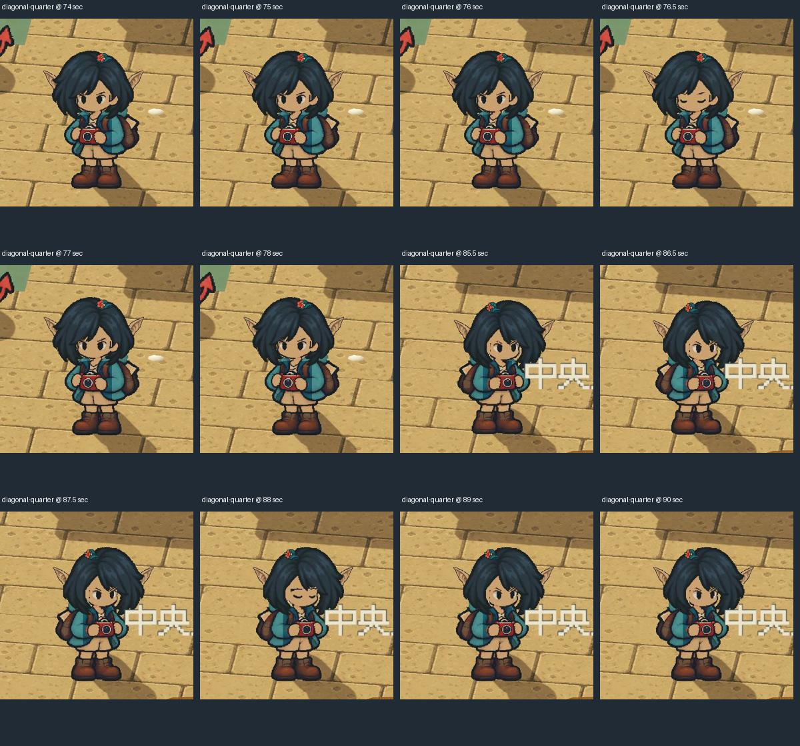

[正常影片](images/ART-17-directional-idle-20261015-diagonal-normal.mp4) · [四分之一模擬速度](images/ART-17-directional-idle-20261015-diagonal-quarter.mp4) · [完整局部驗收與隔離存檔證據](images/ART-17-directional-idle-20261015-verification.json)。

分支：`feature/island-experience`；固定開始 SHA：`ce86d3b`。本批與 ART-17 共用必要的閉眼姿勢修正，程式與證據提交：[3c6ae27](https://github.com/deadline314/Snapland/commit/3c6ae27c071290d12fc2f952ef036319f19257ce)。票況：進行中；沒有將外套換色當作不同衣物輪廓完成。

# Commit — 2026-10-17 防止缺件混穿與修正側身換色

固定接續基準：main `1baf7dd098b3f01635c76f6364ca6db224468837`；分支：`codex/wardrobe-silhouettes`。

### 問題

底層仍會逐格選擇不完整的服裝候選，壞格才穿回原衣；珊瑚外套的避免背心特例只在正式主角入口，沒有形成共通防線。另在原生全身抽樣發現：正面內衣的保護區也套到側身，選珊瑚款後袖子中心仍大片是藍色。

### 改動

四件正式外套明確沿用原外套換色，不再選用歷史背心候選。真正輪廓替換先檢查整套必要姿勢；有缺件就保留原完整身體及對應位置，不在不同影格混穿。必要清單包含目前分開保存的八向行走，不能刪掉一整個缺少的動作就變成「完整」。

左右側走路／待機共 24 格有各自核對過的衣料標記，袖子與衣襬可正確換色，保持原畫與步態。其他動作的衣料處理不由這 24 格推論為完成；不同服飾輪廓仍依本票未勾選條件驗收。

### 研究與流程

本輪重新閱讀 Spine、Unity、Aseprite、Godot、Universal LPC、Spriter 六方資料，實際看過並保存兩張官方靜態插圖。採同一姿勢進度、明確衣物身份、製作端標記與整套檢查；方法、取捨、來源與界線見[服裝完整性研究](../../design/runtime/outfit-completeness.md)。

先檢查完整 148 格的衣料草稿，再逐格看原身體、相機、內衣與衣袖。全姿勢版本會誤標鏡片，亦有抬手／跨胸袖子漏標，已拒收；只採左右側走路與專用待機完整的 24 格。本流程的共通規則已整理回 User-guide，未把自動輸出當成批准原件。

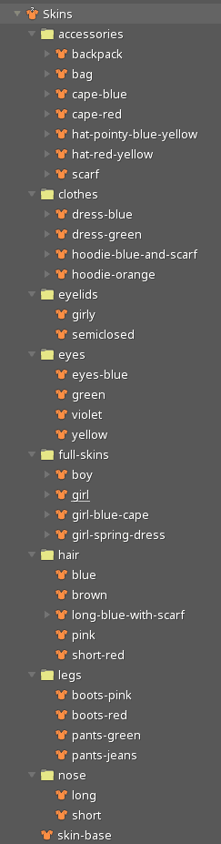
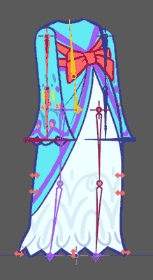

兩張為文件內靜態原始圖，並非整頁截圖或動畫播放驗收。[來源與雜湊](images/ART-18-reference-provenance-20261017.json)。

### 局部驗證

| 範圍 | 結果 |
|---|---|
| 整套服裝完整性 | 314 項通過；另一動作壞格、整段缺少、來源／定位／數值損壞皆保留原衣，修復重載可恢復 |
| 側身衣料 | 24 格、三個替換色共 72 組通過；標記外像素差為 0，三髮型外露衣料及捲髮遮擋另有獨立見證 |
| 製作工具 | 4 項回歸通過；重新輸出原畫後重建的衣料資料與正式檔逐位元一致 |
| 隔離 PCK | 沒有原始 PNG 的入口通過 316 項完整性檢查及 72 組衣料檢查 |

執行為 Linux Godot 4.7；以上無頭／PCK 的來源與像素檢查不代表原生動畫主觀品質、Windows 4.7.2 EXE 或整島驗收。

### 製作端檢視

洋紅色為衣料標記，下一列為珊瑚配色預覽，皆為製作端診斷圖，不是原生遊戲截圖。24 格均已實際檢視。

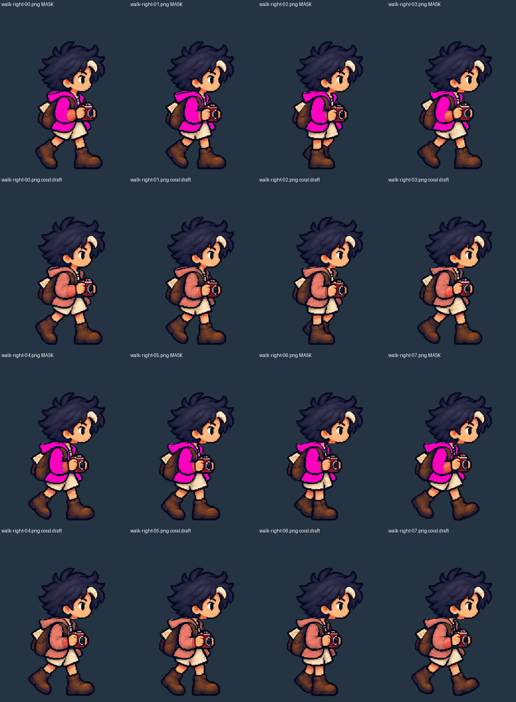
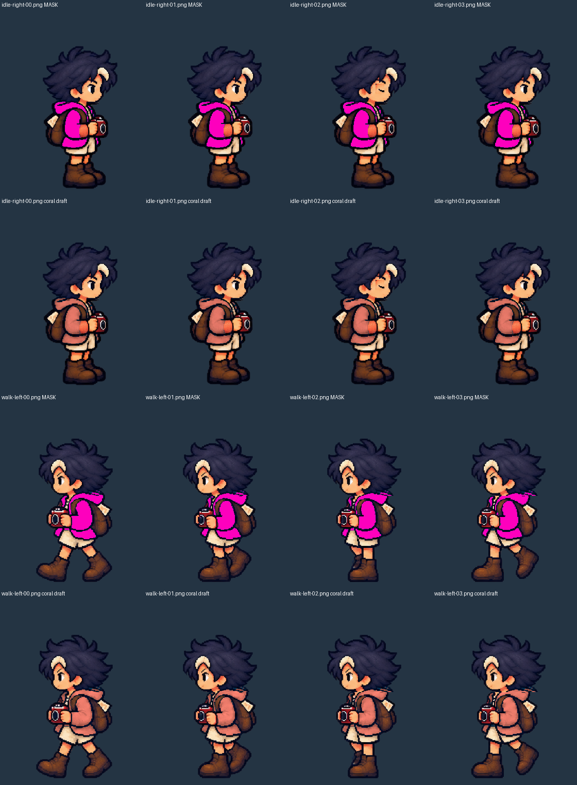
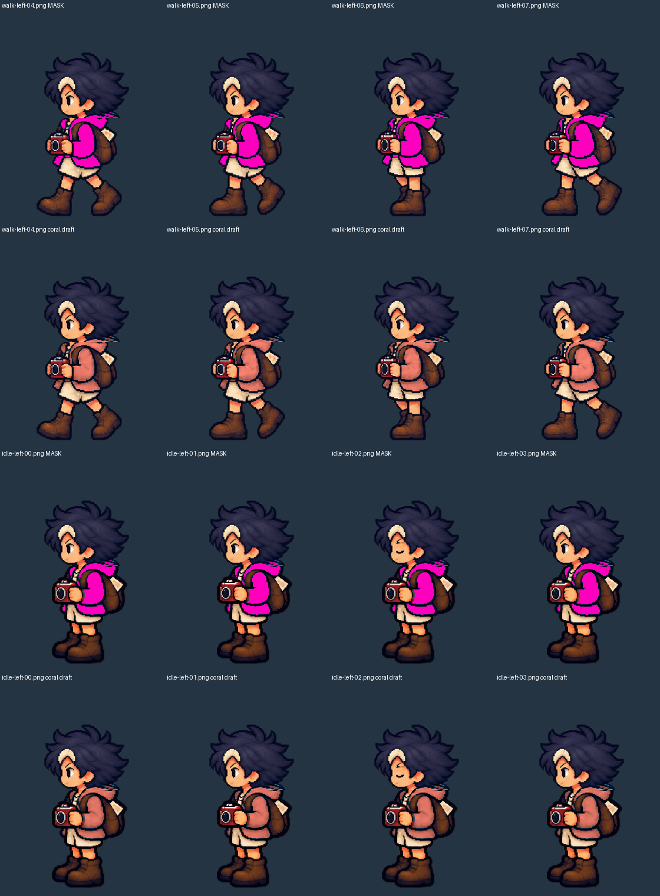

票況：進行中。本輪不把外套換色或安全性修正當成不同服裝輪廓完成。

## 2026-10-17 原生、固定引擎與輸出補驗

程式與製作圖提交：[b84746a](https://github.com/deadline314/Snapland/commit/b84746aea2329bc467ed3050faad85e739840357)。本輪使用正式島上角色與原步態，沒有採用全姿勢衣料拒收稿。

| 範圍 | 實際結果 |
|---|---|
| 正常速度原生 | 14 組真實按鍵移動、16 項檢查通過；包含行走時衣袖／手部保護區 RGBA 相同及停步配色見證 |
| 真正四分之一模擬時間 | 14 組移動、14 項檢查通過；使用已保存的固定配色見證版本，沒有擴稱為新的整區 RGBA 檢查 |
| 實際檢視 | 兩段 1280×720／30 FPS 影片解碼為 93 張全身樣本、9 張聯絡圖，全部實際看過；沒有宣稱連續播放每個編碼格 |
| Godot 4.7.2 | 取得與 CI 相同的官方 ed1daf0bf，乾淨匯入、服裝兩項、動畫庫、步態保留、八向步行與 432 格待機共六項局部測試通過，0 ERROR |
| Godot 4.7.2 匯出 PCK | 來源 PNG 隔離後，316 項完整性與 72 組衣料檢查通過；4.7 PCK 亦通過相同探測 |
| 完整 CI | 衣料修改前的 main `1baf7dd` 實際失敗：設計缺 SG-1 目錄，runtime 在既有腿部樣本來源中位數斷言失敗並逾時；未刪斷言、改選擇器或算成通過 |

原生仍是 Godot 4.7／llvmpipe，環境解析度與特效有明示降成本 fixture，人物合成維持 280×360。4.7.2 補驗是 Linux 來源與 PCK，沒有聲稱 Windows EXE、完整光影、原機器即時效能或真人試玩。暫停選單短暫遮住一個影片樣本，另保留原始角色像素 PNG。

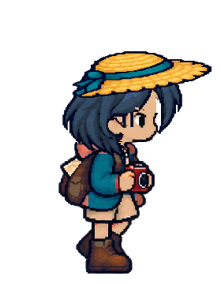
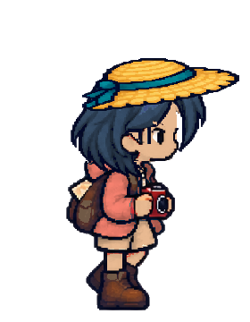
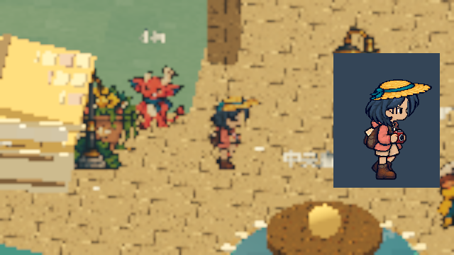

[正常速度影片](images/ART-18-side-20261017-normal.mp4) · [真正慢速影片](images/ART-18-side-20261017-quarter.mp4) · [正常原生報告](images/ART-18-side-20261017-normal-audit.json) · [慢速原生報告](images/ART-18-side-20261017-quarter-audit.json) · [完整驗收範圍與 SHA](images/ART-18-side-20261017-verification.json)。

[正常全身抽樣](images/ART-18-side-20261017-normal-frames-03.png) · [慢速全身抽樣](images/ART-18-side-20261017-quarter-frames-03.png) · [固定 4.7.2 輸出探測](images/ART-18-side-20261017-pack-4.7.2-material-report.json)。兩份 PCK 本身未提交或發布，票內保存來源與雜湊。

### 拒收例與品質防線

[鏡片／跨胸衣袖誤標草稿](images/ART-18-side-20261017-rejected-full-camera.png)、[抬手漏標草稿](images/ART-18-side-20261017-rejected-full-raised-arms.png) 與[第二輪修訂仍有誤標](images/ART-18-side-20261017-rejected-full-v3.png) 均為製作端拒收圖，未作為遊戲素材。乾淨匯入曾抓到型別推斷錯誤，獨立像素檢查另抓到 JSON 數字型別使有效標記未載入；修正後重新執行全部側身矩陣與兩版隔離 PCK。

本輪保存實際流程與結果，整票仍為進行中；不同服飾輪廓及完整動作品質繼續按原驗收判定。

## 2026-10-17 接續：歷史候選檢視相容

固定起始 main `bc6a6ecd4872af5a441e0d4f96c211bbb12576a6`；分支 `codex/outfit-source-inspection`。

上一批局部檢查漏掉 `test_avatar.gd` 的既有候選檢視契約。[遠端 CI 38965270551](https://github.com/deadline314/Snapland/actions/runs/38965270551) 在「historical coral vest variant remains available for explicit source inspection」停止並逾時；正式換色安全回退已使同一入口不再選舊背心。這是漏測造成的相容問題，非已通過驗收。

沿用本票六方換件研究，明確區分正式全套衣物解析與單格製作檢視。預計新增只能明確呼叫的候選檢視入口，共用原本來源／圖框／錨點驗證及固定畫布合成；舊測試保留候選確實不同的斷言，遷移至該明確入口，另檢查正式來源／錨點／快取不被檢視污染。不加 CI known failure、不改測試選擇器、不讓被拒收背心返回衣櫃。

### 改動與驗證

新增 `inspect_variant_texture`，只供明確單格候選檢視；它共用原本合成與來源安全驗證，但使用獨立快取／布局命名空間。正式換裝依然需整套完整，不接入歷史背心。舊角色測試保留候選可讀且不同的原斷言，呼叫改為明確檢視 API，另核對畫布一致及正式衣物不變。未刪斷言、未修改 CI 測試選擇器。

最終程式在官方 Godot 4.7.2 隔離匯出 PCK 通過：335 項整套衣物／檢視契約（含兩項無原 PNG 驗證）、72 組衣料、原有 avatar、角色動畫庫，以及 64 格短髮／捲髮跨膚色／種族完整渲染回歸。打包來源逐檔雜湊與最終程式一致。最終本機另通過 333 項契約、完整八向樣本與損壞來源恢復（38.85 秒）、72 組衣料及固定根點步行回歸；文件連結檢查通過。

[驗證範圍、來源／PCK 雜湊及各測試紀錄](images/ART-18-inspection-20261017-verification.json)。匯出採 Windows Desktop preset 的 PCK，在 Linux 隔離測試，不能稱 Windows EXE 或完整光影／原生美術驗收。這次未再製作新的步態影片；原生正常／慢放範圍沿用上批明示證據。部分故意損壞的反例會發出來源 WARNING，所有採用的測試均無 ERROR。

全套遠端 CI 仍需核對最新 main；SG-1 設計缺檔未解，不能宣稱全綠。ART-18 仍進行中，真正不同衣物輪廓與完整動作原畫尚未交付，不勾選原本未達成的條件。

### Commit

- [b1100b3](https://github.com/deadline314/Snapland/commit/b1100b3c1f76261d39050641de1fead65e4f4e9b)：明確候選檢視 API、共享驗證合成、正式快取／錨點隔離及原有檢查遷移。共通流程已整理至 User-guide。

# Commit — 2026-10-21 純衣料長外套預覽與完整路線檢查

整身長衣生成會改掉已批准人物的頭、手及腳。現在先保留原人物，只讓純衣料隨當格肩、肘、腕變化；相機、手、頭髮、背帶與腳保留原像素。正面八個行走姿勢可重建不同輪廓的長外套製作預覽；預覽不在正式衣櫃，不改變既有四款外套的可玩內容。

[六方重新閱讀、來源圖、製作與拒收流程](../../design/runtime/outfit-completeness.md)已記錄，共通規則同步至 User-guide。數值通過但袖口／相機錯位的版本仍拒收，沒有為接受候選而放寬原人物保護。

### 測試結果

| 範圍 | 實際結果 |
|---|---|
| 衣料覆蓋 | 正面行走8/148個必要原畫格；140個缺格逐一列出。慶祝另外24個既有回退請求，不當成新原畫 |
| 最終重建 | 8格保留固定畫布、原頭髮所有權及頭／腳保護區；24張來源／衣料／合成PNG與原生檢視所用圖逐位元一致 |
| 來源變更反例 | 最後一格原人物指紋錯誤，exit2明確拒絕，前7格沒有被當成完整可用輸出 |
| 空白衣料反例 | 無可見衣料時exit2拒絕，沒有已接受輸出 |
| 正式完整回退 | 真正衣櫃無候選；148個原畫格＋24個回退請求保留完整原人物，exit0、0ERROR；限預設人類／原微風髮型 |
| 原生正常／四分之一時間 | 兩段1280×720、20FPS無聲製作預覽，63格3.15秒／249格12.45秒，exit0、0ERROR；逐姿勢16張已查看 |
| 實際1px錯位反例 | 頭／腳視窗比較立即拒絕，exit1、0ERROR；不是只驗錨點數值 |
| Python完整可用套件 | 本機124/124通過，40.990秒，含9項新衣料資料反例 |
| Godot完整套件 | 新工具留CI；既有5daf281的92項通過只作前置基線，不當成本批結果 |

原生內容是8FPS製作時間軸，沒有代表正式世界的行走距離時序、即時衣櫃操作、髮尾物理、降低動態或輸出包。兩段影片完整解碼；沒有聲稱連續看完或真人試玩。整票維持進行中，原驗收未勾項保持不變。

### 截圖與影片

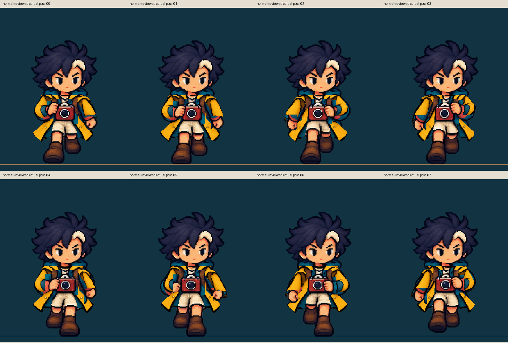

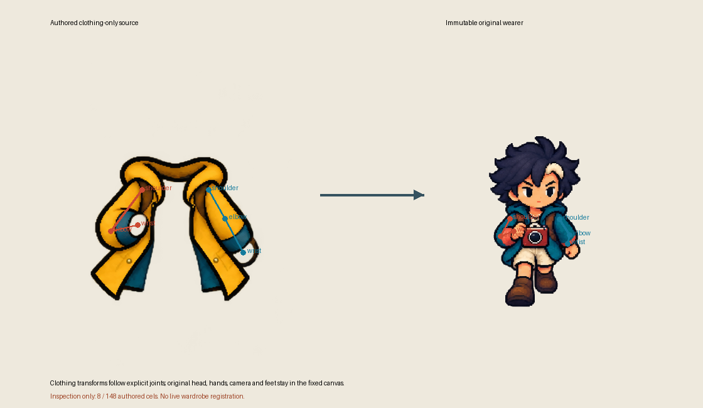

[正常短片](images/ART-18-authoring-20261021-normal-reviewed.mp4) · [四分之一時間](images/ART-18-authoring-20261021-quarter-reviewed.mp4) · [完整缺件與回退清單](images/ART-18-authoring-20261021-fallback-runtime-reviewed-coverage.json) · [正式172個請求的逐項結果](images/ART-18-authoring-20261021-fallback-runtime-reviewed-fallback-report.json) · [重建結果](images/ART-18-authoring-20261021-bake-delivery-bake-report.json) · [來源與範圍](images/ART-18-authoring-20261021-provenance.json) · [拒收歷史](images/ART-18-authoring-20261021-attempt-history.json) · [原檔、完整提示及診斷快照](images/ART-18-authoring-20261021-source-and-diagnostics.zip) · [附件雜湊清單](images/ART-18-authoring-20261021-manifest.json)。

# Commit — 2026-10-21 補齊八向專用待機衣料預覽

長外套製作預覽新增36個八方向專用待機姿勢，保留原人物眨眼、相機、紙張、背包、手與腳。配合先前正面行走8格，同一衣物的製作聯集為44/148個必要原畫格，另列104個缺格和24個慶祝回退請求；預覽持續隔離，沒有進入正式衣櫃。整票仍進行中，驗收條件維持原未勾項。

來源與目標關節都畫出後修正袖口與腕點；頭髮只有在原像素完全相同時才共用原保護。第一次數值通過的原生版本仍因短褲邊線透進長衣和袖片取進鄰片而拒收，修正後重新輸出。多份來源不能用重複姿勢或不同衣物湊出完整覆蓋。研究取捨與共通流程已同步[設計紀錄](../../design/runtime/outfit-completeness.md)及User-guide。

### 測試結果

| 範圍 | 實際結果 |
|---|---|
| 同一衣物的多來源聯集 | 44/148、缺104；另列24個非新原畫的回退請求；重複格、不同衣物及錯誤身份皆拒絕 |
| 既有頭髮與新待機身體 | 36個實際待機格、八向變更髮像素及錯用動作反例通過；整套衣物局部394項，2.58秒、0ERROR |
| 袖片鄰片反例 | 修正前保有121正確像素卻誤取23鄰片；修正後121正確、0鄰片且衣身保留，0.34秒、0ERROR；加入官方第93項檢查 |
| 原生正常／真正四分之一時間 | 1280×720、20FPS、無聲；468格23.40秒／1870格93.50秒；兩段exit0、0ERROR |
| 逐姿勢與錯位反例 | 兩速共72張實際視窗姿勢及關節圖已查看；注入1個實際螢幕像素的位移即拒絕 |
| 最後重建 | 108張新待機原人物／衣料／合成PNG與原生輸入逐位元相同；舊正面原人物／完整合成16張PNG保持逐位元相同 |
| Python完整可用套件 | 本機128/128，42.493秒，包含13項衣料清單檢查 |
| 前批完整CI | 460db2a的124項Python、92個Godot實際執行皆成功；不含本批新待機與第93項檢查，本批留新CI |

這是2D製作視窗，採原待機每格時長；不是正式衣櫃輸入、髮尾動態、降低動態或輸出包驗收。影片完整解碼，不聲稱連續觀看或真人試玩。

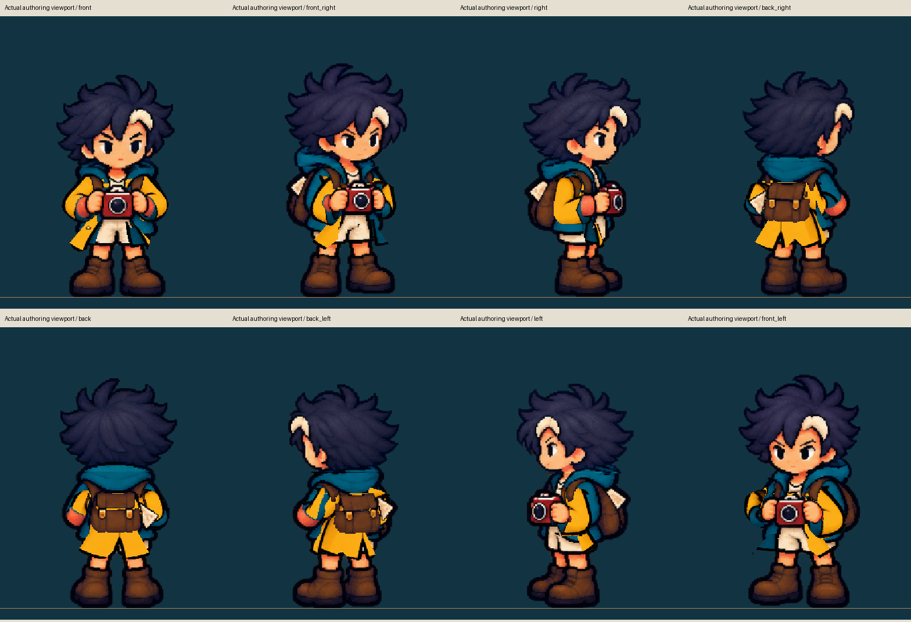
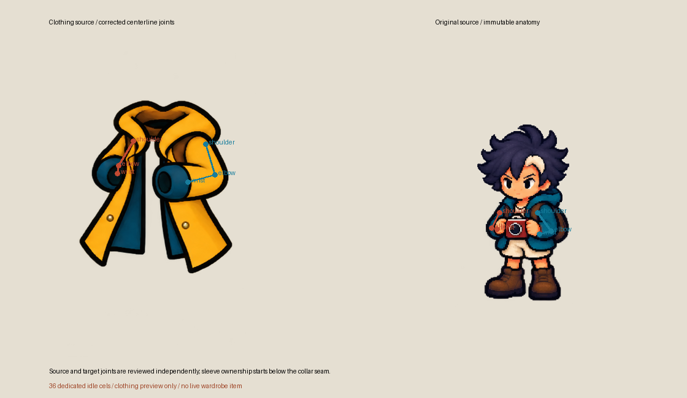

[正常短片](images/ART-18-idle-cloth-20261021-normal-v2.mp4) · [真正四分之一時間](images/ART-18-idle-cloth-20261021-quarter-v2.mp4) · [正常逐姿勢1](images/ART-18-idle-cloth-20261021-normal-v2-poses-1.png)／[2](images/ART-18-idle-cloth-20261021-normal-v2-poses-2.png)／[3](images/ART-18-idle-cloth-20261021-normal-v2-poses-3.png) · [慢放逐姿勢1](images/ART-18-idle-cloth-20261021-quarter-v2-poses-1.png)／[2](images/ART-18-idle-cloth-20261021-quarter-v2-poses-2.png)／[3](images/ART-18-idle-cloth-20261021-quarter-v2-poses-3.png)。

[缺件與回退清單](images/ART-18-idle-cloth-20261021-combined-coverage.json) · [全部範圍與來源](images/ART-18-idle-cloth-20261021-verification.json) · [拒收歷史](images/ART-18-idle-cloth-20261021-attempt-history.json) · [前批實際完整CI](images/ART-18-idle-cloth-20261021-ci-460db-verification.json) · [完整提示、原檔與診斷](images/ART-18-idle-cloth-20261021-source-and-diagnostics.zip) · [附件雜湊](images/ART-18-idle-cloth-20261021-manifest.json)。

# Commit — 2026-10-22 衣身底料保護與拒收流程

固定起點 `59a494f`；分支 `codex/finish-runtime-batch-20261020`。

持相機的衣料改到擺臂時，舊袖子範圍會在獨立衣身上挖出缺口。現在製作預覽可分別核對衣身與袖片來源；無袖款明確保留原臂所有權。錯誤來源、越界、尺寸與缺件會拒絕，原人物與正式衣櫃不因製作試驗而改變。

本輪重新實際閱讀Spine、Unity、Aseprite、Godot、Universal LPC及Spriter六個團隊的相關原文件，保存兩張已查看的官方靜態圖。採用原則、原件、完整提示及製作取捨見[研究與設計紀錄](../../design/runtime/outfit-completeness.md)。

| 驗證 | 結果 |
|---|---|
| 局部資料驗證 | 19項通過；獨立衣身來源、自己的圖格尺寸、原臂所有權與構造反例均有核對 |
| 真引擎缺口反例 | 保留舊排除行為時exit1／1ERROR；正確版本0.35秒、exit0／0ERROR，原袖片與鄰片保護仍成立 |
| 既有衣料回歸 | 原正面24張、八向待機108張，共132張PNG逐位元相同 |
| 新衣物審圖 | 56格外套與100格另一款長背心草稿均拒收；新批准衣料格為0，不與舊44格混算 |
| 拒收原生紀錄 | 正常速度100格製作檢視，頭腳數值通過仍因遮擋／接縫破綻拒收；1280×720、20FPS、628幀31.40秒無聲影片完整解碼 |
| 前置main完整CI | 59a494f的137項Python、93項Godot及5範圍實際成功；不含本輪製作能力改動，本輪留新CI |

審圖拒絕原因包括舊短褲邊線、背包被切去下半部、手掌被衣料覆蓋及原臂範圍不準。這些草稿未上架，也不計為新增已批准覆蓋；原長外套維持44/148，缺104格與24個非新原畫的慶祝回退請求。整票仍進行中，未勾條件保持原狀。本輪沒有新的正常／慢放正式換裝、降低動態或輸出包驗收。

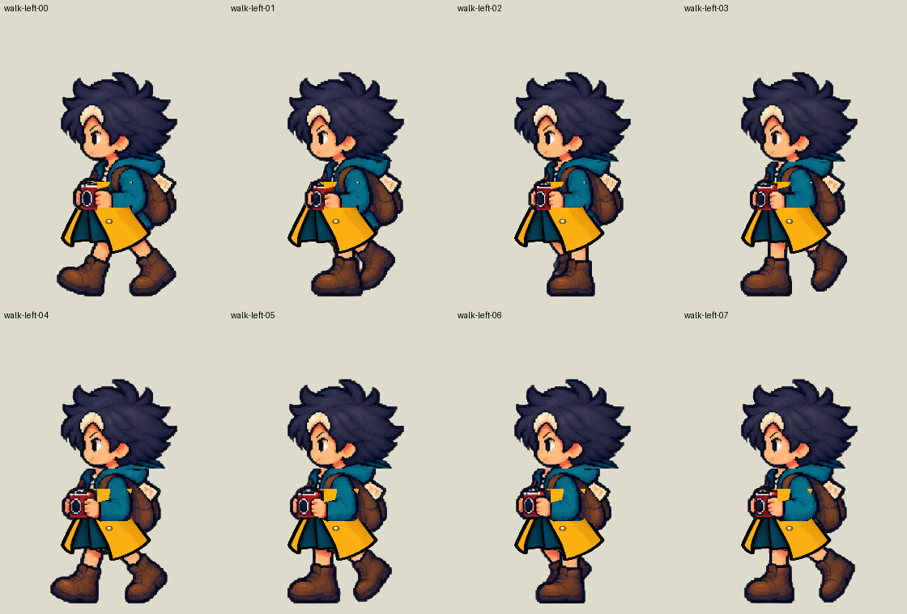
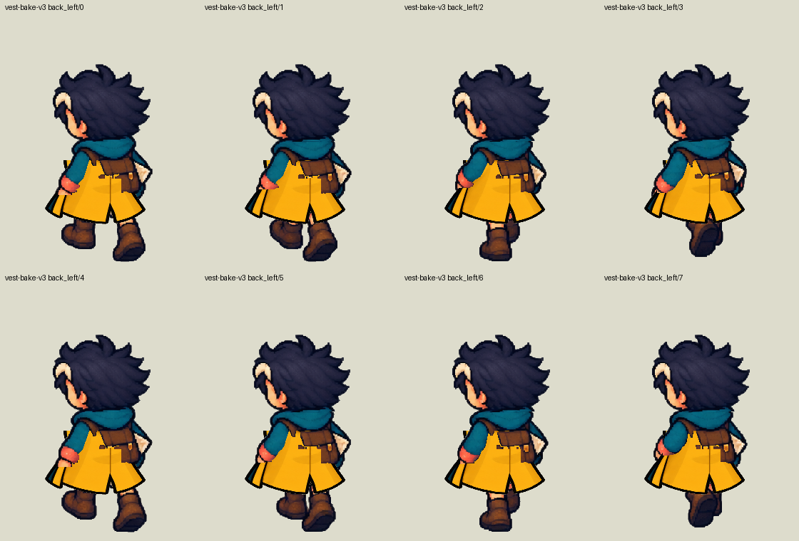

[局部驗證與完整範圍](images/ART-18-underlay-20261022-verification.json) · [反例與修正](images/ART-18-underlay-20261022-part-delivery.json) · [拒收影片](images/ART-18-underlay-20261022-rejected-native.mp4) · [來源／完整提示與診斷](images/ART-18-underlay-20261022-rejected-sources-and-diagnostics.zip) · [附件指紋](images/ART-18-underlay-20261022-manifest.json)。
