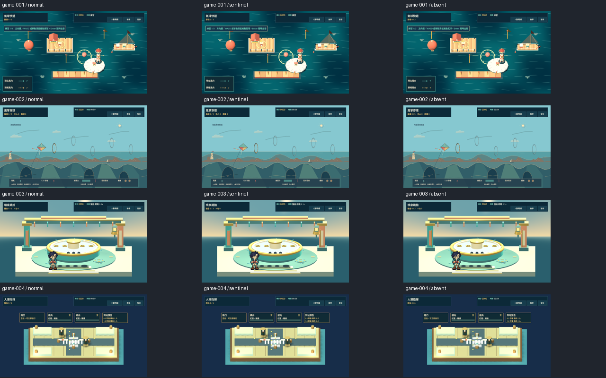
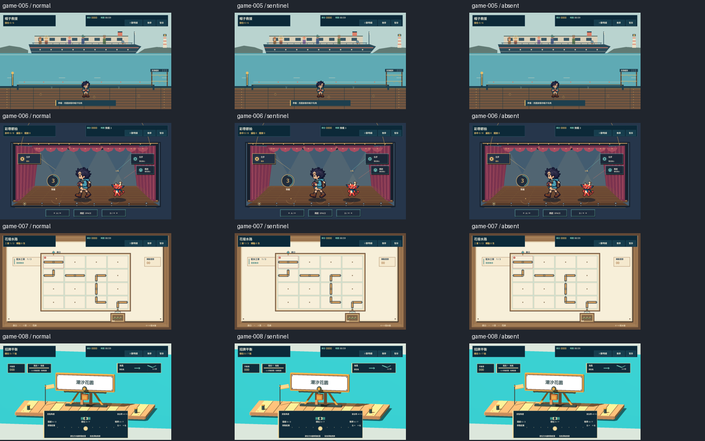
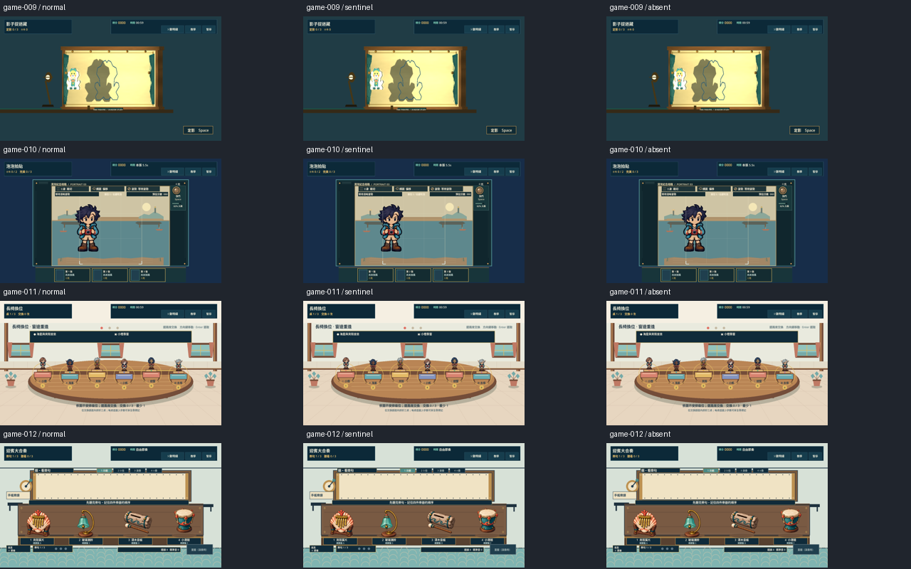
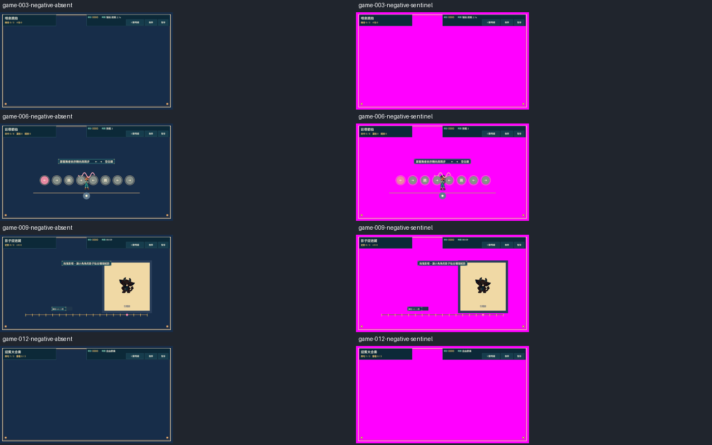

# [ART-19] 修正海港背景美術風格

> 狀態：封存（由 ART-5 取代）

開始基準：`5d74214`；分支：`feature/island-first-park`。

## 內文

### 需求
修正海港、溫室廣場、夕陽舞台和夜間入口四格背景的通用生成插畫感，保留原有場景構圖與海港遊樂園特色。背景與已認可角色使用一致的高細節像素語言，建築、植物、石材與光影有明確結構和細節取捨。

### 來源
2026-10-12 使用者提供四格背景圖並指出「太 AI」，要求修正。使用者此前要求參考至少六方方法、維持自己的美術風格；不只研究，須保存實際審閱的畫面。

### 驗收條件
- [x] 比較至少六個來源的背景形狀、材質、可讀性與製作方法，附閱讀紀錄、採用理由及參考截圖。
- [x] 四格保留海港、溫室、舞台、夜間入口構圖與可供遊戲使用的空間，畫面使用一致且細緻的像素形狀。
- [x] 建築支撐、窗格、欄杆、台階和地面透視可辨且合理；花葉與表面細节有取捨，沒有糊成一片的裝飾或滿幅均勻噪點。
- [ ] 每格光源與影子方向一致，夜間燈光範圍可辨；與現有角色配色、輪廓和細節密度協調。
- [ ] 原生小遊戲與背景時段切換、降低動態及輸出版本正常；實際檢視全圖、遊戲尺寸和代表角色疊放畫面。
- [x] 票保留原圖、修正版、提示詞與工具紀錄、原生截圖及測試結果。

### 測試流程
1. 比較原圖與修正版全圖及遊戲尺寸，逐格查看建築、植物、石材與光影。
2. 在十二款小遊戲與四時段中確認背景、角色及互動物件可辨。
3. 切換降低動態、重新進入並在輸出版本確認資源載入，保存實際看過的畫面。

---

# 跟其他票的關係

- Blocks：無
- Blocked by：無
- Related：ART-5、ART-13、ART-17、ART-18、ART-21

---

# Commit-1

## 問題

原四格背景的筆刷、植物與材質密度過於平均，且放進遊戲時被拉伸，建築輪廓和可操作物件不易區分。

## 改動

保留碼頭、溫室、帷幕舞台與夜間拱廊，改用有取捨的像素群、清楚支撐和海島配色；遊戲畫面維持原圖比例。原圖、修正版與生成紀錄均保留，研究比較七個來源並附實際查看的像素群例圖。

## 驗收

已親自查看四格原圖／修正版，以及十二款遊戲四時段共 48 張原生畫面。窗格、欄杆、輪廓與角色可辨，關聯小遊戲 42 個案例、時段和日照局部測試通過；原生截圖流程及降低動態操作通過。這輪是背景呈現驗收，沒有宣稱十二款玩法試玩通關。時段目前仍是洗色配合既有動態物件，圖內固定光影不會重新計算；因此光影與輸出版本條件保留未勾選，票維持進行中。

### 參考與紀錄

[七方閱讀與採用理由](../../design/runtime/background-art-revision.md)。生成提示詞、來源和雜湊保存在背景資產紀錄，工具為內建 image generation。

48 張完整畫面依 images/ART-19-game-01–12-dawn/noon/dusk/night.png 命名；降低動態畫面為 images/ART-19-reduced-motion-on.png。

分支：`feature/island-first-park`。[遠端提交](https://github.com/deadline314/Snapland/commit/64fcf8cbd313ba350c7165a2e4ec914398a8f943)。

# 封存

2026-10-24 核對現行十二款小遊戲後，四格共用背景已由 ART-5 的各款專用場景取代，時段與降低動態畫面由 ART-21 的 60 格現行矩陣驗收。延續使用者允許重做簡陋場景的方向，保留原圖與歷史紀錄，停止把已不在玩家畫面中的舊四格圖當作現行美術交付。舊圖固定光影與原輸出條件保持未勾選；封存不代表這兩項原畫要求已完成。

# Commit-2

## 內文

逐一確認十二款現行入口均有自己的場景。凍結動作並收起暫停遮罩後，原背景、整幅洋紅測試背景及完全不畫舊背景三種狀態，1280×720 全畫面像素逐位元組一致，12／12 通過。四款仍有舊背景繪製呼叫的場景，再暫時隱藏新版場景，洋紅與空白比較均能偵測出差異，4／4 反向對照通過。其餘八款已不呼叫舊背景。這輪只查可見性，不改遊戲程式、不刪原圖、不新增玩法通關或輸出版本聲稱。

### 測試結果

| 項目 | 結果 |
|---|---|
| 原生初始場景比較 | 12／12 全畫面相同，28.32 秒，exit 0、0 ERROR |
| 反向對照 | 4／4 能偵測裸露的舊背景替換 |
| 實際查看 | 三頁共 36 張正向畫面及一頁 8 張反向畫面 |
| 現行時段／降低動態 | 沿用 ART-21 的已交付 60 格驗收，不冒稱本輪重跑 |

[完整畫面、原始紀錄及重播程序](images/ART-19-retired-20261024-evidence.zip)；[來源版本、範圍及雜湊](images/ART-19-retired-20261024-review.json)。

