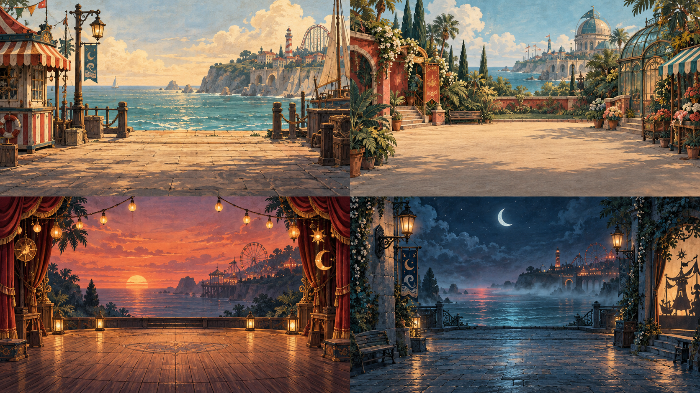
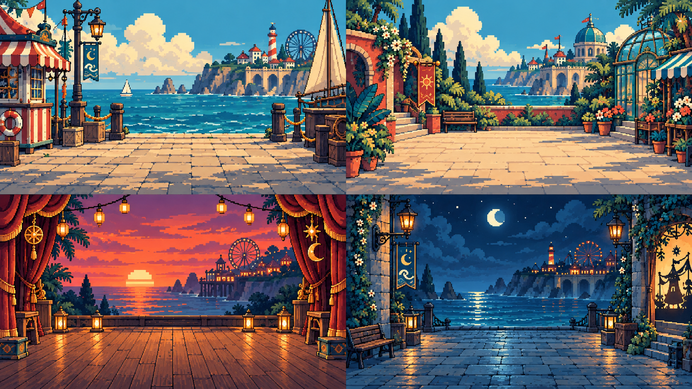
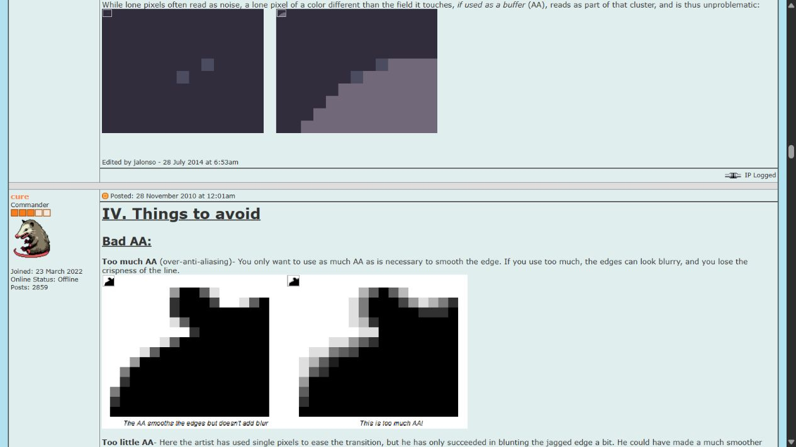
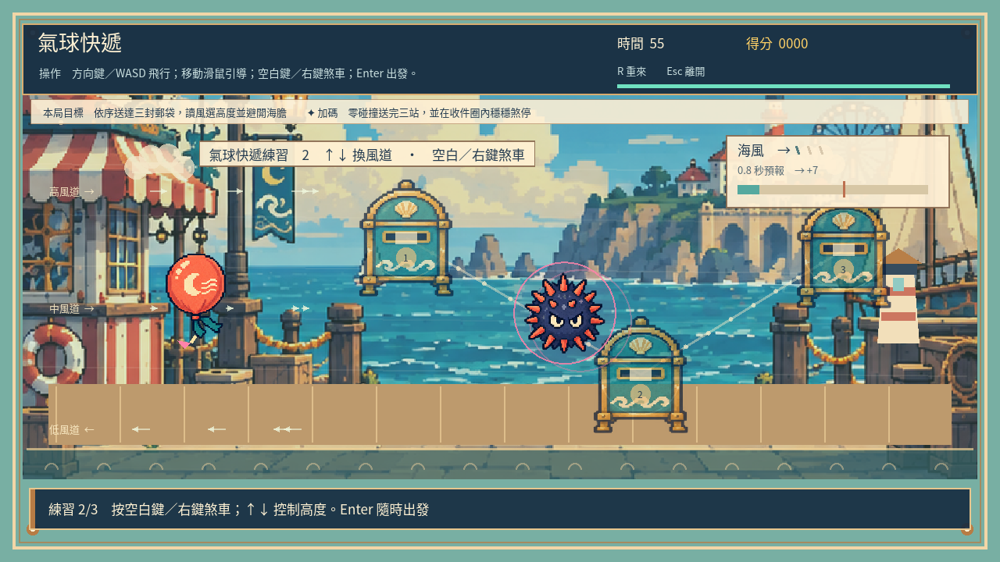
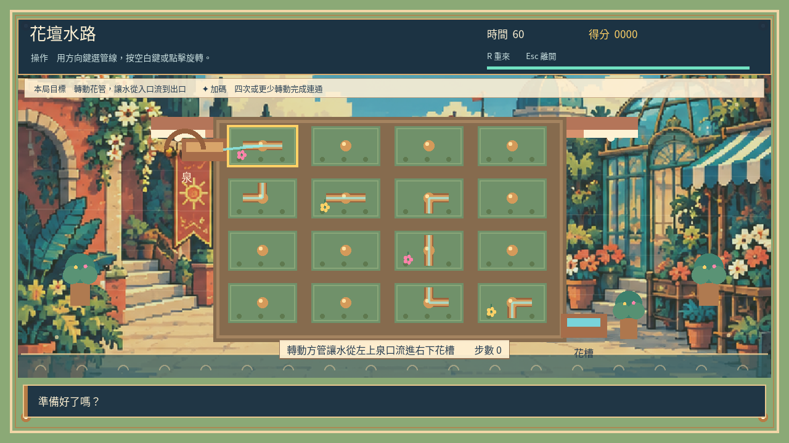
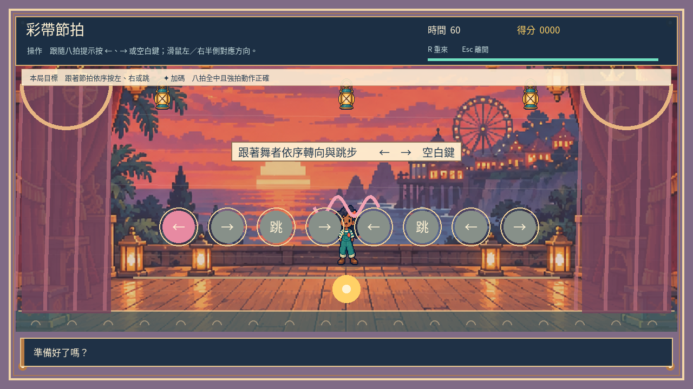
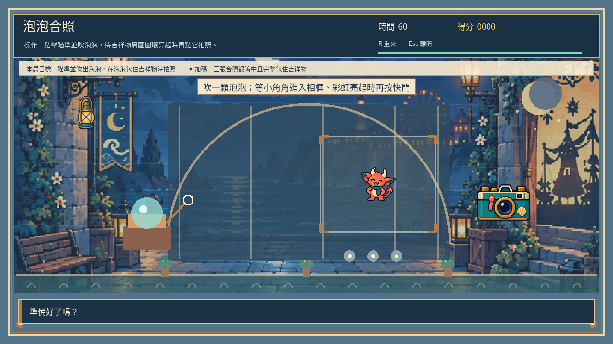

# [ART-19] 修正海港背景美術風格

> 狀態：進行中

開始基準：`5d74214`；分支：`feature/island-first-park`。

## 內文

### 需求
修正海港、溫室廣場、夕陽舞台和夜間入口四格背景的通用生成插畫感，保留原有場景構圖與海港遊樂園特色。背景與已認可角色使用一致的高細節像素語言，建築、植物、石材與光影有明確結構和細節取捨。

### 來源
2026-10-12 使用者提供四格背景圖並指出「太 AI」，要求修正。使用者此前要求參考至少六方方法、維持自己的美術風格；不只研究，須保存實際審閱的畫面。

### 驗收條件
- [x] 比較至少六個來源的背景形狀、材質、可讀性與製作方法，附閱讀紀錄、採用理由及參考截圖。
- [x] 四格保留海港、溫室、舞台、夜間入口構圖與可供遊戲使用的空間，畫面使用一致且細緻的像素形狀。
- [x] 建築支撐、窗格、欄杆、台階和地面透視可辨且合理；花葉與表面細节有取捨，沒有糊成一片的裝飾或滿幅均勻噪點。
- [ ] 每格光源與影子方向一致，夜間燈光範圍可辨；與現有角色配色、輪廓和細節密度協調。
- [ ] 原生小遊戲與背景時段切換、降低動態及輸出版本正常；實際檢視全圖、遊戲尺寸和代表角色疊放畫面。
- [x] 票保留原圖、修正版、提示詞與工具紀錄、原生截圖及測試結果。

### 測試流程
1. 比較原圖與修正版全圖及遊戲尺寸，逐格查看建築、植物、石材與光影。
2. 在十二款小遊戲與四時段中確認背景、角色及互動物件可辨。
3. 切換降低動態、重新進入並在輸出版本確認資源載入，保存實際看過的畫面。

---

# 跟其他票的關係

- Blocks：無
- Blocked by：無
- Related：ART-5、ART-13、ART-17、ART-18

---

# Commit-1

## 問題

原四格背景的筆刷、植物與材質密度過於平均，且放進遊戲時被拉伸，建築輪廓和可操作物件不易區分。

## 改動

保留碼頭、溫室、帷幕舞台與夜間拱廊，改用有取捨的像素群、清楚支撐和海島配色；遊戲畫面維持原圖比例。原圖、修正版與生成紀錄均保留，研究比較七個來源並附實際查看的像素群例圖。

## 驗收

已親自查看四格原圖／修正版，以及十二款遊戲四時段共 48 張原生畫面。窗格、欄杆、輪廓與角色可辨，關聯小遊戲 42 個案例、時段和日照局部測試通過；原生截圖流程及降低動態操作通過。這輪是背景呈現驗收，沒有宣稱十二款玩法試玩通關。時段目前仍是洗色配合既有動態物件，圖內固定光影不會重新計算；因此光影與輸出版本條件保留未勾選，票維持進行中。

### 參考與紀錄

[七方閱讀與採用理由](../../design/runtime/background-art-revision.md)。生成提示詞、來源和雜湊保存在背景資產紀錄，工具為內建 image generation。

48 張完整畫面依 images/ART-19-game-01–12-dawn/noon/dusk/night.png 命名；降低動態畫面為 images/ART-19-reduced-motion-on.png。

分支：`feature/island-first-park`。本次提交連結於推送後補登。
