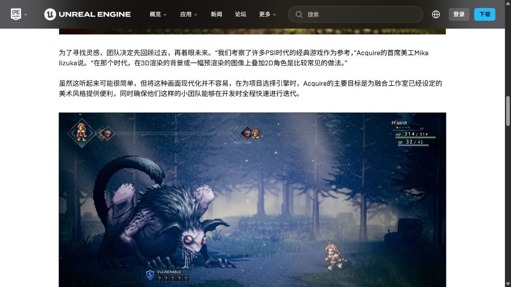
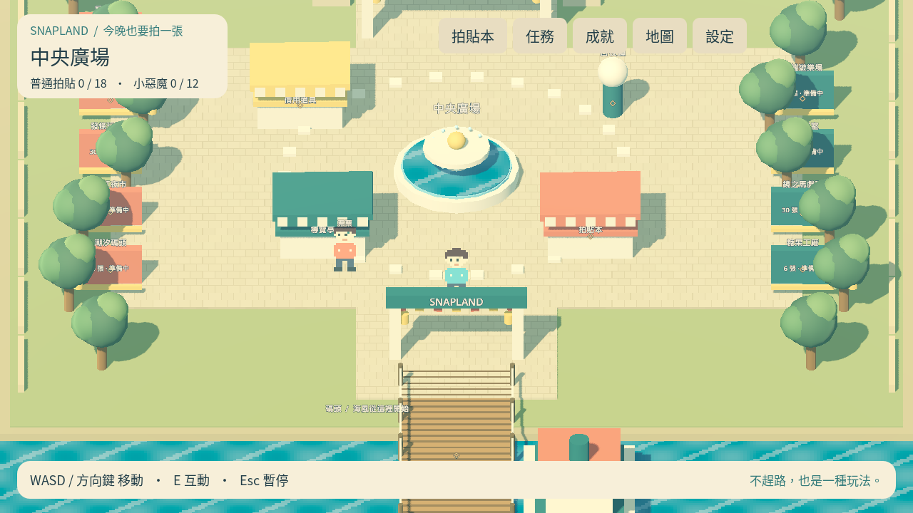
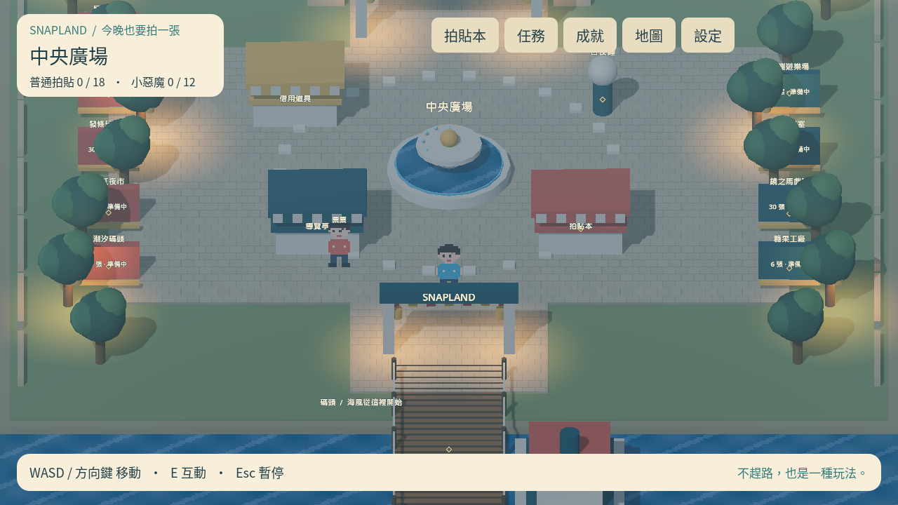
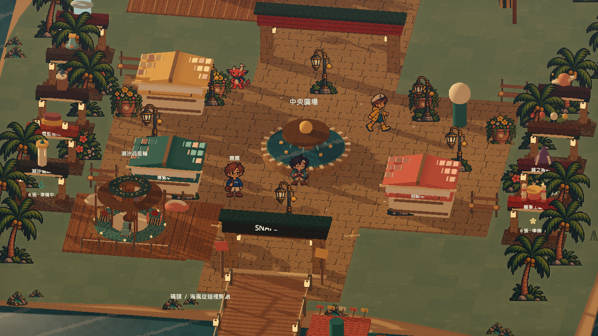
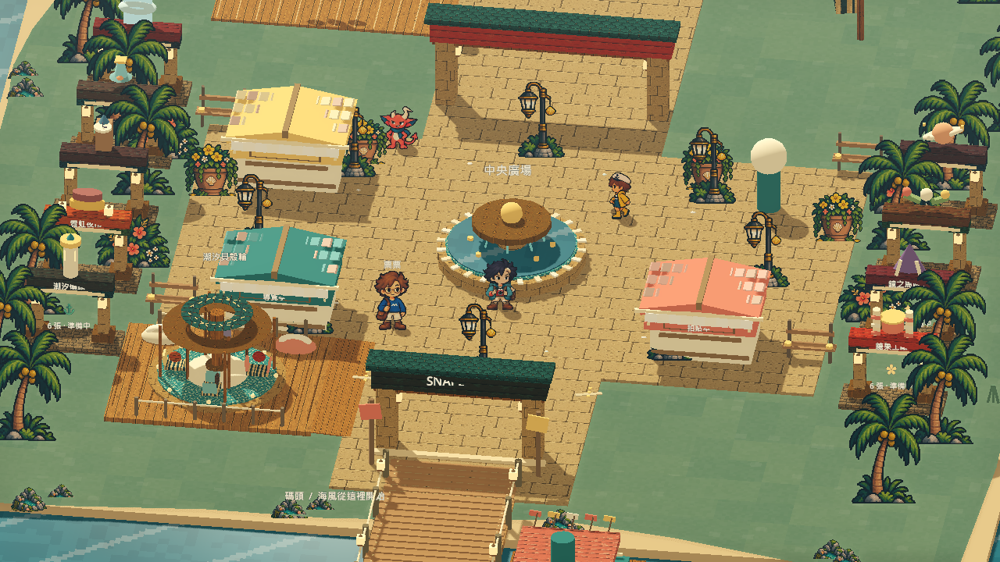
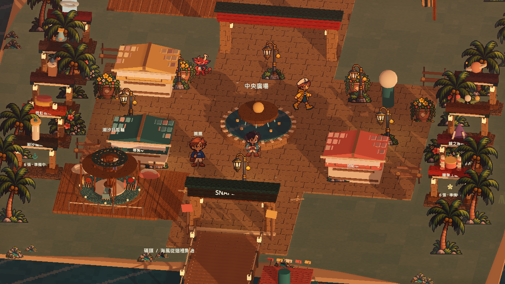
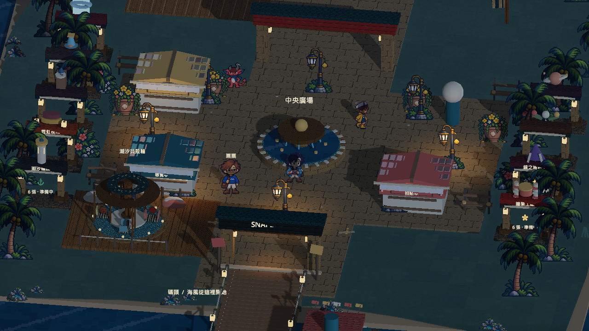
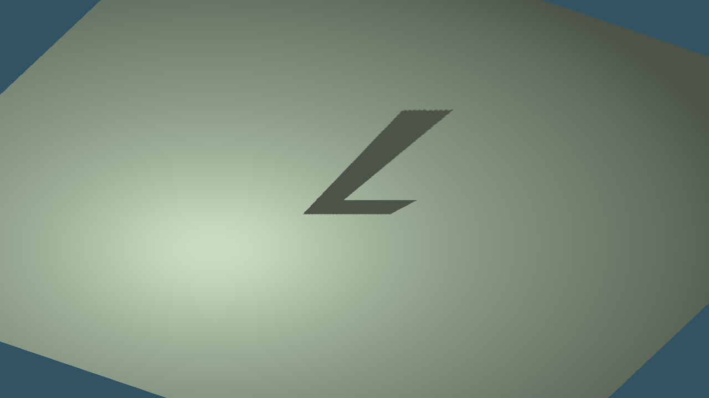
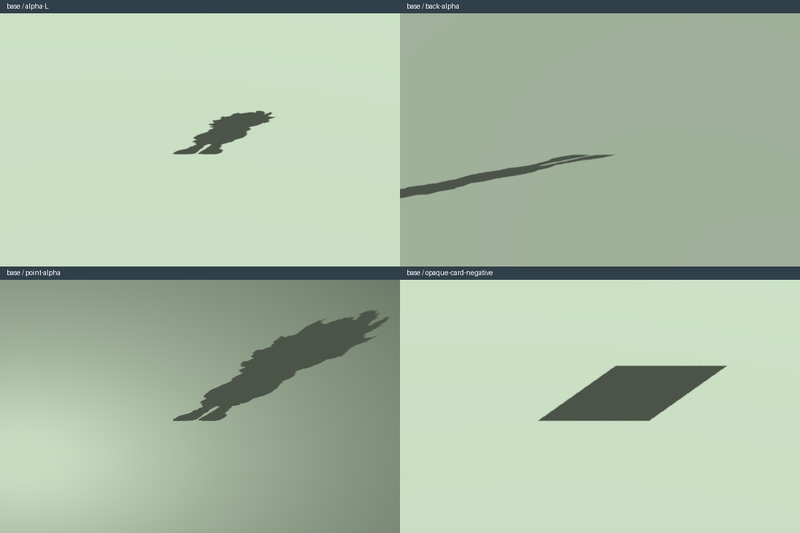
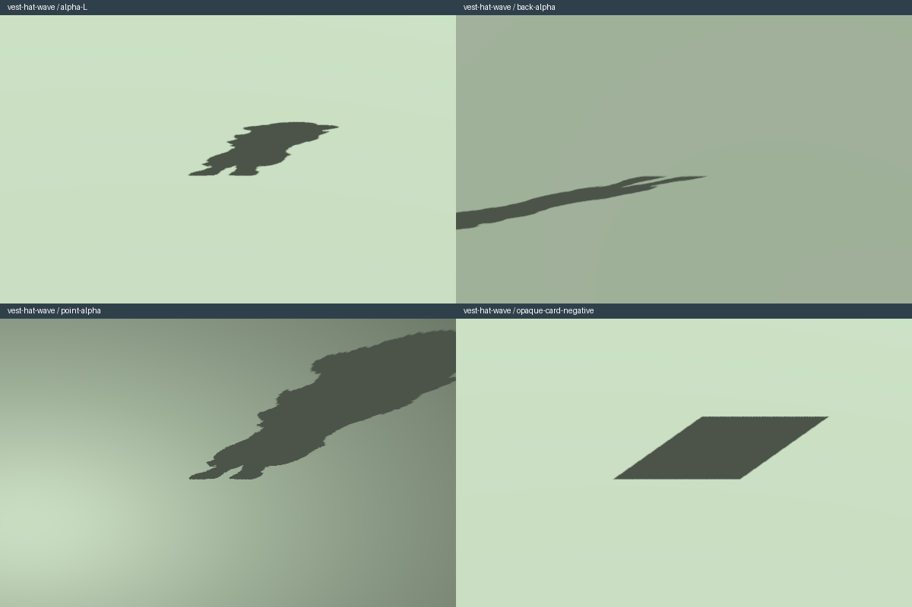

# [ART-1] 建立立體像素園區光影

> 狀態：進行中

## 內文

### 需求

園區採像素角色與立體環境，具有光影、動態水面、植栽與角色動作。

### 來源

使用者於 2026-10-11（Asia/Taipei）要求從上島開始實作主區域、迎賓大道全部小遊戲及共用系統；其他園區先做路口。每項實作前研究業界實例並保存圖例；本票是可執行第一版，品質以實際驗收為準。

### 驗收條件

- [x] 碼頭、廣場與迎賓大道有可辨識地標、實際光影與環境動態。
- [x] 角色有移動及面向動畫；畫面經原生 GPU 查看並附截圖。
- [x] 實作前提供已讀的業界圖例與來源，研究圖片只供審閱。

### 測試流程

1. 啟動遊戲，進入本票內容，依畫面提示實際操作。
2. 核對本票每項驗收條件，測試返回、重試、重開與輔助情境。
3. 保存原生畫面截圖與局部測試摘要；無法確認的項目保持未勾選。

---

# 跟其他票的關係

- Blocks：無
- Blocked by：MAIN-3
- Related：MAIN-1、SG-1、ST-1

---

## 開始基準

c1b7b19；feature/island-first-park。

## 業界研究

參見 [園區與介面研究](../../design/runtime/world-research.md)，來源在實作前讀取。

# Commit-1

## 內文

問題：主區域尚無HD-2D場景、動態與光影。

改動：像素角色走進立體碼頭、主廣場與迎賓大道，水面、旗幟、植栽與日夜光影連動。

驗收：Intel Arc B580原生GPU画面已查看，角色面向與步行、日夜及降低動態通過。

分支：`feature/island-first-park`；開始基準：`c1b7b19`；[程式 commit](https://github.com/deadline314/Snapland/commit/f2d6b84919a91d534082660a12aec5a9b44eaa2c)。

### 測試結果

| 項目 | 結果 |
|---|---|
| 受影響局部驗證 | 本票相關runtime與主場景整合通過 |
| 原生畫面 | GPU擷取並查看；程式化操作驗收 |
| 遠端CI | 帳戶限制，工作未啟動；未重試 |

### 研究與圖例

[園區與介面研究](../../design/runtime/world-research.md)。圖例為審閱參考，不是本作遊戲素材或試玩證據。

### 截圖

[整組驗收、票況與存檔事故紀錄](../first-playable-delivery.md)。

## 2026-10-13 試玩後修訂

使用者否定目前島上畫面／動畫／介面品質。歷史交付證據只代表當時版本與當時範圍；本輪新增品質驗收如下。

- [ ] 新島畫面有清楚前景、中景、遠景、高度與材質層次；角色接地、陰影與實際光源一致，不以存在3D節點判定HD-2D美術通過。
- [ ] 保存本輪原生前後畫面與影片，實際查看後記錄通過或拒絕原因。

Related：ART-22、MAIN-11、MAIN-14、MAIN-15、ST-5。

# Commit-2

### 問題
角色像平面紙片投影，背景與角色的光照方向不一致，夜間燈光也缺少與附近物件互動的陰影。

### 改動
角色表面跟隨場景光源，腳下保留置中的柔和接地陰影；日照與附近兩盞燈產生方向陰影。凌晨、中午、傍晚、晚上各有不同的天空、填光和燈光，燈光數量維持受控。票票移到入口屋頂遮不到全身的位置。

### 驗收
主 Session 以本票提交內容重建並執行光影、地圖和設施局部驗證，三項全過，載入及執行沒有 ERROR。原生 GPU 擷取四時段共 361 格／6.017 秒，四張最終圖片均已實際查看：地面長影會隨日照改變，夜間燈光照亮附近人物，票票的完整全身可見。角色方向影是近似體積，未精確描出頭髮、衣服與坐姿；本段不宣稱完整角色動畫或整島精品品質通過，新增品質条件維持未勾。

### 測試與證據
[多方向研究與圖例](../../design/runtime/island-experience-references.md) · [光影取捨与驗證界限](../../design/runtime/character-lighting-shadows.md) · [局部驗證](images/ART-1-island-final-lighting-local.log) · [原生紀錄](images/ART-1-island-final-native.log) · [四時段報告](images/ART-1-island-final-report.json) · [原生四時段影片](images/ART-1-island-final-normal.mp4)。

本輪固定基準：`939130f`；分支：`feature/island-experience`；票況：進行中。共用變動包括 MAIN-11 的票票站位與 MAIN-15 的入口距離驗證，保留原有通路、互動及設施測試斷言；本段為受控場景檢查，沒有人工試玩或試聽宣稱。

# Commit-3

## 內文

先驗證透明輪廓能否保留缺口，避免正式角色從近似體積換成整張方卡陰影。
獨立原生場景以正面方向光、背面方向光及夜燈逐一投影透明 L 形；三組各
13 個實心與 32 個透明內部採樣全部符合。故意換成不透明方卡時，32 個缺口
全部被填滿，驗證明確拒絕。低解析度反例亦失敗；之前寬範圍試作的方向光
失敗結果保留。四張投影／反例畫面均已實際查看。

這是獨立輪廓可行性驗證，正式島嶼角色仍維持原近似陰影；角色、衣髮、動作
和整島品質不由這組幾何樣本代替驗收。原有未勾選條件及進行中狀態保留。

### 測試結果

| 項目 | 結果 |
|---|---|
| 原生 GPU 正常樣本 | 2.38 秒，exit 0，0 ERROR |
| 不透明方卡反例 | 32／32 透明缺口不符，按預期拒絕 |
| 低解析度反例 | 2.19 秒，exit 1，1 預期驗證 ERROR |
| 正式遊戲光影改動 | 無；本輪僅獨立驗證 |

### 截圖與紀錄

[正常採樣](images/ART-1-alpha-shadow-20261024-accepted-samples.json) ·
[原生執行紀錄](images/ART-1-alpha-shadow-20261024-accepted-execution.log) ·
[低解析度反例](images/ART-1-alpha-shadow-20261024-low-resolution-negative-samples.json) ·
[先前失敗採樣](images/ART-1-alpha-shadow-20261024-rejected-wide-samples.json) ·
[證據雜湊](images/ART-1-alpha-shadow-20261024-hashes.json) ·
[研究與重跑流程](../../design/runtime/character-lighting-shadows.md#alpha-silhouette-feasibility-review-2026-10-24)。

# Commit-4

## 內文

把同一獨立投影檢查延伸到正式主角的兩張完整合成圖：原外套正面待機第0格，
以及免費長背心、草帽、正面招手第0格。保留原人物畫布與腳底位置，沒有重畫
或調整人物；兩張來源及兩組四格投影對照已實際查看，頭髮／帽緣與鞋間缺口
可在投影辨認。背向低角度長影另保留完整原生圖片。

| 實際範圍 | 結果 |
|---|---|
| 原外套靜態合成 | 4.26秒，exit0／0ERROR；三光源實心156／156符合；透明370／370、365／370、370／370符合 |
| 長背心＋草帽＋招手首格 | 5.38秒，exit0／0ERROR；三光源實心263／263符合；透明254／257、251／257、257／257符合 |
| 方卡反例 | 兩組透明採樣各0／370、0／257符合，按原條件拒絕 |
| 原L形／低解析度反例重跑 | 正常2.57秒exit0／0ERROR；低解析度2.14秒exit1／1項預期ERROR |

以上只驗靜態合成的內部輪廓，不是全部頭髮邊緣、完整招手、動態髮尾、坐姿、
八方向、正式島嶼、影片或輸出包驗收。原判定維持，整票及品質條件不勾選。

[原外套逐樣本](images/ART-1-character-alpha-20261024-base-samples.json) ·
[長背心逐樣本](images/ART-1-character-alpha-20261024-vest-hat-wave-samples.json) ·
[原外套來源](images/ART-1-character-alpha-20261024-base-source.png) ·
[長背心來源](images/ART-1-character-alpha-20261024-vest-hat-wave-source.png) ·
[原外套原生紀錄](images/ART-1-character-alpha-20261024-base-execution.log) ·
[長背心原生紀錄](images/ART-1-character-alpha-20261024-vest-hat-wave-execution.log) ·
[證據指紋](images/ART-1-character-alpha-20261024-hashes.json)。
