# [ART-20] 重整遊園介面視覺層級

> 狀態：進行中

開始基準：`64fcf8cbd313ba350c7165a2e4ec914398a8f943`；分支：`feature/island-first-park`。

## 內文

### 需求
重新設計遊園 HUD、主選單、對話、任務、成就、收藏、商店、換裝、日夜、暫停與設定的視覺及操作層級。使用原創海港樂園語言，提供足夠的細節和清楚的空間分配，避免單薄方框、平均堆疊装飾與資訊噪音。

2026-10-12 使用者追加建議採 3D 或偽 3D 增加深度。比較旅券、收藏本及衣櫃的厚度、投影、凸起頁籤與適度開合；清楚文字、輸入焦點和降低動態設定仍優先。

### 來源
2026-10-12（Asia/Taipei）使用者要求全面重新審閱 UI 和小遊戲，提升目標、計分及操作手感；先廣泛 survey，減少遊戲當下提示，提供含截圖的完整教學。使用者授權自行決定設計，強調循序完善、細節有主次且不雜亂，以可面向大眾的品質驗收。

### 驗收條件
- [x] 實際比較至少八個跨不同團隊的一手 UI、遊戲與可用性來源，保存採用理由及看過的截圖。
- [ ] 所有列明介面有統一而有特色的字階、圖標、材質與層級；主要任務、收藏與操作一眼可辨。
- [ ] 鍵盤、滑鼠、焦點、返回與資料空白狀態可用；常見視窗、日夜與降低動態下沒有裁切或操作穿透。
- [ ] 保存全套原生前後截圖、實際操作影片與局部測試結果。

### 參考資料與實際觀察

已閱讀十項一手介面及可用性資料，跨 Nintendo、Apple、Microsoft、W3C、Valve 與 Disney；各項採用理由、文字閱讀及未觀看影片的界線見[研究紀錄](../../design/runtime/ui-quality-survey.md)。另實際查看三款遊戲的公開畫面，見[畫面比較](../../design/runtime/ui-visual-review.md)。

- [Sea of Stars 官方圖例](https://sabotagestudio.com/presskits/sea-of-stars/)：狀態集中在角落，選擇靠近操作對象，主要場景保留空間。採用資訊層級，不複製戰鬥框樣式。
- [Dave the Diver 官方畫面](https://store.steampowered.com/app/1868140/DAVE_THE_DIVER/)：任務、時間與工具分組，需求靠近對象；不照搬經營畫面的資訊密度。
- [Hades 官方更新說明](https://www.supergiantgames.com/blog/hades-superstar-update-patch-notes/)：閱讀了暫停變暗、減少重複數值和讓返回更清楚的說明；本項沒有觀看遊戲畫面。

### 測試流程
1. 查看本票研究紀錄與圖例，核對採用的原則和原生前後比較。
2. 使用隔離存檔實際操作本票完整流程，核對各項驗收條件。
3. 核對重試、返回、重開與相關設定，保存原生截圖、影片和受影響測試摘要。

---

# 跟其他票的關係

- Blocks：無
- Blocked by：無
- Related：ART-6、ART-8、ART-21、MAIN-10

---

# Commit-1

## 問題
旅券、地圖、收藏與成就曾共用簡單清單，小視窗的文字、按鈕與返回位置不穩定。

## 改動
遊園介面改用海港旅券、摺疊地圖、翻頁收藏本與印章卡；增加紙張厚度、凸起按鈕、清楚標題及固定返回位置。內容可捲動，小視窗保持可讀文字與足夠按鈕面積，衣櫃保留全身預覽。

## 驗收
以獨立存檔，在本次可提交版本實際操作九種遊園介面、四個時段及降低動態開關，1280×720 與 800×600 都通過；親自查看小視窗地圖、收藏、成就、衣櫃、時段及主畫面。此段驗收限遊園介面，整套小遊戲及教學介面仍由相關票繼續完善。

### 測試結果
- 可提交版本：地圖／收藏／成就 59 項通過；衣櫃檢查通過；原生遊園介面輸入流程通過，0 腳本或引擎錯誤。
- 證據：[驗收摘要](images/ART-20-review.json)、[原生操作影片](images/ART-20-native-ui.mp4)。
- 分支：`feature/island-first-park`；[遠端交付提交](https://github.com/deadline314/Snapland/commit/da19582)。

### 截圖

# Commit-2

## 問題

衣櫃和商店的選中頁籤、鏡框與主要動作層級不夠清楚；小視窗調整時，操作列、商品焦點和價格資訊可能難以完整閱讀。

## 改動

衣櫃改以深色選中頁籤、凸起試衣鏡框和單一主要動作建立層級；商品金額與餘額不足狀態改用深色字，並在視窗縮小後重新排版及保持所選商品可見。保留實際購買、穿戴、取消及降低動態行為。

## 驗收

以隔離存檔執行同一原生輸入流程，在乾淨基準版及候選版各取得六張對照畫面。候選版原生 v4 完成六張擷取且無引擎或腳本錯誤；已檢視標準商店、降低動態商店、800×600 商店與外觀畫面，所選商品、全身預覽、價格、狀態與操作列均可見。另完成並播放標準尺寸影片至結尾，核對開頭與結尾畫面。這是自動化原生介面流程及指定畫面的人工檢視，不代表完整遊戲試玩、完整衣櫃動畫檢查或本票所有介面都已完成視覺驗收，因此本票維持進行中。

### 測試結果

| 項目 | 結果 |
|---|---|
| 衣櫃 UI 局部測試 | 通過 60 項，0 錯誤 |
| 核心與衣櫃執行檢查 | 通過，0 錯誤；損壞存檔案例的預期警告除外 |
| 教學面板與目錄 | 通過，0 錯誤 |
| 原生候選版 v4 | 六張畫面完成，0 引擎或腳本錯誤 |
| 標準尺寸原生影片 | 242 幀、60 fps、1280×720，播放至 4.033 秒結尾；檢視開頭與結尾畫面 |

### 基準版與候選版畫面

| 畫面 | 基準版 | 候選版 |
|---|---|---|
| 標準外觀 | 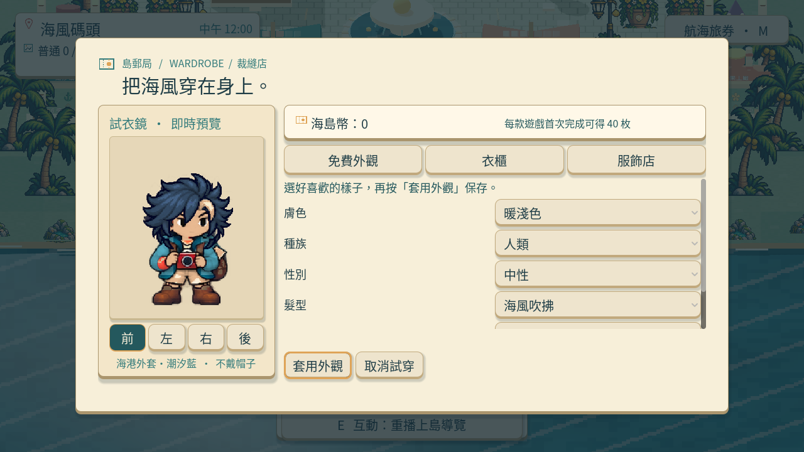 | 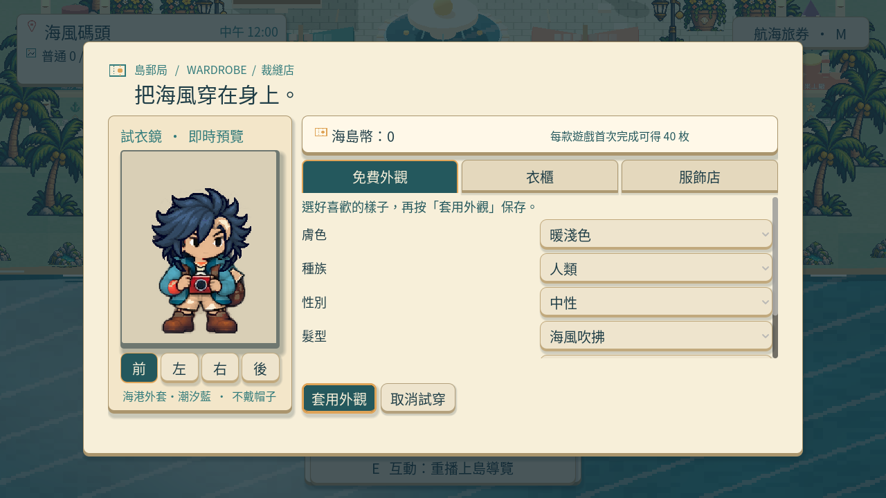 |
| 標準衣櫃 | 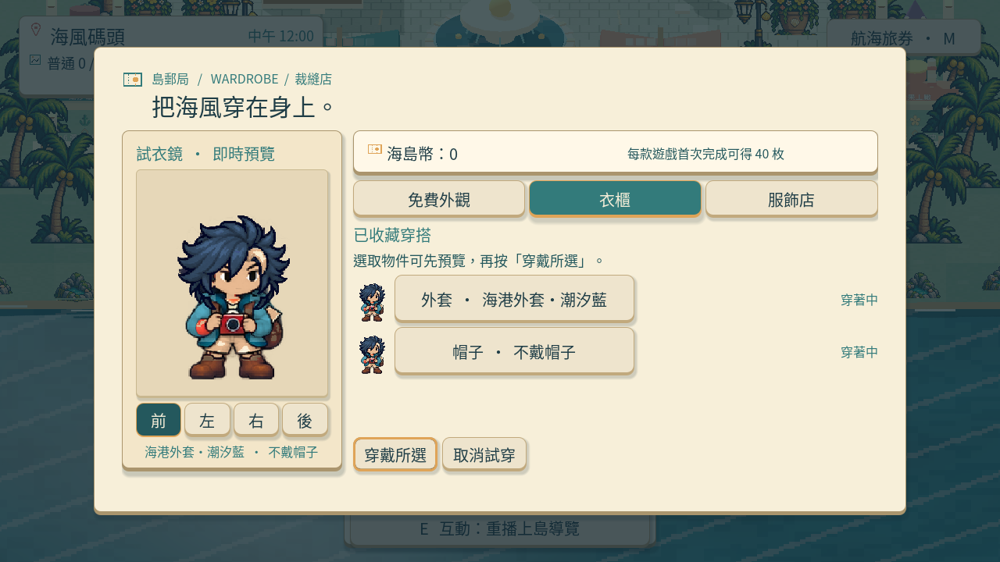 | 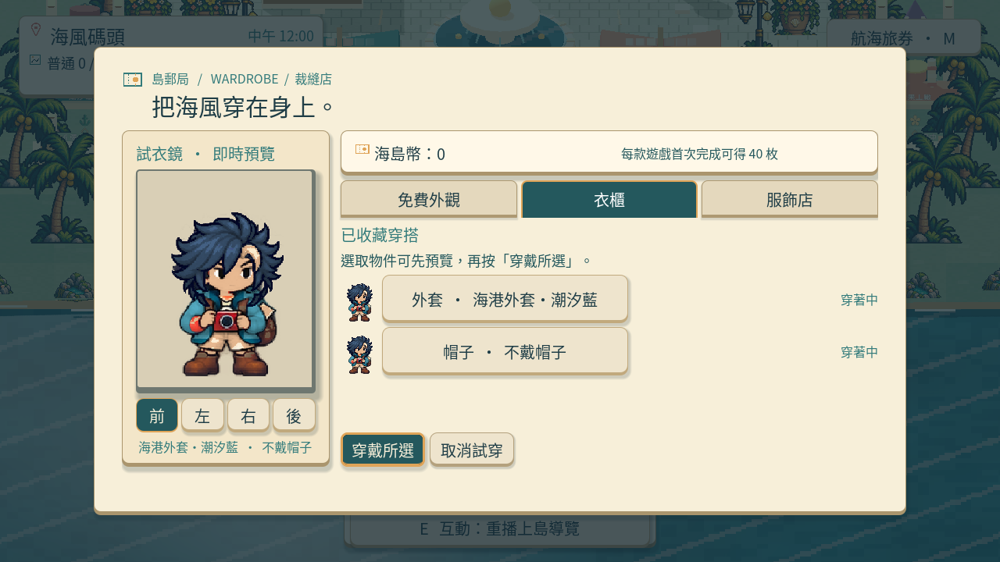 |
| 未負擔商店選取 | 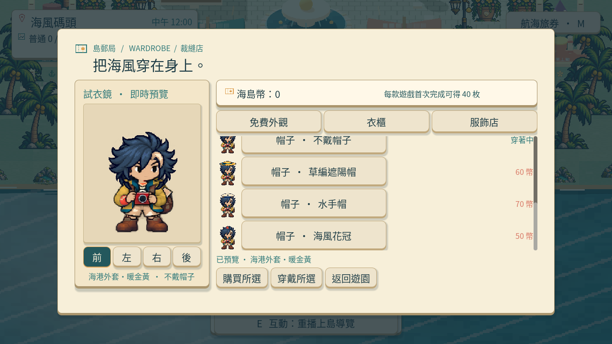 | 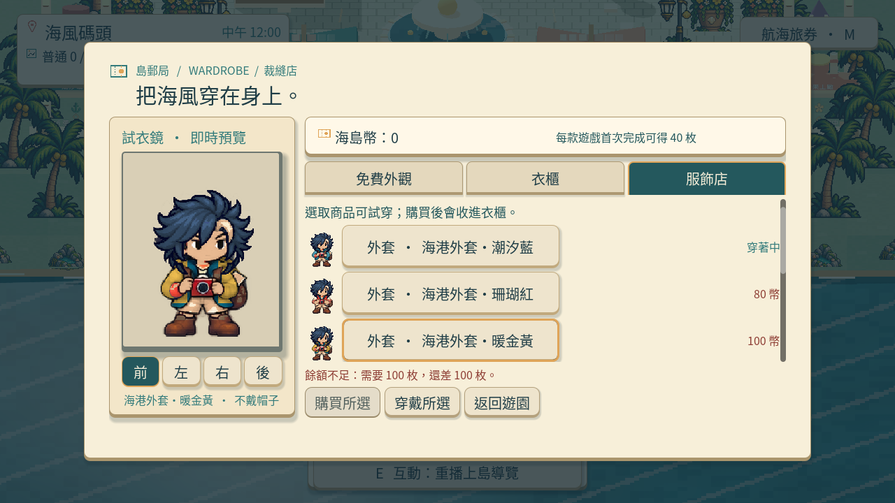 |
| 降低動態商店 |  |  |
| 800×600 商店 | 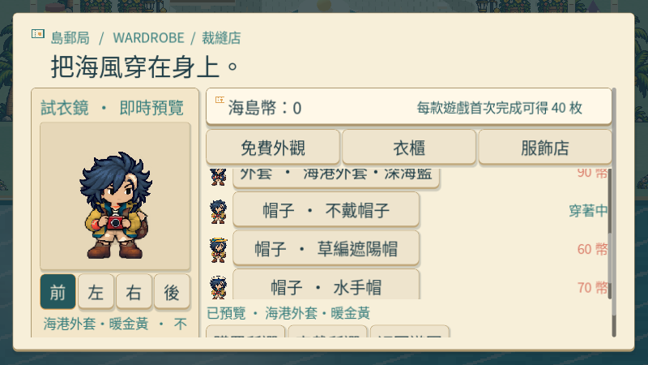 | 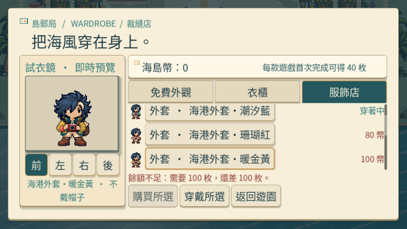 |
| 800×600 外觀 | 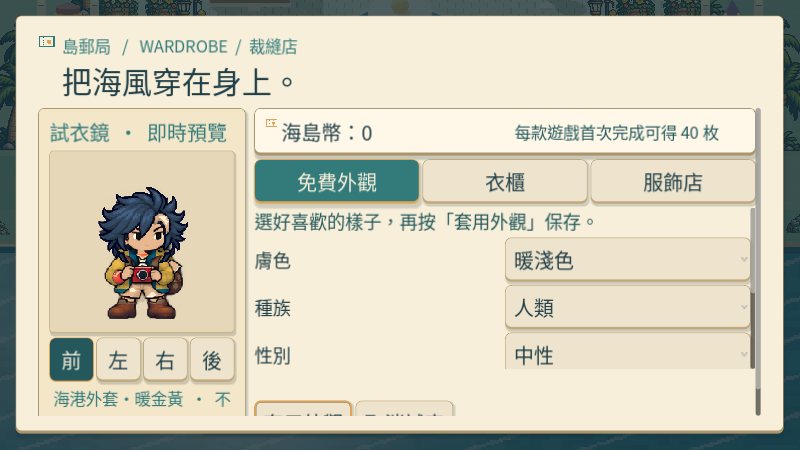 | 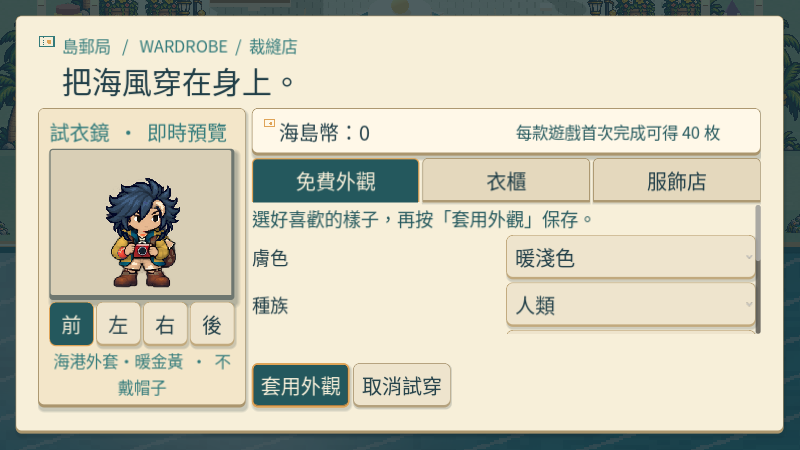 |

### 原生操作錄影

[衣櫃標準尺寸四頁操作錄影](images/ART-20-wardrobe-hierarchy-native.mp4)

### 提交

分支：`feature/island-first-park`；[遠端交付提交](https://github.com/deadline314/Snapland/commit/557404258269e65d59cd9dcac5b04d1de92c5634)。

## 2026-10-13 試玩後修訂

使用者否定目前島上畫面／動畫／介面品質。歷史交付證據只代表當時版本與當時範圍；本輪新增品質驗收如下。

- [ ] 重新以島上遊玩流程驗收拍貼與介面：清楚主要操作、可見照片、收藏回饋與返回方式，不靠裝飾或增加選單複雜度改善。
- [ ] 保存本輪原生前後畫面與影片，實際查看後記錄通過或拒絕原因。

Related：ART-22、MAIN-11、MAIN-14、MAIN-15、ST-5。

# Commit-4

### 問題
收藏本照片太小，下排文字會被捲動區裁掉；測試曾只核對整個視窗，漏掉真正可見的範圍。暫停介面也有不必要的大量空白。

### 改動
大視窗的收藏本改成一排四張完整照片，小視窗改用雙欄捲動；圖片、名稱、收藏狀態、頁碼與返回都有清楚位置。照片可放大並返回原焦點，保留完整比例。減少 HUD 高度，依內容調整暫停、時段與相簿的大小，視窗改變時也維持相同操作邏輯。

### 驗收
主 Session 重建本票提交內容，版面、照片檢視器與共用縮圖三项局部驗證全過。實際原生操作遊園選單、四個時段及降低動態，錄影 891 格／14.85 秒、0 ERROR；已查看大／小相簿、地圖、衣櫃、設定、成就和對話截圖。實體視窗為 1280×720 與 800×600，後者截取的有效畫布是 800×450。保留第一輪裁字失敗圖，新增測試逐一核對卡片、文字與導覽位於紙頁和捲動區的可見範圍。正式遊戲取得照片及重開後檢視高清原圖仍與 MAIN-16 一起驗收；本票維持進行中，未把局部改善稱作所有介面精品完成。

### 測試與證據
[版面決策與邊界](../../design/runtime/album-layout-refinement.md) · [照片放大與返回](../../design/runtime/album-photo-interaction.md) · [局部版面驗證](images/ART-20-island-final-layout-local.log) · [照片檢視驗證](images/ART-20-island-final-viewer-local.log) · [原生操作紀錄](images/ART-20-island-final-native.log) · [選單操作影片](images/ART-20-island-final-normal.mp4)。

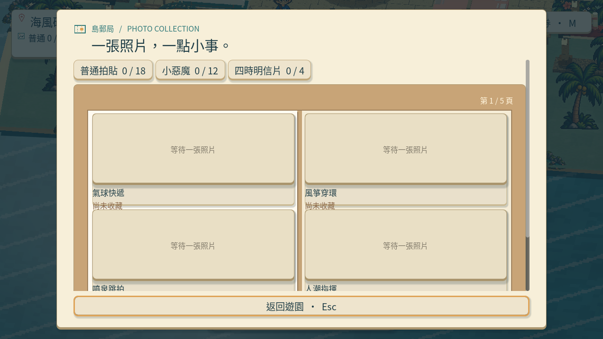
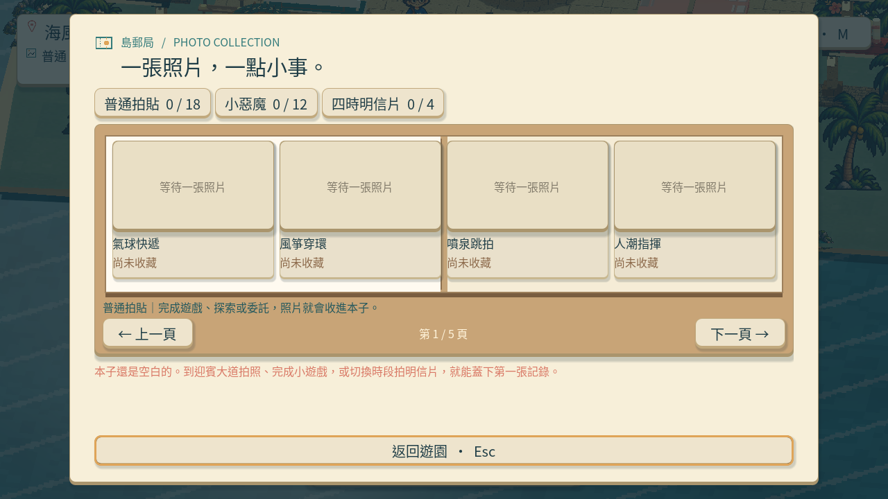
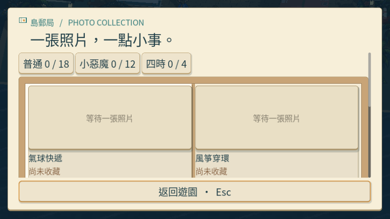
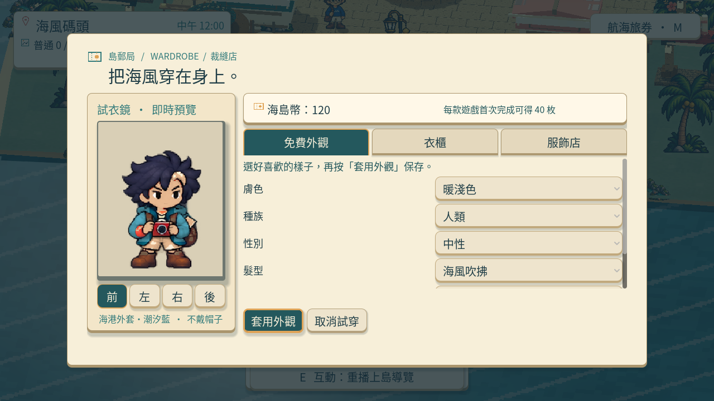
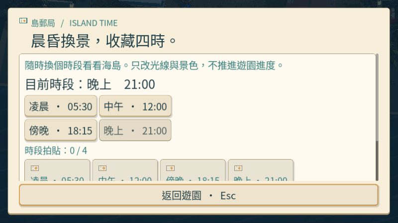
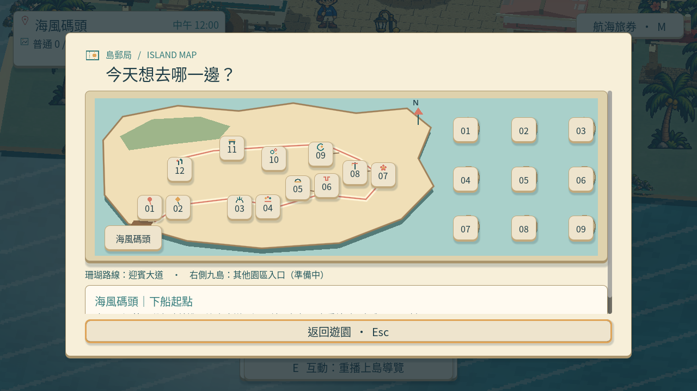

本輪提交基準：`e0a332b`；分支：`feature/island-experience`。共用改動涉及 MAIN-13 的收藏卡片顯示，沒有更改收藏資格或重新發獎勵。本段是程式化操作及原生畫面檢查，沒有人工試玩或試聽宣稱。
