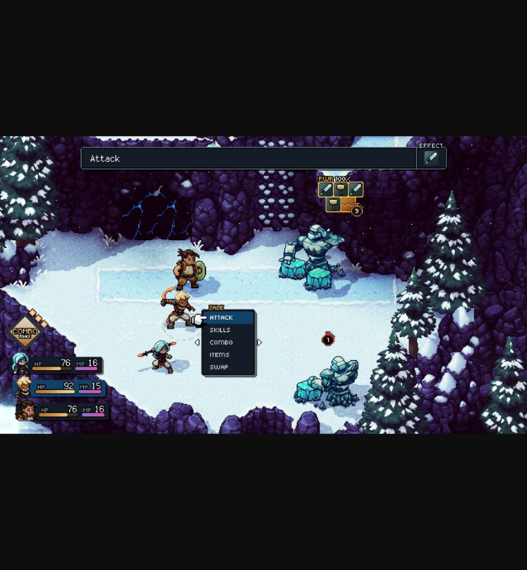
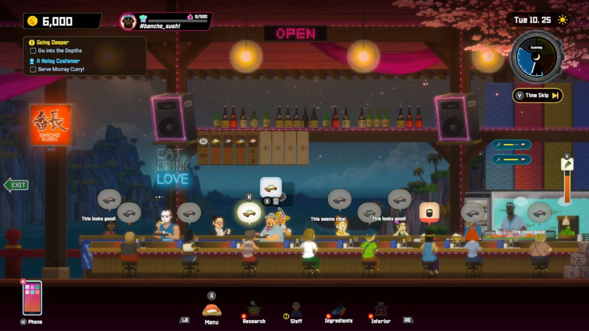
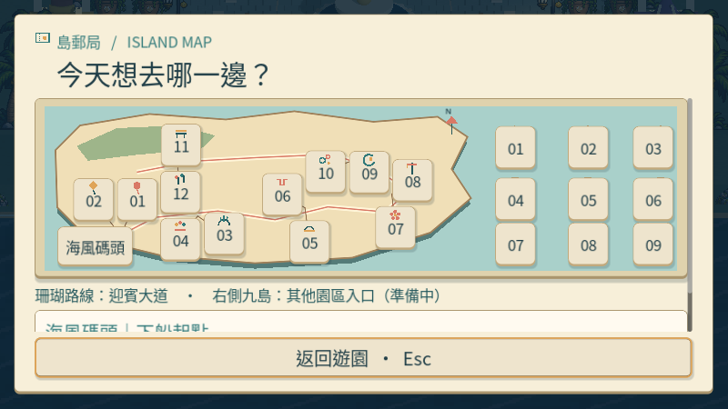
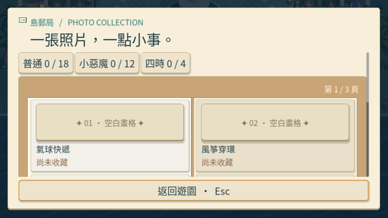
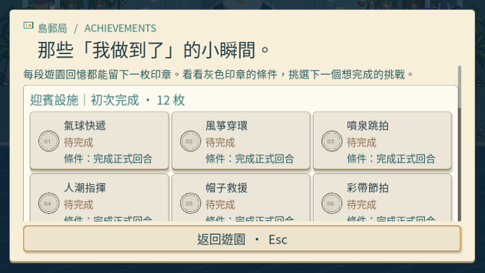
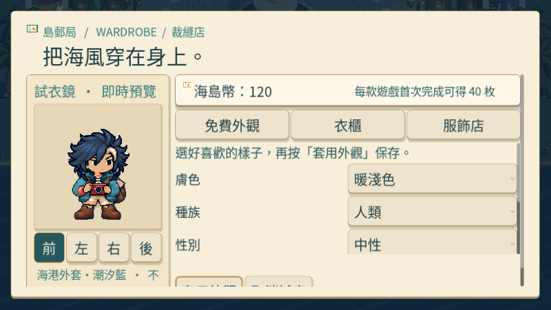
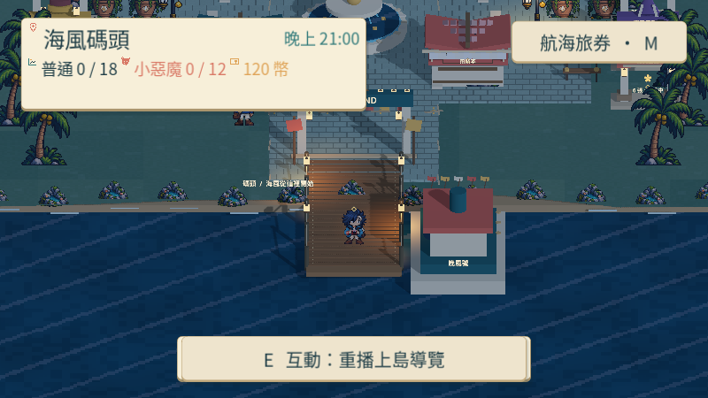

# [ART-20] 重整遊園介面視覺層級

> 狀態：進行中

開始基準：`64fcf8cbd313ba350c7165a2e4ec914398a8f943`；分支：`feature/island-first-park`。

## 內文

### 需求
重新設計遊園 HUD、主選單、對話、任務、成就、收藏、商店、換裝、日夜、暫停與設定的視覺及操作層級。使用原創海港樂園語言，提供足夠的細節和清楚的空間分配，避免單薄方框、平均堆疊装飾與資訊噪音。

2026-10-12 使用者追加建議採 3D 或偽 3D 增加深度。比較旅券、收藏本及衣櫃的厚度、投影、凸起頁籤與適度開合；清楚文字、輸入焦點和降低動態設定仍優先。

### 來源
2026-10-12（Asia/Taipei）使用者要求全面重新審閱 UI 和小遊戲，提升目標、計分及操作手感；先廣泛 survey，減少遊戲當下提示，提供含截圖的完整教學。使用者授權自行決定設計，強調循序完善、細節有主次且不雜亂，以可面向大眾的品質驗收。

### 驗收條件
- [x] 實際比較至少八個跨不同團隊的一手 UI、遊戲與可用性來源，保存採用理由及看過的截圖。
- [ ] 所有列明介面有統一而有特色的字階、圖標、材質與層級；主要任務、收藏與操作一眼可辨。
- [ ] 鍵盤、滑鼠、焦點、返回與資料空白狀態可用；常見視窗、日夜與降低動態下沒有裁切或操作穿透。
- [ ] 保存全套原生前後截圖、實際操作影片與局部測試結果。

### 參考資料與實際觀察

已閱讀十項一手介面及可用性資料，跨 Nintendo、Apple、Microsoft、W3C、Valve 與 Disney；各項採用理由、文字閱讀及未觀看影片的界線見[研究紀錄](../../design/runtime/ui-quality-survey.md)。另實際查看三款遊戲的公開畫面，見[畫面比較](../../design/runtime/ui-visual-review.md)。

- [Sea of Stars 官方圖例](https://sabotagestudio.com/presskits/sea-of-stars/)：狀態集中在角落，選擇靠近操作對象，主要場景保留空間。採用資訊層級，不複製戰鬥框樣式。
- [Dave the Diver 官方畫面](https://store.steampowered.com/app/1868140/DAVE_THE_DIVER/)：任務、時間與工具分組，需求靠近對象；不照搬經營畫面的資訊密度。
- [Hades 官方更新說明](https://www.supergiantgames.com/blog/hades-superstar-update-patch-notes/)：閱讀了暫停變暗、減少重複數值和讓返回更清楚的說明；本項沒有觀看遊戲畫面。

### 測試流程
1. 查看本票研究紀錄與圖例，核對採用的原則和原生前後比較。
2. 使用隔離存檔實際操作本票完整流程，核對各項驗收條件。
3. 核對重試、返回、重開與相關設定，保存原生截圖、影片和受影響測試摘要。

---

# 跟其他票的關係

- Blocks：無
- Blocked by：無
- Related：ART-6、ART-8、ART-21、MAIN-10

---

# Commit-1

## 問題
旅券、地圖、收藏與成就曾共用簡單清單，小視窗的文字、按鈕與返回位置不穩定。

## 改動
遊園介面改用海港旅券、摺疊地圖、翻頁收藏本與印章卡；增加紙張厚度、凸起按鈕、清楚標題及固定返回位置。內容可捲動，小視窗保持可讀文字與足夠按鈕面積，衣櫃保留全身預覽。

## 驗收
以獨立存檔，在本次可提交版本實際操作九種遊園介面、四個時段及降低動態開關，1280×720 與 800×600 都通過；親自查看小視窗地圖、收藏、成就、衣櫃、時段及主畫面。此段驗收限遊園介面，整套小遊戲及教學介面仍由相關票繼續完善。

### 測試結果
- 可提交版本：地圖／收藏／成就 59 項通過；衣櫃檢查通過；原生遊園介面輸入流程通過，0 腳本或引擎錯誤。
- 證據：[驗收摘要](images/ART-20-review.json)、[原生操作影片](images/ART-20-native-ui.mp4)。
- 分支：`feature/island-first-park`；[遠端交付提交](https://github.com/deadline314/Snapland/commit/da19582)。

### 截圖

