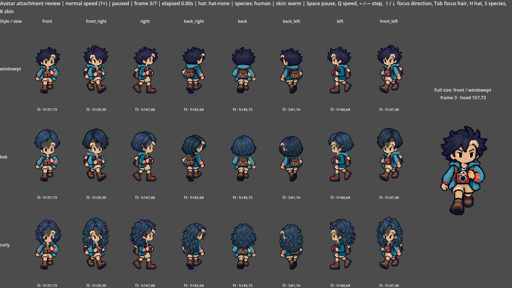
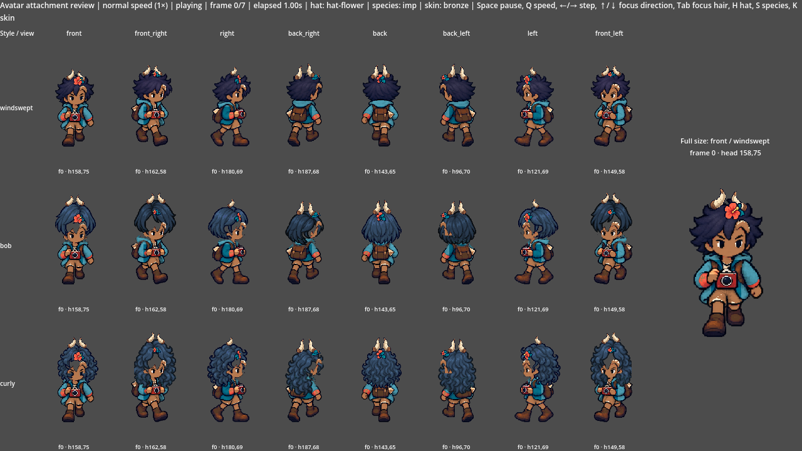
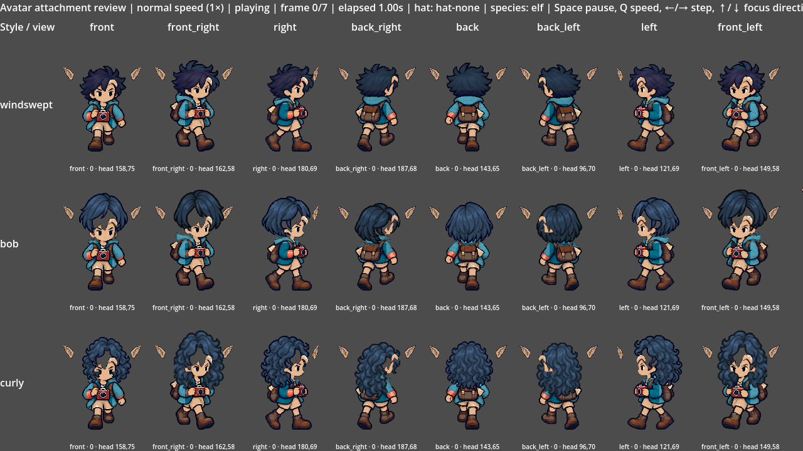

# [ART-22] 修正步行頭髮與身體分離

> 狀態：進行中

## 內文

### 需求

主角步行、停走及轉向時，髮型、帽子與頭部保持連接，不再出現頭髮漂離身體。保留角色身份與換裝自由。

### 來源

2026-10-13（Asia/Taipei）使用者試玩回饋，要求先完善島上體驗：角色頭髮分離與動畫怪異、真正 HD-2D、特色攤位、全角色對話、探索與遊樂設施、符合玩家習慣的拍貼與介面。設計自主決定，至少六個多方向實例，研究與實際畫面分開記錄。

### 驗收條件

- [ ] 八方向每個步行影格與停走轉向均保持頭髮貼合頭部，帽子及種族部件跟隨同一頭部位置。
- [x] 各髮型、帽子與膚色切換不露禿洞、不切掉頭手腳，原本角色身份一致。
- [ ] 實際看過原生正常速度與慢放、八方向及換裝錄影，保存問題前後截图和影片。

### 測試流程

1. 使用獨立存檔從上島開始，操作本票涉及功能。
2. 依每項條件確認玩家可見行為，核對返回、重訪、時段與降低動態。
3. 查看原生畫面及正常與慢放影片；需要聲音時實際試聽，保存證據。

---

# 跟其他票的關係

- Blocks：無
- Blocked by：無
- Related：ART-14、ART-17、ART-18

---

## 本輪開始

固定基準：`97e7ee8`；分支：`feature/island-experience`。2026-10-13 島上試玩改善依使用者回饋重新驗收，不以舊版畫面或數據檢查替代本輪遊玩。

# Commit-1

## 問題

不同方向的頭髮與耳朵、角及帽子沒有依實際頭型貼合；背面原髮色也出現橫向色帶。

## 改動

保留主角原本完整髮型與髮色，其他髮型依每張角色的頭部位置貼合，帽子與種族配件接在實際頭部輪廓。保留脸部特徵與全身，不靠挪動身體掩蓋接合問題。

## 驗收

主 Session 對本次提交的內容獨立執行匯入及四項相關測試，全部通過、無 ERROR。檢查八方向、三種髮型的完整角色畫面，以及帽子、種族和五種膚色的切換；正常錄影與四分之一慢放分別保存。這份接合檢查不能取代步態自然度驗收；正式島上停走與轉向仍隨新步態一併驗收。

### 測試結果

| 項目 | 結果 |
|---|---|
| 本次提交匯入與角色、接合、八方向、動畫資料檢查 | 5 / 5 通過 |
| 全部 64 張步行姿勢 × 3 種髮型的耳角接合 | 通過 |
| 原生接合錄影 | 1280×720，925 幀；錄製 88 秒，非即時效能聲明 |
| 完整套件 | 留給 CI，本次未執行 |

### 截圖與影片

[正常速度](images/ART-22-attachment-palette-normal.mp4) · [四分之一慢放](images/ART-22-attachment-palette-quarter.mp4)

分支：`feature/island-experience`。遠端提交連結於推送後補入。
