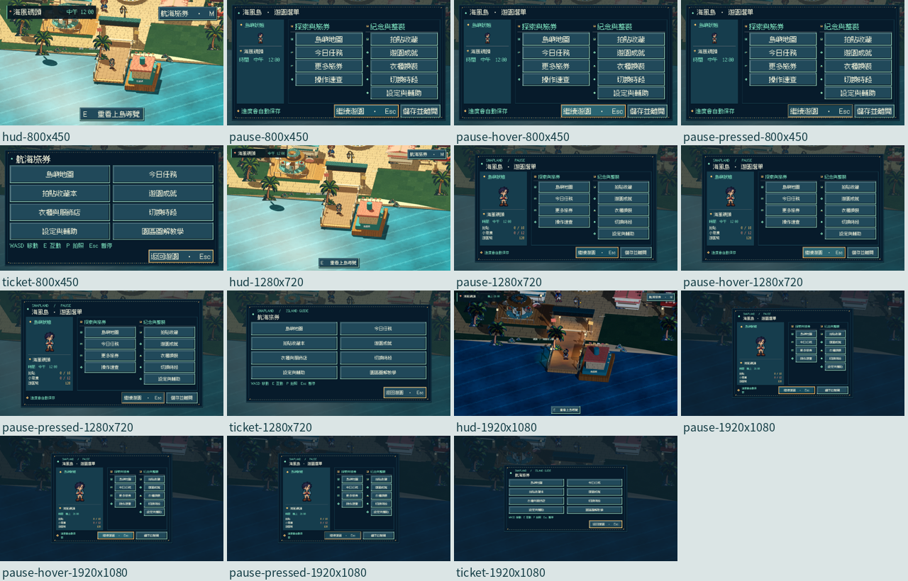

# [ART-23] 重設全遊戲像素介面與暫停導覽

> 狀態：完成

## 內文

### 需求

以精緻像素圖示、邊框、焦點與一致資訊層級取代舊紙卡風格；重新設計島上HUD、對話、暫停與主要導覽，主要操作一次看見。

### 來源

2026-10-14 Asia/Taipei，使用者要求徹底捨棄舊介面，指出暫停選單空間不足、配置不合理及無謂捲動；全遊戲重設高精緻像素UIUX，先參考歧路旅人、幻想水滸傳及多方向業界實例。

### 驗收條件

- [x] 一般內容採完整展開、分類或分頁，盡量免捲動；像素層次與按鈕各狀態清楚，文字沒有重疊。
- [x] 至少比較六個不同遊戲或設計來源，含歧路旅人與幻想水滸傳；保留實際閱讀、觀察與參考畫面。
- [x] 遊戲共用介面呈现精緻像素風格；文字清楚，選中、焦點、停用與按下狀態可辨識。
- [x] 1280×720暫停介面一次看見所有主要操作，沒有不必要的捲動或裁切。
- [x] 800×450、1280×720、1920×1080與較大文字設定下，核心操作可見且可用；滑鼠與鍵盤焦點可完成導覽。
- [x] HUD與對話不遮擋必要內容；關閉選單、返回遊戲與對話恢復正常，附原生截圖。

### 2026-10-14 追加需求

固定選單與一般內容優先完整展開，長收藏或多項資料使用分類與分頁，盡量不讓玩家滾動。像素介面加入合理的側面厚度、高光與投影；懸停、按下與焦點能辨識，文字不可重疊或被裁切。

### 測試流程

1. 使用獨立測試存檔，開啟本票各介面並核對所有主要操作。
2. 依序以800×450、1280×720、1920×1080及較大文字查看，確認內容與操作完整。
3. 操作滑鼠與鍵盤導覽、返回、套用、暫停及恢復，記錄局部測試和原生畫面。

---

# 跟其他票的關係

- Blocks：ART-24、ART-25、ART-26
- Blocked by：無
- Related：ART-20

---

本輪開始固定基準：f1d2feedcf6b58418d2a6682238ce088e92cbbaf；分支：`feature/island-experience`。

## Commit — 2026-10-14 像素介面與免捲動交付

**問題：** 暫停選單空間不足，固定操作需要滾動，舊紙卡也缺少清楚的深淺與按鈕狀態。

**改動：** 改為深海藍像素畫框，以高光、側面與投影表現厚度；暫停導覽分區完整展開，滑鼠懸停、按下及鍵盤焦點可辨識。小遊戲中的主選單會正確置頂並暫停其輸入。

**驗收：** 共用樣式、實際下拉選單、十種選單的暫停與返回、進度和主場景局部測試通過。已比較七個不同遊戲／設計方向並保留實際讀取與參考圖。 Root以獨立存檔完成800×450文字1.25、1280×720文字1.0、1920×1080文字1.25原生檢查，實際查看畫面並操作滑鼠、Tab及Esc。全組36項受影響局部套件通過，原有測試選擇器與斷言未改；不代表人類試玩、試聽或效能驗收。

[原生驗收說明](../../design/runtime/pixel-ui-native-review.md) · [測試與全部截圖索引](images/ART-23-pixel-native-review.json) · [研究與實際來源](../../design/runtime/pixel-ui-redesign.md)。

[本票畫面](images/ART-23-pixel-final-pause-1280x720-scale1.00.png) · [小尺寸畫面](images/ART-23-pixel-final-pause-pressed-800x450-scale1.25.png)。

分支：`feature/island-experience`；[本票程式與證據提交](https://github.com/deadline314/Snapland/commit/7f8fa964e661faf550226c089687c78a4f75ba58)。當時本機條件通過但共用分支尚未推main，故保留進行中；後續整合與本輪重驗以文末為準。

## Commit — 2026-10-20 最新main原生重驗與結案

固定開始SHA：`dd8318b130783c0a0af0b0a7acff6617fc727556`；分支：`codex/finish-runtime-batch-20261020`。

原交付內容已核對為目前origin/main的祖先，不再受「共用feature尚未整合」阻塞。本輪重新打開共用像素介面、HUD、暫停、懸停／按下和旅券導覽，確認主要操作、分類與分頁、字形行高、邊界、鍵鼠焦點及返回。三個實際視窗均為文字1.25：800×450／1280×720中午正常動態，1920×1080夜間且降低動態。

驗收另發現舊工具只改顯示後端，雲端的Godot視窗仍停1280；第一次800／1920畫面不算尺寸通過。現在同時核對視窗、後端、固定邏輯1280×720、真實縮放0.625／1.0／1.5及輸出PNG尺寸。故意只改後端的反例會exit1明確拒絕。時段也從實際遊戲狀態核對，不以工具要求值當完成。舊Windows800／1920圖尺寸另已確認正確，不由此次雲端問題推論舊圖全失效。

十四項相關UI／進度／劇情局部回歸通過，原時限及斷言保留；三程序皆exit0、0ERROR並收到真正完成行。全部99張目前畫面依本票分組，已看四票聯絡表及代表頁原尺寸。本票15張接受畫面與雜湊見[報告](images/ART-23-verify-20261020.json)。

照片與結算在這個UI工具中是隔離的合成示例，頁面直接開啟；鍵盤、滑鼠、Esc／Tab與按下／放開經實際事件路由。這不是小遊戲通關、真人偏好、音樂試聽或效能驗收，亦不替代ART-17／18完整角色與MAIN-10當前教學資產的驗收。

研究沿用[七方向實際紀錄](../../design/runtime/pixel-ui-redesign.md)，本輪重看幻想水滸傳與歧路旅人原始靜格，補讀Godot視窗、顯示後端及多解析度文件；不把參考圖當本作素材。可重用的視窗／輸出／輸入座標核對流程已補入User-guide。

### 遠端交付

[0680338](https://github.com/deadline314/Snapland/commit/06803382e3c31cd1f9bb7ee3eff129b5387d520e)：本票已正常快轉推送，fetch確認HEAD、本機main與origin/main一致。其他未達驗收票保持未結案。
