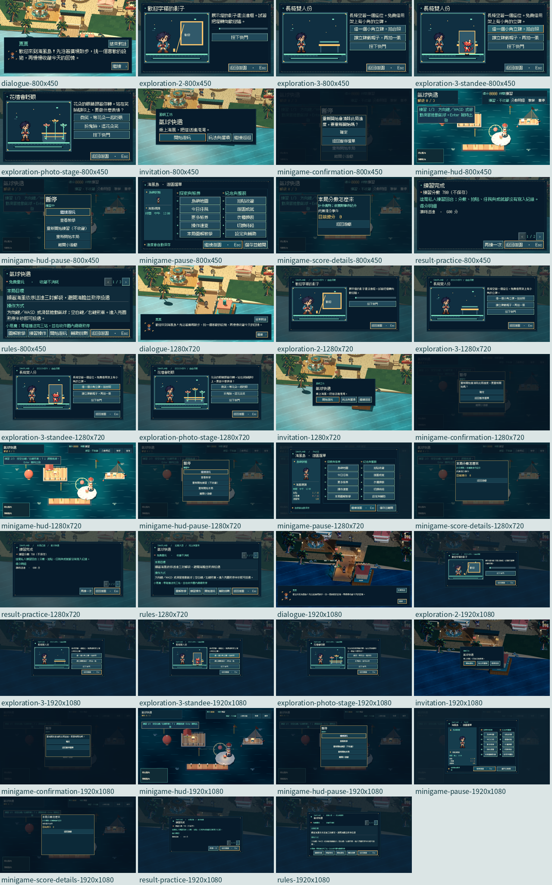

# [ART-26] 重設小遊戲與拍貼操作介面

> 狀態：完成

## 內文

### 需求

重設小遊戲邀請、教學入口、遊玩HUD、暫停、結算與拍貼操作，讓目標、進度、分數與下一步清楚。

### 來源

2026-10-14 Asia/Taipei，使用者要求徹底捨棄舊介面，指出暫停選單空間不足、配置不合理及無謂捲動；全遊戲重設高精緻像素UIUX，先參考歧路旅人、幻想水滸傳及多方向業界實例。

### 驗收條件

- [x] 一般內容採完整展開、分類或分頁，盡量免捲動；像素層次與按鈕各狀態清楚，文字沒有重疊。
- [x] 邀請、教學、HUD、暫停、結算與拍貼採同套精緻像素視覺，依小遊戲需要呈現關鍵資訊。
- [x] 遊玩畫面保留足夠視野；分數、時間、目標與必要操作清楚，沒有常駐長提示堆疊。
- [x] 暫停、重試、結束與結算主要操作完整可見，不出現不必要捲動。
- [x] 拍貼預覽、拍攝、重拍與保存操作明確，保留原始照片與收藏流程。
- [x] 不同解析度、長目標、現有玩家顯示及原有教學／結算流程通过局部測試與原生截圖。

### 2026-10-14 追加需求

固定選單與一般內容優先完整展開，長收藏或多項資料使用分類與分頁，盡量不讓玩家滾動。像素介面加入合理的側面厚度、高光與投影；懸停、按下與焦點能辨識，文字不可重疊或被裁切。

### 測試流程

1. 使用獨立測試存檔，開啟本票各介面並核對所有主要操作。
2. 依序以800×450、1280×720、1920×1080及較大文字查看，確認內容與操作完整。
3. 操作滑鼠與鍵盤導覽、返回、套用、暫停及恢復，記錄局部測試和原生畫面。

---

# 跟其他票的關係

- Blocks：無
- Blocked by：ART-23
- Related：ART-20

---

本輪開始固定基準：f1d2feedcf6b58418d2a6682238ce088e92cbbaf；分支：`feature/island-experience`。

## Commit — 2026-10-14 像素介面與免捲動交付

**問題：** 小遊戲的目標、分數、暫停和拍貼操作缺乏一致層級，提示與遊玩區也可能互相遮擋。

**改動：** 統一邀請、圖解入口、HUD、暫停、確認、結算、對話與拍貼的像素框架；重要資訊靠邊分組，詳細計分可另開查看，較長內容以頁面呈現。

**驗收：** 原有69項HUD檢查、九款相關畫面、玩法模型、對話、入口、拍貼原圖與新增三尺寸介面測試通過；練習、暫停、重試與返回流程已驗證。結算截圖是腳本示例，沒有當作人類通關。 Root以獨立存檔完成800×450文字1.25、1280×720文字1.0、1920×1080文字1.25原生檢查，實際查看畫面並操作滑鼠、Tab及Esc。全組36項受影響局部套件通過，原有測試選擇器與斷言未改；不代表人類試玩、試聽或效能驗收。

[原生驗收說明](../../design/runtime/pixel-ui-native-review.md) · [測試與全部截圖索引](images/ART-23-pixel-native-review.json) · [研究與實際來源](../../design/runtime/pixel-ui-redesign.md)。

[本票畫面](images/ART-26-pixel-final-minigame-hud-1280x720-scale1.00.png) · [小尺寸畫面](images/ART-26-pixel-final-dialogue-800x450-scale1.25.png)。

分支：`feature/island-experience`；[本票程式與證據提交](https://github.com/deadline314/Snapland/commit/aef79b7c0a46429b80a0f2334de65e109124fcb3)。當時本機條件通過但共用分支尚未推main，故保留進行中；後續整合與本輪重驗以文末為準。

## Commit — 2026-10-20 最新main原生重驗與結案

固定開始SHA：`dd8318b130783c0a0af0b0a7acff6617fc727556`；分支：`codex/finish-runtime-batch-20261020`。

原交付內容已核對為目前origin/main的祖先，不再受「共用feature尚未整合」阻塞。本輪重新打開探索拍貼、對話、邀請、詳細規則、小遊戲HUD、計分詳情、重試確認、暫停與練習結算，確認主要操作、分類與分頁、字形行高、邊界、鍵鼠焦點及返回。三個實際視窗均為文字1.25：800×450／1280×720中午正常動態，1920×1080夜間且降低動態。

驗收另發現舊工具只改顯示後端，雲端的Godot視窗仍停1280；第一次800／1920畫面不算尺寸通過。現在同時核對視窗、後端、固定邏輯1280×720、真實縮放0.625／1.0／1.5及輸出PNG尺寸。故意只改後端的反例會exit1明確拒絕。時段也從實際遊戲狀態核對，不以工具要求值當完成。舊Windows800／1920圖尺寸另已確認正確，不由此次雲端問題推論舊圖全失效。

十四項相關UI／進度／劇情局部回歸通過，原時限及斷言保留；三程序皆exit0、0ERROR並收到真正完成行。全部99張目前畫面依本票分組，已看四票聯絡表及代表頁原尺寸。本票39張接受畫面與雜湊見[報告](images/ART-26-verify-20261020.json)。

照片與結算在這個UI工具中是隔離的合成示例，頁面直接開啟；鍵盤、滑鼠、Esc／Tab與按下／放開經實際事件路由。這不是小遊戲通關、真人偏好、音樂試聽或效能驗收，亦不替代ART-17／18完整角色與MAIN-10當前教學資產的驗收。

研究沿用[七方向實際紀錄](../../design/runtime/pixel-ui-redesign.md)，本輪重看幻想水滸傳與歧路旅人原始靜格，補讀Godot視窗、顯示後端及多解析度文件；不把參考圖當本作素材。可重用的視窗／輸出／輸入座標核對流程已補入User-guide。

### 遠端交付

本票以正常快轉整合；提交連結於推送後接續補入。其他未達驗收票保持未結案。

本輪交付：[c4b4dc2](https://github.com/deadline314/Snapland/commit/c4b4dc290765027b11c793bc3a5eb57f2a644d9c)。
