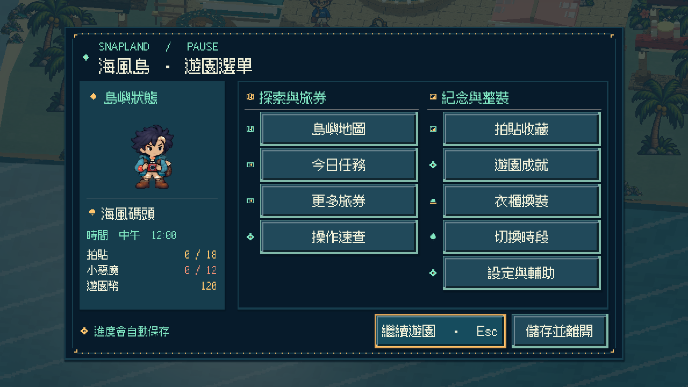
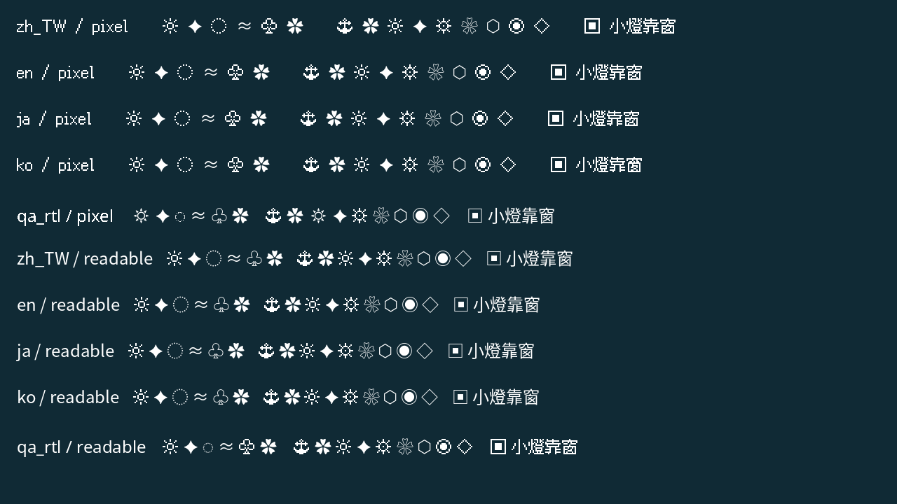
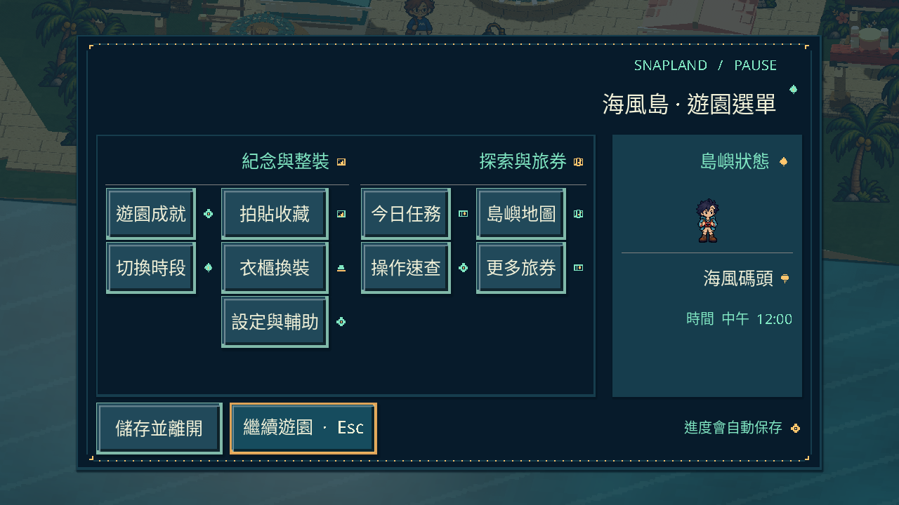
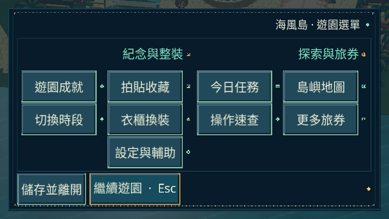

# [ART-27] 完善像素字體與多語可讀性

> 狀態：完成

## 內文

### 需求

遊戲介面採有特色、精緻且清晰的像素字體，與既有像素畫框、層次和島嶼氣質一致。繁中、拉丁文字與其他語系有合適的字形後備及可讀選擇；不能因換字體造成缺字、截字、重疊或退回過小字級。

### 來源

2026-10-14（Asia/Taipei）使用者希望遊戲換用像素字體，並為不同語系建立框架，持續雕琢整個島。沿用先比較六個以上不同方向、保存來源與實際畫面、優先玩家閱讀與操作的規範。

### 驗收條件

- [x] 比較至少六個字型、授權或遊戲文字呈現的第一手方向，保存實際查閱內容、取捨與參考畫面。
- [x] 選用的字型有明確合法授權、來源與雜湊；支援繁中主要內容與拉丁文字，缺字有可驗證後備。
- [x] 像素字體、清晰閱讀選擇及文字放大可使用並保存，與全套介面視覺一致。
- [x] 暫停、對話、旅券、收藏、換裝、設定、小遊戲及拍貼主要文字可完整閱讀，不重疊、不裁切，固定操作不新增無謂捲動。
- [x] 800×450、1280×720、1920×1080 與較大文字設定均實際看過原生畫面；長文字與語系變體有獨立驗收證據。

### 測試流程

1. 使用隔離存檔逐頁查看主要介面，核對像素筆畫、字形、基線、焦點及文字完整性。
2. 切換清晰閱讀和較大文字，確認內容與全部主要控制仍可閱讀、操作。
3. 比較不同解析度及語系驗收字串，實際檢查缺字、長句、數字與標點，保存截圖。
4. 核對字型來源、授權與雜湊，執行受影響局部測試。

---

# 跟其他票的關係

- Blocks：無
- Blocked by：無
- Related：MAIN-19、ART-23、ART-24、ART-25、ART-26

---

## 開始基準

`bbba056`；`feature/island-experience`。

# Commit-1

## 內文

問題：原本字體與像素介面不一致；更換字型後，後備行高、長成就條件及固定操作的最小尺寸又暴露出裁切和溢出的問題。

改動：預設採繁中像素字體，提供易讀字型、放大文字及多文字後備。島上標籤、小遊戲、拍貼和共用介面沿用一致的文字風格；成就依完整內容分頁，試衣鏡保留較大角色預覽，旅券與互動列守住螢幕邊界。立體按鈕的邊框也能被後開的對話正確遮住。

驗收：主 Session 直接執行原生版本並看過 800×450、1280×720、1920×1080 的各 33 張畫面，以及六組字體／語系驗收。繁中、長英文、日韓及 RTL 樣本均有獨立畫面，沒有把 QA 樣本當成全作翻譯。受影響局部測試、字型來源與授權檢查通過；完整紀錄如下。分支 `feature/island-experience`，固定開始基準 `bbba056`。

### 測試結果

[精簡驗收](images/ART-27-verification.json)；[99 張原生畫面索引](images/ART-27-native-index.json)；[語系與字體六組原生紀錄](../Snapland-main/images/MAIN-19-native-language-verification.json)。字型 30 項、HUD 69 項檢查均通過；字型來源 3 項及啟動隔離 13 項 Python 檢查通過。靜態盤點的 975 個字符全有隨遊戲攜帶的字型可用，這不代表支援所有 Unicode。

### 截圖

[小畫面大字換裝](images/ART-27-native-wardrobe-appearance-800x450-scale1.25.png)；[1920 大字成就與固定返回](images/ART-27-native-achievements-1920x1080-scale1.25.png)；[小遊戲介面](images/ART-27-native-minigame-hud-1280x720-scale1.25.png)。

### 實際參考

[八個方向的查閱內容、取捨與合法授權](../../design/runtime/typography-localization.md)；[字型版本、原始來源與雜湊](../../assets/fonts/font-provenance.json)。以下是研究頁截圖，沒有當成本作素材或遊戲驗收：

- [Fusion](images/ART-27-reference-fusion.png)、[Cubic 11](images/ART-27-reference-cubic.png)、[Galmuri](images/ART-27-reference-galmuri.png)、[Ark Pixel](images/ART-27-reference-ark.png)
- [Unifont](images/ART-27-reference-unifont.png)、[Godot 國際化](images/ART-27-reference-godot-i18n.png)、[SIL OFL](images/ART-27-reference-ofl.png)

### 歷史交付狀態

當時本票局部驗收已通過；交付仍保留在島嶼工作分支。角色整組動畫與配樂完整試聽仍有既有票待驗，沒有把這次文字驗收寫成整座島已完成，也沒有合併尚未整組驗收的分支，票維持進行中。

### 遠端交付

`feature/island-experience`；[本次來源提交](https://github.com/deadline314/Snapland/commit/82a6f386637b883fe655ac64bd7618f82e012360)。正式存檔與備份雜湊與本輪開始相同。

# Commit-2：補齊漏字符號與高行距選單

本輪重新檢查正式內容，找出三個未隨遊戲攜帶的符號，以及 RTL 像素字體後備遺漏的錨與齒輪。現在訪客、靠窗規則與園區標記使用已具備的可辨符號；各種語系／文字風格使用隨附字體，不依賴玩家的系統字型。

原生畫面還抓到 1.25 大字 RTL 的暫停按鈕被擠出視窗；修正群組排列與次要狀態空間後，1280×720／800×450 的全部主要入口、繼續與離開均完整可見且不重疊。原中文三尺寸的幾何、Tab 與滑鼠返回保持通過。

原 30 項字型檢查加十組正式符號 profile，共 40 項通過；長椅規則／畫面 49／80 項、語系保存／損毀資料回退／即時狀態與新增雙尺寸高行距條件通過。字型來源／授權三項 Python 檢查通過，75 份正式文字來源的 1025 個非 ASCII 字符由隨附字型覆蓋，0 缺字；不代表全部 Unicode。最終原生 QA 與相關局部執行 exit 0、0 ERROR；故意缺譯文／損毀語系使用明確 WARNING。

既有 99 張主要介面證據保留，本輪另有六組語系／字體 fixture、最終 RTL 雙尺寸與正式符號圖，實際檢視的具體清單見[本輪驗證](images/ART-27-text-20261020-verification.json)。本票文字與字型條件已完成並整合；角色、配樂與全遊戲品質依原票接續，未發布語系也不當成完整翻譯。

[研究與流程](../../design/runtime/typography-localization.md) · [40 項字型紀錄](images/ART-27-text-20261020-40-font-checks.log) · [受影響套件](images/ART-27-text-20261020-glyph-suites.json) · [三尺寸原介面回歸](images/ART-27-text-20261020-ui-suites.json)。

[保留的拒收裁切畫面](images/ART-27-text-20261020-rejected-rtl-pause.png)。
