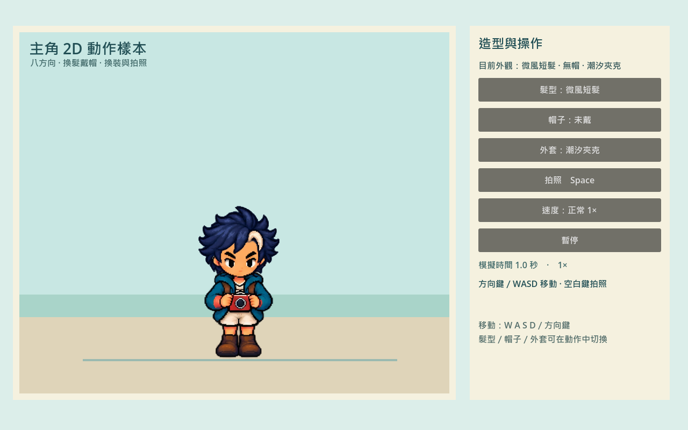
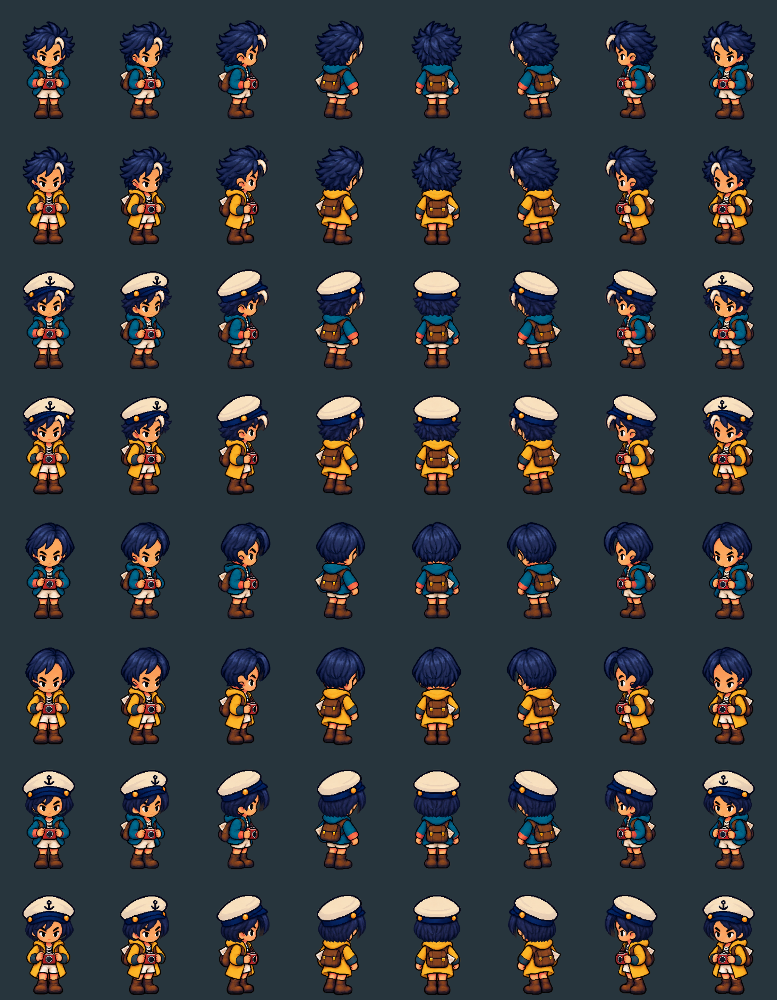
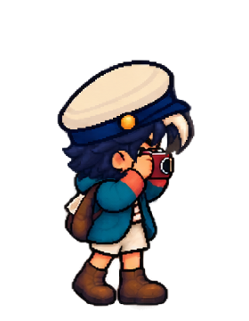

# [ART-29] 製作主角完整換裝動作樣本

> 狀態：完成

## 內文

### 需求
保留原本 2D 像素主角，以完整光頭人物底圖、同風格八方向頭髮與配件及正確綁定位置做一套完整樣本，證明髮帽、不同輪廓衣物與相機能隨動作自然保持一致，行走起停與轉身完整；通過後才擴到其他角色。不得改成新風格的 3D 人物。

### 來源
2026-10-15 使用者批准 ART-28 的重設方向，明確要求換髮、戴帽、不同衣服、拿相機及走路起停轉身全部驗證，正常速度與慢放都要實際看過。
2026-10-16 使用者明確否定 3D 模型樣本，澄清應保留原本 2D 畫風，製作光頭底圖，再生成正確八方向頭髮與配件並綁在正確位置。
2026-10-16 使用者再次授權依此 2D 方向實作完整主角樣本，要求正常與慢放均實看，不得改成人物 3D 模型。

### 驗收條件
- [x] 主角有可反覆編修與輸出的完整人物原件，保留身份、比例與像素風格。
- [x] 兩種髮型、戴帽／無帽、兩件不同輪廓衣物在八方向與必要動作下完整對齊。
- [x] 相機與雙手在舉機、握持、快門與放下時不漂移，前後遮擋正確。
- [x] 行走起步、半步停下、轉向、反向與貼牆完整合理，不用即時拆腿或旋轉鞋片補造步態。
- [x] 動作中換裝、暫停與恢復保持人物完整、姿勢同步且事件不重複。
- [x] 正常速度、四分之一慢放、逐姿勢全身與輸出版本均實際檢視並留下證據。

### 測試流程
1. 以主角逐一更換髮型、帽子與衣服，觀察八方向及持相機姿勢。
2. 操作短距起停、斜向切換、反向、貼牆及拍照中換裝，核對腳步、全身與握持。
3. 比較正常速度與四分之一慢放、暫停恢復及普通輸出版本，逐項記錄可接受結果或拒收原因。

[批准設計](../../design/runtime/character-production-pipeline-v2.md)；[實作與驗收順序](../../design/runtime/hero-2d-sample-implementation-plan.md)。

---

# 跟其他票的關係

- Blocks：無
- Blocked by：無
- Related：ART-28、ART-17、ART-18、ART-22

---

# Commit-1

## 內文

原先人物裁切後的中心不一致，頭髮與帽子會在走路時偏移；先前的立體人物候選也不符合原本畫風。
現在主角有完整光頭人物、兩種八方向髮型、戴帽版本、兩件不同輪廓外套，以及起步、走路、停步、轉身和舉相機動作。所有外觀跟隨同一個姿勢與人物基準，拍照時手與相機保留正確遮擋。
已逐段播放正常與四分之一模擬速度錄影，檢視全身動作圖格與八組外觀；本次檢視未再見原先的中心跳動或髮帽分離。短距起停、反向、貼牆、拍照中換裝與暫停恢復的原生輸入驗證通過，獨立輸出的預設畫面可啟動。

### 測試結果

| 項目 | 結果 |
|---|---|
| 素材與製作工具局部測試 | 通過 8／8 |
| 隔離原生姿勢、部件與完整圖格檢查 | 通過；1280 張合成圖格 |
| 正常與四分之一模擬速度 | 原生事件檢查通過，影片逐段實看 |
| 全身與外觀檢視 | 兩件衣物全部動作、八方向髮帽矩陣與相機遮擋檢視通過 |
| 獨立輸出 | 預設畫面啟動 30 格，無 ERROR；操作巡覽於原生專案驗證 |
| 文件連結、測試入口與獨立審閱 | 通過；無可操作發現 |

### 截圖

[正常錄影](images/ART-29-2d-normal.mp4)（39.133 秒／1174 格）、[四分之一模擬速度錄影](images/ART-29-2d-quarter.mp4)（141.733 秒／4252 格），均為 1280×800、30 FPS。
[全身步行](images/ART-29-2d-windswept-hat0-tide_jacket-walk.png)、[長外套起步](images/ART-29-2d-windswept-hat0-long_coat-start.png)、[停步](images/ART-29-2d-windswept-hat0-long_coat-stop.png)、[轉身](images/ART-29-2d-windswept-hat0-long_coat-turn.png)、[相機全身圖格](images/ART-29-2d-bob-hat1-long_coat-photo.png)。
[驗收範圍與版本證據](images/ART-29-2d-verification.json)、[樣本操作與重製](../../design/runtime/hero-2d-sample-delivery.md)。

本次交付位於 `feature/island-experience`，限獨立主角樣本；提交為包含本段的 ART-29 交付提交。
