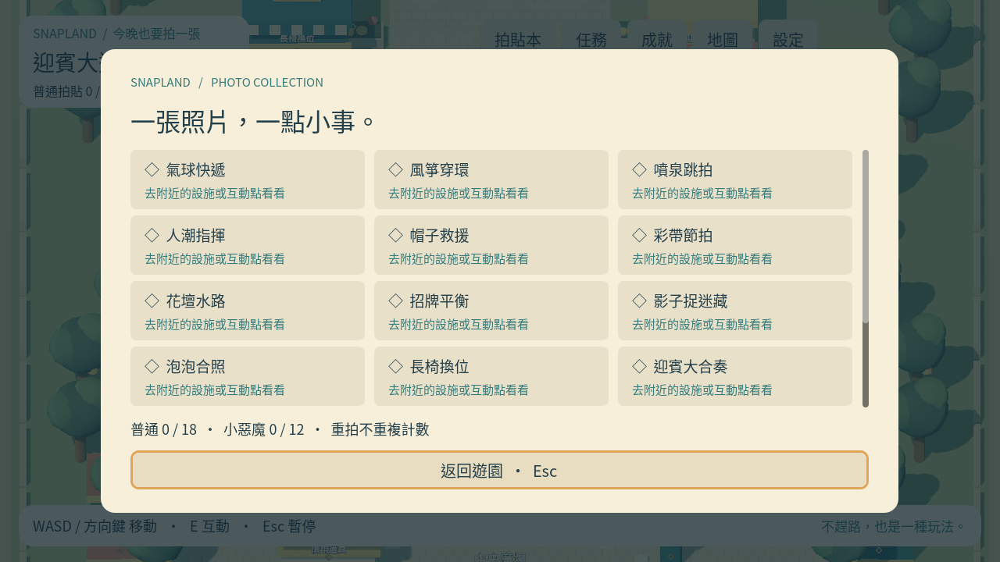

# [ART-2] 建立遊園介面與操作引導

> 狀態：進行中

## 內文

### 需求

用清楚的繁中介面引導探索、任務、對話、遊戲、收藏與設定。

### 來源

使用者於 2026-10-11（Asia/Taipei）要求從上島開始實作主區域、迎賓大道全部小遊戲及共用系統；其他園區先做路口。每項實作前研究業界實例並保存圖例；本票是可執行第一版，品質以實際驗收為準。

### 驗收條件

- [x] 介面可用鍵盤與滑鼠操作，互動提示清楚且沒有文字截斷。
- [x] 對話、暫停、結算與設定有明確返回方式；遊戲期間不穿透操作。
- [x] 實作前提供 UIUX 參考圖與實際採用理由。

### 測試流程

1. 啟動遊戲，進入本票內容，依畫面提示實際操作。
2. 核對本票每項驗收條件，測試返回、重試、重開與輔助情境。
3. 保存原生畫面截圖與局部測試摘要；無法確認的項目保持未勾選。

---

# 跟其他票的關係

- Blocks：無
- Blocked by：MAIN-3
- Related：MAIN-1、SG-1、ST-1

---

## 開始基準

c1b7b19；feature/island-first-park。

## 業界研究

參見 [園區與介面研究](../../design/runtime/world-research.md)，來源在實作前讀取。

# Commit-1

## 內文

問題：對話、收藏、設定與小遊戲之間尚無一致介面。

改動：現在以清楚操作提示與可見鍵盤焦點操作各選單，對話與結算有返回方式。

驗收：原生各選單畫面與12款結算已查看，鍵鼠路由、取消不穿透與暫停／恢復通過。

分支：`feature/island-first-park`；開始基準：`c1b7b19`；[程式 commit](https://github.com/deadline314/Snapland/commit/de7aefcf310c8cea710ac98e5a9d9af289ab3226)。

### 測試結果

| 項目 | 結果 |
|---|---|
| 受影響局部驗證 | 本票相關runtime與主場景整合通過 |
| 原生畫面 | GPU擷取並查看；程式化操作驗收 |
| 遠端CI | 帳戶限制，工作未啟動；未重試 |

### 研究與圖例

[園區與介面研究](../../design/runtime/world-research.md)。圖例為審閱參考，不是本作遊戲素材或試玩證據。

### 截圖

[整組驗收、票況與存檔事故紀錄](../first-playable-delivery.md)。
