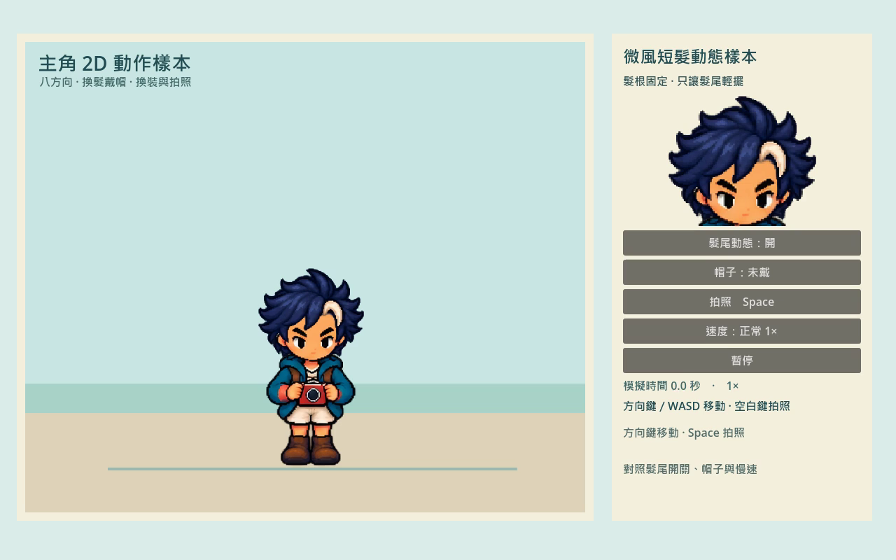
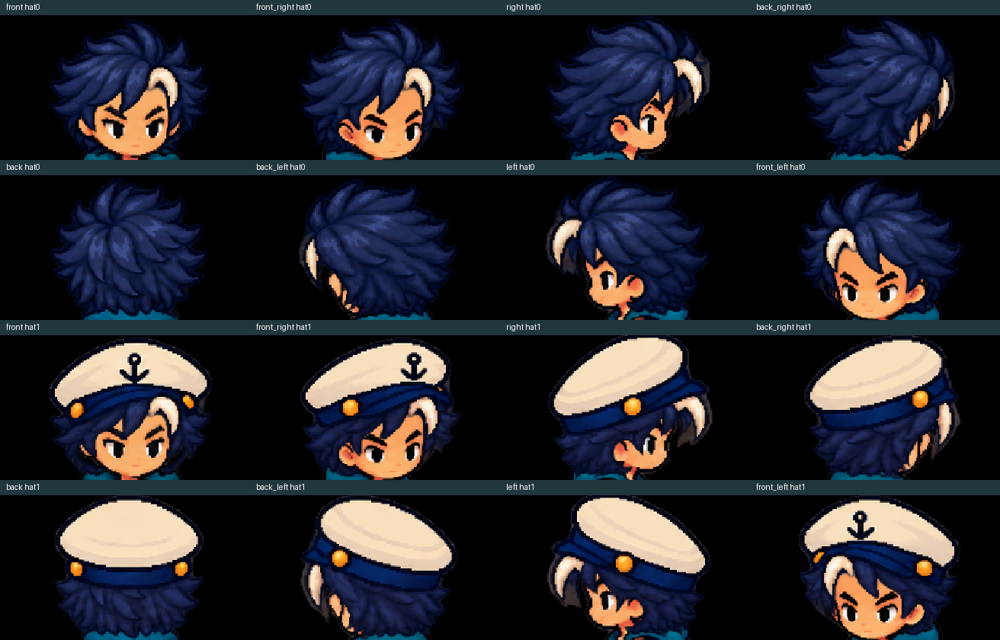
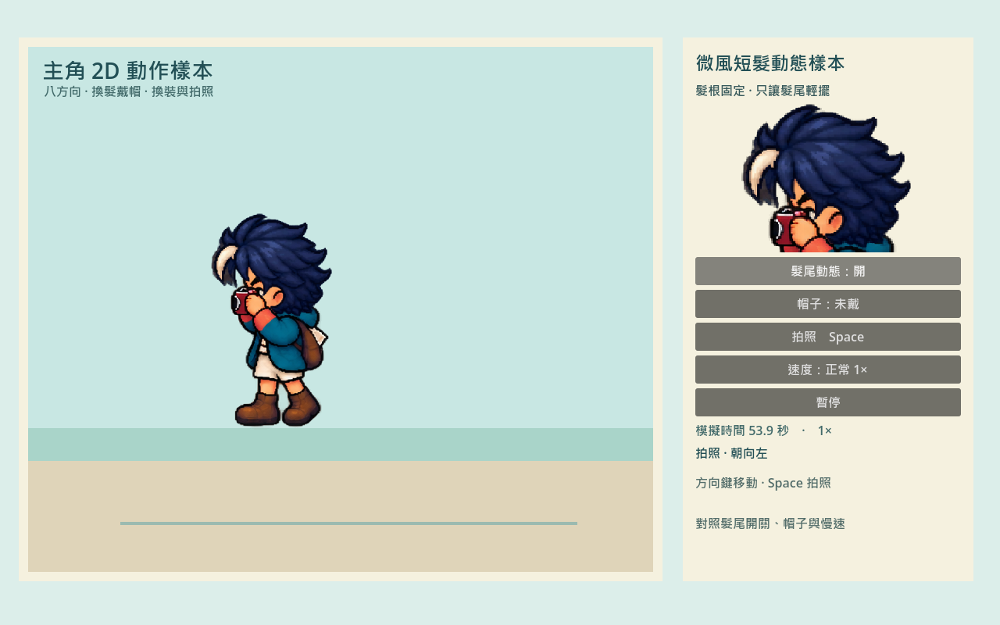

# [ART-30] 製作主角髮尾骨架動態樣本

> 狀態：完成

## 內文

### 需求
以主角一款髮型製作 2D 骨架飄動樣本，保留原本人物畫風、八方向原畫與全身步態。髮根固定跟隨頭部，髮尾隨起停自然回擺，戴帽與轉向時不破壞頭型或遮擋；通過正常與慢放檢視後才擴充。

### 來源
2026-10-16 使用者確認先以主角一款髮型製作 2D 骨架飄動樣本，明確要求髮根不漂移、髮尾自然回擺，並驗證戴帽、八方向轉身、起停、暫停恢復，以及正常速度和慢放。

2026-10-16 使用者澄清主要問題是人物逐格像素偏移時頭髮不跟隨。髮根固定指對當格頭部的相對位置固定，不能把整段走路的髮根鎖在同一個人物座標。

### 驗收條件
- [x] 使用主角原有一款髮型，人物畫風、八方向輪廓與全身步態保持一致。
- [x] 髮根與頭頂穩定跟隨當格頭部，髮尾可見延遲、回擺並自然收斂，不整頂滑動或露頭皮。
- [x] 戴帽／無帽在八方向轉身與起停均合理，帽子固定、帽下髮尾動態受限且遮擋正確。
- [x] 暫停時髮尾凍結，恢復不跳動；換方向、換帽和重新定位不帶入不合理的舊動量。
- [x] 可關閉髮尾額外動態並回到原畫，拍照中的手與相機遮擋仍正確。
- [x] 正常與四分之一模擬速度影片、全身及髮根近照均實際檢視，獨立輸出可啟動並留下證據。

### 測試流程
1. 比較主角原畫與動態開／關，查看髮根、頭頂、外側髮尾與臉部。
2. 在無帽和戴帽下，逐一走八方向，操作短距起停、連續轉身、急停反向與拍照。
3. 在髮尾回擺途中暫停、恢復、換帽與重新定位，觀察是否凍結、跳動或帶入舊動量。
4. 播放正常與四分之一模擬速度錄影，檢查全身、放大的髮根和獨立輸出畫面。

---

# 跟其他票的關係

- Blocks：無
- Blocked by：ART-29
- Related：ART-29、ART-28

---
# Commit-1

## 內文

主角頭髮原本只有固定部件，且走路時頭部的細微位移沒有同步帶動髮根；整頂頭髮若一起旋轉也會讓帽子和頭皮鬆開。
現在保留原本微風短髮與八方向畫風，髮根和帽子跟隨當格頭部，外側髮尾會在移動後延遲、回擺並收回。切換方向、換帽和重新定位會清除舊動量，暫停會連同髮尾一起凍結；關閉額外動態會回到原畫。
正常與四分之一模擬速度的錄影已分段播放、抽格檢視，並核對兩種帽狀態的八方向全身與頭部近看。未觀察到髮根相對滑移或露頭皮，帽子保持貼合，相機及手部遮擋正確；獨立輸出可啟動，實際操作事件巡覽通過。

### 測試結果

| 項目 | 結果 |
|---|---|
| 髮尾動態局部檢查 | 延遲、反擺、收斂、暫停恢復、限幅與重置通過 |
| 原畫合成與八方向綁定 | 640 張休止合成一致，逐格頭部跟隨通過 |
| 實際渲染像素檢查 | 四組靜態姿勢下髮根／帽子受保護內部像素位移為零；髮尾有可見變化且能回到休止 |
| 正常／慢速原生巡覽 | 兩種帽狀態、八方向起停、連續轉向、半步、反向、暫停恢復、動態開關與拍照皆通過 |
| 獨立輸出 | 預設畫面啟動及原生事件巡覽通過，無 ERROR |
| 局部審查 | 修正缺漏渲染證據可能被誤判通過的問題，回歸 4／4 通過 |

### 截圖

[正常錄影](images/ART-30-normal-normal.mp4)（56.8 秒／1704 格）、[四分之一模擬速度錄影](images/ART-30-quarter-quarter.mp4)（214.133 秒／6424 格），皆為 1280×800、30 FPS，播放速度 1×。
[慢放全身](images/ART-30-quarter-body-directions.png)、[慢放頭部](images/ART-30-quarter-head-directions.png)、[回擺中暫停](images/ART-30-quarter-pause-during-rebound.png)、[實際渲染比較](images/ART-30-gpu-pixel-comparison.json)、[驗收範圍與雜湊](images/ART-30-verification.json)。

[操作與重建說明](../../design/runtime/hero-2d-hair-sample-delivery.md)。此為主 Session 的限定樣本檢視，非使用者親自試玩或整島驗收。
