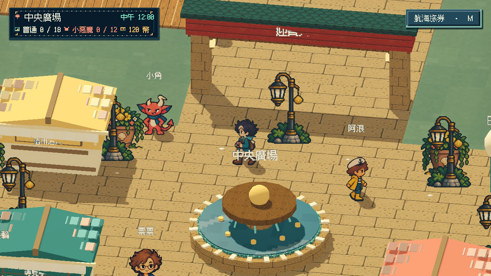
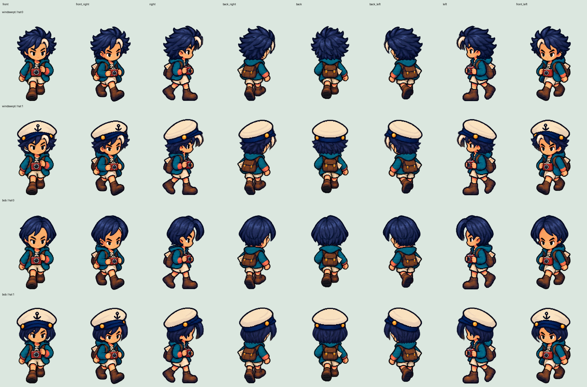
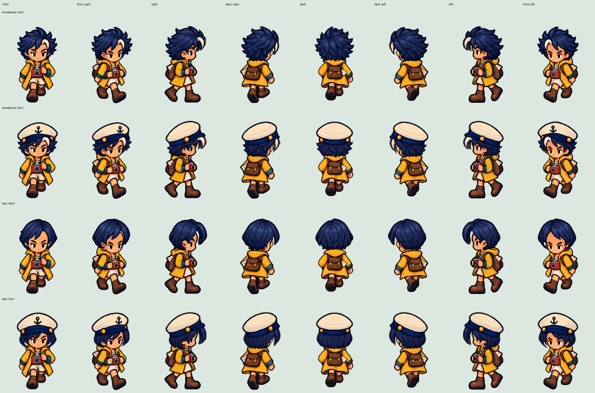

# [ART-31] 修正全部二維行走像素偏移

> 狀態：完成

## 內文

### 需求
所有仍在使用或已交付的 2D 行走動畫都必須有可重現的畫面偏移檢查。固定角色位置播放行走時，人物基準不得因圖格裁切、重新置中或取整而跳位；頭髮、帽子和其他部件必須跟隨當格人物。保留原本畫風及真正的肢體動作，不以凍結動畫或整頂頭髮搖動掩蓋問題。

### 來源
2026-10-16 使用者指出原島嶼、獨立樣本及所有已提供的 2D 行走動畫都有偏移，包含先前聲稱修好的版本；要求用程式量測驗證，完成後自主繼續，不等再次回報。

### 驗收條件
- [x] 盤點所有目前使用及已交付的 2D 行走來源與合成入口，逐項記錄量測結果，不遺漏原島嶼與獨立樣本。
- [x] 固定站位播放完整八方向週期，從實際畫面量出軀幹、頭部、附件及循環接縫的位移，原有問題能使檢查失敗。
- [x] 修正可確認的全身跳位及部件相對滑移，保留肢體與合理起伏，不能只讓測試座標看似固定。
- [x] 實際移動、停下、轉向、換裝、戴帽及髮尾動態開關均保持穩定，暫停恢復不跳位。
- [x] 正常及四分之一模擬速度以固定參考線、全身與頭部畫面檢視，保留修正前後的量測、錄影及失敗證據。

### 測試流程
1. 固定人物世界位置與鏡頭，逐格播放每個行走週期，顯示參考線並量測身體實際像素。
2. 比對原島嶼和獨立樣本、兩件衣物與髮帽，確認程式能抓出舊版問題。
3. 重做實際移動、八方向轉身與起停、暫停恢復，播放正常與慢速錄影核對。

---

# 跟其他票的關係

- Blocks：ART-29、ART-30
- Blocked by：無
- Related：ART-17、ART-18

---

# Commit-1

## 內文

原島嶼把擺動中的鞋子當成人物中心，獨立樣本的頭、眼與脖子也逐格不一致；換髮還會受深色衣服和手臂的位置影響，先前只追頭部座標的驗收因此漏掉問題。
現在同方向共用穩定頭頸，肩背、相機與肢體保留各格原畫。髮帽共用正確的頭部大小與位置，起停不再切換成大小不同的頭像；NPC 身體與附件也使用相同校正。
固定站位的 600 張行走格全部通過，舊版 76 組失敗證據保留；原島嶼正常與真正四分之一速度的按鍵操作各通過 13 組情境。完整換裝與髮尾骨架樣本均重錄並分段播放檢視，兩種衣物及髮帽八方向矩陣已核對，三個更新後輸出可啟動。

### 測試結果

| 項目 | 結果 |
|---|---|
| 局部素材與偏移檢查 | 通過 19／19；含故意偏一像素、空資料與錯誤邊界負例 |
| 固定人物位置的實際合成畫面 | 通過 76 組／600 格；修正前同項 76 組失敗 |
| 下半身原畫、根點及鞋底 | 通過 12 組；NPC 共用地面不跳，保留原畫動肢 |
| 局部原生回歸入口 | 通過 12 項；包含換髮、眼鼻、坐姿、衣櫃、NPC 與行走 |
| 主角姿勢與部件 | 通過；1280 張實際合成圖格 |
| 髮尾實際顯示比較 | 通過 16 組；保護髮根與帽子，末端可見回擺並收斂 |
| 原島嶼正常／慢速按鍵 | 各通過 13 組；八方向、換髮戴帽、反向及暫停恢復 |
| 兩套獨立樣本正常／慢速操作 | 通過；分段播放、全身與頭部檢視 |
| 輸出版本 | 島嶼與兩套樣本啟動通過；髮尾輸出另通過直接操作巡覽 |
| 資料與文件 | 素材重建兩次 21 檔一致；連結檢查通過 |

### 截圖

[完整驗收紀錄與範圍](images/ART-31-verification.json)、[修正前](images/ART-31-pixel-before.json)、[修正後](images/ART-31-pixel-after.json)、[根點與原畫檢查](images/ART-31-root-after.json)。

[固定站位正常對照](images/ART-31-fixed-normal.mp4)、[固定站位慢播對照](images/ART-31-fixed-quarter.mp4)、[原島嶼正常操作](images/ART-31-island-normal.mp4)、[原島嶼慢速操作](images/ART-31-island-quarter.mp4)。

[換裝樣本正常](images/ART-31-sample-normal.mp4)、[換裝樣本慢速](images/ART-31-sample-quarter.mp4)、[髮尾樣本正常](images/ART-31-hair-normal.mp4)、[髮尾樣本慢速](images/ART-31-hair-quarter.mp4)。
