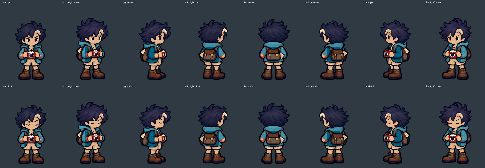
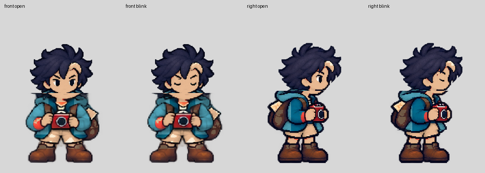

# [ART-32] 接回穩定八方向待機眨眼

> 狀態：完成

## 內文

### 需求
主角在島上八方向停止後恢復自然待機及眨眼，與行走共用穩定頭部與固定畫布，髮根、帽子和臉不因切換或眨眼跳位。

### 來源
2026-10-16 使用者要求持續自主完成：先接回穩定待機與眨眼，再將髮尾骨架接進島上主角，正常與慢放確認無偏移後擴其他髮型。

### 驗收條件
- [x] 八方向待機與起停轉身保持人物基準，眨眼只改眼部且可重新張開。
- [x] 待機保留符合原畫的輕微呼吸，頭髮、帽子及相機不滑移。
- [x] 暫停恢復及降低動態正常；正常與四分之一速度均經原生畫面檢查。

### 測試流程
1. 使用獨立存檔進入實際島嶼，依序觀察八方向站立、眨眼、移動起停及轉身。
2. 切換髮型、帽子與衣物，拍照、暫停恢復及降低動態，檢查完整人物與頭部近看。
3. 正常及四分之一速度分開執行，逐格量測並播放錄影，保留失敗與通過證據。

---

# 跟其他票的關係

- Blocks：ART-33
- Blocked by：無
- Related：ART-17、ART-29、ART-30、ART-31

---

# Commit-1

## 內文

原專用待機與行走頭身比例不同，直接接回會讓頭頸出現切口；只用行走停格又缺少眨眼與呼吸。
現在八方向站姿共用原行走頭頸與固定地面，眨眼只改眼部，胸肩保留一像素呼吸，雙腳固定。首版接縫在近看拒收後重做，保留失敗畫面。
八方向正常及真正四分之一模擬速度的島上起停、站立、眨眼與原生暫停恢復均通過。錄影分段播放並近看頭頸，另以逐像素檢查覆蓋不同髮型、帽子和衣物；這些自動檢查不代稱完整遊戲試玩。

### 測試結果

| 項目 | 結果 |
|---|---|
| 素材檢查與負例 | 8 項通過，含半透明鞋底與裁切拒收 |
| 換裝待機逐像素檢查 | 432 格通過，非眨眼頭部與雙腳固定 |
| 島上正常／四分之一速度 | 各 8 方向，原生暫停恢復通過 |
| 待機時序／原步行／步行像素回歸 | 3 組通過 |
| 新原始匯出重建 | 8 張圖逐位元一致，來源與設定紀錄一致 |
| 本次原生執行 log | 無 ERROR |

### 截圖

[正常錄影](images/ART-32-normal.mp4) · [四分之一速度錄影](images/ART-32-quarter.mp4)

