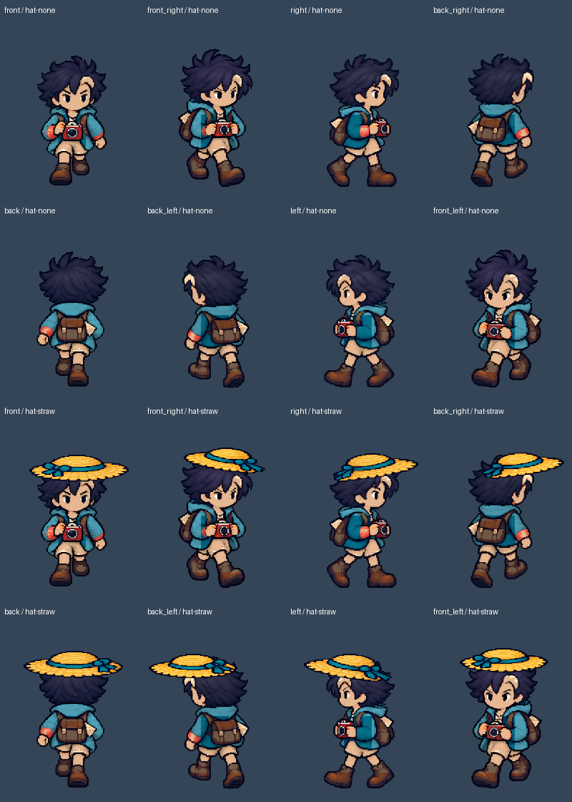
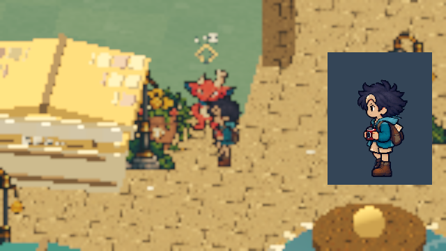

# [ART-33] 接入島上主角髮尾骨架

> 狀態：完成

## 內文

### 需求
把已驗證的微風短髮 2D 骨架接到實際島嶼主角，保留原本畫風、光影及遮擋，只有髮尾隨移動自然回擺。

### 來源
2026-10-16 使用者要求持續自主完成：先接回穩定待機與眨眼，再將髮尾骨架接進島上主角，正常與慢放確認無偏移後擴其他髮型。

### 驗收條件
- [x] 島上主角實際使用 2D 骨架，髮根、臉、帽子及相機保持固定。
- [x] 八方向起停、反向、戴帽、換裝、拍照及暫停恢復正常，髮尾可見回擺並收斂。
- [x] 降低動態及停用能還原靜態原畫，正常與四分之一速度均確認沒有新增偏移。

### 測試流程
1. 使用獨立存檔進入實際島嶼，依序觀察八方向站立、眨眼、移動起停及轉身。
2. 切換髮型、帽子與衣物，拍照、暫停恢復及降低動態，檢查完整人物與頭部近看。
3. 正常及四分之一速度分開執行，逐格量測並播放錄影，保留失敗與通過證據。

---

# 跟其他票的關係

- Blocks：ART-34
- Blocked by：ART-32
- Related：ART-17、ART-29、ART-30、ART-31

---

## 本輪開始

2026-10-17（Asia/Taipei）重新依使用者的像素偏移與頭髮分離回饋驗證；固定基準 `372df05a6db31ef247a59167a7ef00dedaae1bb2`，分支 `codex/character-hair-binding`。沿用既有像素人物與八方向原畫，先核對固定畫布，再完成島上髮根固定與髮尾回擺。

# Commit-1

## 內文

既有固定根點與待機已在島上，但髮尾骨架仍只在獨立樣本；走路中換裝或切換額外動態還會短暫回到第一格。
現在島上人類主角的微風短髮使用原人物像素與固定髮根，只讓外側髮束末端回擺。帽子、臉、相機及原步態保留，換裝和動態切換維持當格與步行進度；停止後收斂，降低動態／停用恢復原圖。其他種族、其他髮型及單次動作保留完整原人物，本票沒有把它們算成新增骨架覆蓋。

先核對七方官方文字資料，另檢視 Unity 換圖錯位與修正兩張靜態原圖，採用原因與範圍見[研究與製作紀錄](../../design/runtime/island-hair-binding.md)。初版合成改動了微透明像素，已拒收並保留[失敗紀錄](images/ART-33-rejected-overlap-audit.json)；修正後以原 RGBA、實際骨架渲染與故意一像素偏移的負例確認。

### 測試結果

| 項目 | 結果 |
|---|---|
| 原畫歸屬、重疊區、可重建與 64 格來源一致性 | 4 項通過 |
| 實際渲染八方向 × 四種帽子 | 32 組通過；休止、保護區及收斂後的像素差均為 0，髮尾確有可見變化 |
| 島上正常／真正四分之一模擬速度 | 各 14 組操作通過；包含原生按鍵、起停、帽子、換裝、拍照、暫停及降低動態 |
| 持續移動直接反向、移動中換裝與動態切換 | 正常／四分之一速度各 8 項通過；保留當格、步態進度與固定髮根 |
| 局部角色回歸 | 5 項通過，0 ERROR；包含 432 格待機、主角八向／NPC 原畫、64 格 × 三髮型的耳角接合 |
| 最終匯入及文件連結 | 通過，0 ERROR |

錄影以完整人物抽幀檢視：正常 51 張、四分之一速度 42 張；另檢視實際島上與頭部／帽髮原始像素圖。不是逐電影格人工審閱或真人試玩。

本輪為雲端 Godot 4.7／llvmpipe。原始人物 280×360 像素比較使用 Forward+；島上錄影為降低環境渲染成本的明列 fixture，停用環境 SSAO／glow／太陽陰影及降低 3D render scale，人物原始合成維持完整解析度。沒有把這些結果算成 Windows 4.7.2、完整光影、原硬體效能或 Windows 輸出包的重新驗收。

### 截圖與影片

[正常錄影](images/ART-33-normal-review.mp4) · [四分之一模擬速度錄影](images/ART-33-quarter-review.mp4)

[持續反向與換裝正常錄影](images/ART-33-live-normal-review.mp4) · [持續反向與換裝四分之一錄影](images/ART-33-live-quarter-review.mp4)

[完整量測與驗收範圍](images/ART-33-verification.json) · [32 組像素比較](images/ART-33-pixels-audit.json)

[正常逐姿勢 1](images/ART-33-normal-poses-1.png) · [2](images/ART-33-normal-poses-2.png) · [3](images/ART-33-normal-poses-3.png)

[四分之一逐姿勢 1](images/ART-33-quarter-poses-1.png) · [2](images/ART-33-quarter-poses-2.png) · [3](images/ART-33-quarter-poses-3.png)

分支：`codex/character-hair-binding`，由原遊戲分支建立的獨立工作區交付；主線遊戲與其他票仍依各自驗收處理。
