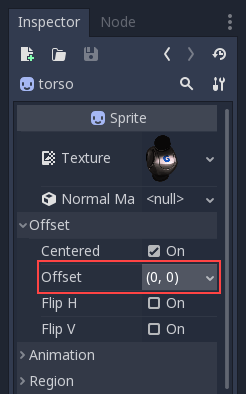
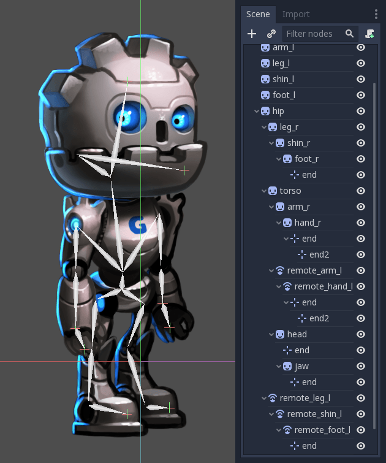
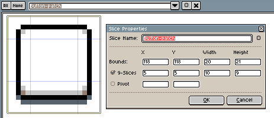
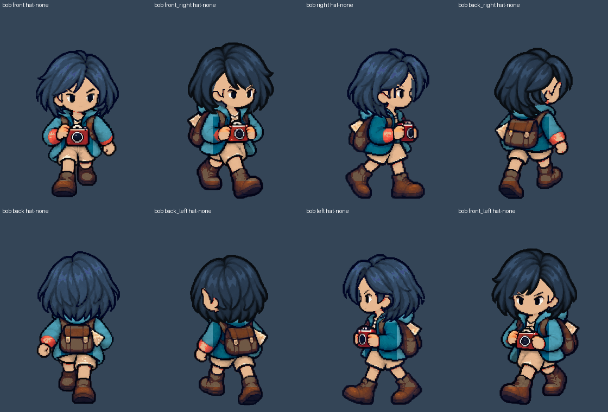
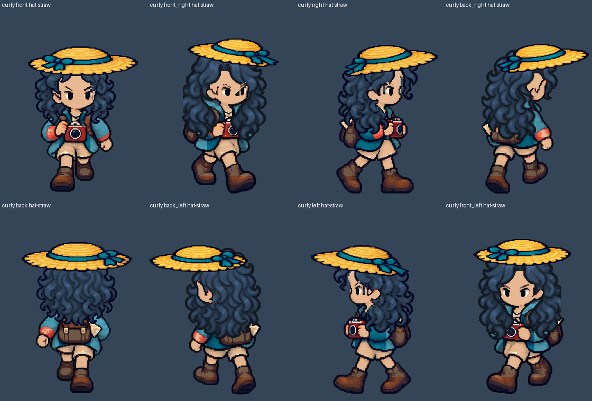
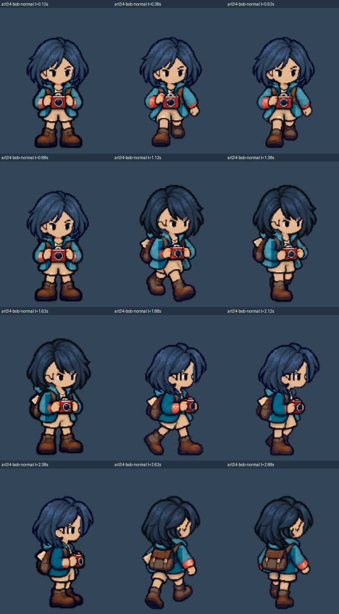
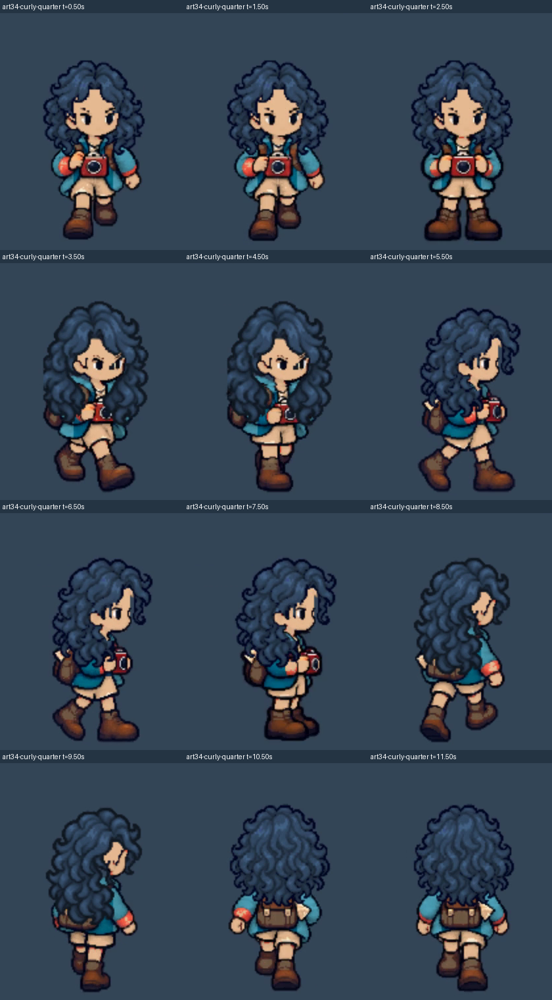

# [ART-34] 擴充島上其他髮型動態

> 狀態：完成

## 內文

### 需求
以已接受的島上主角整合為基礎，逐款接上現有其他髮型的適當髮尾動態，不讓髮型替換破壞臉、帽子或根點。

### 來源
2026-10-16 使用者要求持續自主完成：先接回穩定待機與眨眼，再將髮尾骨架接進島上主角，正常與慢放確認無偏移後擴其他髮型。

### 驗收條件
- [x] 現有其他髮型逐款完成八方向與戴帽／無帽覆蓋，沒有未聲明的原型代用。
- [x] 各髮型幅度符合長短與輪廓，髮根固定、髮尾回擺及停止收斂正常。
- [x] 換髮、衣物、相機、起停轉身及暫停回歸通過，正常及四分之一速度均經檢查。

### 測試流程
1. 使用獨立存檔進入實際島嶼，依序觀察八方向站立、眨眼、移動起停及轉身。
2. 切換髮型、帽子與衣物，拍照、暫停恢復及降低動態，檢查完整人物與頭部近看。
3. 正常及四分之一速度分開執行，逐格量測並播放錄影，保留失敗與通過證據。

---

# 跟其他票的關係

- Blocks：無
- Blocked by：ART-33
- Related：ART-17、ART-18、ART-29、ART-30、ART-31

---

# Commit-1

## 內文

現有短髮與捲髮換裝可以顯示，但島上移動時仍維持整張靜態髮型。
開始逐款核對八方向髮根、帽緣與髮尾，保留既有完整人物及步態。

### 製作基準

- 分支：`codex/hairstyle-motion`
- 基準：[def7970](https://github.com/deadline314/Snapland/commit/def7970bdb2b118900d1d52f2a987785e6617254)
- 研究沿用並補查 Aseprite、Spine、Godot、Unity、Phaser、Spriter 六方官方文件；實際讀取文字，不宣稱影片試看或玩家偏好調查。

# Commit-2

## 內文

短髮與捲髮現在各自帶有八方向的固定髮根與適合輪廓的髮尾幅度。臉、帽子和蓋住背包的髮段維持完整；換裝與降低動態沿用原步態影格。

### 測試結果

| 項目 | 結果 |
|---|---|
| 三款髮型 × 八方向 × 四種帽狀態 | 96 組真正渲染比較通過；休止、保護區與收斂像素誤差 0 |
| 匯出資源包的原生渲染 | 從沒有原始素材的隔離目錄啟動；同 96 組及額外 200 格走路／眨眼的休止像素一致 |
| 換髮定位與既有待機 | 200 格髮層定位、432 格既有待機回歸通過 |
| 即時換裝與步態 | 三款髮型的步態保存局部回歸通過 |
| 短髮正常／四分之一速度島上流程 | 各 14 組移動操作與 13 項檢查通過 |
| 製作資料驗證 | 6 項 Python 測試通過 |

研究文字與採用理由見[方法紀錄](../../design/runtime/alternate-hair-motion.md)。本階段仍在進行捲髮與兩款連續轉向的島上錄影檢查，驗收條件維持未勾選。

# Commit-2b

## 內文

Windows 的清單換行可能讓同一套素材被誤判為變更，造成短髮／捲髮動態停用。現在相同文字內容在 Windows 和 Linux 都能正常啟用；真正變更的素材仍保留完整原人物。

使用 Windows 換行的實際清單重新匯出資源包，從沒有原始素材的隔離目錄通過 96 組與額外 200 格渲染比較；7 項 Python 回歸通過。本項不等同 Windows EXE 或完整光影驗收。

# 參考圖與可重用流程

本批文字比較 Aseprite、Spine、Unity、Godot、Phaser、Spriter 六方方法。以下五張是官方文件內原始靜態示意圖，已實際檢視並原樣保存；不是完整網頁截圖，也沒有把別人的人物放進遊戲。Spine 圖片擷取失敗，沒有列作已看過的圖片。

[Unity 替換部件範例](https://docs.unity3d.com/Packages/com.unity.2d.animation@10.0/manual/CharacterParts.html)：先看錯位，再看相對 pivot 對齊後的接合。採用共用根點，不因每格部件外框大小改變位置。

[Godot Cutout](https://docs.godotengine.org/en/stable/tutorials/animation/cutout_animation.html)：參考 Offset 與父子階層的分工，保留原全身逐幀步態，只讓合適的末端部件回擺；不採用範例人物外觀。

[Aseprite Slices](https://www.aseprite.org/docs/slices/)：製作時記錄畫布與 pivot，不用每格鞋底或透明外框重算角色中心。

[圖片來源、觀察與 SHA256](images/ART-34-reference-provenance.json)。來源圖與本票的遊戲截圖分開標示；圖片說明只支持定位方法，不當作自然動畫或玩家偏好驗收。

本批可重用順序：先讀 User-guide 與本票依賴 → 比較多方文字和實際圖例 → 先做一款完整方向／動作樣本 → 正常、慢速及完整人物逐格檢查 → 起停、換裝、暫停、降低動態及匯出包回歸 → 保存失敗與通過證據，再擴下一款。跨票共通部分已整理回 User-guide；角色各款的製作細節留在本票及方法文件。

# Commit-3

## 內文

兩款替換髮型原本沒有島上動態，現已各自完成八方向髮尾綁定；髮根、臉、帽緣與完整人物保持原來位置。短髮的回擺較小，捲髮採適合外輪廓的幅度，蓋在背包或肩上的髮段保留完整遮擋。換髮、換衣物及降低動態不重置步態。

兩款各以正常及真正四分之一模擬時間完成 14 組島上移動操作，另各做兩種速度的連續反向與移動中換髮。八段錄影解碼為完整人物影格，以每模擬秒四張抽樣，共 234 張實際檢視；另檢視八張髮型／帽子全身圖。這是本批局部驗收，不是逐電影格連續播放、真人試玩或全島品質驗收。

### 測試結果

| 項目 | 結果 |
|---|---|
| 兩款 × 正常／四分之一速度 | 4 趟島上流程，各 14 組移動、13 項檢查，全部通過 |
| 連續反向、移動中換髮／衣物／動態 | 4 趟流程各 11 項檢查；三款髮型保持當前非零步態影格及進度 |
| 三款 × 八方向 × 四種帽狀態 | 96 組實際渲染；休止、保護區及停止收斂誤差均為 0 |
| 實際匯出資源包 | 隔離原始素材後，同 96 組及額外 200 格走路／眨眼休止渲染一致；原始 PNG 不在探測目錄中 |
| 髮層定位、步態、既有待機回歸 | 200 格定位、三款步態保存、八向走路及 432 格待機通過 |
| 製作資料、連結與啟動設定 | 7 項 Python 測試、連結與原生測試設定檢查通過 |
| 失敗偵測 | 故意偏移一像素會被抓到；來源變更、未知髮型及降低動態保留完整人物 |

使用獨立絕對存檔，原生流程均 exit 0、0 ERROR。雲端使用 Godot 4.7／Forward+／llvmpipe；島上錄影降低環境特效成本，人物仍維持 280×360。另以 Windows CRLF 清單匯出資源包，96 組與 200 格渲染再驗通過；文字換行不會使動態誤判停用。資源包驗證不等於 Windows 4.7.2 EXE、完整光影或即時效能驗收。其他種族部件及單次動作繼續顯示完整原人物；完整衣物輪廓與 NPC 覆蓋另見 ART-18／17。

### 截圖與影片

[短髮正常](images/ART-34-bob-normal.mp4) · [短髮四分之一](images/ART-34-bob-quarter.mp4) · [捲髮正常](images/ART-34-curly-normal.mp4) · [捲髮四分之一](images/ART-34-curly-quarter.mp4)

[短髮連續反向正常](images/ART-34-bob-reverse-normal.mp4) · [短髮連續反向慢速](images/ART-34-bob-reverse-quarter.mp4) · [捲髮連續反向正常](images/ART-34-curly-reverse-normal.mp4) · [捲髮連續反向慢速](images/ART-34-curly-reverse-quarter.mp4)

[驗收範圍與素材雜湊](images/ART-34-verification.json) · [原生像素比較](images/ART-34-pixels.json) · [資源包像素比較](images/ART-34-packed-pixels.json) · [資源包來源](images/ART-34-pack-provenance.json) · [研究與取捨](../../design/runtime/alternate-hair-motion.md)

Windows 換行修正：[82952d5](https://github.com/deadline314/Snapland/commit/82952d5da787aab816e1a50b586ad91631e9d755)。程式提交：[50bfcbd](https://github.com/deadline314/Snapland/commit/50bfcbd2e8c43ba12fe5aa5f6e7bd75f82fbe8fb)。[草稿 PR #2](https://github.com/deadline314/Snapland/pull/2)，接續 ART-33 的 PR #1。整體設計 CI 仍受 SG-1 既有小遊戲目錄缺檔影響，沒有略過檢查或宣稱完整套件通過。
