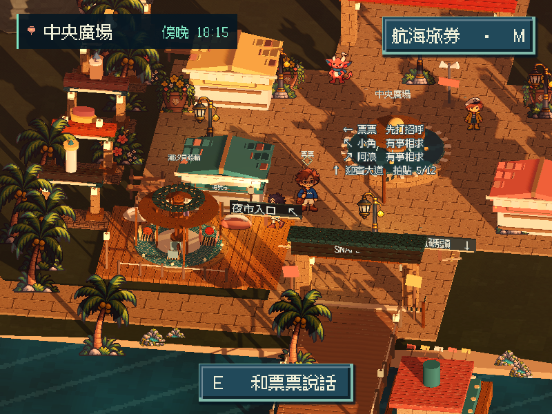

# [ART-35] 改善迎賓大道路燈與指引

> 狀態：完成

## 內文

### 需求

讓玩家在黃昏和夜間能從中央廣場辨認碼頭、遊戲大道及區域入口方向。路燈照亮可行走的地面，靜態指引在降低動態時仍清楚。門口告示須反映園區實際開放和入場資格。

### 來源

2026-11-26，使用者要求持續改善未完成的遊戲體驗。迎賓大道原生照明檢查發現黃昏最弱燈池略低於可見亮度門檻，且已開放的霓虹夜市仍在實體入口標成準備中。

### 驗收條件

- [x] 黃昏各可見燈池符合原生亮度差檢查，白天、夜間及降低動態設定表現一致。
- [x] 中央廣場三處指引對應實際可走方向，黃昏與夜間可辨識。
- [x] 夜市入口告示與實際入場規則一致，未開放區域依舊顯示準備中。
- [x] 可實際走到入口並互動，保持原有碰撞、進出與燈數上限。
- [x] 留下局部驗證摘要及一張代表性原生截圖。

### 測試流程

1. 比較黃昏與夜間開燈前後的實際地面亮度，檢查降低動態設定。
2. 在小視窗及原生遊戲視窗沿中央廣場的指引步行到入口。
3. 檢查五張及六張普通卡的夜市門口顯示與互動。

---

# 跟其他票的關係

- Blocks：無
- Blocked by：無
- Related：無
---

# Commit-1

## 內文

中央廣場新增三面靜態方向牌，指向海風碼頭、迎賓大道及夜市入口。門口告示顯示夜市實際開放狀態與六張普通卡條件。黃昏燈池增加可見亮度，降低動態時方向與燈光保持穩定。

### 測試結果

| 項目 | 結果 |
|---|---|
| 島嶼布局 | Godot 4.7.2 局部回歸通過 |
| 原生照明 | 四個時段通過。黃昏最弱燈池亮度差由 3.996 提升到 4.412，門檻為 4.0。 |
| 原生步行與入口 | 800×600 黃昏降低動態、1280×720 夜間各通過 38 項檢查。三面方向牌可辨識，五張卡阻擋入場、六張卡可進入且不消耗，維持最多八盞作用燈與兩盞投影燈。 |

### 截圖

