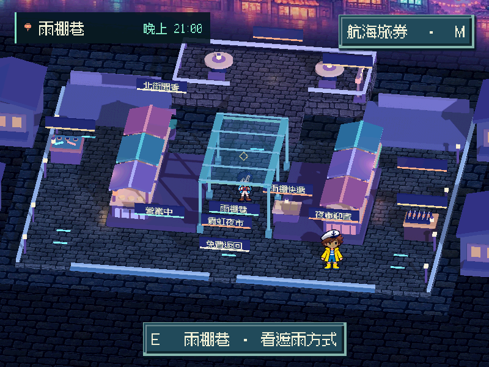

# [ART-37] 打磨夜市雨街反光與光影層次

> 狀態：完成

## 內文

### 需求

讓霓虹夜市的攤街、雨棚與屋頂呈現雨後材質差異。地面能看出冷色環境光、附近暖燈和濕石板反光，走動時看得清楚路面、入口、指標和角色。

### 來源

2026-11-26 玩家對話要求改善地圖、美術、光源、動畫與遊戲效能。夜市攤街、雨棚與屋頂動線承接園區設計與 MAIN-37。

### 驗收條件

- [x] 開攤時可區別濕石板、雨棚下相對乾燥的步道、屋頂地面，以及燈旁局部的暖色反光。
- [x] 切換日夜與收攤時反光強度符合現有燈光，玩家、標示和安全步行路線可辨識。
- [x] 開啟減少動態後，雨滴和地面反光保持既有無動態設定，路面仍可辨識。
- [x] 維持三處本地燈光、地圖與擋雨範圍、步行上屋頂及免費往返。

### 測試流程

1. 從迎賓大道進入夜市，走過兩側攤街、雨棚並循斜坡登上屋頂，觀察石板與燈旁反光。
2. 在原生視窗比較日夜、營業與收攤，再啟用減少動態並檢查雨滴、反光與指標。
3. 返回夜市入口並往返迎賓大道，確認場景、攤位與地圖互動。

---

# 跟其他票的關係

- Blocks：無
- Blocked by：無
- Related：MAIN-37、ART-35

---

# Commit-1

攤街以冷色濕石板為主，局部暖燈倒影會配合時段與收攤狀態。雨棚下較乾燥，屋頂較霧，遠處地面收斂為低對比的小石板。半透明雨棚下方仍可看清玩家與指標。

| 項目 | 結果 |
|---|---|
| Godot 4.7.2 局部 | 夜市地形、雨棚、斜坡、燈光、地圖與安全重置通過 |
| OpenGL 原生 800×600／1280×720，字級 125% | 78／77 項通過 |
| 原生 800×600 光照取樣 | 暖紅反光增加 0.259，減少動態時取樣漂移 0.0003 |
| 園區與連結規格 | 2 項通過 |

