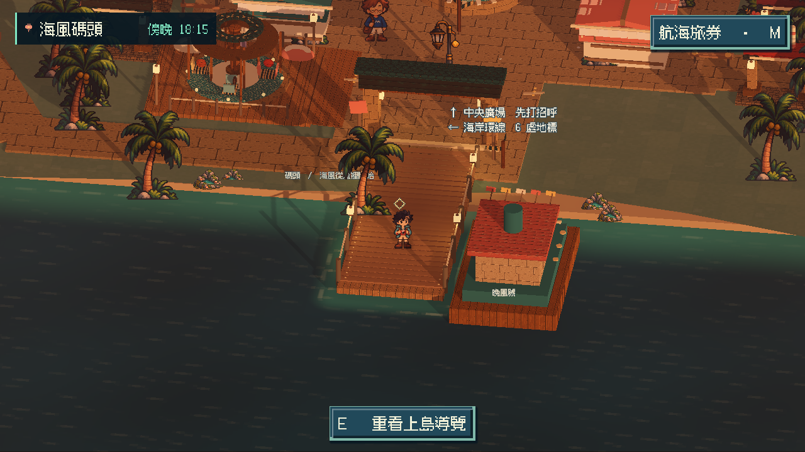

# [ART-38] 打磨迎賓海灣岸浪與水色

> 狀態：完成

## 內文

### 需求

迎賓廣場與碼頭前的海面需要有清楚的深淺、溫和的岸浪與安靜的遠水。縮短跨越整片海面的重複斜紋，讓水線讀起來像接著實際岸沿和碼頭，和既有暖光、石岸及像素人物搭配。

### 來源

2026-11-26 使用者要求從頭打磨地圖、美術、光源、動態與效能。迎賓廣場原生固定視點已量到海面斜紋高度重複。

### 驗收條件

- [x] 同一鏡位可看出淺海與遠水的色階。岸浪有空隙且沿實際岸沿，遠水不出現滿幅平行亮線。
- [x] 一般模式可看見水面動態，減少動態可穩定靜止。晴亮、傍晚及夜色下的碼頭仍易辨。
- [x] 保持碼頭、岸沿和港口原有動線。水面維持一個表面和原有渲染預算，無新增燈光或視窗。
- [x] 同機配對檢查更新成本與代表視點，PM 只留一張必要原生畫面。

### 測試流程

1. 在相同視點與時段比對舊、新海面，量出斜紋延續性並看岸線接觸。
2. 走去碼頭再回廣場，確認一般與減少動態及各時段切換。
3. 檢查港口、水池和可走邊界，並比較相同畫面前後的渲染成本。

---

# 跟其他票的關係

- Blocks：無
- Blocked by：無
- Related：MAIN-46、MAIN-47

---

# Commit-1

## 內文

迎賓海灣大範圍的斜亮紋改為安靜的遠水和沿岸短浪。靠岸的海玻璃色和碼頭周圍的微光讓停泊區更容易辨認。正常動態可見，開啟減少動態後水面維持靜止。

### 測試結果

| 項目 | 結果 |
|---|---|
| Godot 4.7.2 局部回歸 | 園區佈局、海岸自由探索、潮汐碼頭、主場景整合共 4 套通過 |
| Windows 原生流程 | 800×600 通過 27 項，1280×720 與 1920×1080 各通過 33 項 |
| 固定鏡位海面 | 1280×720 完成前後比對，亮紋相關係數 0.813 降至 0.215。一般模式的取樣區有 19.39% 像素變化，減少動態為 0% |
| 同機原生繪製 | RX 9070 XT、Forward+、1920×1080，暖機後取三組各 300 幀。各組第 95 百分位的中位數，CPU 1.368→1.313 毫秒，GPU 0.694→0.673 毫秒，實際幀間隔 2.782→2.650 毫秒，繪製呼叫 2339→2336 |

### 截圖

