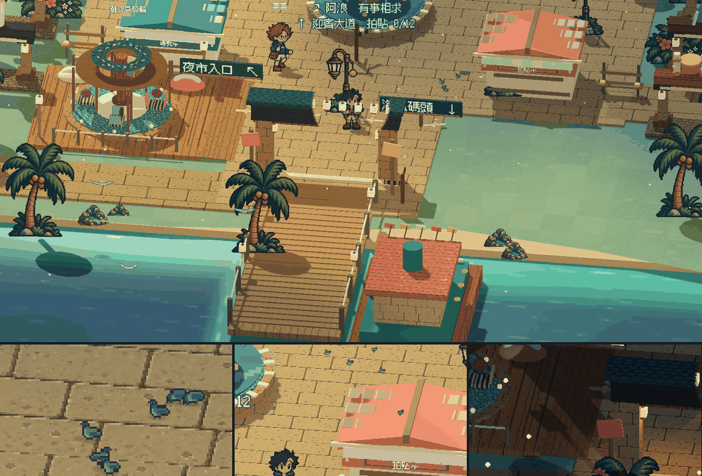

# [ART-39] 讓園區有雲影飄塵與小動物

> 狀態：完成

## 內文

### 需求

園區站著不動時畫面幾乎靜止，缺少天氣與生物的氣息。讓地面有緩慢飄過的雲影，空氣中有依時段變化的飄塵、花粉或螢火，並有會對玩家靠近產生反應的小動物，讓每一區看起來是活的。

### 來源

2026-11-27 使用者要求畫面不要死板、圖片要融入場景、背景要有動畫與互動，並調整光照、渲染與效能。

### 驗收條件

- [x] 白天地面與角色身上可見緩慢移動的雲影，夜晚不出現雲影。
- [x] 各時段有不同的空氣粒子，夜晚可見發光的螢火。
- [x] 廣場的鳥在玩家走近時飛走，離開後會回來；碼頭上空有海鷗滑翔。
- [x] 開啟減少動態後雲影與粒子靜止或隱藏，小動物不突然移動。
- [x] 七個區域都可進入並往返，原有互動、燈光數量與動線不變。

### 測試流程

1. 在迎賓廣場站定，觀察雲影、粒子與鳥。
2. 走向鳥群再離開，確認飛走與返回。
3. 切換四個時段與減少動態，再往返其他區域。

---

# 跟其他票的關係

- Blocks：無
- Blocked by：無
- Related：ART-38、MAIN-51

---

# Commit-1

## 內文

園區站著不動時只有樹葉與水面在動，看不出天氣，也沒有任何生物。

現在白天有柔和的雲影緩慢飄過地面、海面、建物與角色，夜晚不出現。空氣裡的粒子隨時段更換：清晨與中午是花粉和花瓣，傍晚是被夕陽照亮的暖色飄塵，夜晚是忽明忽暗、帶一點光暈的螢火。各區依主題不同：夜市有攤位蒸氣與炭火星、糖果工廠有糖晶閃光與糖漿槽蒸氣、碼頭有浪花、花園有花粉與螢火、馬戲團與玩具城是光裡的浮塵。廣場上有一群鴿子在地上踱步啄食，玩家走近會一隻接一隻驚飛，離開幾秒後從另一側飛回來降落；碼頭上空有海鷗繞圈滑翔，海面與棧橋上看得到牠們的影子；花台邊有蝴蝶。其他六區也各有麻雀、鴿子、蝴蝶或飛蛾。開啟減少動態後，雲影停住、粒子隱藏、鳥全部落地站好，海鷗與蝴蝶不再移動。

以原生畫面在迎賓廣場、碼頭與其他六區，於中午、傍晚、夜晚逐一看過；相隔一秒的兩張畫面確認雲影、粒子與動物都在動，減少動態下相隔一秒的兩張畫面完全相同。雲影只出現在場景上，介面不會變暗。每區新增的場景節點為六到八個，同一視點的繪製數增加三到六次。

### 測試結果

| 項目 | 結果 |
|---|---|
| 環境氛圍檢查（七區設定、切換時段與設定不新增節點、鳥驚飛與返回、減少動態） | 通過 375 / 375 |
| 受影響的區域、往返與整合套件（十二組） | 全部通過 |
| 中午相隔一秒兩張畫面的變動像素（1920×1080） | 87,749 |
| 減少動態相隔一秒兩張畫面的變動像素 | 0 |
| 每區粒子總數上限 200 | 迎賓 194、碼頭 114、糖果 78、夜市 138（含原有雨絲 90）、馬戲團 60、玩具城 76、花園 120 |
| 迎賓區場景節點 | 2275 → 2283 |
| 迎賓廣場同一視點繪製數（中午／夜晚） | 1743 → 1748／2674 → 2677 |
| 其他六區同一視點繪製數 | 各增加 4 到 6 次 |
| 執行 log | 無 ERROR |

### 截圖

