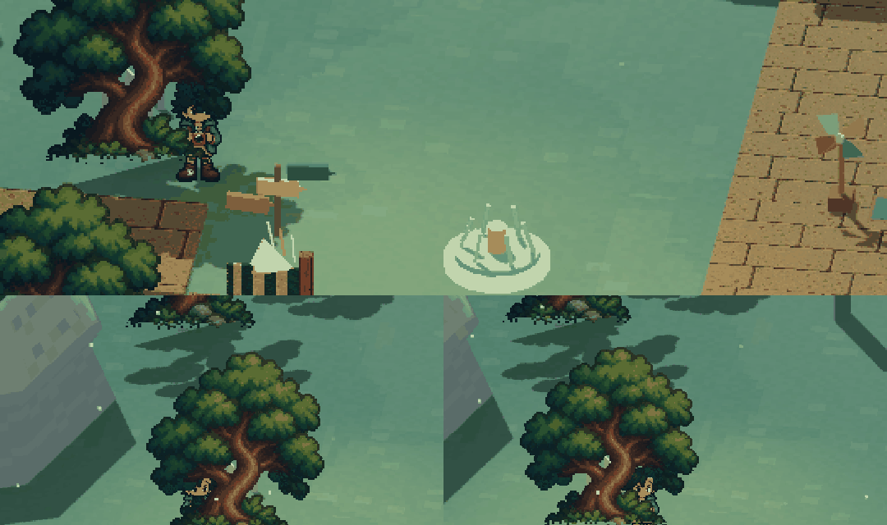

# [ART-40] 加強草地與植物的風吹律動

> 狀態：完成

## 內文

### 需求

草地是一片均勻的綠色，樹與花只有很輕微的擺動，看起來像貼在地上的圖。讓草地有成片的風浪與深淺變化，植物有陣風感，玩家經過灌木與花圃時植物會被撥動，讓圖片融入場景。

### 來源

2026-11-27 使用者要求畫面不要死板、圖片要融入場景、背景要有動畫與互動，並調整光照、渲染與效能。

### 驗收條件

- [x] 草地可見一陣一陣掃過的風浪與自然的深淺斑塊，不是單一色塊。
- [x] 樹、灌木與花圃隨陣風擺動，強弱有變化且根部不滑動。
- [x] 玩家貼近灌木或花圃走過時，植物明顯被撥動後回彈。
- [x] 開啟減少動態後草地與植物靜止。
- [x] 草地朝向、陰影與既有佈局檢查維持通過。

### 測試流程

1. 在迎賓大道觀察草地與樹的風吹變化。
2. 沿花圃與灌木邊走過，確認撥動與回彈。
3. 開啟減少動態確認靜止，再切換時段。

---

# 跟其他票的關係

- Blocks：無
- Blocked by：無
- Related：ART-39

---

# Commit-1

## 內文

草地是一格一格的棋盤色塊，樹與花只有幾乎看不出來的擺動，玩家走過植物時沒有任何反應。
現在草地是不規則的深淺斑塊，一陣一陣的風會從草地上掃過，草色隨風鋒變亮、草尖跟著倒向；樹、灌木與花圃吃同一陣風，平靜時輕輕顫動，風鋒經過時整株傾斜並加快擺動，根部不動。玩家貼近植物時，植物會被往另一側撥開並沙沙晃動，腳下的草也會被壓暗一圈。開啟減少動態後風完全停止，植物與草地不再反應。
原生檢視迎賓大道：兩個時間點的草地與樹冠有可見變化，站在樹的左右兩側時樹冠分別倒向另一邊；減少動態下相隔一秒多的兩張畫面逐點相同。

### 測試結果

| 項目 | 結果 |
|---|---|
| 島上風場檢查 | 通過 |
| 環境生命感、島嶼佈局、日夜光照、元件動畫 | 通過 |
| 溫室、夜市、遊戲啟動、主場景整合 | 通過 |
| 減少動態兩張畫面差異 | 0 個取樣點 |

### 截圖

