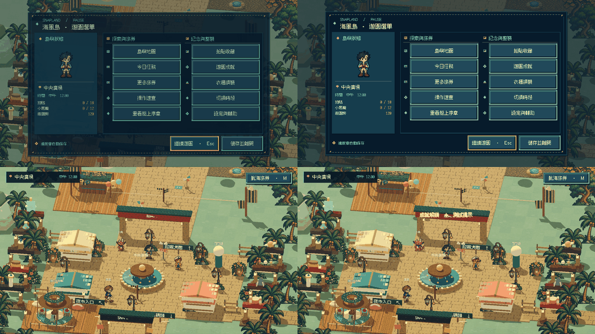

# [ART-41] 讓介面開關與按鈕有動態回饋

> 狀態：完成

## 內文

### 需求

選單、面板與按鈕都是瞬間出現與消失，按下去沒有手感。讓面板開關有短促的進出場，按鈕在聚焦與按下時有回饋，數字變化有跳動，並為圖示按鈕補上只講重點的滑鼠提示。

### 來源

2026-11-27 使用者要求畫面不要死板、圖片要融入場景、背景要有動畫與互動，並調整光照、渲染與效能。

### 驗收條件

- [x] 開啟與關閉面板有短於四分之一秒的進出場，不延遲操作。
- [x] 按鈕聚焦、滑過與按下有可見回饋，鍵盤、手把與滑鼠一致。
- [x] 拍貼與遊園幣數字變化時有跳動提示。
- [x] 只有圖示或縮寫的按鈕有一句話以內的滑鼠提示。
- [x] 開啟減少動態後所有進出場改為直接切換，功能不變。

### 測試流程

1. 開啟暫停選單、地圖、收藏與設定並關閉，觀察進出場。
2. 用鍵盤與滑鼠各操作一次按鈕。
3. 開啟減少動態後重複一次。

---

# 跟其他票的關係

- Blocks：無
- Blocked by：無
- Related：ART-20

---

# Commit-1

## 內文

選單與面板原本瞬間出現，按鈕滑過與按下沒有任何變化，收到拍貼或遊園幣時也沒有提示。
現在開啟面板時會短促地滑入並淡入，同一個面板翻頁時不重播；按鈕在滑過、取得焦點與按下時有亮暗回饋；關閉面板回到園區時，剛拿到的拍貼、小惡魔與遊園幣會以上升的小字顯示；提示訊息與互動提示出現時會跳一下。教學說明的翻頁箭頭補上一句提示。開啟減少動態後，以上全部改為直接顯示，上升小字改為短暫靜止顯示。
原生畫面確認面板進場中途與完成後的位置一致、遊園幣增加後出現提示；面板、按鈕、旅行與整合檢查通過。

### 測試結果

| 項目 | 結果 |
|---|---|
| 介面動態檢查 | 通過 21 項 |
| 面板外殼、彈出視窗、按鈕層次 | 通過 |
| 主場景整合、收藏介面、小遊戲抬頭列 | 通過 |
| 面板進場時間 | 0.16 秒，不延遲操作 |

### 截圖

