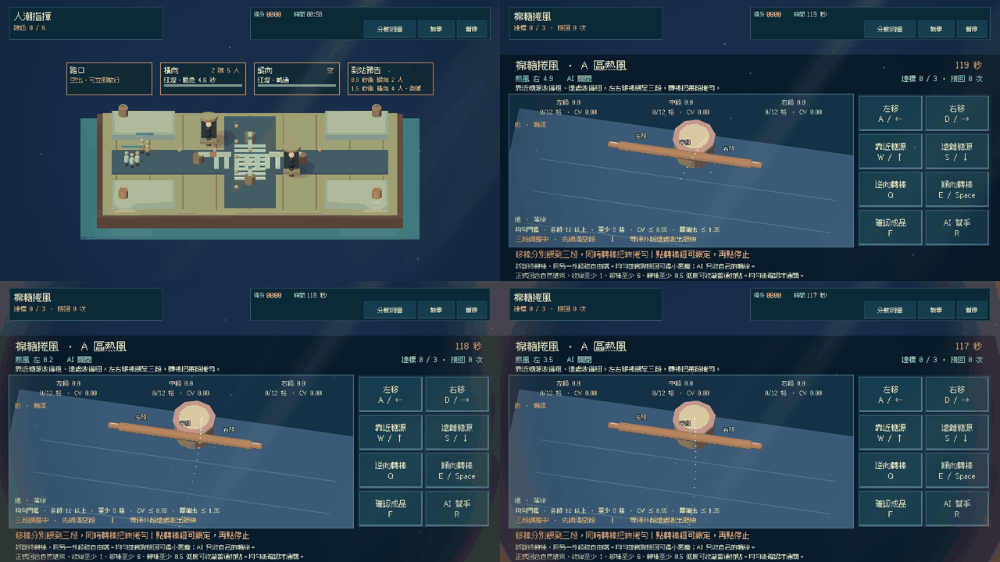

# [ART-42] 讓小遊戲場景有景深與動態

> 狀態：完成

## 內文

### 需求

小遊戲的背景是一張靜止的圖，前景物件像直接貼在上面。讓背景有光線、飄浮物與遠近層次的緩慢變化，並讓得分、失誤與結束時有畫面回饋，使物件像處在場景之中。

### 來源

2026-11-27 使用者要求畫面不要死板、圖片要融入場景、背景要有動畫與互動，並調整光照、渲染與效能。

### 驗收條件

- [x] 小遊戲背景可見緩慢的光影或飄浮物變化，不影響判讀玩法物件。
- [x] 得分與失誤時有對應的畫面回饋，強度不遮擋操作。
- [x] 既有小遊戲不需逐款修改即可獲得場景動態。
- [x] 開啟減少動態後背景靜止且回饋改為不晃動的提示。
- [x] 既有小遊戲的規則、計分與結果不變。

### 測試流程

1. 進入三款不同區域的小遊戲，觀察背景與回饋。
2. 開啟減少動態後重玩一款。
3. 完成一回合確認結算與收藏正常。

---

# 跟其他票的關係

- Blocks：無
- Blocked by：無
- Related：ART-41

---

# Commit-1

## 內文

小遊戲的場景是一張靜止的畫面，得分與失誤時畫面沒有任何反應。
現在所有小遊戲共用一層場景空氣：緩慢移動的斜向光束、四角的柔和暗角，以及依區域配色的飄浮微粒（迎賓的花粉、碼頭的水沫、糖果工廠的糖粉、夜市的火星），並隨時段調整明暗。得分時畫面邊角泛金光、分數跳一下；失誤時邊角泛紅並輕微晃動；過關時落下彩紙。這層效果不需要逐款修改，新舊四十八款都自動套用。開啟減少動態後光束與微粒靜止，回饋只留下短暫不動的邊角光，不晃動也沒有彩紙。
原生檢視迎賓、碼頭、糖果工廠與夜市各一款，邊角光不蓋住操作區；小遊戲規則、計分與結算相關檢查全數通過。

### 測試結果

| 項目 | 結果 |
|---|---|
| 場景空氣檢查 | 通過 28 項 |
| 小遊戲介面、抬頭列、入口與整合 | 通過 |
| 抽查四款小遊戲的回合與結算檢查 | 通過 |
| 每款新增成本 | 一道全畫面效果與至多 32 顆微粒 |

### 截圖

