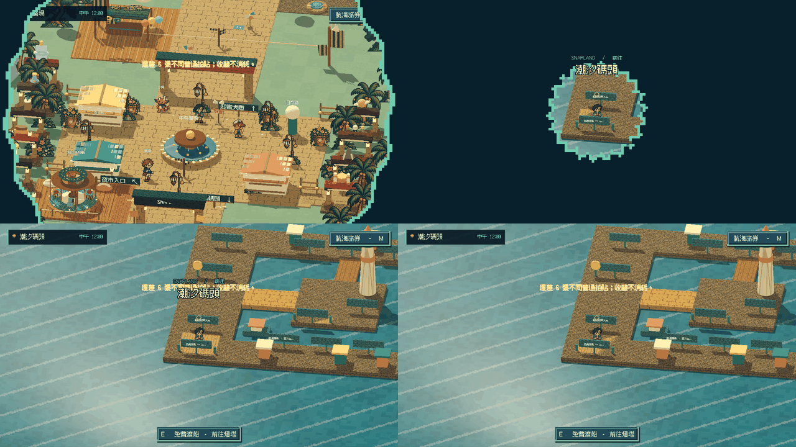

# [ART-43] 加入換區轉場並隱藏載入停頓

> 狀態：完成

## 內文

### 需求

前往其他區域時畫面會凍結約三秒後直接換景，像當機。加入有主題的轉場，讓畫面在載入期間保持有動靜，抵達時自然展開。

### 來源

2026-11-27 使用者要求畫面不要死板、圖片要融入場景、背景要有動畫與互動，並調整光照、渲染與效能。

### 驗收條件

- [x] 換區時先有轉場遮住畫面，載入期間不出現凍結的遊戲畫面。
- [x] 抵達後轉場展開並顯示區域名稱。
- [x] 轉場期間無法重複觸發旅行或其他互動。
- [x] 開啟減少動態後改為簡單淡入淡出。
- [x] 七個區域的往返、存檔與門檻判定不變。

### 測試流程

1. 從迎賓廣場前往任一區域再返回，觀察轉場。
2. 轉場中連按互動鍵，確認不重複觸發。
3. 開啟減少動態後重複一次。

---

# 跟其他票的關係

- Blocks：無
- Blocked by：無
- Related：MAIN-44、MAIN-45、MAIN-48

---

# Commit-1

## 內文

前往其他區域時畫面會停住一到數秒後直接換景，看起來像當機。
現在出發時有一圈票孔造型的遮罩從四周收合，遮住畫面後顯示目的地名稱，場景在遮罩後載入；抵達時遮罩展開，區域名稱在畫面上方停留片刻後淡出。轉場期間不能再次觸發旅行、互動或開啟選單。開啟減少動態後改為簡單的淡出淡入。
原生執行迎賓廣場到潮汐碼頭：遮罩 0.35 秒內蓋滿，全程約 2.5 秒，轉場中第二次旅行被拒絕；七區往返、門檻與存檔檢查通過。

### 測試結果

| 項目 | 結果 |
|---|---|
| 區域旅行檢查 | 通過 |
| 轉場遮罩釋放與取消 | 通過 |
| 遊戲啟動與主場景整合 | 通過 |
| 迎賓廣場到潮汐碼頭 | 遮罩 0.35 秒蓋滿，約 2.5 秒完成 |

### 截圖

