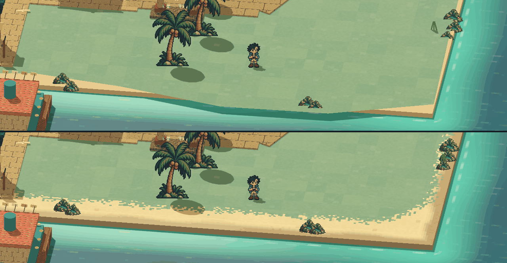

# [ART-44] 修正海岸草地與水面超出地面

> 狀態：完成

## 內文

### 需求

迎賓碼頭旁的草地蓋過沙灘一路伸到水邊，帶水窪的岸石擺在草地上，地面各層的邊界互相超出，看起來像圖層沒對齊。讓草地、沙灘、水面與岸石各自停在合理的邊界內。

### 來源

2026-11-27 使用者附三張迎賓碼頭截圖，指出地面層超出、方形色塊道具、樹木風格與影子錯誤，並要求讓同類問題不再發生。

### 驗收條件

- [x] 草地邊緣全程留在沙灘內側，任何視點都看不到草地直接接水。
- [x] 沙灘沿整條岸線連續，沒有被草地截斷的缺口。
- [x] 岸石只出現在沙灘或水邊，不壓在草地或步道上。
- [x] 水面不高出岸沿，也不從地面縫隙露出。
- [x] 碼頭、步道與可走範圍不變。

### 測試流程

1. 沿迎賓海岸從西走到東，逐段檢查草地、沙灘與水的交界。
2. 在碼頭兩側檢查岸石位置。
3. 切換四個時段重看一次。

---

# 跟其他票的關係

- Blocks：MAIN-53
- Blocked by：無
- Related：ART-38

---

# Commit-1

## 內文

草地原本和整塊陸地一樣大，邊緣還往外多凸出一截，所以蓋過沙灘直接接到水面，沙灘只剩斷斷續續的斜邊；帶水窪的岸石有的壓在草地上，有的懸在水面外。
現在草地四邊都往內縮並收成圓角，南岸留出約三公尺的沙灘，東、西、北岸也各有一條連續的沙帶；沙灘有顆粒紋理，靠水的一圈是顏色較深的濕沙，草地邊緣以零星草點過渡到沙地。岸石全部移到沙灘上靠近水線的位置，海邊的草叢也改放在沙地。碼頭、步道、海岸環線與可走範圍沒有變動。
以原生畫面在碼頭、東南角、西南角、東岸與北岸比對修正前後（中午與夜晚），草地不再接水、沙灘沒有缺口、岸石都在沙上；版面檢查新增「草地離水至少 0.3 公尺、草地高於沙面、水面低於沙面、岸石只在沙上、環線鋪面不出陸地」等條件並通過。

### 測試結果

| 項目 | 結果 |
|---|---|
| 島嶼版面檢查（含新增的地面分層條件） | 通過 |
| 日照、海岸自由遊玩、主場景整合、啟動 | 通過 |
| 草地邊緣到水線的最窄沙帶 | 1.25 公尺以上（規範下限 0.3） |
| 迎賓區節點數（修正前 → 後） | 2275 → 2275 |
| 碼頭視點繪製數（中午，修正前 → 後） | 1858 → 1858 |

### 截圖

